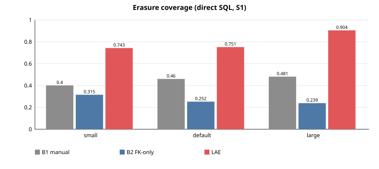
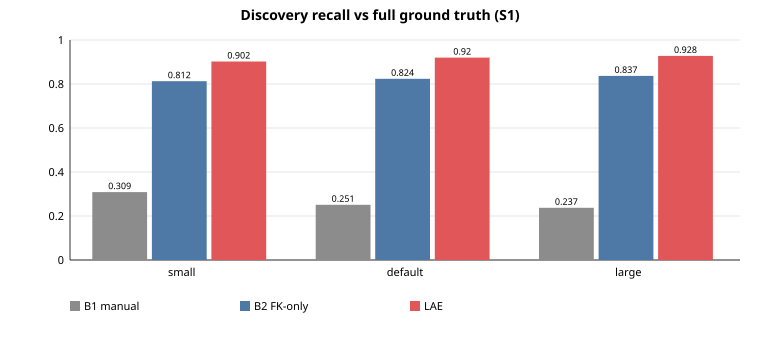
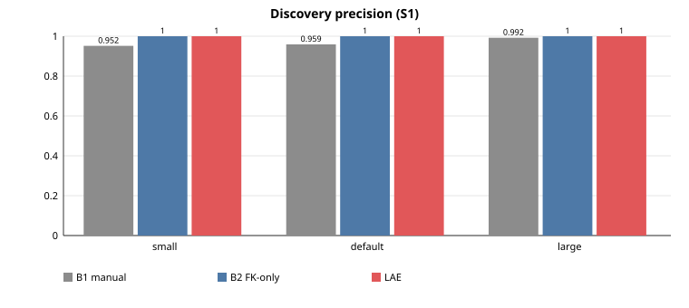
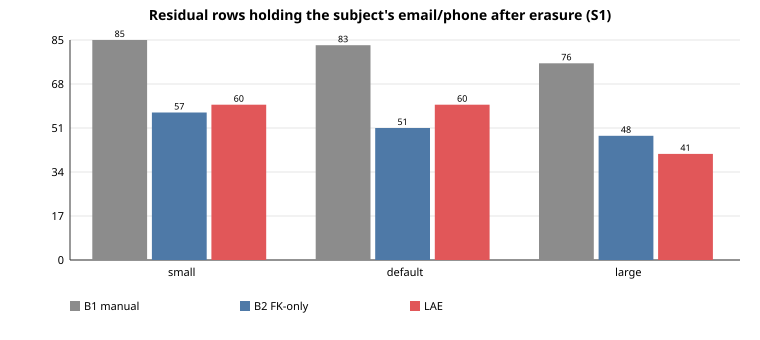
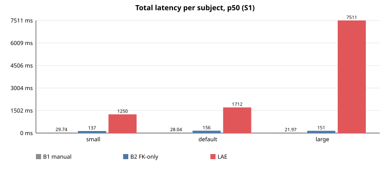
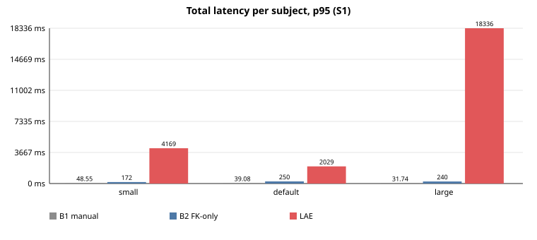
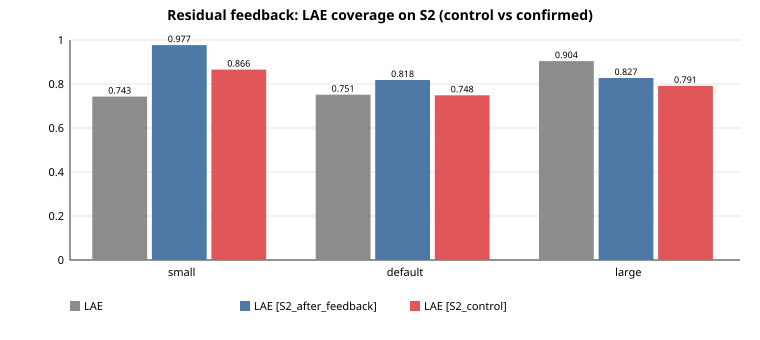
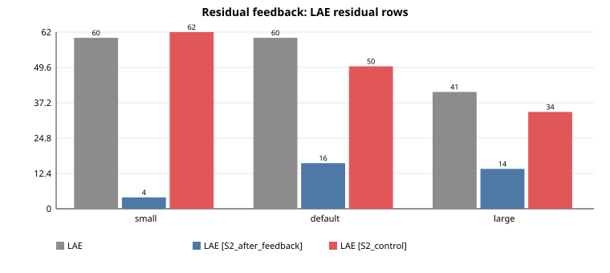
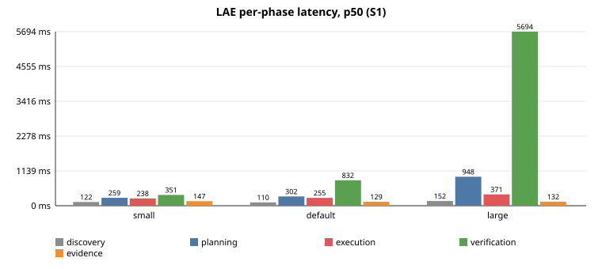

# LAE benchmark results (B5 completeness + latency)

Generated by `python -m benchmarks.run` (raw per-subject rows in `results/raw/`, gitignored). Every number below was measured. Nothing is estimated.

- generated: 2026-11-04T18:36:48+00:00 (started 2026-11-04T18:09:40+00:00, 1628.2 s wall)
- seed: 42; subjects per set: 20
- git commit: `99082c5990177c20678b4df8baaaec9c300beb24` (dirty working tree: True)
- partial re-run 2026-11-04T18:55:08+00:00 at `99082c5`: default/PROPOSED_LAE/S1, default/PROPOSED_LAE/S2_after_feedback, large/PROPOSED_LAE/S1, large/PROPOSED_LAE/S2_after_feedback, small/PROPOSED_LAE/S1, small/PROPOSED_LAE/S2_after_feedback (fresh data; replaced the earlier rows for these keys)

## Environment

- OS: Windows-11-10.0.26300-SP0; CPU: Intel(R) Core(TM) 5 120U; 10 physical / 12 logical cores; RAM 15.6 GiB
- Python 3.12.10; packages: alembic 1.20.1, cryptography 50.0.2, fastapi 0.162.0, lae 0.1.0, networkx 3.7, psycopg 3.3.8, pydantic 2.14.2, sqlalchemy 2.1.8, sqlglot 30.29.0
- PostgreSQL 16.15 (Debian 16.15-1.pgdg12+2) (`PostgreSQL 16.15 (Debian 16.15-1.pgdg12+2) on x86_64-pc-linux-gnu, compiled by gcc (Debian 12.2.0-14+deb12u1) 12.2.0, 64-bit`), pgvector 0.8.7, pgcrypto 1.3
- Docker server 29.9.2 (Docker Desktop, 12 CPUs, 7.6 GiB for the VM); the database runs in the `pgvector/pgvector:pg16` container on the same host
- PG settings: default_transaction_isolation=read committed, effective_cache_size=4GB, fsync=on, jit=on, maintenance_work_mem=64MB, max_connections=100, random_page_cost=4, shared_buffers=128MB, synchronous_commit=on, work_mem=4MB
- Caches were NOT dropped between subjects (warm runs). Each method pass starts with VACUUM ANALYZE on freshly seeded data.

## Scales

- **default**: 1000 customers, 3000 orders, 7574 order lines, 1000 tickets, 2531 messages, 500 documents, 3000 marketing events. S1 strata {'hidden=N,shared=N': 5, 'hidden=N,shared=Y': 5, 'hidden=Y,shared=N': 5, 'hidden=Y,shared=Y': 5}; S2 strata {'hidden=N,shared=N': 5, 'hidden=N,shared=Y': 5, 'hidden=Y,shared=N': 5, 'hidden=Y,shared=Y': 5}. Scale wall time 249.3 s.
- **large**: 10000 customers, 30000 orders, 75094 order lines, 10000 tickets, 24897 messages, 5000 documents, 30000 marketing events. S1 strata {'hidden=N,shared=N': 5, 'hidden=N,shared=Y': 5, 'hidden=Y,shared=N': 5, 'hidden=Y,shared=Y': 5}; S2 strata {'hidden=N,shared=N': 5, 'hidden=N,shared=Y': 5, 'hidden=Y,shared=N': 5, 'hidden=Y,shared=Y': 5}. Scale wall time 1217.7 s.
- **small**: 100 customers, 300 orders, 737 order lines, 100 tickets, 276 messages, 50 documents, 300 marketing events. S1 strata {'hidden=N,shared=N': 1, 'hidden=Y,shared=N': 10, 'hidden=Y,shared=Y': 9}; S2 strata {'hidden=Y,shared=N': 15, 'hidden=Y,shared=Y': 5}. Scale wall time 157.2 s.

## Methods

- **BASELINE_1_MANUAL**: hard-coded DELETEs of customer_address, loyalty_account, ticket_message (via the subject's tickets), support_ticket, document, customer in ONE transaction; no knowledge of derived artifacts, caches, embeddings, hidden copies or retention
- **BASELINE_2_FK_ONLY**: lae.discovery declared-FK edges only -> lae record discovery (BFS downstream) -> DELETE every discovered SUBJECT_ROOT/OWNED/SHARED row child-first in ONE transaction; other subjects' rows are not deleted (their SET NULL FK handles them)
- **PROPOSED_LAE**: lae.services.pipeline: create_request -> run_discovery -> generate_plan -> acknowledge acknowledgeable BLOCKING conflicts -> approve(plan_hash) -> execute LIVE (SERIALIZABLE, drift re-check) -> verify -> issue_evidence

## Protocol and metric definitions

- *Fresh data per method*: before every method pass the bench DB is reset (`app` and `lae` dropped, `alembic upgrade head`) and re-seeded with the same scale and seed (byte-identical rows). All methods see the same subjects (set S1), run sequentially. Subjects within a set are pairwise independent (no shared rows or referrals between them), so one erasure cannot change another subject's ground truth.
- *Ground truth* is the generator's own bookkeeping (`db/fixtures/generator.py`), never derived from FKs. Discovery truth = owned rows + derived key-addressable rows (matview / CTAS / embedding / cache) + hidden copies (marketing_event_log rows whose lower/trim email equals the subject's). *FK-reachable truth* = owned rows only.
- *Discovered* = rows the method identifies as the subject's to erase: B1 the rows matched by its hard-coded predicates; B2 and LAE the SUBJECT_ROOT/OWNED nodes of the record graph (predicate keys resolved to the rows they address). Precision/recall/F1 are micro-averaged (sums of tp/fp/fn over subjects) with `lae.verification.metrics` (exact fractions; floats only for display).
- *Erasure coverage* (direct SQL after execution): per ground-truth unit, correct iff owned non-retained row deleted; ANONYMIZE row still present, unlinked from the subject and its PII columns changed or NULL; RETAIN row present and byte-identical; derived row gone; hidden copy gone; other customer's reference to the subject cleared.
`coverage` counts every subject of the set (a BLOCKED or FAILED subject keeps its units, mostly incorrect); `coverage (committed only)` restricts to subjects whose erasure transaction committed.
- *Residual rows*: an independent scan in SQL over every text/json column of every `app` table and matview: `hmac` = whole-value HMAC-SHA256 (pgcrypto) of lower/trim value equals the subject's email or phone; `substring` = the email occurs anywhere (free text, JSON), or the phone matches. Reported numbers are `substring` (superset).
- *Unrelated damage*: rows deleted or modified that belong to neither the subject's owned/derived/shared rows nor the rows referencing the subject (md5 per row before/after; marketing log compared as a multiset). Must be 0. Shared rows destroyed and retention violations are counted separately.
- *Latency*: `time.perf_counter` per phase per subject; p50/p95 by linear interpolation over the subjects of a set. LAE `planning` re-runs discovery inside `generate_plan` (that is how the pipeline works). Snapshot time is per pass.
- *DB overhead*: `pg_total_relation_size` summed over schema `lae` before/after a set; rows added to `lae` tables (count(*) delta) and audit events per request.
- *Residual feedback*: after LAE on S1, every SUGGESTED edge with evidence `residual_scan` is CONFIRMED (`pipeline.set_edge_status`), then LAE runs on S2 in the same DB (`S2_after_feedback`). `S2_control` = LAE on S2 on fresh data without confirmation. Blocked plans: acknowledgeable BLOCKING conflicts are acknowledged; non-acknowledgeable ones (shared records) leave the plan BLOCKED and nothing is executed.

## Results

### Completeness and safety

| scale | method | set | n | committed | failed | blocked | LAE outcomes | precision | recall | F1 | recall (FK truth) | coverage | coverage (committed only) | residual rows | rows before | unrelated damage | shared destroyed | retention violations |
|---|---|---|---|---|---|---|---|---|---|---|---|---|---|---|---|---|---|---|
| small | BASELINE_1_MANUAL | S1 | 20 | 1 | 19 | 0 | n/a | 0.9518 | 0.3086 | 0.4661 | 0.3798 | 0.4004 | 0.8333 | 85 | 86 | 0 | 0 | 0 |
| small | BASELINE_2_FK_ONLY | S1 | 20 | 20 | 0 | 0 | n/a | 1 | 0.8125 | 0.8966 | 1 | 0.3153 | 0.3153 | 57 | 86 | 0 | 12 | 258 |
| small | PROPOSED_LAE | S1 | 20 | 14 | 0 | 6 | FAILED=13;PARTIAL=1 | 1 | 0.9023 | 0.9487 | 1 | 0.7427 | 0.8995 | 60 | 86 | 0 | 0 | 0 |
| small | PROPOSED_LAE | S2_control | 20 | 19 | 0 | 1 | FAILED=19 | 1 | 0.8827 | 0.9377 | 1 | 0.8656 | 0.8861 | 62 | 93 | 0 | 0 | 0 |
| small | PROPOSED_LAE | S2_after_feedback | 20 | 19 | 0 | 1 | PARTIAL=19 | 1 | 1 | 1 | 1 | 0.9770 | 1 | 4 | 93 | 0 | 0 | 0 |
| default | BASELINE_1_MANUAL | S1 | 20 | 0 | 20 | 0 | n/a | 0.9592 | 0.2509 | 0.3977 | 0.3045 | 0.4600 | n/a | 83 | 83 | 0 | 0 | 0 |
| default | BASELINE_2_FK_ONLY | S1 | 20 | 20 | 0 | 0 | n/a | 1 | 0.8238 | 0.9034 | 1 | 0.2522 | 0.2522 | 51 | 83 | 0 | 10 | 322 |
| default | PROPOSED_LAE | S1 | 20 | 14 | 0 | 6 | FAILED=8;PARTIAL=6 | 1 | 0.9199 | 0.9583 | 1 | 0.7513 | 0.8983 | 60 | 83 | 0 | 0 | 0 |
| default | PROPOSED_LAE | S2_control | 20 | 15 | 0 | 5 | FAILED=9;PARTIAL=6 | 1 | 0.9199 | 0.9583 | 1 | 0.7485 | 0.8944 | 50 | 71 | 0 | 0 | 0 |
| default | PROPOSED_LAE | S2_after_feedback | 20 | 15 | 0 | 5 | PARTIAL=15 | 1 | 1 | 1 | 1 | 0.8180 | 1 | 16 | 71 | 0 | 0 | 0 |
| large | BASELINE_1_MANUAL | S1 | 20 | 0 | 20 | 0 | n/a | 0.9924 | 0.2373 | 0.3830 | 0.2836 | 0.4810 | n/a | 76 | 76 | 0 | 0 | 0 |
| large | BASELINE_2_FK_ONLY | S1 | 20 | 20 | 0 | 0 | n/a | 1 | 0.8370 | 0.9112 | 1 | 0.2387 | 0.2387 | 48 | 76 | 0 | 10 | 331 |
| large | PROPOSED_LAE | S1 | 20 | 19 | 0 | 1 | FAILED=10;PARTIAL=9 | 1 | 0.9275 | 0.9624 | 1 | 0.9042 | 0.9231 | 41 | 76 | 0 | 0 | 0 |
| large | PROPOSED_LAE | S2_control | 20 | 14 | 0 | 6 | FAILED=7;PARTIAL=7 | 1 | 0.9566 | 0.9778 | 1 | 0.7914 | 0.9438 | 34 | 58 | 0 | 0 | 0 |
| large | PROPOSED_LAE | S2_after_feedback | 20 | 14 | 0 | 6 | PARTIAL=14 | 1 | 1 | 1 | 1 | 0.8273 | 1 | 14 | 58 | 0 | 0 | 0 |

### Latency (ms, per subject)

| scale | method | set | disc p50 | disc p95 | plan p50 | plan p95 | exec p50 | exec p95 | verify p50 | verify p95 | total p50 | total p95 | snapshot |
|---|---|---|---|---|---|---|---|---|---|---|---|---|---|
| small | BASELINE_1_MANUAL | S1 | 16.32 | 25.6 | n/a | n/a | 13.16 | 22.04 | n/a | n/a | 29.74 | 48.55 | n/a |
| small | BASELINE_2_FK_ONLY | S1 | 40.59 | 45.77 | n/a | n/a | 72.89 | 93.58 | n/a | n/a | 137 | 172 | 99 |
| small | PROPOSED_LAE | S1 | 122 | 264 | 259 | 551 | 238 | 492 | 351 | 787 | 1250 | 4169 | 376 |
| small | PROPOSED_LAE | S2_control | 178 | 236 | 391 | 498 | 357 | 434 | 459 | 608 | 1855 | 2124 | 485 |
| small | PROPOSED_LAE | S2_after_feedback | 122 | 251 | 277 | 500 | 284 | 562 | 386 | 963 | 1319 | 2626 | 376 |
| default | BASELINE_1_MANUAL | S1 | 15.48 | 21.04 | n/a | n/a | 12.76 | 19.61 | n/a | n/a | 28.04 | 39.08 | n/a |
| default | BASELINE_2_FK_ONLY | S1 | 32.54 | 45.67 | n/a | n/a | 80.45 | 163 | n/a | n/a | 156 | 250 | 98.5 |
| default | PROPOSED_LAE | S1 | 110 | 166 | 302 | 447 | 255 | 388 | 832 | 907 | 1712 | 2029 | 418 |
| default | PROPOSED_LAE | S2_control | 200 | 243 | 458 | 579 | 407 | 539 | 944 | 1103 | 2269 | 2966 | 764 |
| default | PROPOSED_LAE | S2_after_feedback | 105 | 155 | 297 | 396 | 210 | 308 | 793 | 859 | 1638 | 1827 | 418 |
| large | BASELINE_1_MANUAL | S1 | 11.63 | 16.79 | n/a | n/a | 9.88 | 15.12 | n/a | n/a | 21.97 | 31.74 | n/a |
| large | BASELINE_2_FK_ONLY | S1 | 32.05 | 51.01 | n/a | n/a | 87 | 152 | n/a | n/a | 151 | 240 | 82.9 |
| large | PROPOSED_LAE | S1 | 152 | 285 | 948 | 1197 | 371 | 695 | 5694 | 25444 | 7511 | 18336 | 435 |
| large | PROPOSED_LAE | S2_control | 94.61 | 193 | 749 | 1421 | 233 | 449 | 4911 | 6112 | 6098 | 7602 | 467 |
| large | PROPOSED_LAE | S2_after_feedback | 108 | 182 | 851 | 1035 | 314 | 470 | 5294 | 5689 | 6710 | 7398 | 435 |

### Database overhead (LAE)

| scale | method | set | lae bytes added | lae rows / request | audit events / request | confirmed feedback edges | edges confirmed | residual probes | ambiguous probes excluded | subjects w/ ambiguous probes |
|---|---|---|---|---|---|---|---|---|---|---|
| small | PROPOSED_LAE | S1 | 1433600 | 78.95 | 7.2 | 0 | n/a | 109 | 8 | 4 |
| small | PROPOSED_LAE | S2_control | 1540096 | 85.35 | 8.7 | 0 | n/a | 112 | 4 | 2 |
| small | PROPOSED_LAE | S2_after_feedback | 966656 | 90.25 | 8.7 | 2 | COLUMN:app.customer.email->app.marketing_event_log.email; TABLE:app.customer.email->app.marketing_event_log.email | 114 | 2 | 1 |
| default | PROPOSED_LAE | S1 | 1449984 | 80.4 | 7.2 | 0 | n/a | 82 | 34 | 17 |
| default | PROPOSED_LAE | S2_control | 1409024 | 76.6 | 7.5 | 0 | n/a | 88 | 28 | 15 |
| default | PROPOSED_LAE | S2_after_feedback | 876544 | 78.95 | 7.5 | 2 | COLUMN:app.customer.email->app.marketing_event_log.email; TABLE:app.customer.email->app.marketing_event_log.email | 88 | 28 | 15 |
| large | PROPOSED_LAE | S1 | 1581056 | 90 | 8.7 | 0 | n/a | 78 | 39 | 20 |
| large | PROPOSED_LAE | S2_control | 1449984 | 81.1 | 7.2 | 0 | n/a | 74 | 40 | 20 |
| large | PROPOSED_LAE | S2_after_feedback | 876544 | 83.25 | 7.2 | 2 | COLUMN:app.customer.email->app.marketing_event_log.email; TABLE:app.customer.email->app.marketing_event_log.email | 74 | 40 | 20 |

### Coverage by category (units correct / total)

- small / B1 manual: anonymized 0/56, derived 0/46, hidden 0/50, owned_deleted 5/158, references 0/5, retained 202/202
- small / B2 FK-only: anonymized 0/56, derived 0/46, hidden 0/50, owned_deleted 158/158, references 5/5, retained 0/202
- small / LAE: anonymized 41/56, derived 34/46, hidden 0/50, owned_deleted 105/158, references 2/5, retained 202/202
- small / LAE [S2_control]: anonymized 61/61, derived 46/46, hidden 0/61, owned_deleted 101/110, references 1/1, retained 242/242
- small / LAE [S2_after_feedback]: anonymized 61/61, derived 46/46, hidden 58/61, owned_deleted 101/110, references 1/1, retained 242/242
- default / B1 manual: anonymized 0/63, derived 0/54, hidden 0/45, owned_deleted 0/141, references 0/1, retained 259/259
- default / B2 FK-only: anonymized 0/63, derived 0/54, hidden 0/45, owned_deleted 141/141, references 1/1, retained 0/259
- default / LAE: anonymized 48/63, derived 37/54, hidden 0/45, owned_deleted 78/141, references 1/1, retained 259/259
- default / LAE [S2_control]: anonymized 37/57, derived 28/42, hidden 0/39, owned_deleted 80/130, references 2/2, retained 219/219
- default / LAE [S2_after_feedback]: anonymized 37/57, derived 28/42, hidden 34/39, owned_deleted 80/130, references 2/2, retained 219/219
- large / B1 manual: anonymized 0/65, derived 0/50, hidden 0/40, owned_deleted 0/131, references 0/1, retained 266/266
- large / B2 FK-only: anonymized 0/65, derived 0/50, hidden 0/40, owned_deleted 131/131, references 1/1, retained 0/266
- large / LAE: anonymized 60/65, derived 48/50, hidden 0/40, owned_deleted 125/131, references 1/1, retained 266/266
- large / LAE [S2_control]: anonymized 43/65, derived 34/50, hidden 0/24, owned_deleted 86/139, references 2/3, retained 275/275
- large / LAE [S2_after_feedback]: anonymized 43/65, derived 34/50, hidden 20/24, owned_deleted 86/139, references 2/3, retained 275/275

### Coverage by stratum

- small / B1 manual: hidden=N,shared=N (n=1): 5/6; hidden=Y,shared=N (n=10): 107/278; hidden=Y,shared=Y (n=9): 95/233
- small / B2 FK-only: hidden=N,shared=N (n=1): 5/6; hidden=Y,shared=N (n=10): 87/278; hidden=Y,shared=Y (n=9): 71/233
- small / LAE: hidden=N,shared=N (n=1): 6/6; hidden=Y,shared=N (n=10): 248/278; hidden=Y,shared=Y (n=9): 130/233
- small / LAE [S2_control]: hidden=Y,shared=N (n=15): 353/392; hidden=Y,shared=Y (n=5): 98/129
- small / LAE [S2_after_feedback]: hidden=Y,shared=N (n=15): 392/392; hidden=Y,shared=Y (n=5): 117/129
- default / B1 manual: hidden=N,shared=N (n=5): 71/132; hidden=N,shared=Y (n=5): 39/116; hidden=Y,shared=N (n=5): 92/184; hidden=Y,shared=Y (n=5): 57/131
- default / B2 FK-only: hidden=N,shared=N (n=5): 34/132; hidden=N,shared=Y (n=5): 53/116; hidden=Y,shared=N (n=5): 33/184; hidden=Y,shared=Y (n=5): 22/131
- default / LAE: hidden=N,shared=N (n=5): 132/132; hidden=N,shared=Y (n=5): 48/116; hidden=Y,shared=N (n=5): 162/184; hidden=Y,shared=Y (n=5): 81/131
- default / LAE [S2_control]: hidden=N,shared=N (n=5): 80/80; hidden=N,shared=Y (n=5): 97/172; hidden=Y,shared=N (n=5): 92/108; hidden=Y,shared=Y (n=5): 97/129
- default / LAE [S2_after_feedback]: hidden=N,shared=N (n=5): 80/80; hidden=N,shared=Y (n=5): 97/172; hidden=Y,shared=N (n=5): 108/108; hidden=Y,shared=Y (n=5): 115/129
- large / B1 manual: hidden=N,shared=N (n=5): 75/131; hidden=N,shared=Y (n=5): 39/104; hidden=Y,shared=N (n=5): 49/118; hidden=Y,shared=Y (n=5): 103/200
- large / B2 FK-only: hidden=N,shared=N (n=5): 26/131; hidden=N,shared=Y (n=5): 40/104; hidden=Y,shared=N (n=5): 28/118; hidden=Y,shared=Y (n=5): 38/200
- large / LAE: hidden=N,shared=N (n=5): 131/131; hidden=N,shared=Y (n=5): 91/104; hidden=Y,shared=N (n=5): 100/118; hidden=Y,shared=Y (n=5): 178/200
- large / LAE [S2_control]: hidden=N,shared=N (n=5): 84/84; hidden=N,shared=Y (n=5): 134/177; hidden=Y,shared=N (n=5): 120/136; hidden=Y,shared=Y (n=5): 102/159
- large / LAE [S2_after_feedback]: hidden=N,shared=N (n=5): 84/84; hidden=N,shared=Y (n=5): 134/177; hidden=Y,shared=N (n=5): 136/136; hidden=Y,shared=Y (n=5): 106/159

## Charts

