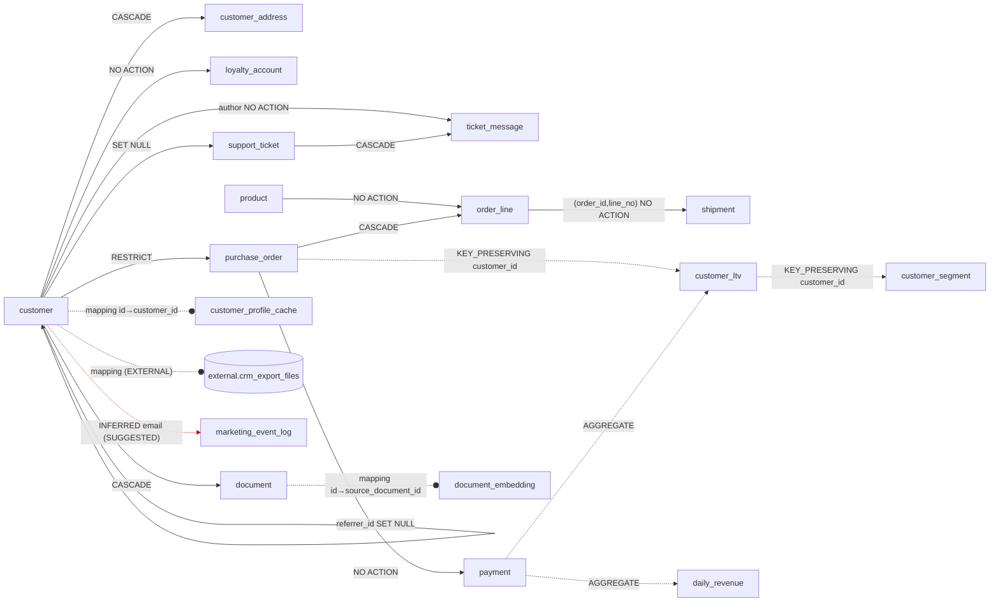
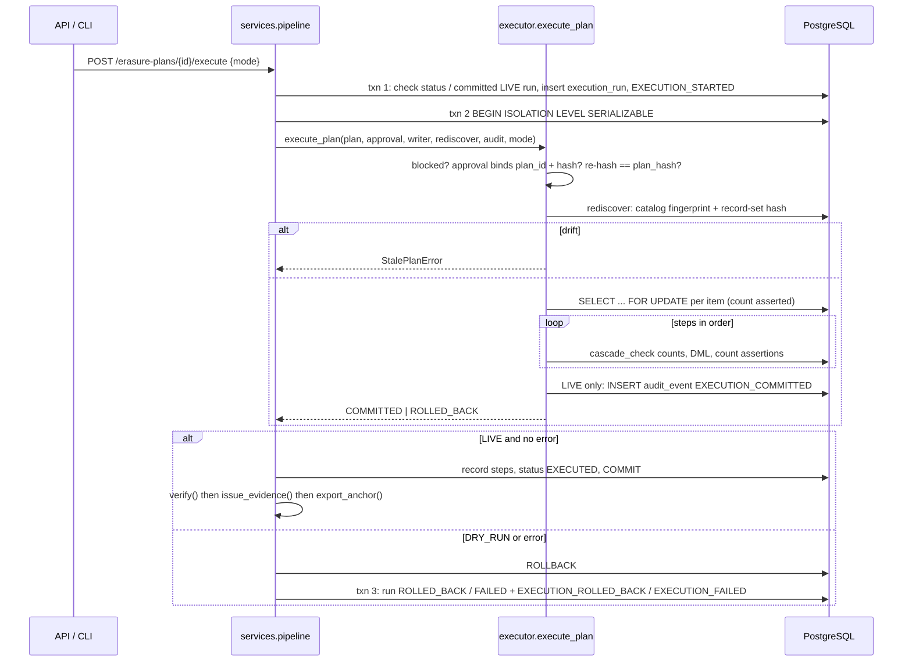
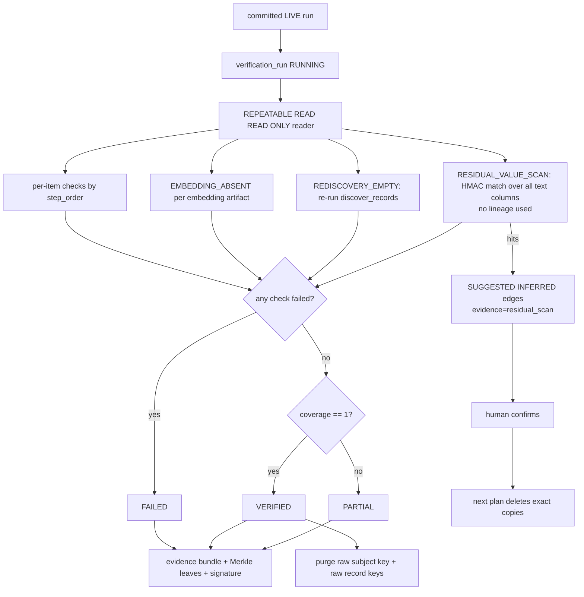

# Algorithms

Each section covers one algorithm: its **purpose**, **inputs and outputs**, the **steps**, **pseudocode** that follows the code, **complexity**, and **limitations**. All descriptions refer to code at git HEAD `118846f` (security hardening `57de8e8` included), with paths relative to `backend/src/lae/` unless stated otherwise. Where the code and the older design documents disagree, this file describes the code, and the disagreement is listed in §20.

Notation: `R` = records discovered, `E` = record edges, `T` = tables in the catalog, `F` = foreign keys, `B` = `DiscoveryLimits.batch_size` (default 1 000), `n` = number of evidence leaves.

---

## 0. Data lineage example (demo schema)

The table-level lineage graph of `db/fixtures/app_schema.sql` and `app_derived.sql`, as discovery builds it. Solid arrows are declared FKs (with `ON DELETE` action), dashed arrows are SQL lineage, dotted arrows are registered mappings, and the red arrow is a suggestion that is not traversed.



`product` is upstream of `order_line`. Because traversal is downstream from `customer` only, products are never reached. `marketing_event_log` has no PK and no FK, so it is reachable only after a human confirms an inferred edge (§9, §19).

---

## 1. Catalog snapshot and schema fingerprint

**Purpose.** Capture the structure of the target schemas once, and detect any later change in structure (drift).

**Input.** `CatalogReader` port, schema list (`LAE_TARGET_SCHEMAS`, default `app`. The value `lae` is rejected by `config.Settings._no_engine_schema`).
**Output.** `CatalogSnapshot(tables, schemas, fingerprint)`.

**Steps** (`discovery/catalog.py: read_catalog`, `build_catalog`, `catalog_fingerprint`; SQL in `db/catalog_queries.py`):
1. `TABLES_SQL` lists relations with `relkind IN ('r','p','v','m')`, excluding partitions, together with `reltuples` and `pg_get_viewdef(oid, true)` for views and matviews.
2. `COLUMNS_SQL` returns columns (`format_type`, `attnotnull`). `PRIMARY_KEYS_SQL` returns PK columns in index order. `FOREIGN_KEYS_SQL` returns FKs (see §2).
3. Validate: every table is inside the requested schemas, there are no duplicate tables or columns, and every PK column exists.
4. Fingerprint = `canonical_hash` of `{schemas (sorted), tables (sorted by TableRef) as describe_table, foreign_keys sorted by (child, constraint)}`. `describe_table` holds kind, columns (ordinal, name, type, nullability), PK and the stripped definition. **Row estimates are excluded**, so `ANALYZE` does not count as drift.

```
fingerprint = sha256_hex(canonical_json({
    "schemas": sorted(set(schemas)),
    "tables": [describe_table(t) for t in sorted(tables, key=ref)],
    "foreign_keys": sorted(describe_fk(f) for f in fks, key=(child, constraint)),
}))
```

`schema_drift(old, new)` reports added, removed and changed tables. `fingerprint_changed` is the authoritative flag, because FK changes are not visible in `CatalogSnapshot.tables`.

**Complexity.** Four catalog queries. Hashing is O(size of the description).
**Limitations.** Triggers, functions, grants and indexes are **not** part of the fingerprint. Only partitioned parents are listed, not their partitions.

---

## 2. Foreign-key discovery

**Purpose.** Turn declared FKs into table- and column-level lineage edges without losing composite-key order or the `ON DELETE` action.

**Query** (`FOREIGN_KEYS_SQL`). This is the architecture.md §6 query plus `ORDER BY ns.nspname, cl.relname, c.conname`:

```sql
... CROSS JOIN LATERAL unnest(c.conkey, c.confkey) WITH ORDINALITY AS k(child_att, parent_att, ord)
... array_agg(ac.attname ORDER BY k.ord) AS child_columns,
    array_agg(ap.attname ORDER BY k.ord) AS parent_columns, c.confdeltype, ...
WHERE c.contype = 'f' AND ns.nspname = ANY(%(schemas)s)
```

`unnest(conkey, confkey) WITH ORDINALITY` pairs the i-th child attribute with the i-th parent attribute. `array_agg(... ORDER BY ord)` keeps that pairing. This is why `app.shipment → app.order_line` comes out as child `(order_id, line_no)` → parent `(order_id, line_no)`, in that order.

**Conversion** (`discovery/foreign_keys.py: foreign_key_edges`):

```
for fk in sorted(fks, key=(child, constraint)):
    reject duplicate (child, constraint); validate columns; skip (warn) if parent is outside the snapshot
    emit TABLE edge  parent -> child, source_columns = parent cols, target_columns = child cols,
         origin DECLARED_FK, transform FOREIGN_KEY, traceability KEY_PRESERVING, status CONFIRMED,
         on_delete = confdeltype ('a','r','c','n','d')
    for i, (pc, cc) in enumerate(zip(parent_cols, child_cols)):
         emit single-pair COLUMN edge (pair_index = i)
```

Edge ids are deterministic: `uuid5(NS_FK, "DECLARED_FK" ␟ child ␟ constraint ␟ level ␟ pair_index)` (`fk_edge_id`). The child table is part of the id because constraint names are unique per table, not per schema.

**Complexity.** One query. O(F · k) edges, where k is the number of FK columns.
**Limitations.** FKs whose parent is outside the scanned schemas are skipped with a warning. The TABLE edge is the unit of traversal. COLUMN edges are only descriptive.

---

## 3. SQL lineage classification (SQLGlot)

**Purpose.** For every inspectable derived artifact (view, matview, derived table), decide whether the subject's rows can be found by key (`KEY_PRESERVING`), only through aggregates (`AGGREGATE`), or not at all (`OPAQUE`).

**Inputs.** `ArtifactDefinition`, `CatalogSnapshot`, `extra_keys: Mapping[TableRef, Iterable[tuple[str,...]]]`.
**Output.** `SqlLineageResult(artifact_id, edges, traceability, warnings)`. The function **never raises for bad SQL**. The only exception is `UnknownTableError` for an unknown target.

**Steps** (`discovery/sql_lineage.py: extract_sql_lineage`, `_analyse`, `_classify_path`, `_inferred_edges`, `_combine`):
1. `EXTERNAL` artifact → `OPAQUE` with no edges.
2. Registered key mappings → `REGISTERED_MAPPING` TABLE edge (KEY_PRESERVING) plus COLUMN edges (IDENTITY). An invalid mapping makes the whole artifact OPAQUE. Mapped sources are skipped in the inference below.
3. `sqlglot.parse_one(sql, read="postgres")`. `CREATE ... AS` and `INSERT ... SELECT` are unwrapped. A parse failure, multiple statements or `Command` → OPAQUE. Source tables then come from a conservative text scan (`_text_scan`).
4. Construct checks: a recursive CTE, LATERAL or set-returning function, table function, unknown function (`exp.Anonymous` not in `_KNOWN_SCALAR_FUNCTIONS ∪ _KNOWN_AGG_FUNCTIONS`), or a table outside the catalog → OPAQUE reasons.
5. `qualify(..., validate_qualify_columns=True)` against a `MappingSchema` built from the catalog, then `lineage(None, qualified, ...)` for all outputs. Paths are enumerated up to `_MAX_PATHS = 5000` (beyond that → OPAQUE).
6. **Path classification** (`_classify_path`). Walking from the output down to a table column:
   - `AGGREGATE` if any node contains an aggregate (`exp.AggFunc`, or a known anonymous aggregate),
   - else `EXPRESSION` if any node is not a bare column (aliases, casts and parentheses are stripped by `_strip`),
   - else `IDENTITY`.
   - `aggregated` = the path crosses an aggregating SELECT (GROUP BY, DISTINCT, HAVING, a direct aggregate) or is AGGREGATE.
   - `key_identity` = IDENTITY **and** the expression is among the grouping expressions of every aggregating scope it crosses. ROLLUP, CUBE and GROUPING SETS never count as grouping. DISTINCT and DISTINCT ON do count.
7. **Control lineage** (`_control_lineage`): columns in `JOIN ... ON` → `JOIN_KEY`, and columns in `WHERE`/`HAVING`/`GROUP BY` → `FILTER`. A column that also flows into an output gets no control edge. Otherwise one single-pair COLUMN edge is emitted to **each** output column.
8. **Per-source traceability** (`_inferred_edges`):

```
candidate_keys(source) = [PK(source)] + sorted(extra_keys[source])
for key in candidate_keys:
    if every column of key has a key_identity path to some output column:
        TABLE edge KEY_PRESERVING with source_columns = key, target_columns = first such outputs
        break
else if any path from source is not aggregated:  TABLE edge OPAQUE  (+ warning "values ... without a surviving key")
else:                                            TABLE edge AGGREGATE
```

9. **Artifact traceability** (`_combine`): OPAQUE if any TABLE edge is OPAQUE or there are no edges at all, else KEY_PRESERVING if any edge is KEY_PRESERVING, else AGGREGATE. TABLE-edge transform: KEY_PRESERVING → IDENTITY, AGGREGATE → AGGREGATE, OPAQUE → EXPRESSION.

**The `extra_keys` rule** (`services/pipeline.py: _extra_keys`). A PK alone is not enough: `SELECT o.customer_id, ... FROM purchase_order o ... GROUP BY o.customer_id` keeps the *FK column*, not the PK of `purchase_order`. The service therefore adds, as candidate keys, the child columns of every **declared FK TABLE edge whose source table is the subject root or reachable from it** over FK edges:

```
graph = build_lineage_graph(catalog, fk_edges)
chain = {root_table} ∪ graph.reachable_from(root_table)
for e in fk TABLE edges:
    if e.source in chain: extra_keys[e.target].append(e.target_columns)
```

This is restricted to the subject chain on purpose. A `GROUP BY product_id` aggregate (with `product` upstream of the chain) must not become "owned".

**Artifact chains** (`extract_artifacts_lineage`). Run all artifacts. Add the `target_columns` of every KEY_PRESERVING TABLE edge as a candidate key **of the artifact**. Repeat until the key set stops changing, at most `len(artifacts)+1` rounds. On the demo this is how `customer_ltv.customer_id` becomes a key for `customer_segment`.

**Demo results** (integration tests `tests/integration/discovery/test_sql_lineage_integration.py`):
`customer_ltv` is KEY_PRESERVING via `purchase_order.customer_id → customer_id`, while `payment → customer_ltv` is AGGREGATE. `daily_revenue` is AGGREGATE. `customer_segment` is KEY_PRESERVING via `customer_ltv.customer_id`. Without `extra_keys`, `customer_ltv` is AGGREGATE and `customer_segment` becomes OPAQUE.

**Complexity.** Parsing and qualification are roughly linear in SQL size. Path enumeration can be exponential in join and CTE depth and is capped at 5 000 paths. The fixpoint takes ≤ A+1 rounds over A artifacts.
**Limitations.** Join equivalence (`c.id = o.customer_id`) is not used to transfer keys. Recursive CTEs, PL/pgSQL and triggers make an artifact OPAQUE. Warnings contain names only, never SQL literals.

---

## 4. Inferred relationships

**Purpose.** Suggest relationships that are not declared, for a human to confirm.

**Steps** (`discovery/inference.py: candidate_pairs`, `infer_relationships`):
1. Only base tables (`TableKind.TABLE`) are considered. Child columns that are already declared FK children, and pairs covered by `exclude`, are skipped.
2. Name candidates:
   - `<stem>_id`: parent table named `stem` (weight 1), `stem+s`/`stem+es` (0.98), or a suffix of the stem (0.95). The parent must have a single-column PK.
   - `email` / `<stem>_email`: any other base table with a PK and an `email` column. Weight 0.95 if the stem names the parent, else 0.9.
   - Type families must match (integer / text / uuid / numeric).
3. For each candidate: `sample_values(child, 1000)` returns distinct non-NULL values in deterministic `md5(v::text)` order. `count_contained(child, parent, sample)` counts how many of them exist in the parent, comparing **exact text** (`{c}::text = ANY(...)`).
4. `ratio = contained / |sample|` as `Decimal`. Skip the candidate if `ratio < threshold` (default 0.95).
5. `confidence = min(ratio × weight, 0.999)`, rounded **down** to 3 decimals. Emit a TABLE and a COLUMN edge with `origin=INFERRED`, `status=SUGGESTED`, `transform=FOREIGN_KEY`, `traceability=KEY_PRESERVING`. Only counts go into `details`.

**Complexity.** O(T·C) name matching, then 2 queries per candidate.
**Limitations.** Exact text containment. On tiny/7, `marketing_event_log.email → customer.email` has 17/19 = 0.894 < 0.95, so there is **no suggestion at the default θ** (CR lineage-discovery-engineer-2 §2). The threshold is compared to the *ratio*, not the confidence. A suggestion is never traversed until confirmed (§5).

---

## 5. Record-level BFS discovery with roles

**Purpose.** Find the concrete rows that depend on the subject's root row, and give each a role.

**Inputs.** `LineageGraph`, `SubjectRoot`, subject key, `TargetReader`, `DiscoveryLimits(max_depth=10, max_records=100_000, batch_size=1_000)`.
**Output.** `RecordDiscoveryResult(record_graph, affected_artifacts, warnings)`.

The service runs discovery in a `REPEATABLE READ`, read-only transaction (`pipeline.run_discovery`, `generate_plan`).

**Traversable edge** (`records._is_traversable`): TABLE level, `KEY_PRESERVING`, non-empty `source_columns`, and only from `graph.downstream(table, CONFIRMED_ONLY)`. So SUGGESTED and REJECTED edges are never followed. A warning reports how many unconfirmed edges were skipped.

```
root_key = load_root(subject_key)            # SubjectNotFoundError if absent; key columns must equal the PK
frontier = [root_key]; depth = 0
while frontier:
    for table in sorted(tables of frontier):
        parents = sorted(frontier rows of table)
        for edge in downstream(table, CONFIRMED):           # deterministic order
            if traversable(edge):
                values = distinct non-NULL projections of parents onto edge.source_columns
                for batch of ≤ B uncached values:
                    rows = reader.select_by_columns(edge.target, edge.target_columns, batch,
                                                    select = PK ∪ needed columns)
                    child = RecordKey(target, PK, pk values)  or, if no PK,
                            RecordKey(target, edge.target_columns, values, is_predicate=True)
                for each child: if new: depth+1 > max_depth or |records| > max_records -> DiscoveryLimitExceeded
                                 link (parent, child, edge_id)
                                 enqueue child unless child.table == root.table      # other subjects are not traversed
                if edge is an artifact edge and rows were found: affected[target] ⊔= KEY_PRESERVING
            elif edge is KEY_PRESERVING without columns: affected[target] ⊔= OPAQUE (warning)
            else: affected[target] ⊔= edge.traceability            # AGGREGATE / OPAQUE marker, no rows
    frontier = sorted(new children); depth += 1
```

`⊔` keeps the most severe value: OPAQUE > AGGREGATE > KEY_PRESERVING.

**Roles** (`_Discovery.roles`):
- `SUBJECT_ROOT`: the root row.
- `REFERENCING_OTHER_SUBJECT`: any *other* row of the root table that was reached (for example customers 15 and 16, whose `referrer_id = 7`).
- `OWNED`: initially every other row.
- **SHARED fixpoint** (a greatest fixpoint, repeated until nothing changes). `refs[t]` = traversable CONFIRMED TABLE edges into `t` that are `DECLARED_FK` or map the source's full PK. An OWNED row becomes `SHARED` if
  (a) none of its parents is SUBJECT_ROOT or OWNED, **or**
  (b) one of its non-NULL references from a subject-reachable source table points at a value that is **not** among the projected keys of the current SUBJECT_ROOT/OWNED rows.
  Each round rebuilds the index of owned key values, so the property spreads to descendants that are reached only through SHARED rows.

Example: the message that customer 8 writes on customer 7's ticket is reached via `support_ticket → ticket_message.ticket_id`. Its `author_customer_id = 8` is not an owned customer key, so it becomes SHARED. A message written by the subject on an anonymous ticket (`customer_id IS NULL`) also becomes SHARED. This is the conservative divergence documented in CR lineage-discovery-engineer-2 §3.

The record graph is then built with `add_root` / `add_dependency`. On a re-visit the most protective role is kept: SUBJECT_ROOT > REFERENCING_OTHER_SUBJECT > SHARED > OWNED.

**Record-set hash** (`RecordGraph.record_set_hash`): `canonical_hash([k.as_canonical() for k in sorted keys])`. It covers keys only, not edges or roles.

**Complexity.** Queries ≈ Σ over traversed (edge, depth) of ⌈distinct parent values / B⌉. The roles fixpoint is O(rounds × R × refs). Memory is O(R) rows (projected columns only).
**Limitations.** Downstream only, CONFIRMED only. Tables without a PK are addressed by predicate. Upstream lookups are never made, so SHARED attribution is conservative.

---

## 6. Deletion ordering

**Purpose.** Order deletes so that no FK is violated, and break cycles only through nullable references.

### 6.1 `RecordGraph.deletion_order(nullable)` (`lineage/record_graph.py`)

```
work = DiGraph(nodes, edges without self-loops)          # a row referencing itself is deleted by one DELETE
removed = []
for comp in SCCs(work) with |comp| > 1 (sorted by min key):
    cand = intra-component edges whose every edge_id is nullable
    work.remove(cand)
    if comp is still cyclic: raise GraphIntegrityError("UNBREAKABLE_CYCLE", tables, record_count)
    for (u,v) in cand (deterministic order):
        if has_path(work, v, u): removed.append((u,v))   # still needed as a break
        else: work.add_edge(u,v)                          # restore: not needed
order = lexicographical_topological_sort(reverse(work), key=RecordKey.sort_key)   # children first
break_edges = sorted((u, v, eid) for (u,v) in removed for eid in edge_ids(u,v))
```

The result is a *minimal*, but not necessarily *minimum*, set of `NULLIFY_REFERENCE` breaks.

### 6.2 `planner/ordering.py: order_deletions`

The planner only issues `DELETE` statements for **explicit** rows. A row removed by `ON DELETE CASCADE` disappears together with its **trigger** (the explicit ancestor that cascades to it).

1. Each constraint "v must be gone before u is deleted" is mapped onto triggers: every trigger `b` of `u` must come after the smallest trigger `d` of `v`. If `b == d`, the constraint is satisfied inside one statement. If `b` and `d` are in the same table, the pair is noted as `same_table` (PostgreSQL checks RESTRICT/NO ACTION at the end of the statement).
2. Build a `RecordGraph` of the explicit rows with the mapped edges and call `deletion_order(nullable)`. `nullable(eid)` (`planner.plan_deletes`) means `on_delete ∈ {RESTRICT, NO ACTION, SET DEFAULT}` and all FK columns are nullable.
3. **Ranked batches.** If the *table-level* precedence graph (Kahn's algorithm, `_topo_tables`) is acyclic, there is one batch per table in topological order. Otherwise (a table-level cycle without a record-level one), rows get longest-path ranks (`_ranks`) over `before ∪ same_table`, and the batches are `(rank, table)`. If ranking finds a cycle → `UNBREAKABLE_CYCLE`.
4. In the planner, a cycle caused by relying on a cascade makes the planner **promote** those cascade rows to explicit deletes and order again. Only if that also fails is `UNBREAKABLE_CYCLE` (BLOCKING) reported.

**Complexity.** SCC detection is O(V+E). Restoring removed edges costs one `has_path` per candidate, O(E·(V+E)) in the worst case. The topological sort is O((V+E) log V) with the lexicographic heap.
**Limitations.** Triggers are not analysed. The table-level fallback relies on ranks, and a violation would fail safely at execution (FK error → full rollback).

---

## 7. Planner rules (policy × role), cascades and conflicts

**Purpose.** Turn a discovery result into an ordered, explained, hashed `ErasurePlan`. Conflicts never raise. They become `PlanConflict`s.

**Inputs** (`planner/planner.py: build_plan`): `request_id`, `RecordDiscoveryResult`, `LineageGraph`, `PolicySet`, inspectable artifacts, external artifacts, `plan_id`, `predicate_row_counts`. The service computes the counts with `count_by_columns` for every predicate key (`pipeline.generate_plan`).

**Pipeline** (`_Planner.run`): `classify → split_cascades → plan_detaches → draft_nullify → draft_anonymize → cascade_conflicts → plan_deletes → cascade_checks → plan_artifacts → draft_retained_rows → draft_shared → plan_external → predicate_warnings → derived_deps → assemble`.

### 7.1 Classification (`classify`)

| Record | Rule |
|---|---|
| Row of an artifact table (registered artifact, view or matview) | Goes to `artifact_rows`. Non-owned rows of key-addressable artifacts become `shared` (never deleted by key) |
| OWNED row in the root table | **Root-table protection**: re-labelled `REFERENCING_OTHER_SUBJECT` |
| SUBJECT_ROOT / OWNED | Policy `DELETE` (the default) → `removal`. `ANONYMIZE` → `anonymize`. `RETAIN` → `retain` |
| REFERENCING_OTHER_SUBJECT | `referencing` |
| SHARED | `shared` |

### 7.2 Cascades (`split_cascades`, `draft_expect`, `cascade_checks`)

- A removed row with a removed parent over an `ON DELETE CASCADE` edge becomes `EXPECT_CASCADE` and is **not** deleted explicitly. If a set of cascade rows has no explicit ancestor (a pure cascade cycle), one row is deleted explicitly.
- `EXPECT_CASCADE` items (phase 3) depend on the `DELETE_ROWS` items of their triggers. Their expected count is checked after the parent deletes (§10).
- **`cascade_check` clauses.** For every `DELETE_ROWS` batch and every CASCADE FK whose parent is the batch table, the reason gets the clause
  `cascade_check <constraint>: <schema.child>(<c1>,..) <- (<p1>,..) = <n>` (`planner/text.py: cascade_check`).
  `n` = child rows referencing the batch that must still exist right before the delete. That is: not nullified first, and not removed by an earlier step (`removal_rank[v] >= d.rank`). The reason is hashed (§8), so `n` is approved together with the plan.
  Real example (subject 18): `DELETE 1 row of app.customer: subject root; cascade_check customer_address_customer_id_fkey: app.customer_address(customer_id) <- (id) = 2; cascade_check document_customer_id_fkey: app.document(customer_id) <- (id) = 0`.

### 7.3 Detaching and conflicts

`plan_detaches` checks, for each `referencing`, `shared` and retained (`anonymize ∪ retain`) row, its parent links:
- `other_subject`: a link to any subject row.
- `shared`/`retained`: a link to a removed row with an `on_delete` action.

A **nullable** FK gives `NULLIFY_REFERENCE` (phase 1, ordered before the parent delete). For ANONYMIZE rows the FK column is added to the `ANONYMIZE_ROWS` target columns as NULLIFY. A **NOT NULL** FK gives:

| Row kind | NOT NULL link | Conflict (severity) |
|---|---|---|
| shared | any | `SHARED_RECORD` **BLOCKING**, not acknowledgeable, plus a `MANUAL_REVIEW` item (`draft_manual`) |
| any, to a removed row, `CASCADE` | – | `CASCADE_DESTROYS_RETAINED` BLOCKING (`cascade_conflicts`). Message for non-owned rows: "cascade would delete a record not owned by the subject" |
| other subject | RESTRICT/NO ACTION/SET DEFAULT | `NOT_NULL_REFERENCE` BLOCKING |
| retained | RESTRICT/NO ACTION | `RESTRICT_FROM_RETAINED` BLOCKING |
| retained | SET NULL/SET DEFAULT | `NOT_NULL_REFERENCE` BLOCKING |

Other conflict codes:
- `UNBREAKABLE_CYCLE` (rows or artifacts, BLOCKING).
- `OPAQUE_ARTIFACT` (BLOCKING, acknowledgeable). Raised for OPAQUE lineage, an artifact with no usable strategy, an AGGREGATE into a non-rebuildable artifact, an artifact missing from the catalog, or EXTERNAL without `EXTERNAL_TASK`. It produces an `UNRESOLVED` item.
- `EXTERNAL_ARTIFACT` (WARNING, with a `SCHEDULE_EXTERNAL` item).
- `RETAINED_WITH_PII` (WARNING). Raised for legal-hold tables with PII, unscrubbable ANONYMIZE columns (part of the PK, or NOT NULL with NULLIFY), and PSEUDONYMIZE columns.
- `UNCONFIRMED_PII` (WARNING).
- `NO_PRIMARY_KEY` (WARNING, for predicate keys).
- `SHARED_RECORD` WARNING for shared rows that survive.

`ACKNOWLEDGEABLE_CODES = {OPAQUE_ARTIFACT, RETAINED_WITH_PII, EXTERNAL_ARTIFACT, NO_PRIMARY_KEY}` (`planner/state.py`). Acknowledging a conflict sets `resolved=True` and **recomputes the hash**. A plan is blocked iff a BLOCKING conflict is unresolved (`ErasurePlan.is_blocked`).

**Shared-record safety** (the Lead decision in CR erasure-engine-engineer-1, policy §2): a SHARED row is never destroyed. A nullable link is detached (row survives, WARNING). A NOT NULL link blocks the plan, and acknowledgement cannot unblock it. Real example: subject 7 at tiny scale gives `NULLIFY_REFERENCE author_customer_id` on the message it wrote on customer 8's ticket, and `MANUAL_REVIEW` plus `SHARED_RECORD` BLOCKING plus `CASCADE_DESTROYS_RETAINED` for customer 8's message on its own ticket (`ticket_id NOT NULL CASCADE`).

### 7.4 Artifacts (`plan_artifacts`)

- Views get no step. Matviews get `REFRESH_MATVIEW`. `RECOMPUTE_SQL` tables with SQL get `RECOMPUTE_TABLE`, whose reason contains `definition_sha256=<sha256(sql)>`. `CACHE` / `INVALIDATE_BY_KEY` → `INVALIDATE_CACHE`. `DELETE_BY_KEY` → `DELETE_DERIVED_BY_KEY` (owned rows only).
- **Propagation.** Every maintainable artifact reachable over CONFIRMED edges from a table modified in phases 1–3, or from a rebuilt artifact, is refreshed even if discovery did not mark it. That is why subject 18, who has no payment, still gets `REFRESH customer_ltv`, `RECOMPUTE customer_segment` and `REFRESH daily_revenue`.
- Order: phase 4 (key-based) then phase 5 (rebuild), each in `LineageGraph.artifact_order` (topological, `ARTIFACT_CYCLE` → `UNBREAKABLE_CYCLE` conflict). `derived_deps` adds `depends_on` from earlier steps whose tables reach the artifact.

### 7.5 Phases and step numbering (`assemble`)

| Phase | Actions |
|---|---|
| 1 | `NULLIFY_REFERENCE`, `ANONYMIZE_ROWS` |
| 2 | `DELETE_ROWS` (ordered batches, §6) |
| 3 | `EXPECT_CASCADE` |
| 4 | `DELETE_DERIVED_BY_KEY`, `INVALIDATE_CACHE` |
| 5 | `RECOMPUTE_TABLE`, `REFRESH_MATVIEW` |
| 6 | `RETAIN_ROWS`, `SCHEDULE_EXTERNAL`, `MANUAL_REVIEW`, `UNRESOLVED` (no DML) |

Drafts are sorted by `(phase, rank, reason)` and numbered from 1. `depends_on` keeps only earlier steps. Conflicts are sorted (BLOCKING first). `plan_hash` is computed last.

**Complexity.** Roughly O(R + E) for classification and detaching, plus ordering (§6). `cascade_checks` scans all lineage edges per DELETE batch, O(batches × edges). `derived_deps` is O(items²).
**Limitations.** The ANONYMIZE column strategy (NULL versus pseudonym) is passed to the executor separately (`pseudonym_columns`) and is visible only in the hashed reason. Triggers are not considered.

---

## 8. Plan hashing and approval binding

**Purpose.** A human approves *exactly* what will run.

```
payload = {
  "request_id", "schema_fingerprint", "record_set_hash",
  "items": [ {step_order, action, table, lineage_level, key_columns, record_keys, target_columns,
              expected_row_count, depends_on (sorted), reason_edge_ids (sorted), reason}  by step_order ],
  "conflicts": sorted([{code, severity, table, resolved}])
}
plan_hash = sha256_hex(canonical_json(payload))        # planner/hashing.py
```

`plan_id` and conflict messages are not hashed.

Approval (`pipeline.approve`, `planner/state.py: check_approval`):
1. Re-hash the stored plan. A mismatch with the stored hash → `InvalidStateTransition` ("stored plan content does not match its hash").
2. Blocked → `PlanBlockedError` (409 `PLAN_BLOCKED`).
3. The status machine must allow `APPROVED` (`TRANSITIONS`: DRAFT→{BLOCKED, APPROVED, SUPERSEDED}, BLOCKED→{DRAFT, SUPERSEDED}, APPROVED→{EXECUTED, FAILED, SUPERSEDED}, EXECUTED→{VERIFIED, FAILED}. VERIFIED, SUPERSEDED and FAILED are terminal).
4. The echoed hash must equal `plan_hash`, else `PlanHashMismatch` (409).

The executor checks again: `approval.plan_id == plan.plan_id`, `approval.plan_hash == plan.plan_hash`, and `compute_plan_hash(plan) == plan.plan_hash`.

**Complexity.** O(plan size).
**Limitations.** `approved_by` is the unauthenticated `X-LAE-Actor` header (risks §2.6).

---

## 9. Executor: drift check, locking, rowcount assertions, dry run

**Purpose.** Apply an approved plan atomically, or change nothing.

**Transaction** (`pipeline.execute`):
1. Write transaction: precondition checks and `EXECUTION_STARTED`.
   - LIVE needs `APPROVED` status, a recorded approval and no committed LIVE run, otherwise `INVALID_STATE` or `ALREADY_EXECUTED`.
   - **Four-eyes rule** (separation of duties): if `Settings.require_four_eyes` is true (env `LAE_REQUIRE_FOUR_EYES`, default `True`) and `approval.approved_by == actor`, the call raises `InvalidStateTransition` with `details.rule = "four_eyes"` (409). The actor is the `X-LAE-Actor` header, so this rule separates *declared* roles under one shared token. It is not per-user authentication (security-review-1 M7).
   - DRY_RUN is allowed on DRAFT or APPROVED plans with a synthetic approval.
2. A **new** `SERIALIZABLE` session in which `execute_plan` runs. `statement_timeout` and `lock_timeout` are set per connection by `db/engine.py` (defaults 30 s / 5 s).

**`execute_plan`** (`executor/executor.py`):

```
if plan.is_blocked: PlanBlockedError
if approval.plan_id != plan.plan_id or approval.plan_hash != plan.plan_hash: PlanHashMismatch
if compute_plan_hash(plan) != plan.plan_hash: PlanHashMismatch
validate(plan)                                   # increasing step_order, deps earlier, key arity
(fp, rsh) = rediscover(writer)                   # read_catalog fingerprint + discover_records hash, same txn
if fp != plan.schema_fingerprint or rsh != plan.record_set_hash: StalePlanError
for item in items (RECORD-level, in DB, with keys):          # lock phase, plan order
    n = writer.lock_rows(table, key_columns, keys)            # SELECT 1 ... WHERE (k) IN (VALUES ...) FOR UPDATE
    assert n == expected_row_count  else RowCountMismatch
for item in items:
    SCHEDULE_EXTERNAL / MANUAL_REVIEW / UNRESOLVED -> SKIPPED
    DELETE_ROWS: for each cascade_check clause: count child rows referencing the batch == n  else RowCountMismatch
    DELETE_ROWS / DELETE_DERIVED_BY_KEY / INVALIDATE_CACHE: n = delete_rows(...); assert n == expected
    EXPECT_CASCADE: remaining = count_by_columns(...); require remaining == 0 and locked - remaining == expected
    ANONYMIZE_ROWS / NULLIFY_REFERENCE: update_columns(..., NULL | PSEUDONYM); assert n == expected
    REFRESH_MATVIEW: refresh_matview(table)
    RECOMPUTE_TABLE: require sha256(recompute_sql[table]) token in item.reason (else PlanHashMismatch);
                     n = recompute_table(...)          # DELETE FROM t; INSERT INTO t <definition>
    RETAIN_ROWS: n = count_by_columns(...); assert n == expected (nothing modified)
LIVE: audit.append(EXECUTION_COMMITTED, ...)  # same transaction as the data changes
return COMMITTED (LIVE) | ROLLED_BACK (DRY_RUN)
```

- **The executor never commits.** The service commits LIVE. For DRY_RUN it calls `s.rollback()`, which also discards the audit append. Any `LaeError` rolls back the whole SERIALIZABLE transaction. The service then records `FAILED` (LIVE) with an `EXECUTION_FAILED` event, or `ROLLED_BACK` (DRY_RUN) with `EXECUTION_ROLLED_BACK`, in a new transaction.
- **Pseudonyms** (`db/target.py: update_columns`): `'anon_' || left(encode(hmac(convert_to(pk1::text || ':' || ..., 'UTF8'), key, 'sha256'), 'hex'), 16)`, with the **pseudonym subkey** `rt.pseudonym_key` (§21). Only confirmed PSEUDONYMIZE columns that are not FK columns get a pseudonym (`planner.pseudonym_columns`). All other targets get NULL.
- Errors carry step, action, table and counts only. Foreign exceptions become `ExecutionError(STEP_FAILED)` raised `from None`.

**Complexity.** One re-discovery, then for each item one lock query and one DML query per batch, plus one or two counts per cascade check.
**Limitations.** Serialization failures are not retried. User triggers are not analysed. The cascade check covers direct children only. Rows inserted after commit belong to a new request.

### Execution workflow



---

## 10. Verification checks, outcome and coverage

**Purpose.** Check the committed result with checks that are as independent of the planner as possible.

**Input** (`verification/engine.py: verify_execution`): the plan, a LIVE+COMMITTED `ExecutionResult` (else `VerificationError(NOT_VERIFIABLE)`), a reader (the service uses `REPEATABLE READ`, read-only), `rediscover_records`, artifacts, probes, scan columns, the HMAC key (≥ 32 bytes; the service passes the **residual-probe subkey** `rt.probe_key`, §21) and policies.

| Plan action | Check(s) bound to `step_order` (`verification/checks.py`) | Pass condition |
|---|---|---|
| DELETE_ROWS, DELETE_DERIVED_BY_KEY, INVALIDATE_CACHE | `ROW_ABSENT` | `count_by_columns(keys) == 0` |
| EXPECT_CASCADE | `CASCADE_COMPLETE` | `count == 0` |
| ANONYMIZE_ROWS | `COLUMNS_ANONYMIZED`, one per target column | rows present == expected, and every value is NULL or fully matches `anon_[0-9a-f]{16}` |
| NULLIFY_REFERENCE | `REFERENCE_NULLIFIED`, one per column | all NULL, and a missing row is allowed only if a DELETE item of the plan removed it |
| RETAIN_ROWS | `RETENTION_HONORED` | rows present == expected |
| REFRESH_MATVIEW, RECOMPUTE_TABLE | `DERIVED_CONSISTENT` (+ `ROW_ABSENT` via key mappings if keyed) | `|stored EXCEPT ALL fresh| + |fresh EXCEPT ALL stored| == 0` (`symmetric_difference_count`) |
| SCHEDULE_EXTERNAL, MANUAL_REVIEW, UNRESOLVED | none | never verified |
| (global) every `EMBEDDING_TABLE` artifact with derivable source keys | `EMBEDDING_ABSENT` | no rows with source keys deleted by the plan (key-based only) |
| (global) | `REDISCOVERY_EMPTY` | rediscovery finds no SUBJECT_ROOT/OWNED rows except retained ones. `SubjectNotFoundError` = nothing found |
| (global) | `RESIDUAL_VALUE_SCAN` | §11 |

**Outcome rule** (`verification/outcome.py: build_report`):

```
required = len(plan.items)                                  # every item is required
verified = #{items: category not in {SCHEDULE, MANUAL_REVIEW, UNRESOLVED}
                    and ≥1 check bound and all bound checks passed}
status   = FAILED if any check failed else PASSED
outcome  = FAILED  if any check failed
         = VERIFIED if coverage == 1          # coverage = Fraction(verified, required), 1 if required == 0
         = PARTIAL  otherwise
```

Failing checks are data (`passed=False`). `VerificationError` means a check could not run, and the service marks the run `ERROR`.

Service effects (`pipeline.verify`):
- VERIFIED → plan `VERIFIED`, request `VERIFIED`.
- PARTIAL → request stays `EXECUTED`.
- FAILED → request `FAILED`.
- `VERIFICATION_COMPLETED` is appended. Residual hits are fed back (§12).

### Verification workflow



**Limitations.** `REDISCOVERY_EMPTY` reuses the same lineage graph, so it cannot find un-modelled copies. Coverage counts items, not rows.

---

## 11. Residual HMAC scan and LOWER_TRIM normalization

**Purpose.** Find leftover copies of the subject's identifier values **without using lineage**.

**Probe capture** (`discovery/records.py: capture_residual_probes`, at planning time, inside the discovery transaction):
1. Columns = root identifier columns (`email`, `phone` for `customer`) plus confirmed PII columns that are `DIRECT_IDENTIFIER` or `use_for_residual_scan`.
2. Read from the root and OWNED rows only (not SHARED).
3. Normalizations (`probe_normalizations`): EXACT always. LOWER_TRIM for e-mail-like names (`email`, `e_mail`, `mail`) or values containing `@`. DIGITS_ONLY for phone-like names.
4. Store only `ResidualProbe(origin, normalization, HMAC-SHA256(key, normalize(value)))` in `lae.residual_probe`. Values that normalize to empty are skipped.

**Scan** (`verification/residual.py: check_residual`, SQL in `db/target.py: hmac_match_count`):

```
columns = all columns of TABLE and MATERIALIZED_VIEW relations whose base type is in
          (text, character varying, varchar, citext, jsonb, json, character)    # pipeline._scan_columns
for col in columns:
    count = Σ_norm  SELECT count(*) FROM t
                    WHERE encode(hmac(convert_to(NORM(col), 'UTF8'), :key, 'sha256'), 'hex') = ANY(:digests_norm)
    if count: hits += {table, column, count}   (→ retained_hits if table has policy RETAIN and a RETAIN_ROWS item)
passed = (Σ hits.count == 0)
```

with
- `EXACT`: `(col::text)`
- `LOWER_TRIM`: `translate(btrim(col, E' \t\n\r\f\x0B'), 'ABCDEFGHIJKLMNOPQRSTUVWXYZ', 'abcdefghijklmnopqrstuvwxyz')`
- `DIGITS_ONLY`: `regexp_replace(col, '[^0-9]', '', 'g')`
- json/jsonb columns are cast to text first.

The Python twin (`audit/hmac_keys.py: normalize`) strips exactly space, TAB, LF, CR, FF and VT (U+000B), and lowercases only A–Z.

**The `\x0B` note.** PostgreSQL `E''` strings support `\b \f \n \r \t`, octal, `\x`, `\u` and `\U`. `E'\v'` is the letter **v**, not a vertical tab. An earlier decision used `\v`, which would have stripped leading and trailing `v` characters (`'vivian'` → `'ivian'`) and kept VT. The corrected SQL writes VT as `\x0B` (CR verification-crypto-engineer-2 §1). `tests/integration/db/test_target.py: test_lower_trim_matches_python_normalization` checks that both sides agree.

**Complexity.** One query per (column, normalization), and each query is a full scan of that table, so the total is O(Σ text cells × normalizations). No index can help, because the HMAC is computed per row.
**Limitations.**
- Whole-value matching only, so free text and JSON-embedded values are missed.
- `count` sums matches over normalizations, so an exact copy counts twice.
- ASCII-only case folding.
- The legal-hold exemption is per table.
- An HMAC of a low-entropy value (a small integer key) is brute-forceable if the key leaks.

---

## 12. Residual-hit feedback into SUGGESTED edges

`pipeline._suggest_from_residual_hits` runs after a verification whose residual check failed:

```
for hit {table, column, count} in failed RESIDUAL_VALUE_SCAN observations:
    skip if table == root table or not in catalog
    sources = [c in root.identifier_columns if c == column] or all identifier columns
    for src in sources, level in (TABLE, COLUMN):
        id = uuid5(_RESIDUAL_NS, f"{level}|{root.table}.{src}|{table}.{column}")
        if id not in snapshot edges:
            add RelationshipEdge(INFERRED, root.table(src) -> table(column), IDENTITY, KEY_PRESERVING,
                                 SUGGESTED, confidence=0.5,
                                 details={evidence: "residual_scan", hit_count, note})
append EDGE_STATUS_CHANGED {suggested_edges, evidence, targets}
```

`create_snapshot` carries these edges into later snapshots, because they cannot be derived from the catalog. It also keeps earlier CONFIRMED and REJECTED decisions on INFERRED edges, matched by their deterministic ids. A human confirms an edge with `POST /api/lineage-edges/{id}/status` (only INFERRED edges, `EDGE_STATUS_CHANGED` audited). Discovery then traverses it, matching exact text (`select_by_columns` on `email`). Because `marketing_event_log` has no PK, the matches are predicate keys.

Real run (tiny/7): after the edge was confirmed, subject 6's plan contained `DELETE 2 rows of app.marketing_event_log ... matched by predicate on (email)`, and its residual scan passed. Case and whitespace variants (subject 7's `"  EMAIL\t"` copies) are **not** matched by exact traversal and keep failing the scan. That is the honest result (CR lineage-discovery-engineer-2, Lead decision 2).

---

## 13. Audit hash chain and envelope

**Recurrence** (`audit/hashchain.py: next_hash`):

```
event_hash_i = SHA-256( bytes.fromhex(prev_hash_i) ‖ SHA-256(UTF-8(payload_canonical_i))
                        ‖ uint64_be(seq_i) ‖ UTF-8(event_type_i) )
prev_hash_1 = "0"*64 ;  prev_hash_{i+1} = event_hash_i
```

**Append** (`db/audit_sink.py: PgAuditSink.append`), inside the caller's transaction:
1. `pg_advisory_xact_lock(hashtext('lae.audit_chain'))`.
2. Read the head and re-verify its hash (`AuditChainBroken` if it fails).
3. `nextval` for `seq`.
4. `payload_canonical = canonical_json({"envelope": {entity_type, entity_id, actor, occurred_at}, "data": payload})`.
5. Compute the hash and `INSERT ... OVERRIDING SYSTEM VALUE`.

The envelope puts the columns that the formula does not cover under the hash (CR verification-crypto-engineer-1 §1). Triggers make `audit_event` append-only (`tests/integration/db/test_constraints.py: test_audit_event_is_append_only`).

**Verification** (`verify_chain`): pure and total. It fails at the first event with a non-increasing seq, a `prev_hash` that differs from the previous hash, or a recomputed hash that differs. Seq gaps are allowed, because rolled-back transactions consume identity values. The service check (`services/impl.py: LaeServices._chain_out`) also applies `first_envelope_mismatch` and reports `ENVELOPE_MISMATCH` at the first bad seq.

**Complexity.** O(N) hashes.
**Limitations.** A superuser can rewrite the *whole* chain consistently. External anchors (§17) make that detectable only if the attacker cannot also rewrite the anchors.

---

## 14. Merkle tree and inclusion proofs

**Leaves** (`audit/evidence.py: leaves_from_verification`): one leaf per record key of a RECORD-level item, `key_hmac = HMAC(key, canonical_json(RecordKey(table, key_columns, key, is_predicate=False).as_canonical()))`. A TABLE-level item gets a single leaf with `key_hmac = HMAC(key, "schema.table")`. Each leaf is `{table, key_hmac, action, check_types (sorted), passed}`, where `passed` = the item is verified. Leaves are sorted by canonical bytes.

**Tree** (`audit/merkle.py`):

```
leaf_hash(l)    = SHA-256(0x00 ‖ canonical_json(l))
node_hash(L, R) = SHA-256(0x01 ‖ L ‖ R)
level_0 = leaf hashes; while |level| > 1: pair left to right; an odd last node is promoted unchanged
root(empty) = SHA-256("")
proof(i): for each level, sibling (L if i is odd, R if i+1 exists, none if promoted); i //= 2
verify_proof: recompute leaf_hash, fold siblings by side, compare with root and proof.root
```

The module states that promotion yields the same root as RFC 6962 MTH. `tests/unit/audit/test_merkle.py: test_root_matches_rfc6962_reference` checks this.

**Complexity.** Build O(n). Proof and verification O(log n).
**Limitations.** Predicate keys are digested with `is_predicate=False`, which differs from the record-graph digest (accepted in CR verification-crypto-engineer-2 §6).

---

## 15. Ed25519 evidence bundle

`audit/evidence.py: build_evidence` builds the bundle:

```
{bundle_version "1", plan_id, plan_hash, snapshot_fingerprint, record_set_hash,
 execution {run_id, mode, committed_at, step_counts {APPLIED, FAILED, SKIPPED}},
 verification {status, checks (sorted by canonical bytes)}, merkle_root, leaf_count,
 chain_anchor {seq, event_hash}, issued_at, signing_key_id}
```

and signs it with `signature = base64(Ed25519.sign(sk, canonical_json(bundle)))`. `key_id` = the first 16 hex characters of SHA-256 over the raw 32-byte public key.

It refuses: non-LIVE or non-COMMITTED executions, a RUNNING verification, naive datetimes, non-hex64 hashes and non-hex64 `key_hmac`s.

Service (`pipeline.issue_evidence`): register the public key, anchor at the current chain head, build, save, append `EVIDENCE_ISSUED`, then purge (§18) if `VERIFIED`, then `export_anchor`. The bundle is issued for VERIFIED, PARTIAL and FAILED outcomes. Only an `ERROR` verification is refused.

---

## 16. Offline verification

`verify_evidence_offline(bundle_json, public_key_pem, leaves_json=None, chain_json=None)` uses no DB and no network, and never raises:
1. Strict JSON parsing: no floats, no NaN, no duplicate keys. The export must be exactly `{"bundle", "signature"}`. Re-canonicalize the bundle and verify the signature. Non-canonical base64 is rejected.
2. Structure: exact field set, `bundle_version`, hex fields, and `signing_key_id == key_id(public_key)`.
3. Optional leaves file: rebuild the Merkle tree **in file order** and compare the root and the count.
4. Optional chain export: verify the segment from its first `prev_hash`, cross-check the envelope columns, and require `(anchor.seq, anchor.event_hash)` to be in the segment.

`valid = signature_ok ∧ no errors ∧ merkle_ok ≠ False ∧ chain_ok ≠ False`.

CLI: `lae verify-evidence bundle.json --public-key pub.pem [--leaves leaves.json] [--chain chain.json]`, exit code 0 or 1. Real run (recorded before the pending security changes; see api_documentation.md): the downloaded bundle verified (`valid: true, merkle_ok: true`). After changing the anchor `seq` from 73 to 72, it failed with `"signature is invalid"`.

---

## 17. External chain-head anchors

`audit/anchor.py: export_chain_head` signs `{"anchor_version":"1", seq, event_hash, exported_at, key_id}`. `pipeline.export_anchor` writes `anchor-<seq:08d>.json` to `Runtime.anchor_dir` (default `var/anchors`, **relative to the process working directory**) and appends `CHAIN_HEAD_EXPORTED`. This runs after every evidence issue and from `lae audit export-head`.

`verify_anchor(anchor_json, pub, chain)` checks the signature and the fields, and optionally that a valid chain segment contains the anchored pair. A consistent rewrite of the chain after the export is therefore detected, provided the anchor file is kept outside the DB.

---

## 18. Purge

`pipeline.issue_evidence`, **only if the outcome is `VERIFIED`**:
- `RequestRepo.purge_subject_key` sets `erasure_request.subject_key = NULL`.
- `PlanRepo.purge_raw_keys` sets `plan_item.record_keys = NULL` and `record_dependency.parent_key/child_key = NULL` for **every plan version of the request** (security-review-1 H3). The HMAC columns that were stored at planning time stay.
- Independently of the outcome, `generate_plan` purges the raw keys of a plan as soon as it is SUPERSEDED by a new version.
- `SUBJECT_DATA_PURGED {plan_id, purged_rows}` is appended.

After the purge, `_request_subject` raises `InvalidStateTransition("subject key already purged ...")`. **PARTIAL and FAILED requests are not purged**, so the raw subject key stays in `lae.erasure_request` for re-planning. This is a deliberate trade-off, and it should be noted in risks (see §20).

---

## 19. Catalog reuse and snapshot carry-over

`latest_or_new_snapshot` reuses the latest snapshot only if the live fingerprint equals its fingerprint. Otherwise it creates a new one. `create_snapshot` re-runs FK, SQL and inference discovery and carries over human decisions and residual-scan suggestions, as described in §12.

---

## 21. HKDF subkey derivation (key separation)

**Purpose.** Use one configured secret (`LAE_HMAC_KEY`) for three purposes without sharing a key between them, so that the key that identifies subjects in audit and evidence **never reaches PostgreSQL** (security-review-1 M3).

```
master = UTF-8 bytes of LAE_HMAC_KEY                    # Settings.hmac_key_bytes, must be >= 32 bytes
derive_subkey(master, purpose) = HKDF-SHA256(ikm=master, salt=b"lae-hkdf-salt-v1",
                                             info=ASCII(purpose), length=32)   # services/runtime.py
rt.keyring       = HmacKeyring(derive_subkey(master, "lae/audit-identity/v1"))
rt.probe_key     = derive_subkey(master, "lae/residual-probe/v1");  rt.probe_keyring = HmacKeyring(rt.probe_key)
rt.pseudonym_key = derive_subkey(master, "lae/pseudonym/v1")
```

| Subkey | Used by | Sent to PostgreSQL? |
|---|---|---|
| audit-identity | `subject_key_hmac`, record-key HMACs in plans and `record_dependency`, evidence leaves (`leaves_from_verification`), API record ids | **No**. All of these are computed in Python |
| residual-probe | `capture_residual_probes` (Python) and `hmac_match_count` (pgcrypto in SQL) | Yes, as a bound parameter, because the scan must compute HMACs in the database |
| pseudonym | `PgTargetWriter.update_columns` (`'anon_' \|\| ...`) | Yes, as a bound parameter |

Golden vectors are unaffected, because `HmacKeyring` itself is unchanged. Only the service passes it derived keys. Regression test: `tests/integration/services/test_security_hardening.py: test_hmac_subkeys_are_domain_separated`.
**Limitations.** All three subkeys come from one master secret, so if the master leaks, all of them leak. Keys still live in env and files (risk R10).

## 22. Single-SELECT validation of artifact SQL

**Purpose.** Registered artifact definitions are spliced into SQL as text (`symmetric_difference_count`, `recompute_table`, `run_readonly_sql`). A definition must not be able to break out into DML, DDL or a second statement (security-review-1 M1).

```
assert_single_select(statement):                                   # db/_sql.py
    probe = statement with %(name)s / %s placeholders replaced by NULL   (parsing only)
    trees = sqlglot.parse(probe, read="postgres")    -> ValidationError if unparseable
    require len(trees) == 1 and isinstance(trees[0], exp.Query)    # SELECT / UNION / ...
    reject if any node is Insert, Update, Delete, Merge, Create, Drop, Alter, Command,
                         Transaction, Commit, Rollback or Into      # also data-modifying CTEs, SELECT INTO
    return statement
```

`PgTargetReader._sql_allowed` first requires the stripped text to be one of the registered artifact definitions (an allow-list built by `pipeline._allowed_sql`). It then applies `assert_single_select`. In addition, these statements run with `prepare=True` (`_exec(..., single_statement=True)`). That forces psycopg's extended protocol, under which PostgreSQL itself rejects a string that contains more than one statement (defence in depth).
Tests: `tests/unit/db/test_sql_validator.py` (14 cases), `test_security_hardening.py: test_artifact_sql_breakout_is_rejected`.
**Limitations.** The check depends on SQLGlot's parser. A volatile user function called inside a SELECT is not detected by the node check. Reader calls are additionally wrapped in a read-only savepoint, but `recompute_table` runs in the executor's write transaction.

## 23. Request admission: canonical subject key and duplicate check

`pipeline.create_request` (security-review-1 M4):
1. Look up the subject row with `select_by_columns(root.table, key_columns, [subject_key])`. No row → 404 `SUBJECT_NOT_FOUND`.
2. **Canonicalise** the key from the database row (`'42'`, `'042'` and `42` give the same `subject_key`), then compute `subject_key_hmac` with the audit-identity keyring.
3. If another request of the same subject root has the same HMAC and a status other than `VERIFIED` or `CANCELLED`, raise `InvalidStateTransition("an open erasure request already exists for this subject", details={"request_id"})` (409). Observed in the real API run (api_documentation.md §3.1).

The check matches by HMAC, so after a change of `LAE_HMAC_KEY` old requests are no longer recognised as duplicates.

## 24. Read paths never create snapshots

`pipeline.latest_snapshot` serves the read-only discovery path (`run_discovery(..., audit=False)` behind `GET /api/discovery/{id}`). It returns the latest READY snapshot or raises `NotFoundError("no lineage snapshot yet; run discovery first")`. Only mutating paths (`create_request`, `POST /api/discovery`, plan generation) call `latest_or_new_snapshot`, which may scan the catalog and create a snapshot (security-review-1 M6). `GET /api/lineage/schema` uses `latest_snapshot` too (`test_schema_graph_get_never_creates_a_snapshot`).

## 20. Discrepancies between design documents and code (code is authoritative here)

| # | Design text | Code |
|---|---|---|
| 1 | architecture.md §11: recompute via `TRUNCATE`+`INSERT` | `PgTargetWriter.recompute_table` uses `DELETE FROM t` then `INSERT INTO t <definition>` |
| 2 | architecture.md §11: `SET LOCAL lock_timeout`, role `lae_executor` | Timeouts are set per connection with `set_config(..., false)` in `db/engine.py`. Execution uses the engine of `LAE_DATABASE_URL`. Migration `0002` adds a non-superuser `lae_app` role (owns `app`, DML on `lae`, no UPDATE/DELETE/TRUNCATE on `audit_event`), which `.env.example` uses. A `lae_executor` role exists but no code uses it |
| 3 | architecture.md §13: purge after `EVIDENCE_ISSUED`, raw keys "replaced by HMACs" | The subject key is purged only for `VERIFIED`. Raw keys are set to NULL (HMACs were stored earlier), across all plan versions. Superseded versions are purged at re-plan time |
| 4 | development_plan AT-15: `EXECUTION_ROLLED_BACK` on a failed LIVE run | A failed LIVE run appends `EXECUTION_FAILED`. `EXECUTION_ROLLED_BACK` is used for DRY_RUN |
| 5 | AT-17: second LIVE gives `ALREADY_EXECUTED` | After commit the plan is `EXECUTED`/`VERIFIED`, so `pipeline.execute` raises `INVALID_STATE` first (observed in the real run). `ALREADY_EXECUTED` is reachable only if the status is still `APPROVED` |
| 6 | architecture.md §12 `EMBEDDING_ABSENT` includes vector digests | Key-based only (deferred) |
| 7 | architecture.md §8 rule 3: SHARED = "referencing another subject's root row" | Conservative fixpoint: any reference to a row outside {SUBJECT_ROOT, OWNED} |
| 8 | architecture.md §6/§7: matview PKs | Matviews have no PK in the catalog. Their rows are predicate keys |
| 11 | `GET /api/discovery/{id}` "latest result, no re-run" (CR frontend-1 decision) | `LaeServices.latest_discovery` **re-runs** discovery read-only, without an audit event, on the latest existing snapshot (`pipeline.latest_snapshot`; it never creates one, 404 if none exists) |
| 12 | `suggest_pii` (module_contracts §5) | Implemented in `discovery/pii.py` but not called by any service, API or CLI path |
