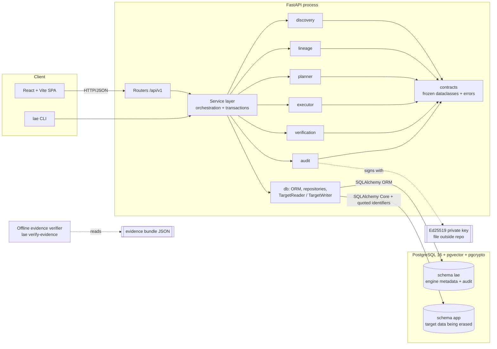

# Lineage-Aware Erasure Engine (LAE): Architecture

Status: **APPROVED 2026-11-04** (design document; deviations in the code are listed in [technical_walkthrough.md](technical_walkthrough.md), Appendix B). Owner: Lead Architect.
Related: [database_schema.md](database_schema.md) · [module_contracts.md](module_contracts.md) · [development_plan.md](development_plan.md) · [risks_and_limitations.md](risks_and_limitations.md)

---

## 0. Repository and environment inspection (Phase 1, 2026-11-04)

| Item | Finding | Consequence |
|---|---|---|
| Working directory | `V:\PROJECTS\Projects_5th_sem\DBMS_PROJECT` is **empty** | No prototype exists, so nothing can be reused or overwritten |
| Git | **Not a Git repository** (`fatal: not a git repository`), which contradicts the brief | `git init` is needed before agent work. It needs approval (see the end of this document) |
| Git client | 2.55.0.windows.2 | OK |
| Python | 3.12.10 (`python`, `py -3.12`). `python3` is only the Microsoft Store alias | Always use `py -3.12` or the venv interpreter |
| pip | 25.0.1. **No project packages installed** (no FastAPI, SQLAlchemy, SQLGlot, NetworkX, pytest…) | Install into a project venv after approval |
| uv / poetry | Not installed | Use `venv` + `pip` (no extra tooling) |
| Node / npm / pnpm | 24.18.0 / 11.16.0 / 11.10.0 | Frontend toolchain is available. Use **npm** |
| Docker / Docker Compose | **Not installed** | Docker Compose is a stated requirement but can't run yet |
| CPU virtualization | **Enabled.** *Correction (2026-11-04):* the first check read `VirtualizationFirmwareEnabled = False`, but `HypervisorPresent = True` and VBS is running. Windows reports `False` whenever a hypervisor is already active | No BIOS change needed |
| WSL | **Not installed** (`wsl --install` needed, which requires admin and a reboot) | **Blocker for Docker Desktop.** User action required |
| PostgreSQL / psql / pgvector | **Not installed** | No database is available yet |
| make | Not installed | Use the `lae` CLI and documented PowerShell commands, not Makefiles |
| Resources | 15.6 GB RAM, 174 GB free on V: | Enough |

**Missing prerequisites (need approval before install):**
1. Install WSL2 (`wsl --install`, admin + reboot) and Docker Desktop. This is the preferred path and gives the `pgvector/pgvector:pg16` image. Virtualization is already enabled.
2. *Fallback if (1) is impossible:* native PostgreSQL 16 for Windows (EDB installer) plus pgvector built from source with MSVC Build Tools (`nmake`). This is harder and less reproducible, so pgvector becomes optional (§12).
3. Python packages (backend) and npm packages (frontend), listed in [development_plan.md §2](development_plan.md).
4. `git init` of this directory.

---

## 1. Problem statement and scope

Given a **data subject** (for example, customer `42`), LAE must:

1. **Discover** where that subject's personal data lives: in base tables reachable through declared foreign keys, through *inferred* relationships, and in *registered derived artifacts* (materialized views, derived tables, embedding tables).
2. **Model** these dependencies as a lineage graph at three levels of granularity.
3. **Plan** an ordered, reviewable set of erasure operations (delete, anonymize, nullify reference, refresh, recompute).
4. **Execute** an *approved* plan atomically and safely.
5. **Verify** that the subject's data is gone. Verification must not rely on the same reasoning that produced the plan.
6. **Prove** what happened, with tamper-evident, signed audit evidence that does not itself contain the erased personal data.

Scope is one PostgreSQL database. Files, caches, backups, logs, replicas and external systems are out of scope (see risks).

### 1.1 Three lineage levels: these must not be confused

| Level | Node | Edge meaning | Source of truth | Example |
|---|---|---|---|---|
| **Table-level** | a relation (`app.purchase_order`) | "rows of B may depend on rows of A" | FK constraints, SQL definitions, registrations, inferences | `app.customer → app.purchase_order` |
| **Column-level** | a column (`app.purchase_order.customer_id`) | "values of B.y are derived from, or keyed by, A.x" with a *transform* | FK column pairs, SQLGlot column lineage | `app.customer.id →(IDENTITY) app.customer_ltv.customer_id`, `app.payment.amount →(AGGREGATE) app.customer_ltv.total_spent` |
| **Record-level** | a concrete row `(table, primary-key tuple)` | "this specific row depends on that specific row" | **Executing queries against data**, guided by column-level edges | `customer(42) → purchase_order(1001)`, `purchase_order(1001) → order_line(1001,1)` |

**Core rule:** a table- or column-level edge says that a dependency is *possible*. It doesn't say which rows are affected. Affected rows are only known after record-level discovery evaluates the join predicate on the actual data. And some table-level edges *cannot* be resolved to records at all:

| Column-level traceability | Meaning | Record-level resolution | Erasure action |
|---|---|---|---|
| `KEY_PRESERVING` | An output column is an identity copy of a source key (FK column, or a `SELECT customer_id …` / `GROUP BY customer_id` output) | Exact rows, via `WHERE mapped_col = source_key` | `DELETE_ROWS` / `DELETE_DERIVED_BY_KEY` |
| `AGGREGATE` | Output rows combine many source rows (`SUM`, `COUNT` without the subject key in `GROUP BY`) | No row "belongs" to the subject, but the subject's *contribution* is inside values | `REFRESH_MATVIEW` / `RECOMPUTE_TABLE` after base erasure |
| `OPAQUE` | No derivable mapping (unparseable SQL, UDFs, external loads, no key columns) | Unknown | `MANUAL_REVIEW`. The plan is `BLOCKED` until a human resolves it |

---

## 2. System context and component architecture



### 2.1 Deployment (Docker Compose)

| Service | Image | Port (host) | Notes |
|---|---|---|---|
| `db` | `pgvector/pgvector:pg16` | `5433` → 5432 | Init script creates the `lae` and `app` schemas, the `vector` and `pgcrypto` extensions, and the roles `lae_owner`, `lae_reader`, `lae_executor` |
| `api` | `python:3.12-slim` + backend | `8000` | Runs `alembic upgrade head` on start. Signing key mounted read-only from `./secrets/` (gitignored) |
| `web` | `node:24-alpine` (dev) / nginx (prod build) | `5173` | Proxies `/api` → `api:8000` |

Host port 5433 avoids clashing with any native PostgreSQL on 5432. For local development without containers, the API and web run natively and point at whichever PostgreSQL is available (`LAE_DATABASE_URL`).

---

## 3. Backend architecture

### 3.1 Layering (dependencies point downward only)

```
api/        FastAPI routers, Pydantic request/response schemas, error mapping.  No business logic.
services/   Use-case orchestration. Owns transaction boundaries and audit emission. Converts ORM rows <-> contracts.
domain:     discovery/  lineage/  planner/  executor/  verification/  audit/
            Pure-ish modules. Accept contracts and ports (Protocols), return contracts.
            Never import FastAPI, never import ORM models, never open their own DB sessions.
db/         SQLAlchemy 2.0 engine/session, ORM models (schema lae), repositories,
            TargetReader/TargetWriter adapters (schema app), catalog queries.
contracts/  Frozen dataclasses, enums, Protocols. Imports nothing from lae except errors.
errors.py   Exception hierarchy.
config.py   pydantic-settings Settings (env prefix LAE_).
```

Why: domain modules can be unit-tested with fakes, agents can work in parallel against frozen contracts, and every DB write passes through the service layer, which also writes the audit event in the same transaction.

### 3.2 Source layout

```
backend/
  pyproject.toml            # package "lae", src layout, extras [dev]
  alembic.ini
  migrations/               # Alembic, schema lae only
  src/lae/
    __init__.py
    config.py
    errors.py
    contracts/              # types.py, enums.py, ports.py   (Lead)
    db/                     # engine.py, models/, repositories/, target.py, catalog_queries.py
    discovery/              # catalog.py, foreign_keys.py, sql_lineage.py, inference.py, pii.py, records.py
    lineage/                # graph.py, record_graph.py, builder.py, serialize.py
    planner/                # planner.py, ordering.py, conflicts.py, hashing.py
    executor/               # executor.py, sql_builder.py
    verification/           # verifier.py, checks/*.py, residual_scan.py
    audit/                  # canonical.py, hashchain.py, merkle.py, signing.py, evidence.py, hmac_keys.py
    services/               # snapshot_service.py, erasure_service.py, audit_service.py ...
    api/                    # app.py, deps.py, errors.py, routers/*.py, schemas/*.py
    cli.py                  # Typer entry point "lae"
  tests/
    unit/  integration/  e2e/  conftest.py
db/
  init/                     # docker-entrypoint SQL: schemas, extensions, roles
  fixtures/                 # app_schema.sql, app_derived.sql, generator.py (ground truth)
benchmarks/                 # scenarios, runner, results/ (gitignored raw, committed summaries)
frontend/                   # React + Vite + TS
docs/
docker-compose.yml
.claude/agents/             # specialist subagent definitions
CLAUDE.md
```

### 3.3 Key technology decisions

| Decision | Choice | Rationale |
|---|---|---|
| DB access | SQLAlchemy 2.0 **sync** + psycopg 3 | Erasure needs exact transaction control (isolation level, `SET LOCAL`, advisory locks). Sync code makes this clearer. FastAPI runs sync endpoints in a threadpool |
| Target-data SQL | SQLAlchemy Core with `quoted_name` / psycopg `sql.Identifier`, values always bound | Table and column names come from the catalog and are never string-concatenated |
| Migrations | Alembic for `lae` only | The `app` schema is *test data*, created from fixtures, not migrated |
| Enums | `text` + `CHECK` constraints, mirrored by Python `StrEnum` | Migrations stay simpler than with PG `ENUM` types |
| IDs | `uuid` (`gen_random_uuid()`) for entities. `bigint identity` for `audit_event.seq` | UUIDs are safe to expose and stable across exports. `seq` gives the strict total order the hash chain needs |
| Long operations | Synchronous request/response in v1 | Prototype scale. Benchmarks run through the CLI, so API timeouts don't apply |
| CLI | Typer | Shares the service layer with the API |

---

## 4. Frontend architecture

- **Stack:** React 18 + Vite + TypeScript (strict), React Router, TanStack Query (server state), `@xyflow/react` + `@dagrejs/dagre` (graph rendering and layout), Vitest + Testing Library.
- **API typing:** `openapi-typescript` generates `src/api/schema.d.ts` from the backend's `/openapi.json`. This is the single source of truth, and there are no hand-written DTOs.
- **No business logic in the UI.** The UI never computes plans, hashes or verdicts. It only displays what the API returns. The UI may *recompute* a plan hash to show "hash matches", but approval always sends the server-provided hash back.
- **Pages:**

| Route | Purpose |
|---|---|
| `/` Dashboard | Latest snapshot, open requests, audit chain status |
| `/lineage` | Snapshot picker. **Level toggle Table ↔ Column**. Edges styled by origin (FK solid, SQL dashed, inferred dotted/orange until confirmed) and traceability |
| `/lineage/suggestions` | Confirm or reject `INFERRED` edges |
| `/artifacts` | Register and edit derived artifacts (SQL definition, key mapping, refresh strategy). Shows SQLGlot parse warnings |
| `/pii` | PII classification: accept or reject heuristic suggestions |
| `/policies` | Subject roots and retention policies |
| `/requests/:id` | Step-by-step workflow: Request → Discover/Plan → *record-level graph* → Review conflicts → **Approve (shows plan hash)** → Dry run → Execute → Verify → Evidence |
| `/audit` | Event log, "verify chain" action, evidence download, Merkle proof lookup |
| `/benchmarks` | Tables and charts of stored benchmark runs |

- Layout: `src/api/` (client, generated types, query hooks), `src/pages/`, `src/components/` (GraphView, PlanTable, CheckList, HashBadge, StatusPill), `src/lib/`.

---

## 5. PostgreSQL schema overview

Two schemas in one database (full DDL and models: [database_schema.md](database_schema.md)):

- **`lae`** is engine metadata: catalog snapshots, lineage edges, artifacts registry, PII classification, policies, requests, plans, executions, verification results, the append-only audit chain, evidence bundles, signing public keys, benchmark runs.
- **`app`** is a realistic *demo target* designed to exercise each hard case: composite FKs, `ON DELETE CASCADE / SET NULL / RESTRICT`, a self-reference (`referrer_id`), a retained-but-anonymized table (orders under a legal-retention policy), an un-keyed denormalized copy (`marketing_event_log.email`, with no FK), key-preserving and aggregate materialized views, a CTAS derived table, and a pgvector embedding table.

Discovery only scans schemas listed in `LAE_TARGET_SCHEMAS` (default `app`). The `lae` schema is never a target.

---

## 6. Foreign-key discovery

Source: `pg_catalog` rather than `information_schema`. `information_schema.referential_constraints` can mismatch composite keys when unique-constraint names collide, and it hides `confdeltype`.

```sql
SELECT c.oid, c.conname,
       ns.nspname  AS child_schema,  cl.relname  AS child_table,
       nsp.nspname AS parent_schema, clp.relname AS parent_table,
       array_agg(ac.attname ORDER BY k.ord) AS child_columns,
       array_agg(ap.attname ORDER BY k.ord) AS parent_columns,
       c.confdeltype, c.confupdtype, c.condeferrable, c.condeferred
FROM pg_constraint c
JOIN pg_class cl  ON cl.oid  = c.conrelid   JOIN pg_namespace ns  ON ns.oid  = cl.relnamespace
JOIN pg_class clp ON clp.oid = c.confrelid  JOIN pg_namespace nsp ON nsp.oid = clp.relnamespace
CROSS JOIN LATERAL unnest(c.conkey, c.confkey) WITH ORDINALITY AS k(child_att, parent_att, ord)
JOIN pg_attribute ac ON ac.attrelid = c.conrelid  AND ac.attnum = k.child_att
JOIN pg_attribute ap ON ap.attrelid = c.confrelid AND ap.attnum = k.parent_att
WHERE c.contype = 'f' AND ns.nspname = ANY(:schemas)
GROUP BY c.oid, c.conname, ns.nspname, cl.relname, nsp.nspname, clp.relname,
         c.confdeltype, c.confupdtype, c.condeferrable, c.condeferred;
```

Each FK yields:
- one **table-level** edge `parent → child`, with `origin=DECLARED_FK`, `transform=FOREIGN_KEY`, `traceability=KEY_PRESERVING`, `on_delete_action=confdeltype` (`a` no action, `r` restrict, `c` cascade, `n` set null, `d` set default)
- one **column-level** edge per column pair (`parent.col_i → child.col_i`), `transform=FOREIGN_KEY`

Composite keys are preserved as ordered column arrays and are never split into independent single-column joins.

**Catalog snapshot:** tables, views, matviews (`pg_class.relkind in ('r','p','v','m')`), columns, PKs (`contype='p'`), unique constraints, and `reltuples` estimates. The **schema fingerprint** is the SHA-256 of the canonical JSON of the catalog (tables, columns, types, PKs, FKs, view definitions). Plans record the fingerprint, and execution aborts if it has changed (§9).

**Inferred relationships** (no FK declared) are kept separate from declared ones. The heuristic is: column `X_id` / `X_email`, a type compatible with a candidate parent key, and sampled value containment ≥ θ (default 0.95, measured over at most N sampled rows). These edges get `origin=INFERRED`, `status=SUGGESTED` and a `confidence`. **Suggested edges are never traversed** until a human confirms them.

---

## 7. SQL transformation lineage (SQLGlot)

Inputs: the `definition_sql` of each registered artifact, plus `pg_get_viewdef()` for views and matviews found in the catalog (these are auto-registered as `MATERIALIZED_VIEW`/`VIEW` artifacts with `definition_sql` taken from the catalog).

Pipeline (pure function, no DB access):
1. `sqlglot.parse_one(sql, read="postgres")`. On failure, `traceability=OPAQUE` and a warning is recorded. Failures are never swallowed silently.
2. `sqlglot.optimizer.qualify.qualify(expr, schema=catalog_mapping, dialect="postgres")` expands `*`, resolves aliases and qualifies columns against the snapshot catalog.
3. For each output column, `sqlglot.lineage.lineage(col, expr, schema=…)` walks to the source columns.
4. **Classify each column-level edge:**
   - `IDENTITY`: the output is a bare column reference (possibly aliased or cast)
   - `AGGREGATE`: the path passes through an `exp.AggFunc` (or a window aggregate)
   - `EXPRESSION`: any other expression (`concat`, `lower`, `CASE`…)
   - `JOIN_KEY` / `FILTER`: columns that appear only in `JOIN … ON` / `WHERE` / `HAVING`. These are *control lineage*: they influence which rows exist, not values
5. **Derive artifact traceability** (table-level edge `source → artifact`):
   - `KEY_PRESERVING` if some output column is `IDENTITY`-derived from the subject-reachable key of that source (its PK, or an FK column referencing the subject root chain), and that column is in `GROUP BY` or the query has no aggregation. The edge stores `source_columns`/`target_columns` for that key mapping
   - `AGGREGATE` if aggregation exists and no subject key survives into the output
   - `OPAQUE` if parsing or qualification fails, or there are set operations without resolvable keys, `LATERAL` set-returning functions, unknown functions, or dynamic SQL
6. Registered `source_key_mapping` (for example, an embedding table's `source_ticket_id → app.support_ticket.id`) **overrides** inference and produces `origin=REGISTERED_MAPPING`, `traceability=KEY_PRESERVING`.

Known gaps (documented as limitations): recursive CTEs, PL/pgSQL, triggers, writes performed by application code.

---

## 8. Record-level dependency discovery

Input: a confirmed lineage graph, the subject root (for example, `app.customer.id = 42`), and limits.
Output: a `RecordGraph` of concrete rows plus table-level "affected artifact" markers.

Algorithm (breadth-first over the table graph, batched over records):

```
frontier = {RecordKey(app.customer, (42,))}; visited = set(frontier)
while frontier:
    group frontier by table T
    for each CONFIRMED downstream edge e: T -> U (FK or KEY_PRESERVING derived):
        keys = [project(r, e.source_columns) for r in frontier[T]]   # parent key tuples
        rows = reader.select_by_columns(U, e.target_columns, keys, select=pk(U) + e.target_columns)
                                                     # WHERE (c1,c2) IN (VALUES ...) in batches of 1000
        for row in rows: add node RecordKey(U, pk(row)); add edge(parent, child, e.edge_id)
                         if new: push to next frontier
    for each AGGREGATE edge T -> A: mark artifact A affected (table-level, no rows)
    for each OPAQUE edge T -> A:    mark artifact A MANUAL_REVIEW
    depth += 1; enforce max_depth, max_records (raise DiscoveryLimitExceeded)
```

Rules that keep record-level discovery honest:
1. **Traversal goes downstream only** (parent → dependent). `customer(42) → purchase_order(1001)` is followed, but `purchase_order(1001) → product(7)` is not, because the product isn't the subject's data.
2. **Dependency is not ownership.** Rows reached in the **root table itself** that aren't the subject (for example, customer 77 whose `referrer_id = 42`) are recorded with role `REFERENCING_OTHER_SUBJECT`. They are never deleted. The plan nullifies the reference instead, or blocks.
3. **Shared rows** (reachable from the subject but also referencing another subject's root row, for example a message thread between two customers) get role `SHARED` and default to `MANUAL_REVIEW` unless policy says otherwise.
4. Tables **without a PK** cannot be addressed by row. They're matched by the edge predicate and recorded as `PredicateKey(table, columns, values)` with a row count. Plan and verification use the predicate.
5. The **record-set hash** is the SHA-256 of the sorted canonical list of `(table, key)`. It's used later to detect drift.
6. Discovery runs inside a `REPEATABLE READ READ ONLY` transaction, so it sees one consistent snapshot.
7. **Residual probes:** the subject's direct-identifier values (for example, the email from the root row and other `DIRECT_IDENTIFIER` columns of reached rows) are normalized and stored **only as HMAC-SHA256 digests** in `lae.residual_probe`. Verification uses them to find copies that lineage never discovered (§10).

---

## 9. NetworkX graph construction

- **`LineageGraph`** wraps an `nx.MultiDiGraph` (multi because two tables can be linked by several FKs, such as `billing_customer_id` and `shipping_customer_id`).
  - Table nodes: key `"t:{schema}.{table}"`, attrs `kind`, `pk`, `is_artifact`.
  - Column nodes: key `"c:{schema}.{table}.{column}"`, attrs `data_type`, `pii_category`.
  - Edges carry the full `RelationshipEdge` contract (`edge_id`, `level`, `origin`, `transform`, `traceability`, `status`, `on_delete`).
  - Views: `table_view()` (TABLE-level edges only), `column_view()` (COLUMN-level edges plus implicit `table → column` containment).
  - Queries: `downstream(table, statuses={CONFIRMED})`, `upstream(...)`, `reachable_from(table)`, `table_cycles()` (`nx.simple_cycles` on the table view), `artifact_order()` (topological order of artifacts for refresh).
  - Persisted as rows in `lae.lineage_edge` (nodes = `lae.catalog_table` / `lae.catalog_column`). `to_dict()` is node-link JSON for the API and UI.
- **`RecordGraph`** wraps an `nx.DiGraph` of `RecordKey` nodes, attrs `role` (`SUBJECT_ROOT`, `OWNED`, `REFERENCING_OTHER_SUBJECT`, `SHARED`), `depth`, `via_edge_ids`.
  - `deletion_order()` returns the reverse topological order (children before parents). FK cycles among records (rare: self-references, mutual references) are found with `nx.strongly_connected_components`. A cycle is *breakable* only if some edge in it has a nullable FK column, in which case the planner adds a `NULLIFY_REFERENCE` step first. Otherwise it raises `GraphIntegrityError`, and the plan is `BLOCKED`.
- Graphs are rebuilt from the database on demand. NetworkX objects are never the system of record.

---

## 10. Erasure planning

`build_plan(request, record_graph, lineage_graph, policies, pii, artifacts) -> ErasurePlan`

1. **Per-table action from policy** (`lae.retention_policy`): `DELETE` (default), `ANONYMIZE` (retain the row and overwrite PII columns according to `pii_classification.erasure_strategy`, `NULLIFY` or `PSEUDONYMIZE`), or `RETAIN` (legal hold: the row is left untouched, which produces a conflict that must be acknowledged explicitly).
2. **Per-record overrides by role:** `REFERENCING_OTHER_SUBJECT` gets `NULLIFY_REFERENCE` (or a conflict if the FK column is `NOT NULL`). `SHARED` gets `MANUAL_REVIEW`.
3. **Cascades are made explicit.** If a child edge has `ON DELETE CASCADE` and its rows are being deleted anyway, the planner emits `EXPECT_CASCADE` with the expected count instead of an explicit delete, and verification checks the count. If the policy says `ANONYMIZE` for a child but the FK cascades on delete, that's a **conflict**, because the database would silently destroy retained rows.
4. **Ordering** follows the record graph's reverse topological order, grouped into one step per `(table, action)` batch:
   `NULLIFY_REFERENCE` / `ANONYMIZE_ROWS` (retained rows detached first) → `DELETE_ROWS` (children → parents) → derived artifacts in `artifact_order()`: `DELETE_DERIVED_BY_KEY`, then `RECOMPUTE_TABLE`, then `REFRESH_MATVIEW`.
5. **Conflict detection** produces a `PlanConflict` list. Examples: a `RESTRICT` FK from a retained row, a `NOT NULL` reference that must be nullified, an unbreakable cycle, an `OPAQUE` artifact, a `SHARED` row, `RETAIN` with PII, or a missing PK. Any unresolved conflict makes the plan **`BLOCKED`**, and it can't be approved.
6. **Plan hash** is the SHA-256 of canonical JSON of `{request_id, snapshot_fingerprint, record_set_hash, items[]}`. Approval must echo this hash (`PlanHashMismatch` otherwise), so a human approves *exactly* what will run.
7. **Status machine:** `DRAFT → APPROVED → EXECUTED → VERIFIED`, with side exits `BLOCKED`, `SUPERSEDED` (re-plan creates version n+1), and `FAILED`. Transitions are enforced in the service layer (`InvalidStateTransition`) and by a `CHECK` that `approved_hash = plan_hash`.

---

## 11. Safe execution

`execute_plan(plan, approval, writer, rediscover, mode)`:

1. Preconditions: plan `APPROVED`, `approval.plan_hash == plan.plan_hash`, no `COMMITTED LIVE` run exists. This is enforced by a partial unique index, which makes the operation **idempotent**.
2. Open one transaction: `SERIALIZABLE`, `SET LOCAL lock_timeout='5s'`, `SET LOCAL statement_timeout=…`, role `lae_executor` (DML on `app` only, no DDL).
3. **Drift check inside the transaction:** compare the schema fingerprint, re-run record discovery, and compare the `record_set_hash`. Any mismatch raises `StalePlanError`, rolls back, and requires a re-plan. This catches rows inserted after approval (a new order for customer 42).
4. `SELECT … FOR UPDATE` on all target rows, in plan order.
5. For each step: build the parameterized statement (`DELETE FROM {ident} WHERE ({pk}) IN (VALUES …)`, `UPDATE … SET col = NULL | pseudonym`, `REFRESH MATERIALIZED VIEW {ident}`, recompute via `TRUNCATE`+`INSERT … definition_sql` for derived tables), execute it, and **assert `rowcount == expected_row_count`**. A mismatch raises `RowCountMismatch` and rolls back the whole plan.
6. `DRY_RUN` does all of the above, then always `ROLLBACK`s. The output is the per-step counts, which can be reviewed before LIVE.
7. The `EXECUTION_COMMITTED` audit event and the step results are written **in the same transaction** as the data changes (same database), so data changes and their audit record commit or fail together. A serialization failure is never retried automatically. The run is recorded as `FAILED` and the user re-plans.
8. Pseudonyms are `'anon_' || left(hmac(pk), 16)`: deterministic per row, not reversible without the HMAC key.

Optional post-commit step, outside the transaction: `VACUUM (VERBOSE) <affected tables>` to reclaim dead tuples. It is disabled by default and recorded as a separate audit event. Physical erasure from WAL and backups is out of scope.

---

## 12. Verification

Verification runs as a **separate transaction** after commit, using the read-only role. Its checks are independent of the planner's reasoning wherever possible:

| Check | What it does | Independent of plan? |
|---|---|---|
| `ROW_ABSENT` | Every `DELETE_ROWS` / `DELETE_DERIVED_BY_KEY` key → `SELECT count(*) = 0` | No (uses plan keys) |
| `CASCADE_COMPLETE` | `EXPECT_CASCADE` keys are absent | No |
| `COLUMNS_ANONYMIZED` | Retained rows: PII columns are NULL or match the pseudonym pattern | No |
| `REFERENCE_NULLIFIED` | Other subjects' rows no longer reference the subject | No |
| `REDISCOVERY_EMPTY` | Re-run record discovery from the subject root. Expect no `OWNED` rows, apart from rows explicitly retained (anonymized or `RETAIN`-acknowledged) | Partly: same graph, fresh data |
| `DERIVED_CONSISTENT` | For each refreshed or recomputed artifact, `(stored EXCEPT ALL fresh) ∪ (fresh EXCEPT ALL stored)` is empty, where *fresh* = `definition_sql` evaluated now | Yes |
| `EMBEDDING_ABSENT` | No rows with the subject's source keys. Also no stored vector with the same `sha256(vector::text)` as the pre-erasure vectors (digests captured at planning time) | Partly |
| `RESIDUAL_VALUE_SCAN` | Scan **every text-like column of every target table** (`text`, `varchar`, `citext`, `jsonb::text`) for values whose normalized HMAC (`encode(hmac(lower(trim(col)), :k, 'sha256'),'hex')`, using pgcrypto) matches a residual probe. This catches un-modelled copies such as `marketing_event_log.email` | **Yes**: no lineage used |

The result is `PASSED` only if every check passes. A residual hit is reported with table and column (never the value) and is fed back as an **inferred-relationship suggestion**. That's how verification discovers gaps that lineage missed.

---

## 13. Cryptographic audit

| Mechanism | Design |
|---|---|
| **Canonical JSON** | UTF-8, keys sorted, `separators=(",",":")`, `ensure_ascii=False`, **floats rejected** (use int, or Decimal as string), datetimes as ISO-8601 UTC `Z`, UUIDs lowercase. Stored as text (`payload_canonical`), because `jsonb` reorders and normalizes and would break re-hashing |
| **Hash chain** | `event_hash = SHA-256( prev_hash_bytes ‖ SHA-256(payload_canonical) ‖ seq_be64 ‖ event_type )`. Genesis `prev_hash = 64×'0'`. Appends are serialized by `pg_advisory_xact_lock(hashtext('lae.audit_chain'))` |
| **Append-only** | A trigger raises on `UPDATE`/`DELETE`/`TRUNCATE` of `lae.audit_event`. `lae_executor` and `lae_reader` have only `INSERT`/`SELECT`. `verify_chain()` recomputes everything |
| **No PII in the audit** | Subject keys, record keys and identifier values appear only as `HMAC-SHA256(LAE_HMAC_KEY, canonical(value))`. Table and column names are not PII |
| **Merkle tree** | Leaves = one per record or artifact outcome `{table, key_hmac, action, check_types, passed}`. RFC 6962-style domain separation: `leaf = H(0x00‖canonical)`, `node = H(0x01‖L‖R)`. Inclusion proofs let an auditor confirm "record X was erased and verified" without seeing other records |
| **Signature** | Ed25519 (`cryptography`). The private key is a PEM file at `LAE_SIGNING_KEY_PATH` (outside the repo, gitignored `secrets/`). The public key and fingerprint are stored in `lae.signing_key` |
| **Evidence bundle** | Canonical JSON `{bundle_version, plan_id, plan_hash, snapshot_fingerprint, record_set_hash, execution {run_id, mode, committed_at, step_counts}, verification {status, checks[]}, merkle_root, leaf_count, chain_anchor {seq, event_hash}, issued_at, signing_key_id}` + `signature`. Exported as a file |
| **Offline verifier** | `lae verify-evidence bundle.json --public-key pub.pem [--leaves leaves.json] [--chain audit_export.json]` checks the signature, Merkle root and chain segment **without any database access** |
| **Purge** | After `EVIDENCE_ISSUED`: `erasure_request.subject_key` set to NULL, raw `plan_item.record_keys` and `record_dependency` raw keys replaced by HMACs, and a `SUBJECT_DATA_PURGED` event appended |

Threat model limits (see risks): a DB superuser can rewrite the whole chain consistently. The mitigation is that evidence bundles and periodic chain-head exports are signed and kept outside the DB, so rewriting becomes *detectable* against any exported anchor.

---

## 14. Benchmarking

Purpose: produce measured research results, not demos.

- **Generator** (`db/fixtures/generator.py`): deterministic (`--seed`), parameters `subjects`, `orders_per_subject` (Poisson λ), `lines_per_order`, `tickets_per_subject`, `hidden_copy_rate`, `chain_depth` (synthetic chain schema `app.chain_1 … app.chain_d`), `artifact_count`. It writes a **ground-truth manifest**, `{subject_key: [(table, key)…]}`, including hidden copies.
- **Scenarios:**

| ID | Varies | Measures |
|---|---|---|
| B1 Scale | subjects 1k / 10k / 100k | snapshot, record discovery, plan, execute, verify latency (p50/p95, 5 warm runs + 1 cold) |
| B2 Fan-out | rows per subject 10 → 10k | discovery and execution latency vs affected rows |
| B3 Depth | chain depth 2 → 20 | discovery latency vs depth, number of queries |
| B4 Artifacts | 0 → 20 matviews / derived tables | refresh/recompute cost, `DERIVED_CONSISTENT` cost |
| B5 Completeness | hidden_copy_rate 0 → 20 % | **precision / recall** of discovered records vs ground truth. **Residual PII count** after erasure for three methods: (a) naive `DELETE` root row, (b) FK `CASCADE`-only, (c) LAE without residual scan, (d) LAE with residual scan + confirmed suggestions |
| B6 Concurrency | concurrent inserts during plan→execute | rate of `StalePlanError` detection (must be 100 %) |

- **Reproducibility:** each run stores `params`, `seed`, `git_commit`, Python, PostgreSQL and package versions, host CPU/RAM, and the PG settings that matter (`shared_buffers`, `work_mem`) in `lae.benchmark_run` and `benchmarks/results/<timestamp>_<scenario>.json`. A run starts with `VACUUM ANALYZE` and drops caches where possible (warm vs cold labelled).
- Runner (as implemented): `python -m benchmarks.run`. Plots come from a notebook-free script `benchmarks/report.py` → `benchmarks/results/summary.md`.

---

## 15. Security architecture (summary)

- Three DB roles: `lae_owner` (migrations), `lae_reader` (`SELECT` on `app`, `SELECT`/`INSERT` on `lae`), `lae_executor` (`SELECT`/`UPDATE`/`DELETE` on `app`, `REFRESH` via ownership of the matviews, `INSERT` on `lae`). For the prototype, the API may use the reader and executor URLs from config.
- All identifiers come from catalog snapshots, are checked against the snapshot (`UnknownTableError`) and are quoted. All values are bound parameters. **No f-string SQL.**
- Secrets (`LAE_HMAC_KEY`, signing key, DB passwords) come from env or files and are never logged, returned by the API or committed. The `.gitignore` includes `secrets/`, `.env`, `benchmarks/results/raw/`.
- The API exposes no raw subject data after purge. Logs never include record key values (only HMACs).
- No authentication in v1 (local research prototype). `approved_by` is a free-text attestation. This is documented as a limitation.

---

## 16. Decisions requiring your approval

1. **Environment path:** (A) enable virtualization → WSL2 + Docker Desktop (recommended), or (B) native PostgreSQL 16 + pgvector built from source.
2. **`git init`** of this directory (and `.gitignore`), so agents can work on branches or worktrees.
3. **Package installation** (lists in development_plan.md §2) into `.venv` and `frontend/node_modules`.
4. Confirm the demo domain (e-commerce + support tickets + embeddings) as the evaluation target.
