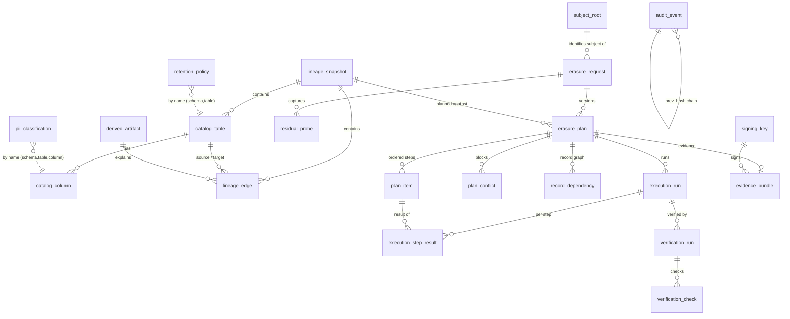

# Database Schema and Data Contracts

Status: **DRAFT v0.1, awaiting approval**. PostgreSQL 16, extensions `pgcrypto`, `vector`.
Owner of implementation: Database Engineer. Owner of this contract: Lead Architect. **Changes require Lead approval.**

---

## 1. Naming convention

| Element | Rule | Example |
|---|---|---|
| Schemas | `lae` (engine), `app` (demo target) | `lae.erasure_plan` |
| Tables | singular, `snake_case` | `plan_item`, not `PlanItems` |
| Primary key | `id uuid DEFAULT gen_random_uuid()`. Exception: `audit_event.seq bigint identity` | `id` |
| Foreign key column | `<referenced_table>_id`. Role-qualified when needed | `plan_id`, `source_table_id` |
| Timestamps | `<verb>_at timestamptz NOT NULL DEFAULT now()`, always UTC | `created_at`, `approved_at` |
| Booleans | `is_` / `has_` prefix | `is_active` |
| Hashes | `<thing>_hash char(64)`, lowercase hex SHA-256, `CHECK (x ~ '^[0-9a-f]{64}$')` | `plan_hash` |
| HMACs | `<thing>_hmac char(64)` | `subject_key_hmac` |
| Enumerations | `text` + `CHECK (col IN (...))`. Values `UPPER_SNAKE` and mirrored by Python `StrEnum` in `lae.contracts.enums` | `status` |
| JSON | `jsonb` for queryable structured data. `text` for anything that is hashed (`*_canonical`) | `payload_canonical` |
| Arrays | `text[]` for ordered column lists | `source_columns` |
| Constraint names | SQLAlchemy `MetaData(naming_convention=…)`, see below | `fk_plan_item_plan_id_erasure_plan` |

```python
NAMING_CONVENTION = {
    "ix": "ix_%(table_name)s_%(column_0_N_name)s",
    "uq": "uq_%(table_name)s_%(column_0_N_name)s",
    "ck": "ck_%(table_name)s_%(constraint_name)s",
    "fk": "fk_%(table_name)s_%(column_0_name)s_%(referred_table_name)s",
    "pk": "pk_%(table_name)s",
}
```

---

## 2. ER design: engine schema `lae`



`pii_classification`, `retention_policy`, `subject_root` and `derived_artifact` are **configuration** that survives snapshots, so they reference target objects *by qualified name*, not by snapshot-scoped IDs. The service layer validates names against the current snapshot.

---

## 3. Table definitions (`lae`)

### 3.1 Catalog and lineage

**`lineage_snapshot`**: one catalog scan
| Column | Type | Constraints |
|---|---|---|
| id | uuid | PK |
| created_at | timestamptz | NOT NULL default now() |
| scanned_schemas | text[] | NOT NULL, `cardinality > 0` |
| schema_fingerprint | char(64) | NOT NULL, hex check |
| status | text | `IN ('BUILDING','READY','FAILED')` |
| table_count, edge_count | integer | NOT NULL default 0, `>= 0` |
| warnings | jsonb | NOT NULL default `'[]'` (SQLGlot and inference warnings) |

Index: `ix_lineage_snapshot_created_at` (desc).

**`catalog_table`**
| Column | Type | Constraints |
|---|---|---|
| id | uuid | PK |
| snapshot_id | uuid | FK → lineage_snapshot ON DELETE CASCADE, NOT NULL |
| schema_name, table_name | text | NOT NULL |
| kind | text | `IN ('TABLE','VIEW','MATERIALIZED_VIEW')` |
| primary_key_columns | text[] | NOT NULL default `'{}'` (empty = no PK) |
| estimated_rows | bigint | nullable |
| definition_sql | text | nullable (views and matviews) |

`UNIQUE (snapshot_id, schema_name, table_name)`.

**`catalog_column`**
| Column | Type | Constraints |
|---|---|---|
| id | uuid | PK |
| table_id | uuid | FK → catalog_table ON DELETE CASCADE |
| column_name | text | NOT NULL |
| ordinal_position | smallint | NOT NULL `> 0` |
| data_type | text | NOT NULL (`format_type()` output, for example `vector(384)`) |
| is_nullable | boolean | NOT NULL |

`UNIQUE (table_id, column_name)`, `UNIQUE (table_id, ordinal_position)`.

**`lineage_edge`**: table-level *and* column-level edges in one table, distinguished by `level`
| Column | Type | Constraints |
|---|---|---|
| id | uuid | PK |
| snapshot_id | uuid | FK → lineage_snapshot ON DELETE CASCADE |
| level | text | `IN ('TABLE','COLUMN')` |
| origin | text | `IN ('DECLARED_FK','SQL_LINEAGE','REGISTERED_MAPPING','INFERRED')` |
| source_table_id | uuid | FK → catalog_table ON DELETE CASCADE |
| target_table_id | uuid | FK → catalog_table ON DELETE CASCADE |
| source_columns | text[] | NOT NULL default `'{}'` |
| target_columns | text[] | NOT NULL default `'{}'` |
| transform | text | `IN ('FOREIGN_KEY','IDENTITY','EXPRESSION','AGGREGATE','FILTER','JOIN_KEY')` |
| traceability | text | `IN ('KEY_PRESERVING','AGGREGATE','OPAQUE')` |
| on_delete_action | char(1) | nullable, `IN ('a','r','c','n','d')` (FK only) |
| constraint_name | text | nullable (FK only) |
| confidence | numeric(4,3) | NOT NULL default 1, `BETWEEN 0 AND 1` |
| status | text | `IN ('CONFIRMED','SUGGESTED','REJECTED')` |
| artifact_id | uuid | FK → derived_artifact ON DELETE SET NULL, nullable |
| details | jsonb | NOT NULL default `'{}'` |

Checks:
- `cardinality(source_columns) = cardinality(target_columns)`
- `level = 'COLUMN'` ⇒ both arrays have length ≥ 1
- `origin = 'DECLARED_FK'` ⇒ `on_delete_action IS NOT NULL AND status = 'CONFIRMED'`
- `origin = 'INFERRED'` ⇒ `confidence < 1 OR status <> 'SUGGESTED'`

Indexes: `(snapshot_id, source_table_id, level)`, `(snapshot_id, target_table_id, level)`, `(snapshot_id, status)`.

### 3.2 Configuration

**`derived_artifact`**
| Column | Type | Constraints |
|---|---|---|
| id | uuid | PK |
| name | text | UNIQUE NOT NULL |
| kind | text | `IN ('MATERIALIZED_VIEW','VIEW','DERIVED_TABLE','EMBEDDING_TABLE')` |
| schema_name, table_name | text | NOT NULL, `UNIQUE (schema_name, table_name)` |
| definition_sql | text | nullable (required unless `kind='EMBEDDING_TABLE'`) |
| refresh_strategy | text | `IN ('REFRESH_MATVIEW','RECOMPUTE_SQL','DELETE_BY_KEY','NONE')` |
| source_key_mapping | jsonb | nullable: `[{"source":"app.support_ticket","source_columns":["id"],"target_columns":["source_ticket_id"]}]` |
| is_auto_registered | boolean | NOT NULL default false (discovered from the catalog) |
| is_active | boolean | NOT NULL default true |
| created_at, updated_at | timestamptz | NOT NULL |

Checks: `kind='MATERIALIZED_VIEW' ⇒ refresh_strategy IN ('REFRESH_MATVIEW','NONE')`, `kind='VIEW' ⇒ refresh_strategy='NONE'`, `refresh_strategy='DELETE_BY_KEY' ⇒ source_key_mapping IS NOT NULL`, `refresh_strategy='RECOMPUTE_SQL' ⇒ definition_sql IS NOT NULL`.

**`pii_classification`**
| Column | Type | Constraints |
|---|---|---|
| id | uuid | PK |
| schema_name, table_name, column_name | text | `UNIQUE (schema_name, table_name, column_name)` |
| category | text | `IN ('DIRECT_IDENTIFIER','QUASI_IDENTIFIER','SENSITIVE','EMBEDDING')` |
| erasure_strategy | text | `IN ('NULLIFY','PSEUDONYMIZE')` (used when the row is retained) |
| source | text | `IN ('MANUAL','HEURISTIC')` |
| is_confirmed | boolean | NOT NULL default false |
| use_for_residual_scan | boolean | NOT NULL default false |

**`subject_root`**: defines what a "data subject" is
| Column | Type | Constraints |
|---|---|---|
| id | uuid | PK |
| name | text | UNIQUE NOT NULL (for example `customer`) |
| schema_name, table_name | text | NOT NULL |
| key_columns | text[] | NOT NULL, cardinality ≥ 1 (must equal the table's PK) |
| identifier_columns | text[] | NOT NULL default `'{}'` (for example `{email,phone}`, used for residual probes) |

**`retention_policy`**
| Column | Type | Constraints |
|---|---|---|
| id | uuid | PK |
| schema_name, table_name | text | `UNIQUE (schema_name, table_name)` |
| action | text | `IN ('DELETE','ANONYMIZE','RETAIN')` |
| legal_basis | text | nullable. `CHECK (action = 'DELETE' OR legal_basis IS NOT NULL)` |

Absent policy ⇒ `DELETE`.

### 3.3 Erasure workflow

**`erasure_request`**
| Column | Type | Constraints |
|---|---|---|
| id | uuid | PK |
| subject_root_id | uuid | FK → subject_root ON DELETE RESTRICT |
| subject_key | jsonb | **nullable, purged after evidence** (for example `[42]`) |
| subject_key_hmac | char(64) | NOT NULL, hex check |
| status | text | `IN ('RECEIVED','PLANNED','APPROVED','EXECUTED','VERIFIED','FAILED','CANCELLED')` |
| requested_by | text | NOT NULL |
| reason | text | nullable |
| created_at | timestamptz | NOT NULL |
| completed_at | timestamptz | nullable |

Check: `status IN ('VERIFIED','CANCELLED') OR subject_key IS NOT NULL` (the raw key may only disappear in terminal states). Index `(subject_root_id, subject_key_hmac)`.

**`residual_probe`**
| Column | Type | Constraints |
|---|---|---|
| id | uuid | PK |
| request_id | uuid | FK → erasure_request ON DELETE CASCADE |
| origin_schema, origin_table, origin_column | text | NOT NULL |
| normalization | text | `IN ('EXACT','LOWER_TRIM','DIGITS_ONLY')` |
| value_hmac | char(64) | NOT NULL |

`UNIQUE (request_id, value_hmac, normalization)`.

**`erasure_plan`**
| Column | Type | Constraints |
|---|---|---|
| id | uuid | PK |
| request_id | uuid | FK → erasure_request ON DELETE RESTRICT |
| snapshot_id | uuid | FK → lineage_snapshot ON DELETE RESTRICT |
| version | integer | NOT NULL `>= 1`, `UNIQUE (request_id, version)` |
| status | text | `IN ('DRAFT','BLOCKED','APPROVED','SUPERSEDED','EXECUTED','VERIFIED','FAILED')` |
| schema_fingerprint | char(64) | NOT NULL |
| record_set_hash | char(64) | NOT NULL |
| plan_hash | char(64) | NOT NULL |
| record_count | integer | NOT NULL `>= 0` |
| created_at | timestamptz | NOT NULL |
| approved_by | text | nullable |
| approved_at | timestamptz | nullable |
| approved_hash | char(64) | nullable |

Checks: `(status IN ('APPROVED','EXECUTED','VERIFIED')) = (approved_at IS NOT NULL)`, `approved_hash IS NULL OR approved_hash = plan_hash`.
Partial unique index: `uq_erasure_plan_active ON (request_id) WHERE status IN ('DRAFT','BLOCKED','APPROVED')` (only one live plan per request).

**`plan_item`**
| Column | Type | Constraints |
|---|---|---|
| id | uuid | PK |
| plan_id | uuid | FK → erasure_plan ON DELETE CASCADE |
| step_order | integer | NOT NULL `>= 1`, `UNIQUE (plan_id, step_order)` |
| action | text | `IN ('NULLIFY_REFERENCE','ANONYMIZE_ROWS','DELETE_ROWS','EXPECT_CASCADE','DELETE_DERIVED_BY_KEY','RECOMPUTE_TABLE','REFRESH_MATVIEW','MANUAL_REVIEW')` |
| schema_name, table_name | text | NOT NULL |
| lineage_level | text | `IN ('RECORD','TABLE')` (TABLE for refresh/recompute) |
| key_columns | text[] | NOT NULL default `'{}'` |
| record_keys | jsonb | nullable: array of key tuples `[[1001],[1002]]`. **Purged** after evidence |
| record_key_hmacs | text[] | NOT NULL default `'{}'` |
| target_columns | text[] | NOT NULL default `'{}'` (columns to anonymize or nullify) |
| expected_row_count | integer | nullable `>= 0` (NULL for TABLE-level refresh) |
| depends_on_steps | integer[] | NOT NULL default `'{}'` |
| reason_edge_ids | uuid[] | NOT NULL default `'{}'` |

Check: `lineage_level='RECORD' ⇒ expected_row_count IS NOT NULL`.

**`plan_conflict`**
| Column | Type | Constraints |
|---|---|---|
| id | uuid | PK |
| plan_id | uuid | FK → erasure_plan ON DELETE CASCADE |
| code | text | `IN ('RESTRICT_FROM_RETAINED','NOT_NULL_REFERENCE','CASCADE_DESTROYS_RETAINED','UNBREAKABLE_CYCLE','OPAQUE_ARTIFACT','SHARED_RECORD','RETAINED_WITH_PII','NO_PRIMARY_KEY','UNCONFIRMED_PII')` |
| severity | text | `IN ('BLOCKING','WARNING')` |
| schema_name, table_name | text | NOT NULL |
| message | text | NOT NULL |
| resolution | text | nullable `IN ('ACKNOWLEDGED','POLICY_CHANGED')` |
| resolved_by | text | nullable |

**`record_dependency`**: the persisted record-level graph
| Column | Type | Constraints |
|---|---|---|
| id | uuid | PK |
| plan_id | uuid | FK → erasure_plan ON DELETE CASCADE |
| parent_table, child_table | text | NOT NULL (qualified `schema.table`) |
| parent_key, child_key | jsonb | nullable (**purged**) |
| parent_key_hmac, child_key_hmac | char(64) | NOT NULL |
| child_role | text | `IN ('SUBJECT_ROOT','OWNED','REFERENCING_OTHER_SUBJECT','SHARED')` |
| edge_id | uuid | FK → lineage_edge ON DELETE RESTRICT, nullable (null only for the root node row) |
| depth | smallint | NOT NULL `>= 0` |

Indexes: `(plan_id, child_table)`, `(plan_id, parent_key_hmac)`.

**`execution_run`**
| Column | Type | Constraints |
|---|---|---|
| id | uuid | PK |
| plan_id | uuid | FK → erasure_plan ON DELETE RESTRICT |
| mode | text | `IN ('DRY_RUN','LIVE')` |
| status | text | `IN ('RUNNING','COMMITTED','ROLLED_BACK','FAILED')` |
| isolation_level | text | NOT NULL default `'SERIALIZABLE'` |
| started_at | timestamptz | NOT NULL |
| finished_at | timestamptz | nullable |
| error | jsonb | nullable `{code, message}` (no PII) |

Checks: `mode='DRY_RUN' ⇒ status <> 'COMMITTED'`.
Partial unique index: `uq_execution_run_live_committed ON (plan_id) WHERE mode='LIVE' AND status='COMMITTED'` (**idempotency**).

**`execution_step_result`**
| Column | Type | Constraints |
|---|---|---|
| id | uuid | PK |
| run_id | uuid | FK → execution_run ON DELETE CASCADE |
| plan_item_id | uuid | FK → plan_item ON DELETE RESTRICT |
| status | text | `IN ('APPLIED','SKIPPED','FAILED')` |
| rows_affected | integer | nullable |
| expected_rows | integer | nullable |
| duration_ms | integer | NOT NULL `>= 0` |

`UNIQUE (run_id, plan_item_id)`.

**`verification_run`**
| Column | Type | Constraints |
|---|---|---|
| id | uuid | PK |
| execution_run_id | uuid | FK → execution_run ON DELETE RESTRICT |
| status | text | `IN ('RUNNING','PASSED','FAILED','ERROR')` |
| started_at, finished_at | timestamptz | |

Check: the referenced execution run must be `LIVE`/`COMMITTED` (enforced in the service, and by a trigger `trg_verification_run_requires_committed`).

**`verification_check`**
| Column | Type | Constraints |
|---|---|---|
| id | uuid | PK |
| verification_run_id | uuid | FK → verification_run ON DELETE CASCADE |
| check_type | text | `IN ('ROW_ABSENT','CASCADE_COMPLETE','COLUMNS_ANONYMIZED','REFERENCE_NULLIFIED','REDISCOVERY_EMPTY','DERIVED_CONSISTENT','EMBEDDING_ABSENT','RESIDUAL_VALUE_SCAN')` |
| schema_name, table_name | text | nullable (null for global checks) |
| column_name | text | nullable |
| plan_item_id | uuid | FK → plan_item, nullable |
| passed | boolean | NOT NULL |
| observed, expected | jsonb | NOT NULL (counts and hashes only, **never values**) |

Index `(verification_run_id, passed)`.

### 3.4 Audit and evidence

**`audit_event`**: append-only hash chain
| Column | Type | Constraints |
|---|---|---|
| seq | bigint | PK, `GENERATED ALWAYS AS IDENTITY` |
| event_id | uuid | UNIQUE NOT NULL default gen_random_uuid() |
| occurred_at | timestamptz | NOT NULL |
| event_type | text | `IN ('SNAPSHOT_CREATED','ARTIFACT_REGISTERED','ARTIFACT_UPDATED','EDGE_STATUS_CHANGED','POLICY_CHANGED','REQUEST_RECEIVED','PLAN_CREATED','PLAN_APPROVED','EXECUTION_STARTED','EXECUTION_COMMITTED','EXECUTION_ROLLED_BACK','EXECUTION_FAILED','VERIFICATION_COMPLETED','EVIDENCE_ISSUED','SUBJECT_DATA_PURGED','CHAIN_HEAD_EXPORTED')` |
| entity_type | text | NOT NULL |
| entity_id | uuid | nullable |
| actor | text | NOT NULL |
| payload_canonical | text | NOT NULL (canonical JSON, hashed verbatim) |
| prev_hash | char(64) | NOT NULL |
| event_hash | char(64) | UNIQUE NOT NULL |

Trigger `trg_audit_event_append_only`: `BEFORE UPDATE OR DELETE` → `RAISE EXCEPTION`, plus a statement-level `BEFORE TRUNCATE`. Index `(entity_type, entity_id)`.

**`signing_key`**
| Column | Type | Constraints |
|---|---|---|
| key_id | text | PK (first 16 hex chars of SHA-256 of the raw public key) |
| algorithm | text | `CHECK (algorithm = 'Ed25519')` |
| public_key_pem | text | NOT NULL |
| created_at | timestamptz | NOT NULL |
| retired_at | timestamptz | nullable |

**`evidence_bundle`**
| Column | Type | Constraints |
|---|---|---|
| id | uuid | PK |
| plan_id | uuid | UNIQUE FK → erasure_plan ON DELETE RESTRICT |
| verification_run_id | uuid | FK → verification_run |
| merkle_root | char(64) | NOT NULL |
| leaf_count | integer | NOT NULL `>= 0` |
| leaves_canonical | text | NOT NULL (JSON array of leaves, HMAC-only) |
| chain_anchor_seq | bigint | FK → audit_event(seq) |
| chain_anchor_hash | char(64) | NOT NULL |
| bundle_canonical | text | NOT NULL |
| signature | text | NOT NULL (base64 Ed25519) |
| signing_key_id | text | FK → signing_key |
| issued_at | timestamptz | NOT NULL |

**`benchmark_run`**
| Column | Type | Constraints |
|---|---|---|
| id | uuid | PK |
| scenario | text | NOT NULL `~ '^B[0-9]+$'` |
| params | jsonb | NOT NULL |
| seed | bigint | NOT NULL |
| git_commit | text | nullable |
| environment | jsonb | NOT NULL |
| metrics | jsonb | NOT NULL |
| created_at | timestamptz | NOT NULL |

---

## 4. Demo target schema `app` (fixtures, not migrations)

Designed so that each row below exercises a specific engine behaviour.

| Table | PK | FKs (ON DELETE) | Exercises |
|---|---|---|---|
| `customer` | `id` | `referrer_id → customer.id` (SET NULL) | subject root; **self-reference / other subjects** |
| `customer_address` | `id` | `customer_id → customer` (CASCADE) | `EXPECT_CASCADE` |
| `loyalty_account` | `customer_id` (1:1, PK = FK) | `customer_id → customer` (NO ACTION) | PK-as-FK |
| `purchase_order` | `id` | `customer_id → customer` (RESTRICT, **nullable**) | retention policy `ANONYMIZE` (tax law). Nullify reference |
| `order_line` | `(order_id, line_no)` | `order_id → purchase_order` (CASCADE) | **composite PK**. Cascade *conflict* if order retained |
| `shipment` | `id` | `(order_id, line_no) → order_line` (NO ACTION) | **composite FK** |
| `payment` | `id` | `order_id → purchase_order` (NO ACTION) | multi-hop |
| `product` | `id` | none | upstream, must **not** be traversed |
| `support_ticket` | `id` | `customer_id → customer` (SET NULL) | |
| `ticket_message` | `id` | `ticket_id → support_ticket` (CASCADE), `author_customer_id → customer` (NO ACTION) | **shared record** (another customer can author on the ticket) |
| `marketing_event_log` | none (**no PK**) | none. Has `email text` | **hidden copy**: no FK, only caught by inference or residual scan |
| `document_embedding` | `id` | none declared. Registered mapping `source_ticket_id → support_ticket.id` | **pgvector** `embedding vector(384)`, `EMBEDDING_TABLE` |
| `customer_ltv` (matview) | `customer_id` (unique index) | from `customer`, `purchase_order`, `payment`, `GROUP BY customer_id` | `KEY_PRESERVING` matview |
| `daily_revenue` (matview) | `day` | `SUM(payment.amount) GROUP BY day` | `AGGREGATE` → `REFRESH_MATVIEW` |
| `customer_segment` (derived table, CTAS) | `customer_id` | from `customer_ltv` | **artifact-on-artifact** ordering, `RECOMPUTE_SQL` |

Ground truth: `db/fixtures/generator.py` writes `ground_truth.json` mapping each subject key to every `(table, key or predicate)` that contains their data, including `marketing_event_log` rows.

---

## 5. SQLAlchemy 2.0 models (contract)

Location: `backend/src/lae/db/models/`. One module per area (`catalog.py`, `config.py`, `workflow.py`, `audit.py`, `bench.py`). Base:

```python
# lae/db/models/base.py
from datetime import datetime
from uuid import UUID
from sqlalchemy import MetaData, text
from sqlalchemy.dialects.postgresql import UUID as PGUUID, TIMESTAMP
from sqlalchemy.orm import DeclarativeBase, Mapped, mapped_column

class Base(DeclarativeBase):
    metadata = MetaData(schema="lae", naming_convention=NAMING_CONVENTION)

def uuid_pk() -> Mapped[UUID]:
    return mapped_column(PGUUID(as_uuid=True), primary_key=True,
                         server_default=text("gen_random_uuid()"))

def created_at() -> Mapped[datetime]:
    return mapped_column(TIMESTAMP(timezone=True), nullable=False, server_default=text("now()"))

HEX64 = "~ '^[0-9a-f]{64}$'"
def enum_check(col: str, enum_cls) -> CheckConstraint:
    return CheckConstraint(f"{col} IN ({', '.join(repr(e.value) for e in enum_cls)})",
                           name=f"{col}_valid")
```

Representative models (all other tables follow the same pattern exactly as in §3):

```python
class LineageSnapshot(Base):
    __tablename__ = "lineage_snapshot"
    id: Mapped[UUID] = uuid_pk()
    created_at: Mapped[datetime] = created_at()
    scanned_schemas: Mapped[list[str]] = mapped_column(ARRAY(Text), nullable=False)
    schema_fingerprint: Mapped[str] = mapped_column(CHAR(64), nullable=False)
    status: Mapped[SnapshotStatus] = mapped_column(Text, nullable=False)
    table_count: Mapped[int] = mapped_column(Integer, nullable=False, server_default="0")
    edge_count: Mapped[int] = mapped_column(Integer, nullable=False, server_default="0")
    warnings: Mapped[list[dict]] = mapped_column(JSONB, nullable=False, server_default="'[]'")
    tables: Mapped[list["CatalogTable"]] = relationship(back_populates="snapshot",
                                                        cascade="all, delete-orphan")
    __table_args__ = (
        enum_check("status", SnapshotStatus),
        CheckConstraint(f"schema_fingerprint {HEX64}", name="fingerprint_hex"),
        CheckConstraint("cardinality(scanned_schemas) > 0", name="schemas_nonempty"),
    )

class LineageEdge(Base):
    __tablename__ = "lineage_edge"
    id: Mapped[UUID] = uuid_pk()
    snapshot_id: Mapped[UUID] = mapped_column(ForeignKey("lae.lineage_snapshot.id", ondelete="CASCADE"))
    level: Mapped[LineageLevel] = mapped_column(Text)
    origin: Mapped[EdgeOrigin] = mapped_column(Text)
    source_table_id: Mapped[UUID] = mapped_column(ForeignKey("lae.catalog_table.id", ondelete="CASCADE"))
    target_table_id: Mapped[UUID] = mapped_column(ForeignKey("lae.catalog_table.id", ondelete="CASCADE"))
    source_columns: Mapped[list[str]] = mapped_column(ARRAY(Text), server_default="{}")
    target_columns: Mapped[list[str]] = mapped_column(ARRAY(Text), server_default="{}")
    transform: Mapped[Transform] = mapped_column(Text)
    traceability: Mapped[Traceability] = mapped_column(Text)
    on_delete_action: Mapped[str | None] = mapped_column(CHAR(1))
    constraint_name: Mapped[str | None] = mapped_column(Text)
    confidence: Mapped[Decimal] = mapped_column(Numeric(4, 3), server_default="1")
    status: Mapped[EdgeStatus] = mapped_column(Text)
    artifact_id: Mapped[UUID | None] = mapped_column(ForeignKey("lae.derived_artifact.id", ondelete="SET NULL"))
    details: Mapped[dict] = mapped_column(JSONB, server_default="'{}'")
    __table_args__ = (
        enum_check("level", LineageLevel), enum_check("origin", EdgeOrigin),
        enum_check("transform", Transform), enum_check("traceability", Traceability),
        enum_check("status", EdgeStatus),
        CheckConstraint("cardinality(source_columns) = cardinality(target_columns)", name="col_arity"),
        CheckConstraint("level <> 'COLUMN' OR cardinality(source_columns) >= 1", name="column_has_cols"),
        CheckConstraint("origin <> 'DECLARED_FK' OR (on_delete_action IS NOT NULL AND status='CONFIRMED')",
                        name="fk_confirmed"),
        CheckConstraint("confidence BETWEEN 0 AND 1", name="confidence_range"),
        Index(None, "snapshot_id", "source_table_id", "level"),
        Index(None, "snapshot_id", "target_table_id", "level"),
        Index(None, "snapshot_id", "status"),
    )

class ErasurePlan(Base):
    __tablename__ = "erasure_plan"
    id: Mapped[UUID] = uuid_pk()
    request_id: Mapped[UUID] = mapped_column(ForeignKey("lae.erasure_request.id", ondelete="RESTRICT"))
    snapshot_id: Mapped[UUID] = mapped_column(ForeignKey("lae.lineage_snapshot.id", ondelete="RESTRICT"))
    version: Mapped[int] = mapped_column(Integer)
    status: Mapped[PlanStatus] = mapped_column(Text)
    schema_fingerprint: Mapped[str] = mapped_column(CHAR(64))
    record_set_hash: Mapped[str] = mapped_column(CHAR(64))
    plan_hash: Mapped[str] = mapped_column(CHAR(64))
    record_count: Mapped[int] = mapped_column(Integer)
    created_at: Mapped[datetime] = created_at()
    approved_by: Mapped[str | None] = mapped_column(Text)
    approved_at: Mapped[datetime | None] = mapped_column(TIMESTAMP(timezone=True))
    approved_hash: Mapped[str | None] = mapped_column(CHAR(64))
    items: Mapped[list["PlanItem"]] = relationship(order_by="PlanItem.step_order",
                                                   cascade="all, delete-orphan")
    conflicts: Mapped[list["PlanConflict"]] = relationship(cascade="all, delete-orphan")
    __table_args__ = (
        UniqueConstraint("request_id", "version"),
        enum_check("status", PlanStatus),
        CheckConstraint("version >= 1", name="version_positive"),
        CheckConstraint("(status IN ('APPROVED','EXECUTED','VERIFIED')) = (approved_at IS NOT NULL)",
                        name="approval_consistent"),
        CheckConstraint("approved_hash IS NULL OR approved_hash = plan_hash", name="approved_hash_matches"),
        Index("uq_erasure_plan_active", "request_id", unique=True,
              postgresql_where=text("status IN ('DRAFT','BLOCKED','APPROVED')")),
    )

class ExecutionRun(Base):
    __tablename__ = "execution_run"
    id: Mapped[UUID] = uuid_pk()
    plan_id: Mapped[UUID] = mapped_column(ForeignKey("lae.erasure_plan.id", ondelete="RESTRICT"))
    mode: Mapped[ExecutionMode] = mapped_column(Text)
    status: Mapped[ExecutionStatus] = mapped_column(Text)
    isolation_level: Mapped[str] = mapped_column(Text, server_default="SERIALIZABLE")
    started_at: Mapped[datetime] = created_at()
    finished_at: Mapped[datetime | None] = mapped_column(TIMESTAMP(timezone=True))
    error: Mapped[dict | None] = mapped_column(JSONB)
    __table_args__ = (
        enum_check("mode", ExecutionMode), enum_check("status", ExecutionStatus),
        CheckConstraint("mode <> 'DRY_RUN' OR status <> 'COMMITTED'", name="dry_run_never_commits"),
        Index("uq_execution_run_live_committed", "plan_id", unique=True,
              postgresql_where=text("mode = 'LIVE' AND status = 'COMMITTED'")),
    )

class AuditEvent(Base):
    __tablename__ = "audit_event"
    seq: Mapped[int] = mapped_column(BigInteger, Identity(always=True), primary_key=True)
    event_id: Mapped[UUID] = mapped_column(PGUUID(as_uuid=True), unique=True,
                                           server_default=text("gen_random_uuid()"))
    occurred_at: Mapped[datetime] = created_at()
    event_type: Mapped[AuditEventType] = mapped_column(Text)
    entity_type: Mapped[str] = mapped_column(Text)
    entity_id: Mapped[UUID | None] = mapped_column(PGUUID(as_uuid=True))
    actor: Mapped[str] = mapped_column(Text)
    payload_canonical: Mapped[str] = mapped_column(Text)
    prev_hash: Mapped[str] = mapped_column(CHAR(64))
    event_hash: Mapped[str] = mapped_column(CHAR(64), unique=True)
    __table_args__ = (
        enum_check("event_type", AuditEventType),
        CheckConstraint(f"prev_hash {HEX64}", name="prev_hash_hex"),
        CheckConstraint(f"event_hash {HEX64}", name="event_hash_hex"),
        Index(None, "entity_type", "entity_id"),
    )
```

Triggers, roles, grants and extensions are created in Alembic revision `0001_baseline` with `op.execute()`. They are listed explicitly in that revision and reviewed by the Lead.

---

## 6. API request/response schemas (Pydantic v2)

Location: `backend/src/lae/api/schemas/`. Conventions: `snake_case` JSON, every model has `model_config = ConfigDict(extra="forbid", frozen=True)`, timestamps are ISO-8601 UTC, IDs are UUID strings, hashes are 64-hex strings. Request models end in `Create`/`Update`/`Request`. Responses end in `Out`.

```python
class TableRefModel(BaseModel):  schema_name: str; table_name: str

# --- snapshots / lineage
class SnapshotCreate(BaseModel):  schemas: list[str] | None = None      # default = settings.target_schemas
class SnapshotOut(BaseModel):     id: UUID; created_at: datetime; status: SnapshotStatus
                                  schema_fingerprint: str; scanned_schemas: list[str]
                                  table_count: int; edge_count: int; warnings: list[WarningOut]
class GraphNodeOut(BaseModel):    id: str; kind: Literal["table","column"]; schema_name: str
                                  table_name: str; column_name: str | None; table_kind: TableKind | None
                                  pii_category: PiiCategory | None; is_artifact: bool
class GraphEdgeOut(BaseModel):    id: UUID; source: str; target: str; level: LineageLevel; origin: EdgeOrigin
                                  transform: Transform; traceability: Traceability; status: EdgeStatus
                                  source_columns: list[str]; target_columns: list[str]
                                  on_delete_action: str | None; confidence: float
class GraphOut(BaseModel):        snapshot_id: UUID; level: LineageLevel; nodes: list[GraphNodeOut]; edges: list[GraphEdgeOut]
class EdgeStatusUpdate(BaseModel): status: Literal["CONFIRMED","REJECTED"]; actor: str

# --- configuration
class ArtifactCreate(BaseModel):  name: str; kind: ArtifactKind; schema_name: str; table_name: str
                                  definition_sql: str | None; refresh_strategy: RefreshStrategy
                                  source_key_mapping: list[KeyMappingModel] | None
class ArtifactOut(ArtifactCreate): id: UUID; is_active: bool; is_auto_registered: bool
                                  parse_warnings: list[str]; traceability: Traceability | None
class KeyMappingModel(BaseModel): source: str; source_columns: list[str]; target_columns: list[str]
class PiiClassificationOut / PiiClassificationUpdate     # fields as table §3.2
class SubjectRootCreate / SubjectRootOut
class RetentionPolicyUpsert / RetentionPolicyOut

# --- erasure workflow
class ErasureRequestCreate(BaseModel): subject_root_id: UUID; subject_key: list[int | str]
                                       requested_by: str; reason: str | None = None
class ErasureRequestOut(BaseModel):    id: UUID; subject_root_id: UUID; subject_key_hmac: str
                                       status: RequestStatus; created_at: datetime; completed_at: datetime | None
                                       current_plan_id: UUID | None      # NOTE: raw subject_key never returned
class PlanCreate(BaseModel):           snapshot_id: UUID | None = None   # default latest READY
                                       max_depth: int = Field(10, ge=1, le=50)
                                       max_records: int = Field(100_000, ge=1)
class PlanItemOut(BaseModel):          id: UUID; step_order: int; action: PlanAction; schema_name: str
                                       table_name: str; lineage_level: Literal["RECORD","TABLE"]
                                       key_columns: list[str]; record_keys: list[list[int | str]] | None
                                       record_key_hmacs: list[str]; target_columns: list[str]
                                       expected_row_count: int | None; depends_on_steps: list[int]
                                       reason_edge_ids: list[UUID]
class PlanConflictOut(BaseModel):      id: UUID; code: ConflictCode; severity: Literal["BLOCKING","WARNING"]
                                       schema_name: str; table_name: str; message: str; resolution: str | None
class PlanOut(BaseModel):              id: UUID; request_id: UUID; version: int; status: PlanStatus
                                       snapshot_id: UUID; schema_fingerprint: str; record_set_hash: str
                                       plan_hash: str; record_count: int; items: list[PlanItemOut]
                                       conflicts: list[PlanConflictOut]; approved_by: str | None
                                       approved_at: datetime | None
class RecordGraphOut(BaseModel):       plan_id: UUID; nodes: list[RecordNodeOut]; edges: list[RecordEdgeOut]
class ConflictResolve(BaseModel):      resolution: Literal["ACKNOWLEDGED"]; actor: str
class PlanApprove(BaseModel):          approved_by: str; plan_hash: str = Field(pattern=r"^[0-9a-f]{64}$")
class ExecutionCreate(BaseModel):      mode: ExecutionMode; actor: str
class StepResultOut(BaseModel):        plan_item_id: UUID; step_order: int; status: StepStatus
                                       rows_affected: int | None; expected_rows: int | None; duration_ms: int
class ExecutionOut(BaseModel):         id: UUID; plan_id: UUID; mode: ExecutionMode; status: ExecutionStatus
                                       started_at: datetime; finished_at: datetime | None
                                       steps: list[StepResultOut]; error: ErrorBody | None
class VerificationOut(BaseModel):      id: UUID; execution_run_id: UUID; status: VerificationStatus
                                       checks: list[CheckOut]; started_at: datetime; finished_at: datetime | None
class CheckOut(BaseModel):             check_type: CheckType; schema_name: str | None; table_name: str | None
                                       column_name: str | None; passed: bool; observed: dict; expected: dict

# --- audit / evidence
class AuditEventOut(BaseModel):        seq: int; event_id: UUID; occurred_at: datetime; event_type: AuditEventType
                                       entity_type: str; entity_id: UUID | None; actor: str
                                       payload: dict; prev_hash: str; event_hash: str
class ChainVerificationOut(BaseModel): valid: bool; checked_events: int; head_seq: int; head_hash: str
                                       first_invalid_seq: int | None
class EvidenceOut(BaseModel):          id: UUID; plan_id: UUID; merkle_root: str; leaf_count: int
                                       chain_anchor_seq: int; chain_anchor_hash: str; signing_key_id: str
                                       issued_at: datetime; bundle: dict; signature: str
class MerkleProofOut(BaseModel):       leaf_index: int; leaf_hash: str; siblings: list[ProofStep]; root: str
class ProofStep(BaseModel):            hash: str; side: Literal["L","R"]

# --- errors (every non-2xx response)
class ErrorBody(BaseModel):            code: str; message: str; details: dict = {}
class ErrorEnvelope(BaseModel):        error: ErrorBody
```

Endpoint list and the exception → HTTP mapping: [module_contracts.md §9](module_contracts.md).

---

## 7. Amendments: CR lead-1 (applied 2026-11-04, authoritative over earlier sections)
- `derived_artifact.kind` adds `'CACHE','EXTERNAL'`. `refresh_strategy` adds `'INVALIDATE_BY_KEY','EXTERNAL_TASK'`. New column `is_inspectable boolean NOT NULL DEFAULT true`, with `CHECK (kind <> 'EXTERNAL' OR is_inspectable = false)`.
- `plan_item.action` adds `'INVALIDATE_CACHE','RETAIN_ROWS','SCHEDULE_EXTERNAL','UNRESOLVED'`. New column `category text NOT NULL`, CHECK `IN ('DELETE','INVALIDATE','RECOMPUTE','RETAIN','SCHEDULE','MANUAL_REVIEW','UNRESOLVED')`, plus `reason text NOT NULL` (an explainable, PII-free sentence).
- `plan_conflict.code` adds `'EXTERNAL_ARTIFACT'`.
- `verification_run` adds `outcome text NULL CHECK (outcome IN ('VERIFIED','PARTIAL','FAILED'))`, `required_artifacts integer`, `verified_artifacts integer`, `CHECK (verified_artifacts <= required_artifacts)`.
- `audit_event.event_type` adds `'CONFLICT_ACKNOWLEDGED','DISCOVERY_COMPLETED'`. `payload_canonical` is the envelope `{"envelope":{entity_type,entity_id,actor,occurred_at},"data":payload}` (CR verification-crypto-engineer-1 §1).
- Demo schema adds `app.document` (FK customer CASCADE, `title`, `body text` containing the name/email) and `app.customer_profile_cache` (no FK. PK `customer_id`. `payload jsonb`. Registered CACHE artifact). `document_embedding.source_document_id → app.document.id` (registered mapping, replaces `source_ticket_id`).
- `verification_check.check_type` adds `'RETENTION_HONORED'`.
- Migration `0002` relaxes the plan approval CHECK and adds role `lae_app`. Migration `0003` adds `UNIQUE (prev_hash)` on `audit_event`.
- `lineage_edge.id` is the discovery id in the first snapshot, and `uuid5(snapshot_id, discovery id)` in later ones (and for residual-scan suggestions), because it is a global primary key.
- Roles in the prototype: `lae_owner` (migrations, seeding), `lae_app` (application and execution) and `lae_reader` (read-only discovery/verification). Execution under a separate `lae_executor` role is deferred because PostgreSQL 16 requires ownership for `REFRESH MATERIALIZED VIEW`. This is documented as a limitation.
