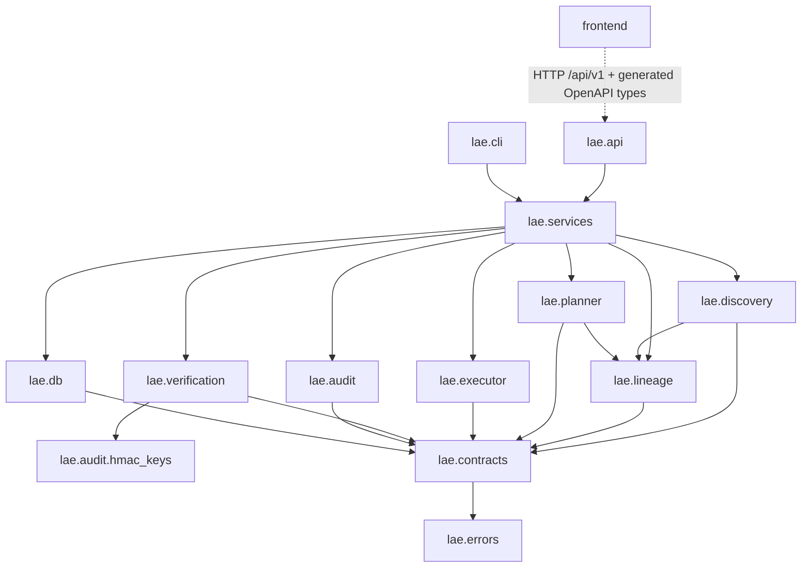

# Module Contracts

Status: **DRAFT v0.1, awaiting approval**. These interfaces are **frozen once approved**. A change needs a Lead-approved edit to this file *before* code changes. Specialists code against these signatures, not against each other's internals.

---

## 1. Module dependency diagram



**Allowed imports** (checked by an `import-linter` contract in CI):

| Module | May import |
|---|---|
| `contracts`, `errors`, `config` | stdlib, pydantic-settings (config only) |
| `audit` | contracts, errors, `cryptography` |
| `lineage` | contracts, errors, `networkx`, audit.canonical (hashing only) |
| `discovery` | contracts, errors, lineage, `sqlglot`, audit.canonical / audit.hmac_keys (hashing only) |
| `planner` | contracts, errors, lineage, audit.canonical / audit.hmac_keys (hashing only) |
| `executor` | contracts, errors |
| `verification` | contracts, errors, audit.hmac_keys, lineage (`RecordDiscoveryResult`, `RecordGraph` types) |
| `db` | contracts, errors, config, SQLAlchemy, psycopg, pgvector |
| `services` | everything above |
| `api` | services, contracts, errors, config, FastAPI |

Domain modules (`discovery`, `lineage`, `planner`, `executor`, `verification`, `audit`) **never** import `lae.db`, `lae.services`, `lae.api`, SQLAlchemy ORM, or FastAPI. They receive DB access only through the **ports** in §3.

---

## 2. Shared contract types (`lae.contracts`), owned by the Lead

All are `@dataclass(frozen=True, slots=True)`. Collections are `tuple`s so instances are hashable and immutable. Enums are `StrEnum` with values exactly as in database_schema.md.

```python
# lae/contracts/types.py
@dataclass(frozen=True, slots=True, order=True)
class TableRef:
    schema: str
    name: str
    def qualified(self) -> str: return f"{self.schema}.{self.name}"
    @classmethod
    def parse(cls, qualified: str) -> "TableRef": ...

@dataclass(frozen=True, slots=True, order=True)
class ColumnRef:
    table: TableRef
    column: str

KeyValue = int | str            # PK values restricted to int/str in v1 (uuid → str)

@dataclass(frozen=True, slots=True, order=True)
class RecordKey:
    table: TableRef
    columns: tuple[str, ...]    # ordered PK columns (or predicate columns if PredicateKey)
    values: tuple[KeyValue, ...]
    is_predicate: bool = False  # True for tables without PK: matches all rows WHERE columns = values

@dataclass(frozen=True, slots=True)
class ColumnInfo:  name: str; ordinal: int; data_type: str; is_nullable: bool

@dataclass(frozen=True, slots=True)
class TableInfo:
    ref: TableRef; kind: TableKind; columns: tuple[ColumnInfo, ...]
    primary_key: tuple[str, ...]; estimated_rows: int | None; definition_sql: str | None

@dataclass(frozen=True, slots=True)
class CatalogSnapshot:
    tables: Mapping[TableRef, TableInfo]   # use types.MappingProxyType
    schemas: tuple[str, ...]
    fingerprint: str                       # sha256 hex of canonical catalog
    def table(self, ref: TableRef) -> TableInfo: ...   # raises UnknownTableError
    def column(self, ref: ColumnRef) -> ColumnInfo: ... # raises UnknownColumnError

@dataclass(frozen=True, slots=True)
class RelationshipEdge:
    edge_id: UUID; level: LineageLevel; origin: EdgeOrigin
    source: TableRef; target: TableRef
    source_columns: tuple[str, ...]; target_columns: tuple[str, ...]
    transform: Transform; traceability: Traceability; status: EdgeStatus
    on_delete: OnDeleteAction | None = None
    constraint_name: str | None = None
    confidence: float = 1.0
    artifact_id: UUID | None = None
    details: Mapping[str, Any] = field(default_factory=dict)

@dataclass(frozen=True, slots=True)
class ArtifactDefinition:
    artifact_id: UUID; name: str; kind: ArtifactKind; target: TableRef
    definition_sql: str | None; refresh_strategy: RefreshStrategy
    key_mappings: tuple["KeyMapping", ...]

@dataclass(frozen=True, slots=True)
class KeyMapping:  source: TableRef; source_columns: tuple[str, ...]; target_columns: tuple[str, ...]

@dataclass(frozen=True, slots=True)
class SqlLineageResult:
    artifact_id: UUID; edges: tuple[RelationshipEdge, ...]
    traceability: Traceability; warnings: tuple[str, ...]

@dataclass(frozen=True, slots=True)
class PiiColumn:   column: ColumnRef; category: PiiCategory; strategy: ErasureStrategy
                   is_confirmed: bool; use_for_residual_scan: bool

@dataclass(frozen=True, slots=True)
class PolicySet:
    retention: Mapping[TableRef, RetentionAction]      # missing ⇒ DELETE
    pii: Mapping[ColumnRef, PiiColumn]
    def action_for(self, t: TableRef) -> RetentionAction: ...

@dataclass(frozen=True, slots=True)
class SubjectRoot: root_id: UUID; table: TableRef; key_columns: tuple[str, ...]
                   identifier_columns: tuple[str, ...]

@dataclass(frozen=True, slots=True)
class DiscoveryLimits: max_depth: int = 10; max_records: int = 100_000; batch_size: int = 1_000

@dataclass(frozen=True, slots=True)
class ResidualProbe: origin: ColumnRef; normalization: Normalization; value_hmac: str

@dataclass(frozen=True, slots=True)
class PlanItem:
    step_order: int; action: PlanAction; table: TableRef; lineage_level: LineageLevel  # RECORD | TABLE
    key_columns: tuple[str, ...]; record_keys: tuple[tuple[KeyValue, ...], ...]
    target_columns: tuple[str, ...]; expected_row_count: int | None
    depends_on: tuple[int, ...]; reason_edge_ids: tuple[UUID, ...]

@dataclass(frozen=True, slots=True)
class PlanConflict: code: ConflictCode; severity: Severity; table: TableRef; message: str

@dataclass(frozen=True, slots=True)
class ErasurePlan:
    plan_id: UUID; request_id: UUID; schema_fingerprint: str; record_set_hash: str
    items: tuple[PlanItem, ...]; conflicts: tuple[PlanConflict, ...]; plan_hash: str
    @property
    def is_blocked(self) -> bool: ...   # any BLOCKING conflict without resolution

@dataclass(frozen=True, slots=True)
class Approval: plan_id: UUID; plan_hash: str; approved_by: str; approved_at: datetime

@dataclass(frozen=True, slots=True)
class StepResult: step_order: int; status: StepStatus; rows_affected: int | None
                  expected_rows: int | None; duration_ms: int

@dataclass(frozen=True, slots=True)
class ExecutionResult: mode: ExecutionMode; status: ExecutionStatus
                       steps: tuple[StepResult, ...]; error: "ErrorInfo | None"

@dataclass(frozen=True, slots=True)
class CheckResult: check_type: CheckType; table: TableRef | None; column: str | None
                   step_order: int | None; passed: bool
                   observed: Mapping[str, Any]; expected: Mapping[str, Any]   # counts/hashes only

@dataclass(frozen=True, slots=True)
class VerificationReport: status: VerificationStatus; checks: tuple[CheckResult, ...]

@dataclass(frozen=True, slots=True)
class AuditEventRecord: seq: int; event_type: AuditEventType; entity_type: str
                        entity_id: UUID | None; actor: str; occurred_at: datetime
                        payload_canonical: str; prev_hash: str; event_hash: str

@dataclass(frozen=True, slots=True)
class EvidenceLeaf: table: str; key_hmac: str; action: PlanAction
                    check_types: tuple[CheckType, ...]; passed: bool
```

---

## 3. Ports (`lae.contracts.ports`): DB access for domain modules

Implemented by `lae.db.target` (Database Engineer). Faked in unit tests (`tests/fakes/`, QA).

```python
class CatalogReader(Protocol):
    def list_tables(self, schemas: Sequence[str]) -> list[TableInfo]: ...
    def list_foreign_keys(self, schemas: Sequence[str]) -> list[ForeignKeyRow]: ...
    def sample_values(self, col: ColumnRef, limit: int) -> list[KeyValue]: ...
    def count_contained(self, child: ColumnRef, parent: ColumnRef, sample: Sequence[KeyValue]) -> int: ...

@dataclass(frozen=True, slots=True)
class ForeignKeyRow:
    constraint_name: str; child: TableRef; parent: TableRef
    child_columns: tuple[str, ...]; parent_columns: tuple[str, ...]
    on_delete: OnDeleteAction; on_update: OnDeleteAction; deferrable: bool

class TargetReader(Protocol):
    """Read-only access to target schemas. All identifiers validated against the bound CatalogSnapshot."""
    def select_by_columns(self, table: TableRef, columns: Sequence[str],
                          values: Sequence[tuple[KeyValue, ...]],
                          select: Sequence[str]) -> list[dict[str, Any]]: ...
    def count_by_columns(self, table: TableRef, columns: Sequence[str],
                         values: Sequence[tuple[KeyValue, ...]]) -> int: ...
    def fetch_columns(self, table: TableRef, key_columns: Sequence[str], key: KeyTuple,
                      columns: Sequence[str]) -> dict[str, Any] | None: ...   # None if row absent
    def run_readonly_sql(self, sql: str, params: Mapping[str, Any]) -> list[tuple]: ...  # artifact definitions only
    def hmac_match_count(self, col: ColumnRef, digests: Sequence[str],
                         normalization: Normalization, hmac_key: bytes) -> int: ...
    def symmetric_difference_count(self, stored: TableRef, definition_sql: str) -> int: ...

class TargetWriter(TargetReader, Protocol):
    """Only constructed inside an executor transaction (role lae_executor)."""
    def lock_rows(self, table: TableRef, key_columns: Sequence[str], keys: Sequence[tuple]) -> int: ...
    def delete_rows(self, table: TableRef, key_columns: Sequence[str], keys: Sequence[tuple]) -> int: ...
    def update_columns(self, table: TableRef, key_columns: Sequence[str], keys: Sequence[tuple],
                       assignments: Mapping[str, ColumnAssignment]) -> int: ...
    def refresh_matview(self, table: TableRef) -> None: ...
    def recompute_table(self, table: TableRef, definition_sql: str) -> int: ...

class AuditSink(Protocol):
    """Appends an audit event within the caller's current transaction."""
    def append(self, event_type: AuditEventType, entity_type: str, entity_id: UUID | None,
               actor: str, payload: Mapping[str, Any]) -> AuditEventRecord: ...

RediscoverFn = Callable[[TargetReader], tuple[str, str]]   # -> (schema_fingerprint, record_set_hash)
```

---

## 4. Database module (`lae.db`), Database Engineer

| Function / class | Input | Output | Raises |
|---|---|---|---|
| `make_engine(settings, role: Literal["owner","reader","executor"])` | Settings | `Engine` | `ConfigurationError` |
| `session_scope(engine, *, isolation=None, read_only=False)` | context manager | `Session` (commit on success, rollback on exception) | propagates |
| `PgCatalogReader(conn)` | `Connection` | implements `CatalogReader` | `CatalogError` |
| `PgTargetReader(conn, catalog)` / `PgTargetWriter(conn, catalog)` | `Connection`, `CatalogSnapshot` | implements ports | `UnknownTableError`, `UnknownColumnError`, `TargetQueryError` |
| `PgAuditSink(session, chain: HashChain)` | Session | implements `AuditSink` (takes the advisory lock, reads head, inserts) | `AuditChainBroken` |
| Repositories: `SnapshotRepo`, `ArtifactRepo`, `PolicyRepo`, `RequestRepo`, `PlanRepo`, `ExecutionRepo`, `VerificationRepo`, `AuditRepo`, `EvidenceRepo`, `BenchmarkRepo` | Session | ORM ↔ contract conversion (`to_contract()`, `from_contract()`) | `NotFoundError` |
| `db/fixtures/generator.py: generate(conn, scale: ScaleParams, seed: int) -> GroundTruth` | | writes `app` data + `ground_truth.json` | |

Rules: every SQL identifier goes through `quote_ident(TableRef|ColumnRef)` after catalog validation. Batches use `WHERE (c1,…,cn) IN (VALUES (%s,…),…)` with ≤ `batch_size` tuples. No method builds SQL from untrusted strings, except `run_readonly_sql`, which only accepts registered artifact definitions and runs under `SET TRANSACTION READ ONLY`.

---

## 5. Discovery module (`lae.discovery`), Lineage Discovery Engineer

| Function | Input | Output | Raises | Notes |
|---|---|---|---|---|
| `read_catalog(reader, schemas)` | `CatalogReader`, `Sequence[str]` | `CatalogSnapshot` | `CatalogError` | Fingerprint via `audit.canonical` |
| `discover_foreign_keys(reader, catalog)` | | `list[RelationshipEdge]` (TABLE + COLUMN level) | `CatalogError` | Composite FKs are kept ordered |
| `extract_sql_lineage(artifact, catalog)` | `ArtifactDefinition`, `CatalogSnapshot` | `SqlLineageResult` | **never raises for bad SQL**: returns `OPAQUE` + warnings. `UnknownTableError` only for an unknown *target* | Pure, no I/O |
| `artifacts_from_catalog(catalog)` | | `list[ArtifactDefinition]` (auto-registered views/matviews) | | |
| `infer_relationships(catalog, reader, *, threshold=0.95, sample=1000)` | | `list[RelationshipEdge]` (`INFERRED`, `SUGGESTED`) | | Never `CONFIRMED` |
| `suggest_pii(catalog)` | | `list[PiiColumn]` (`HEURISTIC`, unconfirmed) | | Name + type patterns |
| `discover_records(graph, root, subject_key, reader, limits, policies)` | `LineageGraph`, `SubjectRoot`, `tuple[KeyValue,...]`, `TargetReader`, `DiscoveryLimits`, `PolicySet` | `RecordDiscoveryResult(record_graph, affected_artifacts: dict[TableRef, Traceability], warnings)` | `SubjectNotFoundError`, `DiscoveryLimitExceeded` | Only `CONFIRMED` edges. Downstream only |
| `capture_residual_probes(root, subject_key, record_graph, reader, policies, hmac)` | | `list[ResidualProbe]` | | Reads identifier columns **once** and keeps only the HMACs |

---

## 6. Lineage graph module (`lae.lineage`), Graph Engineer

```python
def build_lineage_graph(catalog: CatalogSnapshot, edges: Iterable[RelationshipEdge],
                        pii: Mapping[ColumnRef, PiiColumn] = {}) -> LineageGraph
    # raises GraphIntegrityError if an edge references a table/column not in catalog

class LineageGraph:
    catalog: CatalogSnapshot
    def table_view(self, statuses: frozenset[EdgeStatus] = {CONFIRMED}) -> nx.MultiDiGraph
    def column_view(self, statuses=...) -> nx.MultiDiGraph
    def downstream(self, table: TableRef, statuses=...) -> list[RelationshipEdge]   # TABLE level, deterministic order
    def upstream(self, table: TableRef, statuses=...) -> list[RelationshipEdge]
    def column_edges_for(self, table_edge: RelationshipEdge) -> list[RelationshipEdge]
    def reachable_from(self, table: TableRef) -> set[TableRef]
    def table_cycles(self) -> list[list[TableRef]]
    def artifact_order(self, artifacts: Iterable[TableRef]) -> list[TableRef]   # topological, raises GraphIntegrityError on cycle
    def to_node_link(self, level: LineageLevel) -> dict                         # API/UI shape (GraphOut)

class RecordGraph:
    def add_root(self, key: RecordKey) -> None
    def add_dependency(self, parent: RecordKey, child: RecordKey, edge_id: UUID, role: RecordRole) -> bool  # True if child new
    def nodes(self) -> Iterable[tuple[RecordKey, RecordAttrs]]
    def edges(self) -> Iterable[tuple[RecordKey, RecordKey, UUID]]
    def by_table(self) -> dict[TableRef, list[RecordKey]]                        # sorted
    def deletion_order(self, nullable: Callable[[UUID], bool]) -> DeletionOrder
        # DeletionOrder(order: list[RecordKey], break_edges: list[(parent, child, edge_id)])
        # raises GraphIntegrityError(code="UNBREAKABLE_CYCLE") if an SCC has no nullable edge
    def record_set_hash(self) -> str                                             # sha256 of sorted canonical keys
    def to_node_link(self, key_hmac: Callable[[RecordKey], str]) -> dict
```

```python
@dataclass(frozen=True, slots=True)
class RecordAttrs:  role: RecordRole; depth: int; via_edge_ids: tuple[UUID, ...]

@dataclass(frozen=True, slots=True)
class RecordDiscoveryResult:          # lives in lae.lineage (it holds a RecordGraph);
    record_graph: RecordGraph         # produced by discovery, consumed by planner + verification
    affected_artifacts: Mapping[TableRef, Traceability]
    warnings: tuple[str, ...]
```

Accepted refinements (change request graph-engineer-1): `pii: … | None = None`. `DeletionOrder` uses tuples. Optional `statuses` on `reachable_from`/`table_cycles`/`to_node_link` (node-link defaults to all statuses). **COLUMN-level edges are always single-pair.** Re-visited records keep the most protective role. Unknown tables in queries raise `UnknownTableError`.

Determinism requirement: all outputs are sorted (by `TableRef`, then key values) so that hashes are reproducible across runs and platforms.

---

## 7. Erasure planner and execution engine, Erasure Engine Engineer

### 7.1 `lae.planner`
| Function | Input | Output | Raises |
|---|---|---|---|
| `build_plan(request_id, discovery, lineage, policies, artifacts, *, plan_id)` | `UUID`, `RecordDiscoveryResult`, `LineageGraph`, `PolicySet`, `Sequence[ArtifactDefinition]` | `ErasurePlan` (with conflicts. Never raises for conflicts) | `GraphIntegrityError` only for internal inconsistency |
| `compute_plan_hash(plan_without_hash)` | | `str` | |
| `detect_conflicts(...)` | | `list[PlanConflict]` | |
| `check_transition(current: PlanStatus, target: PlanStatus)` | | `None` | `InvalidStateTransition` |

### 7.2 `lae.executor`
```python
def execute_plan(plan: ErasurePlan, approval: Approval, writer: TargetWriter,
                 rediscover: RediscoverFn, audit: AuditSink, mode: ExecutionMode,
                 *, clock: Callable[[], datetime]) -> ExecutionResult
```
- Preconditions: `not plan.is_blocked`, `approval.plan_hash == plan.plan_hash`. Otherwise `PlanBlockedError` / `PlanHashMismatch`.
- Drift: `rediscover(writer) != (plan.schema_fingerprint, plan.record_set_hash)` → `StalePlanError`.
- Per step: `rows != expected_row_count` → `RowCountMismatch(step_order, expected, actual)`.
- **The executor never commits or rolls back.** The service owns the transaction. The executor raises, and the service rolls back, records `FAILED`/`ROLLED_BACK` in a *new* transaction, and appends the audit event. For `DRY_RUN` the service always rolls back.
- Idempotency (one committed LIVE run per plan) is enforced by the service + unique index → `AlreadyExecutedError`.

---

## 8. Verification and cryptographic audit, Verification & Cryptography Engineer

### 8.1 `lae.verification`
```python
def verify_execution(plan: ErasurePlan, execution: ExecutionResult, reader: TargetReader,
                     rediscover_records: Callable[[TargetReader], RecordDiscoveryResult],
                     artifacts: Sequence[ArtifactDefinition], probes: Sequence[ResidualProbe],
                     scan_columns: Sequence[ColumnRef], hmac_key: bytes,
                     policies: PolicySet) -> VerificationReport
```
- Raises `VerificationError` only if checks *cannot run* (for example, a DB error), which gives status `ERROR`. Failing checks are data (`passed=False`), not exceptions.
- `scan_columns` = all text-like columns of all target tables. The service computes it from the catalog.
- Returns `residual_hits` inside the `RESIDUAL_VALUE_SCAN` check's `observed` as `[{table, column, count}]`.

### 8.2 `lae.audit`
| Function / class | Signature | Raises |
|---|---|---|
| `canonical_json(obj) -> bytes` | dict/list/str/int/bool/None/Decimal/UUID/datetime | `CanonicalizationError` (floats, NaN, non-str keys, naive datetimes) |
| `sha256_hex(data: bytes) -> str` | | |
| `HmacKeyring(key: bytes).digest(value, normalization) -> str` | | `ConfigurationError` if key < 32 bytes |
| `HashChain.genesis() -> str`; `HashChain.next_hash(prev_hash, seq, event_type, payload_canonical) -> str` | pure | |
| `verify_chain(events: Iterable[AuditEventRecord], *, expected_start_prev=GENESIS) -> ChainVerification` | pure | never raises. Returns `first_invalid_seq` |
| `MerkleTree.build(leaves: Sequence[EvidenceLeaf]) -> MerkleTree`; `.root`; `.proof(i) -> MerkleProof` | pure | `ValueError` on index |
| `verify_proof(leaf, proof, root) -> bool` | pure | |
| `Signer.load(path) / Signer.generate() / .sign(data) -> str(b64) / .public_key_pem / .key_id` | | `SignatureError` |
| `verify_signature(public_key_pem, data, signature_b64) -> bool` | | |
| `build_evidence(plan, execution, verification, leaves, chain_anchor, signer, issued_at) -> EvidenceBundle` | | |
| `verify_evidence_offline(bundle_json, public_key_pem, leaves_json=None, chain_json=None) -> EvidenceVerification` | **no DB, no network** | |

Golden test vectors (fixed inputs → fixed hashes and signatures with a fixed test key) are committed in `backend/tests/unit/audit/vectors/` and must never change silently.

---

## 9. FastAPI, owned by the Lead

Prefix `/api/v1`. All handlers are thin: validate → call a service → map to `*Out`.

| Method | Path | Request | Response | Service call |
|---|---|---|---|---|
| GET | `/health` | | `{status, db, pgvector, pgcrypto}` | |
| POST | `/snapshots` | `SnapshotCreate` | 201 `SnapshotOut` | `SnapshotService.create` |
| GET | `/snapshots` · `/snapshots/{id}` | | `list[SnapshotOut]` · `SnapshotOut` | |
| GET | `/snapshots/{id}/graph?level=TABLE\|COLUMN&include=SUGGESTED` | | `GraphOut` | |
| PATCH | `/lineage-edges/{id}` | `EdgeStatusUpdate` | `GraphEdgeOut` | only `INFERRED` edges |
| GET/POST | `/artifacts` | `ArtifactCreate` | `ArtifactOut` | |
| PUT/DELETE | `/artifacts/{id}` | | `ArtifactOut` / 204 (soft delete) | |
| GET | `/pii-classifications` · POST `/pii-classifications/suggest` | | `list[…Out]` | |
| PUT | `/pii-classifications/{id}` | `PiiClassificationUpdate` | `PiiClassificationOut` | |
| GET/POST | `/subject-roots` | | | |
| GET/PUT | `/retention-policies` | | | |
| POST | `/erasure-requests` | `ErasureRequestCreate` | 201 `ErasureRequestOut` | |
| GET | `/erasure-requests` · `/erasure-requests/{id}` | | | |
| POST | `/erasure-requests/{id}/plans` | `PlanCreate` | 201 `PlanOut` | discover + plan |
| GET | `/plans/{id}` · `/plans/{id}/record-graph` | | `PlanOut` · `RecordGraphOut` | |
| POST | `/plans/{id}/conflicts/{cid}/resolve` | `ConflictResolve` | `PlanOut` (hash recomputed) | |
| POST | `/plans/{id}/approve` | `PlanApprove` | `PlanOut` | |
| POST | `/plans/{id}/executions` | `ExecutionCreate` | 201 `ExecutionOut` | |
| GET | `/executions/{id}` | | `ExecutionOut` | |
| POST | `/executions/{id}/verifications` | | 201 `VerificationOut` | |
| GET | `/verifications/{id}` | | `VerificationOut` | |
| POST | `/plans/{id}/evidence` · GET `/evidence/{id}` | | `EvidenceOut` | issue (then purge) / fetch |
| GET | `/evidence/{id}/proof?leaf_index=n` | | `MerkleProofOut` | |
| GET | `/evidence/{id}/download` | | `application/json` canonical bundle + leaves | |
| GET | `/audit/events?after_seq=&limit=` | | `list[AuditEventOut]` | |
| POST | `/audit/verify-chain` | | `ChainVerificationOut` | |
| GET | `/signing-keys` | | public keys | |
| GET | `/benchmarks/runs?scenario=` | | `list[BenchmarkRunOut]` | |

**Exception → HTTP mapping** (`lae/api/errors.py`, body is always `ErrorEnvelope`):

| Exception (`lae.errors`) | HTTP | `code` |
|---|---|---|
| `NotFoundError` | 404 | `NOT_FOUND` |
| `ValidationError` (domain), `UnknownTableError`, `UnknownColumnError`, `CanonicalizationError` | 422 | `INVALID_INPUT` / `UNKNOWN_TABLE` / … |
| `InvalidStateTransition` | 409 | `INVALID_STATE` |
| `PlanBlockedError` | 409 | `PLAN_BLOCKED` |
| `PlanHashMismatch` | 409 | `PLAN_HASH_MISMATCH` |
| `StalePlanError` | 409 | `STALE_PLAN` |
| `AlreadyExecutedError` | 409 | `ALREADY_EXECUTED` |
| `RowCountMismatch` | 409 | `ROW_COUNT_MISMATCH` |
| `SubjectNotFoundError` | 404 | `SUBJECT_NOT_FOUND` |
| `DiscoveryLimitExceeded` | 413 | `DISCOVERY_LIMIT` |
| `SerializationConflict` | 503 (+ `Retry-After`) | `SERIALIZATION_CONFLICT` |
| `AuditChainBroken`, `SignatureError` | 500 | `AUDIT_INTEGRITY` |
| `ConfigurationError` | 500 | `CONFIGURATION` |
| any other `LaeError` / unhandled | 500 | `INTERNAL` (no stack trace or values in body) |

### 9.1 Exception hierarchy (`lae/errors.py`)

```
LaeError(code: str, message: str, details: dict)
├── ConfigurationError
├── NotFoundError ── SubjectNotFoundError
├── ValidationError ── UnknownTableError, UnknownColumnError, CanonicalizationError
├── CatalogError
├── DiscoveryLimitExceeded
├── GraphIntegrityError
├── PlanError ── InvalidStateTransition, PlanBlockedError, PlanHashMismatch
├── ExecutionError ── StalePlanError, RowCountMismatch, AlreadyExecutedError, SerializationConflict, TargetQueryError
├── VerificationError
└── AuditError ── AuditChainBroken, SignatureError
```
`details` must never contain personal data values. Tables, columns, counts and HMACs only.

---

## 10. React frontend contract, Frontend Engineer

- Consumes **only** `/api/v1` through `src/api/client.ts`, typed by `src/api/schema.d.ts` generated with `npm run gen:api` (reads `http://localhost:8000/openapi.json` or the committed `docs/openapi.json` snapshot).
- One TanStack Query hook per endpoint in `src/api/hooks.ts`. Mutations invalidate the affected query keys.
- Errors render `ErrorEnvelope.error.code` + `message`. `409 STALE_PLAN` offers a "Re-plan" action.
- Approval UI shows the full `plan_hash` and the counts per action. The approve button sends the hash *as received*.
- The UI never sends raw subject keys anywhere except `POST /erasure-requests`.
- Graph rendering: `GraphOut`/`RecordGraphOut` → React Flow nodes/edges via `src/lib/graphAdapter.ts` (pure, unit-tested). Dagre layout, left → right.

---

## 11. Service layer (`lae.services`), Lead (integration)

Each use case runs in an explicit transaction and appends exactly one audit event per state change **in the same transaction**:

| Service method | Transaction | Audit event |
|---|---|---|
| `SnapshotService.create(schemas)` | owner/reader, READ COMMITTED | `SNAPSHOT_CREATED` |
| `ErasureService.create_request` | | `REQUEST_RECEIVED` (payload: `subject_key_hmac`) |
| `ErasureService.create_plan(request_id, opts)` | discovery in REPEATABLE READ READ ONLY, then a write txn | `PLAN_CREATED` (`plan_hash`, counts) |
| `ErasureService.approve(plan_id, approved_by, plan_hash)` | | `PLAN_APPROVED` |
| `ErasureService.execute(plan_id, mode)` | executor role, SERIALIZABLE | `EXECUTION_STARTED` (separate txn), `EXECUTION_COMMITTED` (same txn as data) or `EXECUTION_ROLLED_BACK`/`FAILED` |
| `ErasureService.verify(execution_id)` | reader, REPEATABLE READ READ ONLY + write txn | `VERIFICATION_COMPLETED` |
| `EvidenceService.issue(plan_id)` | | `EVIDENCE_ISSUED`, then `SUBJECT_DATA_PURGED` |
| `AuditService.verify_chain()` / `export_head()` | | `CHAIN_HEAD_EXPORTED` |
