# LAE technical walkthrough (code at HEAD `9b00d54`)

This is a code-level walkthrough of the **Lineage-Aware Erasure Engine (LAE)**. It is meant for the project team, to prepare for a viva and for independent validation. It describes what the code at commit `9b00d54` does. Where a design document says something else, the code wins, and the difference is listed in [Appendix B](#appendix-b-doccode-discrepancies).

Every file path, identifier, constant, enum value, error code, endpoint and test name below was checked against the repository. The examples in boxes marked *executed* were produced by running the pure functions with `.venv\Scripts\python.exe` (scripts kept outside the repository). No database was contacted and no server was started. All keys in the examples are **fixed test keys**: `bytes(range(32))` for HMAC, `b"k"*32` as an HKDF master key, and the documented test-vector signing key `backend/tests/unit/audit/vectors/test_signing_key.pem`. None of them is a real secret.

---

## Contents

0. [How to read this document](#0-how-to-read-this-document) · [Glossary](#glossary)
1. [Repository structure](#1-repository-structure)
2. [Backend modules, layering and ports](#2-backend-modules-layering-and-ports)
3. [Database schema](#3-database-schema)
4. [SQL lineage extraction and graph construction](#4-sql-lineage-extraction-and-graph-construction)
5. [BFS, DFS and topological ordering](#5-bfs-dfs-and-topological-ordering)
6. [Record-level ownership resolution](#6-record-level-ownership-resolution)
7. [Erasure planning and execution](#7-erasure-planning-and-execution)
8. [Transactions and concurrency](#8-transactions-and-concurrency)
9. [Residual PII detection](#9-residual-pii-detection)
10. [Precision, recall, F1, coverage and benchmark calculations](#10-precision-recall-f1-coverage-and-benchmark-calculations)
11. [Hash chain, Merkle tree, Ed25519, canonical JSON, HKDF](#11-hash-chain-merkle-tree-ed25519-canonical-json-hkdf)
12. [Offline evidence verification](#12-offline-evidence-verification)
13. [API, error mapping and frontend integration](#13-api-error-mapping-and-frontend-integration)
14. [Security architecture and trust boundaries](#14-security-architecture-and-trust-boundaries)
15. [Limitations and future possibilities](#15-limitations-and-future-possibilities)
- [Appendix A: function reference index](#appendix-a-function-reference-index)
- [Appendix B: doc/code discrepancies](#appendix-b-doccode-discrepancies)

---

## 0. How to read this document

**Statement labels.** Every claim about behaviour carries one of three labels:

| Label | Meaning |
|---|---|
| **[IMPL]** | Implemented at HEAD **and** covered by at least one named test. |
| **[LIMIT]** | A documented limitation: the code deliberately does not do this, or does it only partly. The source is given (a doc section, a change request (CR), or the code). |
| **[FUTURE]** | A future possibility. It is **not implemented**. It is listed only so that nobody mistakes it for a feature. |

Plain prose without a label is explanation (how something works), not a new claim.

**Function entries** use one template:

> **`function(signature) -> result`** · `file`
> - *Purpose* · *In → Out* · *Algorithm* · *Math* (if any) · *Example* · *Tests*

Short helpers are grouped in tables with the same columns. Test names are given as `<path under backend/tests>::<test function>`. Frontend tests are given as `<file under frontend/src> › "<it title>"`.

**Paths.** Backend source paths are relative to `backend/src/` unless they start with `backend/`, `db/`, `benchmarks/`, `frontend/` or `docs/`.

**How to validate a claim yourself.** Open the file named next to it. For tests, run `pytest backend\tests -m unit -k <test name>` (unit tests need no database). Integration and e2e tests need the local PostgreSQL container (see `README.md`).

### Glossary

| Term | Meaning in LAE (code reference) |
|---|---|
| **Subject** | The data subject whose data is erased. Configured as a *subject root*: one table and its key columns (`SubjectRoot` in `lae/contracts/types.py`, table `lae.subject_root`). The demo root is `app.customer` with key `id` and identifier columns `email`, `phone`. |
| **Subject key** | The primary-key value(s) of the subject's row, e.g. `(42,)`. Stored raw only in `erasure_request.subject_key` until it is purged. |
| **Record key** | `RecordKey(table, columns, values, is_predicate)`: one concrete row. If `is_predicate=True`, it addresses every row `WHERE columns = values` (tables without a primary key). |
| **Key HMAC** | `HMAC-SHA256(audit-identity subkey, canonical_json(RecordKey.as_canonical()))`, produced by `HmacKeyring.key_digest`. This is the only form in which a record identity leaves the target schema. |
| **Lineage edge** | `RelationshipEdge`: a TABLE- or COLUMN-level dependency `source → target` (upstream → downstream) with an origin (`DECLARED_FK`, `SQL_LINEAGE`, `REGISTERED_MAPPING`, `INFERRED`), a transform, a traceability and a status. |
| **Traceability** | Whether the subject's rows can be followed across an edge: `KEY_PRESERVING` (a key survives), `AGGREGATE` (rows are collapsed, so only a refresh or recompute helps), `OPAQUE` (unknown). |
| **Edge status** | `CONFIRMED` (traversed), `SUGGESTED` (shown for review only, never traversed), `REJECTED`. |
| **Artifact** | A derived object: VIEW, MATERIALIZED_VIEW, DERIVED_TABLE, EMBEDDING_TABLE, CACHE or EXTERNAL (`ArtifactKind`). |
| **Record role** | `SUBJECT_ROOT`, `OWNED`, `REFERENCING_OTHER_SUBJECT`, `SHARED` (§6). |
| **Schema fingerprint** | `canonical_hash` of a sorted description of all tables and FKs (`catalog_fingerprint`). Used for drift detection. |
| **Record-set hash** | `canonical_hash` of the sorted list of all record keys discovered for the subject (`RecordGraph.record_set_hash`). Used for drift detection. |
| **Plan hash** | `canonical_hash(plan_hash_payload(plan))` (§7.6). Approval must echo it exactly. |
| **Drift** | The schema fingerprint or record-set hash recomputed inside the execution transaction differs from the plan's. Raises `StalePlanError` (`STALE_PLAN`). |
| **Probe** | `ResidualProbe(origin, normalization, value_hmac)`: an HMAC of one of the subject's identifier values, captured at planning time, used by the residual scan. |
| **Normalization** | `EXACT`, `LOWER_TRIM` (ASCII trim + ASCII lowercase), `DIGITS_ONLY` (`Normalization`). |
| **Residual scan** | `RESIDUAL_VALUE_SCAN`: a lineage-independent, in-database HMAC search of all text-like columns for the probe digests (§9). |
| **Coverage** | `verified_artifacts / required_artifacts` (an exact `Fraction`). Required = every plan item. See §10 for the two different definitions (verification vs. benchmark). |
| **Outcome** | `VERIFIED` (no failed check and coverage = 1), `PARTIAL`, `FAILED` (`VerificationOutcome`). |
| **Envelope** | The `{"entity_type", "entity_id", "actor", "occurred_at"}` object that `PgAuditSink` embeds inside `payload_canonical`, so these columns are covered by the event hash. |
| **Evidence bundle** | A signed, canonical JSON document summarising plan, execution, verification, Merkle root and chain anchor (§11–12). |
| **Leaf** | `EvidenceLeaf(table, key_hmac, action, check_types, passed)`: one per record (or one per table-level item). |
| **Chain anchor** | `(seq, event_hash)` of an audit event. Inside a bundle it is the head at issue time. An *exported anchor* (`export_chain_head`) is a signed file kept outside the database. |
| **Four-eyes** | `Settings.require_four_eyes` (default `True`): the approver may not execute the plan LIVE. |
| **Dry run** | `ExecutionMode.DRY_RUN`: the same reads and writes as LIVE, in a transaction that is always rolled back. |

---

## 1. Repository structure

Tracked files only (`git ls-files`, 293 files). `node_modules`, `.venv`, caches and gitignored output (`var/`, `evidence_out/`, `secrets/`, `db/fixtures/out/`, `benchmarks/results/raw/`) are left out.

```text
DBMS_PROJECT/
├── CLAUDE.md                     project rules for the coding agents (design-time; see Appendix B)
├── README.md                     how to run locally, demo scenario, measured results
├── .env.example                  names of LAE_* settings (no real values)
├── docker-compose.yml            pgvector/pgvector:pg16 on 127.0.0.1:5433
├── .github/workflows/ci.yml      CI quality gates (written, not executed locally)
├── .claude/agents/*.md           role prompts of the specialist agents that built the code
├── backend/
│   ├── pyproject.toml            deps (sqlglot pinned 30.29.0), pytest markers, ruff, mypy, import-linter
│   ├── alembic.ini
│   ├── migrations/
│   │   ├── env.py, script.py.mako
│   │   └── versions/
│   │       ├── 0001_baseline.py            every lae table, CHECKs, indexes, triggers, lae_reader grants
│   │       ├── 0002_security_hardening.py  lae_app role, lae.grant_app_role(), relaxed approval CHECK
│   │       └── 0003_audit_chain_linear.py  UNIQUE index uq_audit_event_prev_hash
│   ├── src/lae/
│   │   ├── contracts/            frozen shared types: enums.py, types.py, ports.py (Protocols)
│   │   ├── errors.py             LaeError hierarchy with stable error codes
│   │   ├── config.py             Settings (env prefix LAE_), SecretStr secrets
│   │   ├── discovery/            catalog, FK edges, SQLGlot lineage, inference, PII heuristics, record BFS, probes
│   │   ├── lineage/              LineageGraph (table/column), RecordGraph (rows), facade api.py
│   │   ├── planner/              build_plan, ordering, hashing, state machine, PII-free texts
│   │   ├── executor/             execute_plan (approval binding, drift, locks, rowcount asserts)
│   │   ├── verification/         checks, residual scan, rediscovery, outcome, metrics
│   │   ├── audit/                canonical JSON, HMAC keyring, hash chain, Merkle, Ed25519, evidence, anchors
│   │   ├── db/                   ORM models, repositories, PG adapters for the ports, audit sink, SQL helpers
│   │   ├── services/             runtime (keys, engines), pipeline (workflow + transactions), impl (API mapping), facade
│   │   ├── api/                  FastAPI app (app.py), Pydantic schemas (schemas.py), ASGI entry (main.py)
│   │   └── cli.py                Typer CLI `lae`
│   └── tests/
│       ├── conftest.py           test DB URL fixture
│       ├── unit/                 no DB: contracts, audit (+ golden vectors), discovery, lineage, planner, executor, verification, api, db/_sql
│       ├── integration/          real PostgreSQL: db, discovery, verification, services
│       └── e2e/                  security/concurrency tests through API and DB
├── db/
│   ├── init/01_init.sql          first-start init: roles, dev/test databases, extensions, schemas
│   └── fixtures/
│       ├── app_schema.sql        demo target schema `app` (base tables)
│       ├── app_derived.sql       matviews customer_ltv, daily_revenue; CTAS customer_segment
│       └── generator.py          deterministic synthetic data + ground truth + lae config seeding
├── benchmarks/
│   ├── run.py                    benchmark driver and summarize()
│   ├── methods.py                ManualDeletion, FkOnlyDeletion, LaePipeline
│   ├── measure.py                independent SQL measurement (coverage, residual, damage)
│   ├── stats.py                  percentile / describe
│   ├── dbsetup.py, environment.py, report.py
│   └── results/summary.{md,csv,json}, charts/*.svg   committed measured results
├── docs/                         design docs, change_requests/, openapi.json, screenshots/
├── frontend/
│   ├── package.json, vite.config.ts (dev proxy /api → :8000), tsconfig*.json, eslint.config.js
│   ├── e2e/smoke.mjs, e2e/cdp.mjs  dependency-free browser smoke test
│   └── src/
│       ├── api/                  client.ts, credentials.ts, hooks.ts, schema.d.ts (generated), types.ts (aliases)
│       ├── lib/                  graphAdapter.ts (React Flow + dagre), format.ts
│       ├── components/           GraphView, EdgeReview, EdgeEvidencePanel, SettingsDialog, Badges, ...
│       ├── pages/                Dashboard, Requests, Lineage, Plan, Execution, Verification, Benchmarks
│       └── test/                 render helper, setup
└── scripts/                      setup.ps1/.sh, start-backend.ps1, start-frontend.ps1, check.ps1, create_test_dbs.py
```

### 1.1 System architecture

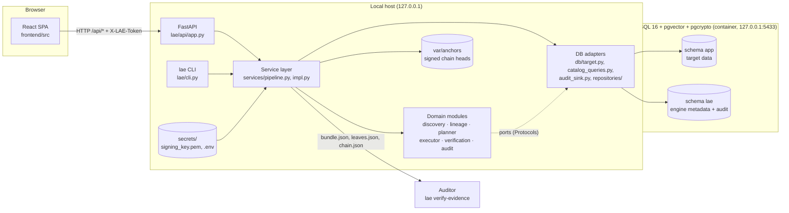

---

## 2. Backend modules, layering and ports

### 2.1 Layering enforced by import-linter

`backend/pyproject.toml` (`[tool.importlinter]`, `include_external_packages = true`) defines five *forbidden* contracts. `lint-imports` fails the build if any is broken. **[IMPL]** (run by `scripts/check.ps1` and `.github/workflows/ci.yml`).

| Contract name (verbatim) | Source modules | Forbidden imports |
|---|---|---|
| Domain modules never touch the DB layer, services, API, ORM or web framework | discovery, lineage, planner, executor, verification, audit | `lae.db`, `lae.services`, `lae.api`, `sqlalchemy`, `fastapi` |
| Contracts are the bottom layer | `lae.contracts`, `lae.errors` | every other `lae.*` package |
| Lineage graph is independent of discovery/planning/execution | `lae.lineage` | discovery, planner, executor, verification |
| Executor is independent of planner internals and discovery | `lae.executor` | discovery, planner, lineage, verification |
| Audit depends only on contracts, errors, cryptography and stdlib | `lae.audit` | discovery, lineage, planner, executor, verification, `networkx`, `sqlglot`, `pydantic` |

Allowed cross-domain imports that the rules permit and the code uses: discovery → lineage (`discovery/records.py` builds a `RecordGraph`), discovery → audit (hashing, HMAC), planner → lineage, verification → lineage (`RecordDiscoveryResult`), verification → audit (`HmacKeyring`). The executor gets the planner's hash function and texts only through arguments (`plan_hasher`, and it re-declares `DEFINITION_TOKEN`), because it may not import `lae.planner`.

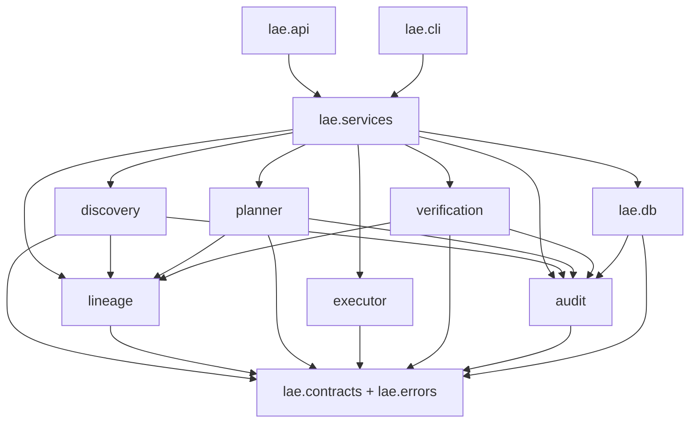

`lae.db` imports `lae.audit` (the audit sink uses `hashchain` and `canonical`). That is allowed: only the domain packages are restricted.

### 2.2 Ports (`lae/contracts/ports.py`)

Domain modules reach a database only through these `@runtime_checkable` Protocols. The PostgreSQL implementations are in `lae.db`. Unit tests use dict-backed fakes (`backend/tests/unit/planner/erasure_harness.py::FakeDB`, and fakes in the verification/discovery unit conftests).

| Port | Methods | PostgreSQL implementation |
|---|---|---|
| `CatalogReader` | `list_tables(schemas)`, `list_foreign_keys(schemas)`, `sample_values(col, limit)`, `count_contained(child, parent, sample)` | `lae/db/catalog_queries.py::PgCatalogReader` |
| `TargetReader` | `select_by_columns(table, columns, values, select)`, `count_by_columns`, `fetch_columns`, `run_readonly_sql`, `hmac_match_count(col, digests, normalization, hmac_key)`, `symmetric_difference_count(stored, definition_sql)` | `lae/db/target.py::PgTargetReader` |
| `TargetWriter` (extends TargetReader) | `lock_rows`, `delete_rows`, `update_columns(…, assignments)`, `refresh_matview`, `recompute_table` | `lae/db/target.py::PgTargetWriter` |
| `AuditSink` | `append(event_type, entity_type, entity_id, actor, payload) -> AuditEventRecord` | `lae/db/audit_sink.py::PgAuditSink` |
| `RediscoverFn` (type alias) | `Callable[[TargetReader], tuple[str, str]]` returning `(schema_fingerprint, record_set_hash)` | a closure in `services/pipeline._execute` |

`ForeignKeyRow` (also in `ports.py`) carries one declared FK: `constraint_name, child, parent, child_columns, parent_columns, on_delete, on_update, deferrable`.

**[IMPL]** Ports are runtime-checkable and the PG classes satisfy them: `unit/contracts/test_contracts.py::test_ports_are_runtime_checkable_protocols`, `integration/db/test_target.py::test_ports_implemented`, `integration/db/test_catalog_reader.py::test_implements_port`, `integration/db/test_audit_sink.py::test_implements_port`, `unit/executor/test_executor.py::test_fake_db_satisfies_target_writer_protocol`.

### 2.3 Module responsibilities

| Package / file | Responsibility |
|---|---|
| `lae/contracts/enums.py` | All `StrEnum`s. Values equal the DB `CHECK` lists (the migration builds its CHECKs from these enums). `ActionCategory`, `_ACTION_CATEGORY`, `UNVERIFIABLE_CATEGORIES`, `action_category()`. |
| `lae/contracts/types.py` | Frozen, slotted dataclasses: `TableRef`, `ColumnRef`, `RecordKey`, `ColumnInfo`, `TableInfo`, `CatalogSnapshot`, `RelationshipEdge`, `KeyMapping`, `ArtifactDefinition`, `SqlLineageResult`, `PiiColumn`, `PolicySet`, `SubjectRoot`, `DiscoveryLimits`, `ResidualProbe`, `PlanItem`, `PlanConflict`, `ErasurePlan`, `Approval`, `ColumnAssignment`, `ErrorInfo`, `StepResult`, `ExecutionResult`, `CheckResult`, `VerificationReport`, `AuditEventRecord`, `EvidenceLeaf`; `key_sort_key`. |
| `lae/errors.py` | `LaeError(message, code=…, details=…)` with a class-level `default_code`. `details` must never hold personal data. |
| `lae/config.py` | `Settings` (pydantic-settings, prefix `LAE_`), `get_settings()` (cached). |
| `lae/discovery/` | `catalog.py` (snapshot, fingerprint, drift), `foreign_keys.py`, `sql_lineage.py`, `artifacts.py`, `inference.py`, `pii.py`, `records.py` (record BFS + roles + probes), `_ids.py` (uuid5 namespaces). |
| `lae/lineage/` | `graph.py` (`LineageGraph`, `build_lineage_graph`, `edge_evidence`), `record_graph.py` (`RecordGraph`, `DeletionOrder`), `results.py` (`RecordDiscoveryResult`), `api.py` (thin facade). |
| `lae/planner/` | `planner.py` (`build_plan`, `detect_conflicts`, `pseudonym_columns`), `ordering.py` (`order_deletions`), `hashing.py`, `state.py`, `text.py`. |
| `lae/executor/executor.py` | `execute_plan`. Never commits. |
| `lae/verification/` | `engine.py` (`verify_execution`), `checks.py`, `residual.py`, `rediscovery.py`, `outcome.py`, `metrics.py`, `_common.py`. |
| `lae/audit/` | `canonical.py`, `hmac_keys.py`, `hashchain.py`, `merkle.py`, `signing.py`, `evidence.py`, `anchor.py`. Pure, no I/O except `Signer.load/save`. |
| `lae/db/models/` | SQLAlchemy 2.0 ORM mirror of the migrations (`base.py` holds `NAMING_CONVENTION`: `ix_%(table_name)s_%(column_0_N_name)s`, `uq_…`, `ck_%(table_name)s_%(constraint_name)s`, `fk_%(table_name)s_%(column_0_name)s_%(referred_table_name)s`, `pk_%(table_name)s`). Parity is tested by `integration/db/test_migrations.py::test_models_and_migration_produce_identical_ddl` and `::test_metadata_matches_live_schema`. |
| `lae/db/repositories/` | Session-bound repositories (`SnapshotRepo`, `ArtifactRepo`, `PolicyRepo`, `RequestRepo`, `PlanRepo`, `ExecutionRepo`, `VerificationRepo`, `EvidenceRepo`, `SigningKeyRepo`, `AuditRepo`, `BenchmarkRepo`). They never commit and convert ORM rows ↔ contract types / `lae.db.records` dataclasses. |
| `lae/db/target.py`, `catalog_queries.py`, `audit_sink.py`, `_sql.py`, `engine.py` | Port adapters, SQL composition helpers, engines and `session_scope`. |
| `lae/services/runtime.py` | `Runtime` (engines, three HMAC subkeys, signer, clock, limits, anchor dir), `derive_subkey`, `configure_logging`. |
| `lae/services/pipeline.py` | The whole workflow with explicit transactions (§8). |
| `lae/services/impl.py` | `LaeServices`: maps pipeline results to API models; read-only queries. |
| `lae/services/facade.py` | `LaeServicesProtocol`, the interface the API depends on. |
| `lae/api/` | `create_app`, `STATUS_BY_CODE`, `_status_for_class`, auth dependency, Pydantic `_In` (`extra="forbid"`) / `_Out` models. |
| `lae/cli.py` | Typer commands: `db upgrade`, `db seed`, `keys generate`, `keys hmac`, `snapshot`, `erase`, `audit verify`, `audit export-head`, `audit export`, `verify-evidence`. |

### 2.4 Errors and codes (`lae/errors.py`)

| Class | `default_code` | Class | `default_code` |
|---|---|---|---|
| `LaeError` | `INTERNAL` | `PlanError` | `PLAN` |
| `ConfigurationError` | `CONFIGURATION` | `InvalidStateTransition` | `INVALID_STATE` |
| `NotFoundError` | `NOT_FOUND` | `PlanBlockedError` | `PLAN_BLOCKED` |
| `SubjectNotFoundError` | `SUBJECT_NOT_FOUND` | `PlanHashMismatch` | `PLAN_HASH_MISMATCH` |
| `ValidationError` | `INVALID_INPUT` | `ExecutionError` | `EXECUTION` |
| `UnknownTableError` | `UNKNOWN_TABLE` | `StalePlanError` | `STALE_PLAN` |
| `UnknownColumnError` | `UNKNOWN_COLUMN` | `RowCountMismatch(step_order, expected, actual)` | `ROW_COUNT_MISMATCH` |
| `CanonicalizationError` | `CANONICALIZATION` | `AlreadyExecutedError` | `ALREADY_EXECUTED` |
| `CatalogError` | `CATALOG` | `SerializationConflict` | `SERIALIZATION_CONFLICT` |
| `DiscoveryLimitExceeded` | `DISCOVERY_LIMIT` | `TargetQueryError` | `TARGET_QUERY` |
| `GraphIntegrityError` | `GRAPH_INTEGRITY` | `VerificationError` | `VERIFICATION` |
| `AuditError`, `AuditChainBroken`, `SignatureError` | `AUDIT_INTEGRITY` | `AuthError` (in `api/app.py`) | `UNAUTHORIZED` |

Codes passed explicitly at raise sites (not class defaults) include: `GraphIntegrityError` codes `DUPLICATE_TABLE`, `DUPLICATE_EDGE`, `UNKNOWN_EDGE`, `NOT_A_TABLE_EDGE`, `INVALID_ORDER`, `ARTIFACT_CYCLE`, `INVALID_LEVEL`, `UNKNOWN_PARENT`, `INVALID_ROLE`, `UNKNOWN_RECORD`, `UNBREAKABLE_CYCLE`, `UNKNOWN_RECORD_TABLE`, `EDGE_MISMATCH`; `PlanError` codes `CONFLICT_NOT_FOUND`, `CONFLICT_ALREADY_RESOLVED`, `CONFLICT_NOT_ACKNOWLEDGEABLE`, `INVALID_PLAN`, `MISSING_DEFINITION`; `ExecutionError` codes `STEP_FAILED`, `EXECUTION_FAILED`; `VerificationError` codes `NOT_VERIFIABLE`, `INVALID_HMAC_KEY`, `UNCHECKABLE_ITEM`, `AMBIGUOUS_ARTIFACT`, `INVALID_PROBE`, `CHECK_NOT_RUNNABLE`, `INVALID_READER_RESULT`.

**[IMPL]** `unit/contracts/test_contracts.py::test_errors_carry_codes_without_values`.

### 2.5 Configuration (`lae/config.py`)

`Settings` fields: `database_url`, `admin_url`, `reader_url`, `executor_url`, `target_schemas` (default `["app"]`, CSV accepted), `hmac_key: SecretStr | None`, `signing_key_path`, `api_token: SecretStr | None`, `require_four_eyes = True`, `statement_timeout_ms = 30_000`, `lock_timeout_ms = 5_000`.

Validators: `target_schemas` may not be empty and may never contain `"lae"` (the engine schema can never be an erasure target); `api_token` must have at least 24 characters. `hmac_key_bytes()` requires at least 32 bytes. `url_for(role)` maps `"owner"`, `"reader"`, `"executor"` (the last two fall back to `database_url`). **[IMPL]** `unit/contracts/test_contracts.py::test_settings_reject_engine_schema_and_short_hmac_key`.

`Runtime.from_settings` builds only the `owner` and `reader` engines. `executor_url` is accepted but never used to build an engine. **[LIMIT]** There is no separate executor DB role in use (Appendix B).

### 2.6 Runtime and HKDF subkeys (`lae/services/runtime.py`)

> **`derive_subkey(master: bytes, purpose: str) -> bytes`** · `services/runtime.py`
> - *Purpose:* domain-separated per-purpose keys (security review M3).
> - *In → Out:* master key bytes, ASCII purpose label → 32-byte key.
> - *Algorithm:* HKDF-SHA256 (RFC 5869) from `cryptography`, `salt=b"lae-hkdf-salt-v1"`, `info=purpose`, `length=32`.
> - *Math:* HKDF-Extract `PRK = HMAC(salt, master)`, HKDF-Expand `T(1) = HMAC(PRK, info ‖ 0x01)`, output = `T(1)` (32 bytes). Different `info` gives computationally independent keys.
> - *Example (executed, master = `b"k"*32`, test value):*
>   `lae/audit-identity/v1 → f32ea188a5172d27aa8ee226364a59727fd37ca8390b6144111341c3efe73ad5`
>   `lae/residual-probe/v1 → 21535832209d9befbc37416bf634804d96ba79efe5b2e844ca2231aec11d271d`
>   `lae/pseudonym/v1 → d67304b27528dd11295a2bdc35c0125367e5628a4fb44979121c81df94bcc08b`
> - *Tests:* `integration/services/test_security_hardening.py::test_hmac_subkeys_are_domain_separated` **[IMPL]**

`Runtime` fields: `keyring` (audit-identity subkey; **never sent to PostgreSQL**), `probe_keyring` + `probe_key` (residual-probe subkey; sent to PG as a bound parameter for in-DB HMAC), `pseudonym_key` (sent to PG by the writer for pseudonyms), `signer`, `clock = utc_now`, `limits = DiscoveryLimits()` (max_depth 10, max_records 100 000, batch_size 1 000), `anchor_dir = Path("var/anchors")`. `configure_logging` sets the `sqlglot` logger to ERROR (SQLGlot can echo SQL text) and `sqlalchemy.engine` to WARNING.

---

## 3. Database schema

Sources: `backend/migrations/versions/0001_baseline.py`, `0002_security_hardening.py`, `0003_audit_chain_linear.py`, the ORM in `lae/db/models/`, `db/init/01_init.sql`, `db/fixtures/app_schema.sql`, `db/fixtures/app_derived.sql`.

Conventions in `0001`: every table lives in schema `lae`; `id uuid DEFAULT gen_random_uuid()` primary keys (except `audit_event.seq` and `signing_key.key_id`); `*_at timestamptz DEFAULT now()`; enums are `text` + `CHECK (col IN (...))` built from `lae.contracts.enums` (so DB and Python cannot drift); hex hashes are `char(64)` with `CHECK (col ~ '^[0-9a-f]{64}$')` (named `ck_<table>_<col>_hex`). The migration starts with `CREATE EXTENSION IF NOT EXISTS pgcrypto` and `vector`.

### 3.1 ER diagram of schema `lae`

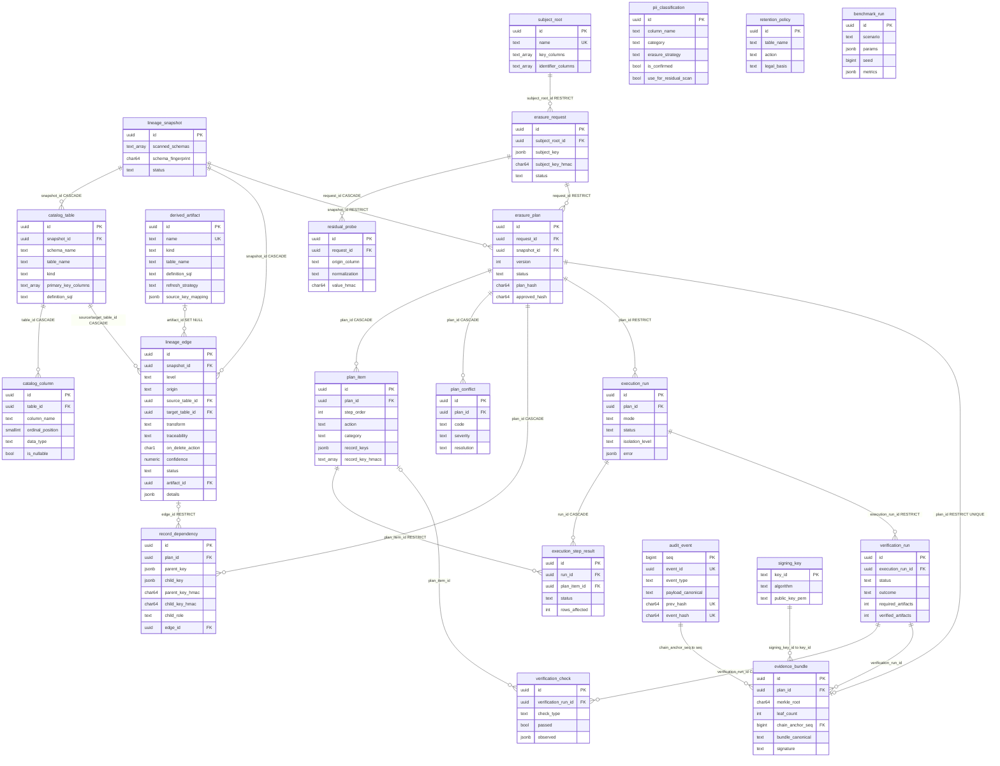

### 3.2 Table-by-table constraints

All **[IMPL]**: `integration/db/test_constraints.py` (`test_check_rejects`, `test_unique_rejects`, `test_pii_and_retention_and_probe_uniques`, `test_only_one_live_plan_but_superseded_allowed`, `test_fk_restrict_and_cascade`, `test_verification_run_requires_live_committed_execution`, `test_audit_event_is_append_only`, `test_audit_event_seq_is_generated_always`, `test_uuid_defaults`) and `integration/db/test_migrations.py` (`test_baseline_creates_every_table`, `test_constraint_names_follow_naming_convention`, `test_triggers_installed`, `test_reader_role_has_select_only`, `test_downgrade_then_upgrade_round_trip`).

| Table | PK | FKs (ON DELETE) | CHECK constraints | Unique / indexes |
|---|---|---|---|---|
| `lineage_snapshot` | `id` | – | `status ∈ SnapshotStatus`; `schema_fingerprint` hex; `schemas_nonempty` (cardinality > 0); `table_count_nonneg`, `edge_count_nonneg` | `ix_lineage_snapshot_created_at (created_at DESC)` |
| `catalog_table` | `id` | `snapshot_id → lineage_snapshot` CASCADE | `kind ∈ TableKind` | `uq(snapshot_id, schema_name, table_name)` |
| `catalog_column` | `id` | `table_id → catalog_table` CASCADE | `ordinal_positive` | `uq(table_id, column_name)`, `uq(table_id, ordinal_position)` |
| `derived_artifact` | `id` | – | `kind ∈ ArtifactKind`; `refresh_strategy ∈ RefreshStrategy`; `matview_strategy` (MATERIALIZED_VIEW ⇒ REFRESH_MATVIEW or NONE); `view_strategy` (VIEW ⇒ NONE); `delete_by_key_mapping` (DELETE_BY_KEY ⇒ mapping not null); `recompute_has_sql`; `definition_required` (SQL required unless EMBEDDING_TABLE / CACHE / EXTERNAL); `external_opaque` (EXTERNAL ⇒ `is_inspectable=false`) | `uq(name)`, `uq(schema_name, table_name)` |
| `lineage_edge` | `id` | `snapshot_id` CASCADE; `source_table_id`, `target_table_id → catalog_table` CASCADE; `artifact_id → derived_artifact` SET NULL | `level ∈ {TABLE, COLUMN}`; origin / transform / traceability / status enums; `on_delete_action` NULL or `OnDeleteAction` (`a r c n d`); `col_arity` (equal cardinality); `column_has_cols`; `fk_confirmed` (DECLARED_FK ⇒ on_delete not null **and** CONFIRMED); `inferred_confidence` (INFERRED ∧ SUGGESTED ⇒ confidence < 1); `confidence_range` [0, 1] | `ix(snapshot_id, source_table_id, level)`, `ix(snapshot_id, target_table_id, level)`, `ix(snapshot_id, status)` |
| `pii_classification` | `id` | – | category / erasure_strategy / source enums | `uq(schema_name, table_name, column_name)` |
| `subject_root` | `id` | – | `key_nonempty` | `uq(name)` |
| `retention_policy` | `id` | – | `action ∈ RetentionAction`; `legal_basis_required` (non-DELETE ⇒ legal_basis not null) | `uq(schema_name, table_name)` |
| `erasure_request` | `id` | `subject_root_id` RESTRICT | status enum; `subject_key_hmac` hex; `subject_key_until_terminal` (`status IN ('VERIFIED','CANCELLED') OR subject_key IS NOT NULL`) | `ix(subject_root_id, subject_key_hmac)` |
| `residual_probe` | `id` | `request_id` CASCADE | normalization enum; `value_hmac` hex | `uq(request_id, value_hmac, normalization)` |
| `erasure_plan` | `id` | `request_id` RESTRICT; `snapshot_id` RESTRICT | status enum; three hash columns hex, `approved_hash` hex or NULL; `version_positive`; `record_count_nonneg`; `approved_hash_matches` (NULL or = `plan_hash`); `approval_consistent` (see 0002 below) | `uq(request_id, version)`; **partial unique** `uq_erasure_plan_active (request_id) WHERE status IN ('DRAFT','BLOCKED','APPROVED')` |
| `plan_item` | `id` | `plan_id` CASCADE | action / category enums; `lineage_level ∈ {RECORD, TABLE}`; `step_order_positive`; `expected_rows_nonneg`; `record_level_count` (RECORD ⇒ expected_row_count not null) | `uq(plan_id, step_order)` |
| `plan_conflict` | `id` | `plan_id` CASCADE | code / severity enums; `resolution` NULL or `ACKNOWLEDGED` / `POLICY_CHANGED` | – |
| `record_dependency` | `id` | `plan_id` CASCADE; `edge_id → lineage_edge` RESTRICT | `child_role ∈ RecordRole`; two key HMACs hex; `depth_nonneg`; `edge_required` (edge_id NULL only for SUBJECT_ROOT) | `ix(plan_id, child_table)`, `ix(plan_id, parent_key_hmac)` |
| `execution_run` | `id` | `plan_id` RESTRICT | mode / status enums; `dry_run_never_commits` (`mode <> 'DRY_RUN' OR status <> 'COMMITTED'`) | **partial unique** `uq_execution_run_live_committed (plan_id) WHERE mode='LIVE' AND status='COMMITTED'` |
| `execution_step_result` | `id` | `run_id` CASCADE; `plan_item_id` RESTRICT | status enum; `duration_nonneg` | `uq(run_id, plan_item_id)` |
| `verification_run` | `id` | `execution_run_id` RESTRICT | status enum; outcome NULL or enum; `coverage_bounded` (`verified_artifacts <= required_artifacts`) | trigger below |
| `verification_check` | `id` | `verification_run_id` CASCADE; `plan_item_id → plan_item` | `check_type ∈ CheckType` | `ix(verification_run_id, passed)` |
| `audit_event` | `seq` (`bigint GENERATED ALWAYS AS IDENTITY`) | – | event_type enum; `prev_hash`, `event_hash` hex | `uq(event_id)`, `uq(event_hash)`, `ix(entity_type, entity_id)`; **0003:** `uq_audit_event_prev_hash` UNIQUE on `prev_hash` |
| `signing_key` | `key_id` | – | `algorithm = 'Ed25519'` | – |
| `evidence_bundle` | `id` | `plan_id` RESTRICT; `verification_run_id`; `chain_anchor_seq → audit_event.seq`; `signing_key_id → signing_key.key_id` | `merkle_root`, `chain_anchor_hash` hex; `leaf_count_nonneg` | `uq(plan_id)` (one bundle per plan) |
| `benchmark_run` | `id` | – | `scenario_format` (`scenario ~ '^B[0-9]+$'`) | – |

**Triggers (0001).**
- `trg_audit_event_append_only` (BEFORE UPDATE OR DELETE, FOR EACH ROW) and `trg_audit_event_append_only_truncate` (BEFORE TRUNCATE, FOR EACH STATEMENT). Both call `lae.audit_event_append_only()`, which raises `'lae.audit_event is append-only: % is not allowed'` with ERRCODE `insufficient_privilege`. **[IMPL]** `integration/db/test_constraints.py::test_audit_event_is_append_only`, `integration/services/test_api_e2e.py::test_audit_events_cannot_be_modified`.
- `trg_verification_run_requires_committed` (BEFORE INSERT OR UPDATE OF execution_run_id) calls `lae.verification_run_requires_committed()`: a verification run needs a LIVE, COMMITTED execution run. **[IMPL]** `integration/db/test_constraints.py::test_verification_run_requires_live_committed_execution`.

`0001` also grants `lae_reader` USAGE on `lae` and SELECT on all its tables, and runs `REVOKE UPDATE, DELETE, TRUNCATE ON lae.audit_event FROM PUBLIC`.

**0002_security_hardening.**
1. Replaces `ck_erasure_plan_approval_consistent` with `CASE WHEN status IN ('APPROVED','EXECUTED','VERIFIED') THEN approved_at IS NOT NULL WHEN status IN ('DRAFT','BLOCKED') THEN approved_at IS NULL ELSE true END`. A SUPERSEDED or FAILED plan may now keep its approval history, so a stale APPROVED plan can be re-planned (review M5). **[IMPL]** `integration/services/test_security_hardening.py::test_four_eyes_and_replan_after_stale`.
2. Creates role `lae_app` (`NOLOGIN NOSUPERUSER NOCREATEDB NOCREATEROLE`, if absent) and function `lae.grant_app_role()`. The function makes `lae_app` owner of schema `app` and every relation in it (PostgreSQL 16 needs ownership for `REFRESH MATERIALIZED VIEW`). It grants `lae_reader` SELECT on `app`, grants `lae_app` SELECT/INSERT/UPDATE/DELETE on all `lae` tables and USAGE/SELECT on sequences, then **revokes UPDATE, DELETE, TRUNCATE on `lae.audit_event`** and everything on `lae.alembic_version` except SELECT. `lae db seed` calls `SELECT lae.grant_app_role()` after re-seeding. **[IMPL]** `integration/services/test_security_hardening.py::test_app_role_cannot_tamper_with_audit`.

**0003_audit_chain_linear.** `CREATE UNIQUE INDEX uq_audit_event_prev_hash ON lae.audit_event (prev_hash)`. Two events can never share a predecessor, so the chain cannot fork (QA defect D1). The ORM mirrors it (`Index("uq_audit_event_prev_hash", "prev_hash", unique=True)` in `lae/db/models/audit.py`). **[IMPL]** `e2e/test_security_db.py::test_two_threads_executing_the_same_plan_commit_exactly_once`, `integration/db/test_audit_sink.py::test_concurrent_appends_are_serialized`.

### 3.3 Roles and grants

| Role | Created by | Rights |
|---|---|---|
| `lae_owner` | the container (`POSTGRES_USER`) | Owns databases and schemas; runs migrations. The default `Settings.database_url` uses it. |
| `lae_reader` | `db/init/01_init.sql` (LOGIN) or `0001` (NOLOGIN if absent) | `USAGE` on `lae`, `app`; `SELECT` on all `lae` tables (0001) and `app` tables (init default privileges, `app_derived.sql`, `grant_app_role`). |
| `lae_app` | `01_init.sql` (LOGIN) or `0002` (NOLOGIN) | Owns `app` objects; DML on `lae` except UPDATE/DELETE/TRUNCATE on `audit_event`; does not own `audit_event`, so it cannot disable the trigger. |
| `lae_executor` | `01_init.sql` only | Default privileges for DML on `app`. **Not used** by the code at HEAD (no engine is built for it). |

`01_init.sql` also creates `lae_test` and the per-workstream test databases `lae_test_qa`, `lae_test_bench`, `lae_test_disc`, `lae_test_erasure`, `lae_test_lead`, `lae_test_verif`, each with `pgcrypto`, `vector` and schemas `lae` and `app`. **[LIMIT]** It contains dev-only passwords (security review L8, security_analysis.md §4). This document does not repeat them.

### 3.4 The demo target schema `app`

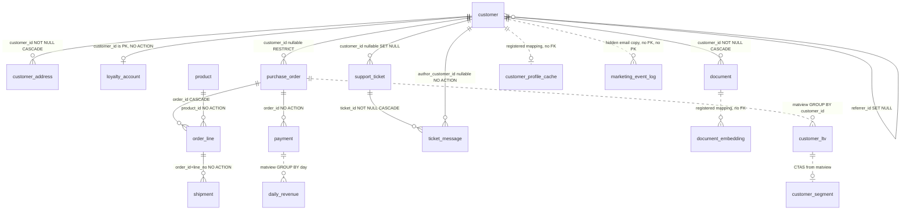

| Relation | Engine behaviour it exercises (SQL comments + seeded policy) |
|---|---|
| `customer` | Subject root. Self-reference `referrer_id ... ON DELETE SET NULL` (other subjects). `email NOT NULL UNIQUE`. |
| `customer_address` | `ON DELETE CASCADE` → `EXPECT_CASCADE` items. |
| `loyalty_account` | PK = FK (1:1), `NO ACTION`. |
| `product` | Upstream reference data. It is never traversed: its edge goes product → order_line, which is not downstream of the subject. |
| `purchase_order` | Retention **ANONYMIZE** (tax records); nullable `RESTRICT` reference to the subject. |
| `order_line` | Composite PK `(order_id, line_no)`, CASCADE from `purchase_order`; retention **RETAIN**. |
| `shipment` | Composite FK `(order_id, line_no)` → `order_line`, `NO ACTION`; retention **RETAIN**. |
| `payment` | Multi-hop `customer → purchase_order → payment`, `NO ACTION`; retention **RETAIN**. |
| `support_ticket` / `ticket_message` | Shared records: another customer can author a message on the subject's ticket (`author_customer_id`). |
| `document` | Free text that contains the customer's name and email; CASCADE. |
| `document_embedding` | `vector(384)`, **no FK**. Registered `EMBEDDING_TABLE` with mapping `app.document(id) → source_document_id`, strategy `DELETE_BY_KEY`. |
| `customer_profile_cache` | **No FK**. Registered `CACHE`, mapping `app.customer(id) → customer_id`, strategy `INVALIDATE_BY_KEY`. Its `jsonb payload` copies name and email. |
| `marketing_event_log` | **No PK, no FK**: a hidden copy of `email`. Only inference or the residual scan finds it. |
| `customer_ltv` (matview) | KEY_PRESERVING: `customer_id` survives `GROUP BY`; `REFRESH_MATVIEW`. Unique index `ux_customer_ltv_customer_id` (not a PK in the catalog). |
| `daily_revenue` (matview) | AGGREGATE: no subject key survives; refreshed. |
| `customer_segment` (CTAS table) | Artifact on an artifact (reads `customer_ltv`). Registered `DERIVED_TABLE` with `RECOMPUTE_SQL`. Its SELECT must stay byte-identical to `SEGMENT_DEFINITION_SQL` in `db/fixtures/generator.py`. |
| `external.crm_export_files` | Registered `EXTERNAL` artifact (no table), strategy `EXTERNAL_TASK`, mapping `app.customer(id) → customer_id`, `is_inspectable=false`. |

Seeded configuration (`db/fixtures/generator.py::_seed_lae_config`): subject root `customer` (`app.customer`, key `id`, identifier columns `email`, `phone`); retention `purchase_order` ANONYMIZE and `order_line`, `payment`, `shipment` RETAIN, with legal basis `"tax record retention (synthetic)"`; ten confirmed `MANUAL` PII classifications, with `use_for_residual_scan` true only for `customer.email` and `customer.phone`. Money is integer cents. The only non-integer numeric column is the embedding. **[IMPL]** `integration/db/test_generator.py::test_seeded_lae_configuration`, `::test_no_float_columns_except_vector`, `::test_in_memory_generation_is_deterministic`, `::test_hidden_copy_counts_match_database`, `::test_only_synthetic_identifiers`.

Scales in `generator.py`: `tiny`, `small`, `default`, `large` (`integration/db/test_generator.py::test_scale_presets_and_validation`).

---

## 4. SQL lineage extraction and graph construction

### 4.1 The snapshot pipeline (`services/pipeline.create_snapshot`)

One owner transaction (default isolation, READ COMMITTED) does the following:

1. `read_catalog(PgCatalogReader(s), target_schemas)` → `CatalogSnapshot` with fingerprint.
2. `discover_foreign_keys` → DECLARED_FK edges.
3. `merge_registered(artifacts_from_catalog(catalog), ArtifactRepo.active_definitions())` → all artifacts; `inspectable_artifacts` keeps those whose target is in the catalog and whose kind is not EXTERNAL.
4. `extract_artifacts_lineage(inspectable, catalog, extra_keys=_extra_keys(catalog, fk_edges, root_table))` → SQL_LINEAGE / REGISTERED_MAPPING edges plus warnings.
5. `infer_relationships(catalog, cat_reader, exclude=[*fk_edges, *sql_edges])` → INFERRED, SUGGESTED edges.
6. Carry-over from the previous snapshot: INFERRED edges whose status a human already set keep that status (edge ids are deterministic uuid5 values, so the same edge has the same id), and residual-scan suggestions (`details["evidence"] == "residual_scan"`) are copied over because they cannot be re-derived from the catalog.
7. `SnapshotRepo.create / save_catalog / save_edges / set_status(READY)` and the `SNAPSHOT_CREATED` audit event, in the same transaction.

`latest_or_new_snapshot` reuses the latest snapshot only if the live catalog fingerprint still equals the stored one. Read paths use `latest_snapshot`, which never creates a snapshot and raises `NotFoundError` if none exists (review M6). **[IMPL]** `integration/services/test_security_hardening.py::test_schema_graph_get_never_creates_a_snapshot`.

### 4.2 Catalog reading and the FK discovery query

`PgCatalogReader` (`lae/db/catalog_queries.py`) runs static catalog SQL with bound parameters only:

- `TABLES_SQL`: `pg_class` relkinds `r`, `p` → TABLE, `v` → VIEW, `m` → MATERIALIZED_VIEW (`RELKIND_TO_KIND`); partitions are skipped (`NOT c.relispartition`); views/matviews get `pg_get_viewdef(c.oid, true)`.
- `COLUMNS_SQL`: `format_type(atttypid, atttypmod)`, `NOT attnotnull` as nullability.
- `PRIMARY_KEYS_SQL`: `pg_index.indisprimary` with `unnest(indkey) WITH ORDINALITY`, so composite PKs keep their column order.
- `FOREIGN_KEYS_SQL` (the FK discovery query):

```sql
SELECT c.oid, c.conname,
       ns.nspname  AS child_schema,  cl.relname  AS child_table,
       nsp.nspname AS parent_schema, clp.relname AS parent_table,
       array_agg(ac.attname ORDER BY k.ord) AS child_columns,
       array_agg(ap.attname ORDER BY k.ord) AS parent_columns,
       c.confdeltype, c.confupdtype, c.condeferrable, c.condeferred
FROM pg_constraint c
JOIN pg_class cl  ON cl.oid  = c.conrelid   JOIN pg_namespace ns  ON ns.oid  = cl.relnamespace
JOIN pg_class clp ON clp.oid = c.confrelid  JOIN pg_namespace nsp ON nsp.oid = clp.relnamespace
CROSS JOIN LATERAL unnest(c.conkey, c.confkey) WITH ORDINALITY AS k(child_att, parent_att, ord)
JOIN pg_attribute ac ON ac.attrelid = c.conrelid  AND ac.attnum = k.child_att
JOIN pg_attribute ap ON ap.attrelid = c.confrelid AND ap.attnum = k.parent_att
WHERE c.contype = 'f' AND ns.nspname = ANY(%(schemas)s)
GROUP BY ...
ORDER BY ns.nspname, cl.relname, c.conname
```

`unnest(conkey, confkey) WITH ORDINALITY` zips the child and parent attribute arrays position by position, so a composite FK such as `shipment(order_id, line_no) → order_line(order_id, line_no)` keeps its pairing. `confdeltype` becomes `OnDeleteAction` (`a` NO_ACTION, `r` RESTRICT, `c` CASCADE, `n` SET_NULL, `d` SET_DEFAULT). **[IMPL]** `integration/db/test_catalog_reader.py::test_foreign_keys_composite_order_and_actions`, `integration/discovery/test_catalog_integration.py::test_composite_fk_order_from_reader`.

### 4.3 Discovery functions (catalog, FK, artifacts)

> **`catalog_fingerprint(tables, foreign_keys, schemas) -> str`** · `discovery/catalog.py`
> - *Purpose:* a schema identity that changes on any structural change.
> - *In → Out:* `TableInfo`s, `ForeignKeyRow`s, schema names → 64-hex.
> - *Algorithm:* `canonical_hash({"schemas": sorted, "tables": [describe_table(t) sorted by ref], "foreign_keys": [describe_foreign_key(f) sorted by (child, constraint_name)]})`. `describe_table` includes kind, columns (sorted by ordinal; name, type, nullability), PK and the stripped view definition, and **excludes `estimated_rows`**, so `ANALYZE` is not drift.
> - *Example (executed):* the 5-table catalog used in §4.6 has fingerprint `bee4c63c5a1cadfb994e6e3a24f64436c4dbe65e56e996d22b39cf6009d43629`.
> - *Tests:* `unit/discovery/test_catalog.py::test_fingerprint_is_order_independent`, `::test_fingerprint_ignores_row_estimates_and_definition_whitespace`, `::test_fingerprint_changes_on_fk_change`, `integration/discovery/test_catalog_integration.py::test_fingerprint_stable_across_reads_and_analyze` **[IMPL]**

| Function | Purpose / algorithm | In → Out | Tests **[IMPL]** |
|---|---|---|---|
| `describe_table(info)` / `describe_foreign_key(fk)` | Canonical dicts used by the fingerprint and by drift. | `TableInfo` / `ForeignKeyRow` → dict | `unit/discovery/test_catalog.py::test_fingerprint_changes_on_schema_change` |
| `build_catalog(tables, foreign_keys, schemas)` | Validates (no table outside the schemas, no duplicate table or column, PK columns exist), sorts, computes the fingerprint. | → `CatalogSnapshot`; `CatalogError` | `unit/discovery/test_catalog.py::test_validation_errors` |
| `read_catalog(reader, schemas)` | `list_tables` + `list_foreign_keys` through the port, then `build_catalog`. | `CatalogReader` → `CatalogSnapshot` | `unit/discovery/test_catalog.py::test_read_catalog_uses_reader_and_sorts`, `integration/discovery/test_catalog_integration.py::test_all_relations_and_kinds` |
| `schema_drift(old, new)` | Added / removed / changed tables + `fingerprint_changed`. FK-only changes show only in the fingerprint. | → `SchemaDrift` (`has_drift`) | `unit/discovery/test_catalog.py::test_schema_drift_detects_added_removed_changed`, `::test_schema_drift_fk_only_change_is_visible_via_fingerprint` |
| `fk_edge_id(fk, level, pair_index=None)` | `uuid5(NS_FK, "DECLARED_FK␟child␟constraint␟level␟idx")`; `stable_id` joins parts with U+001F. | → UUID | `unit/discovery/test_foreign_keys.py::test_edge_ids_are_deterministic_and_distinct` |
| `foreign_key_edges(fks, catalog)` | Per FK: one TABLE edge `parent → child` carrying the ordered column arrays, `on_delete`, `constraint_name`, `transform=FOREIGN_KEY`, `KEY_PRESERVING`, `CONFIRMED`; plus one single-pair COLUMN edge per column pair (`pair_index`, `pair_count` in details). FKs whose parent is outside the snapshot are skipped with a warning; inconsistent rows raise `CatalogError`. | → sorted edges | `unit/discovery/test_foreign_keys.py::test_one_table_edge_plus_one_column_edge_per_pair`, `::test_composite_fk_keeps_column_order`, `::test_every_on_delete_code_is_preserved`, `::test_self_reference_edge`, `::test_parent_outside_catalog_is_skipped`, `::test_inconsistent_fk_rows_raise` |
| `discover_foreign_keys(reader, catalog)` | `foreign_key_edges(reader.list_foreign_keys(...))`. | → edges | `integration/discovery/test_foreign_keys_integration.py::test_every_declared_fk_has_a_table_edge`, `::test_column_edges_one_per_pair_in_order` |
| `auto_artifact_id(target)` | `uuid5(NS_ARTIFACT, "auto␟schema.table")`. | → UUID | `unit/discovery/test_artifacts_inference_pii.py::test_views_and_matviews_are_auto_registered` |
| `artifacts_from_catalog(catalog)` | One artifact per VIEW (`RefreshStrategy.NONE`) and MATERIALIZED_VIEW (`REFRESH_MATVIEW`), definition from `pg_get_viewdef`. | → `ArtifactDefinition`s | same |
| `merge_registered(auto, registered)` | Union keyed by target; a registered artifact replaces the auto one. | → sorted list | `unit/discovery/test_artifacts_inference_pii.py::test_registered_artifacts_win` |
| `external_dependencies(artifacts, catalog)` / `inspectable_artifacts(...)` | EXTERNAL kind **or** target not in catalog → external; the rest are inspectable. | → two disjoint sorted lists | `unit/discovery/test_artifacts_inference_pii.py::test_external_artifacts_are_separated` |

Example of FK edge output (executed, three FKs of the §4.6 catalog): `customer_referrer_id_fkey` gives `TABLE app.customer (id) → app.customer (referrer_id)` with `on_delete = 'n'` (SET_NULL) plus one COLUMN edge, and `purchase_order_customer_id_fkey` gives `TABLE app.customer (id) → app.purchase_order (customer_id)` with `'r'` (RESTRICT).

### 4.4 The SQLGlot pipeline (`discovery/sql_lineage.py`)

`DIALECT = "postgres"`; `SQLGLOT_VERSION` is read from the installed package, which `pyproject.toml` pins to `sqlglot==30.29.0` (**[IMPL]** `unit/discovery/test_sql_lineage.py::test_sqlglot_is_the_pinned_version`).

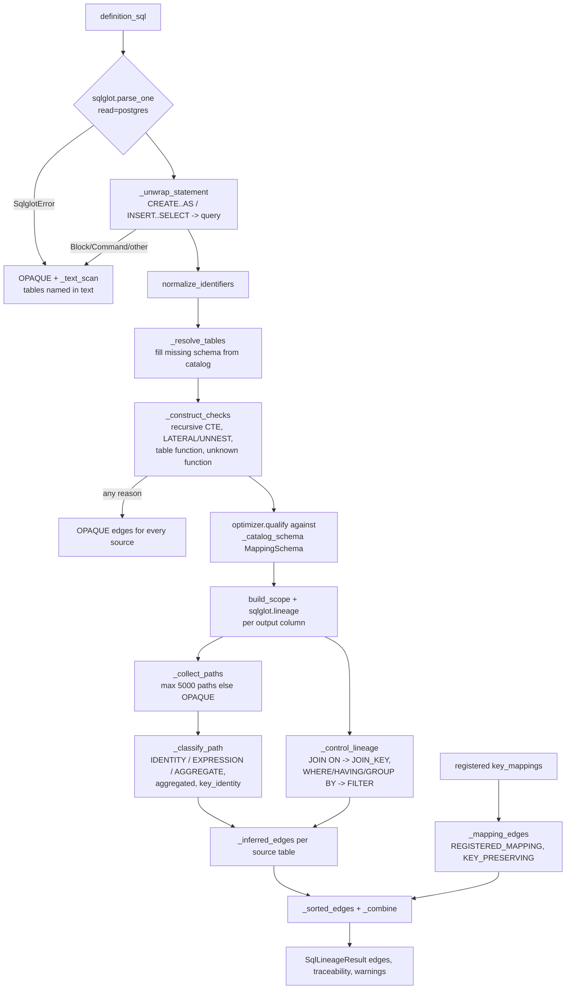

**Construct checks** (`_construct_checks`) add an opaque reason for: `WITH RECURSIVE` (`"recursive CTE (not supported)"`), any `exp.Lateral`, `exp.Unnest`, `exp.Explode`, `exp.ExplodingGenerateSeries`, a table function in FROM, and any `exp.Anonymous` function not in `_KNOWN_SCALAR_FUNCTIONS` (age, array_length, …, to_number) or `_KNOWN_AGG_FUNCTIONS` (bit_and, bit_or, every, json_object_agg, jsonb_agg, jsonb_object_agg, xmlagg). `_resolve_tables` adds a reason for any table outside the catalog.

**Path classification** (`_classify_path`), for each lineage path from an output column down to a source column:
- transform = `AGGREGATE` if any node on the path contains an aggregate (`_contains_agg`), else `EXPRESSION` if any node is not a bare column (after stripping alias, cast and parentheses), else `IDENTITY`;
- `aggregated` = the path crosses an aggregating SELECT scope (`GROUP BY`, `DISTINCT`, `HAVING`, or a direct aggregate in the projection, `_group_exprs`) or is an AGGREGATE path;
- `key_identity` = IDENTITY **and** the expression is one of the grouping expressions at every aggregating scope it crosses.

**Per-source traceability** (`_inferred_edges`, rule 5 of the module docstring):

1. `KEY_PRESERVING` if every column of some *candidate key* reaches an output column through a `key_identity` path. Candidate keys (`_candidate_keys`) are the source's PK plus any `extra_keys[source]`. The TABLE edge then carries `source_columns = key`, `target_columns = outputs`, `details["key_mapping"] = "inferred"`.
2. else `OPAQUE` if any value path is not aggregated (values flow without a surviving key; warning "values of … reach … without a surviving key column");
3. else `AGGREGATE`.

COLUMN edges: one per `(source column, output column, transform)` value path, plus control-lineage COLUMN edges (transform `JOIN_KEY` or `FILTER`, `details["clause"]` = `JOIN` or `WHERE/HAVING/GROUP BY`) from columns that appear only in control clauses to every output column. **Registered key mappings** (`_mapping_edges`) override inference for their source table: one `REGISTERED_MAPPING` TABLE edge (KEY_PRESERVING) plus one COLUMN edge per pair. An invalid mapping is ignored with a warning and forces the whole artifact to `OPAQUE`.

**Artifact traceability** (`_combine`): OPAQUE if any TABLE edge is OPAQUE or there is none; else KEY_PRESERVING if any TABLE edge is; else AGGREGATE.

**Warnings never contain SQL text or literals**, only table, column and function names and exception class names. **[IMPL]** `unit/discovery/test_sql_lineage_matrix.py::test_warnings_never_echo_sql_literals`.

> **`extract_sql_lineage(artifact, catalog, *, extra_keys=None) -> SqlLineageResult`** · `discovery/sql_lineage.py`
> - *Purpose:* table- and column-level lineage of one artifact definition, with traceability.
> - *In → Out:* `ArtifactDefinition`, `CatalogSnapshot`, optional extra candidate keys per source table → `SqlLineageResult(artifact_id, edges, traceability, warnings)`.
> - *Algorithm:* the pipeline above. Pure; never raises for bad SQL (any SQLGlot internal error becomes an "internal analysis error" OPAQUE result). Raises `UnknownTableError` only if a non-EXTERNAL artifact's target is missing. EXTERNAL artifacts return OPAQUE with no edges.
> - *Example (executed):* see §4.6.
> - *Tests:* `unit/discovery/test_sql_lineage.py::test_demo_artifacts_chain`, `::test_registered_mapping_overrides_inference`, `::test_invalid_mapping_makes_artifact_opaque`, `::test_external_artifact_is_opaque_without_edges`, `::test_unknown_target_raises`, `::test_internal_errors_never_escape`, `::test_path_explosion_is_opaque`, `::test_never_raises_on_arbitrary_sql`, `unit/discovery/test_sql_lineage_matrix.py::test_classification_matrix`, `integration/discovery/test_sql_lineage_integration.py::test_customer_ltv_key_preserving_via_customer_id`, `::test_customer_ltv_without_extra_keys_is_aggregate`, `::test_daily_revenue_aggregate` **[IMPL]**

> **`extract_artifacts_lineage(artifacts, catalog, *, extra_keys=None) -> list[SqlLineageResult]`** · `discovery/sql_lineage.py`
> - *Purpose:* lineage of many artifacts, propagating keys along artifact-on-artifact chains (e.g. `customer_ltv.customer_id` becomes a candidate key for `customer_segment`).
> - *Algorithm:* fixpoint. Up to `len(artifacts)+1` rounds: run `extract_sql_lineage` for all; add the `target_columns` of every KEY_PRESERVING TABLE edge into an artifact as a candidate key of that artifact; stop when the key map no longer changes.
> - *Math:* monotone growth of a finite key set, so it terminates; the bound `n+1` covers a chain of length `n`.
> - *Tests:* `unit/discovery/test_sql_lineage.py::test_artifacts_lineage_reaches_fixpoint_over_long_chains`, `::test_segment_alone_is_aggregate_without_upstream_key`, `integration/discovery/test_sql_lineage_integration.py::test_customer_segment_key_preserving_via_upstream_matview_key` **[IMPL]**

`sql_edge_id(artifact_id, origin, level, transform, source, source_columns, target, target_columns)` = `uuid5(NS_SQL, …)`, so re-running lineage gives the same ids (`integration/discovery/test_sql_lineage_integration.py::test_registered_mappings_and_determinism`).

### 4.5 `extra_keys` (`services/pipeline._extra_keys`)

> **`_extra_keys(catalog, fk_edges, root_table) -> dict[TableRef, list[tuple[str, ...]]]`** · `services/pipeline.py`
> - *Purpose:* make `GROUP BY customer_id` artifacts KEY_PRESERVING (CR lineage-discovery-engineer-1 §2 decision).
> - *Algorithm:* build a lineage graph of the FK edges, take `chain = {root} ∪ reachable_from(root)`, and for every TABLE FK edge whose *source* is in the chain add its *target* columns (the FK child columns) as a candidate key of the child table. Restricting to the subject chain avoids treating e.g. a product-level aggregate as subject-owned.
> - *Example (executed, §4.6 catalog, root `app.customer`):* `{app.customer: [("referrer_id",)], app.payment: [("order_id",)], app.purchase_order: [("customer_id",)]}`.
> - *Tests:* `integration/discovery/test_sql_lineage_integration.py::test_extra_keys_are_fk_child_columns_of_the_subject_chain` **[IMPL]**. **[LIMIT]** Without it, `customer_ltv` is classified AGGREGATE (limitations.md #7; `::test_customer_ltv_without_extra_keys_is_aggregate`).

### 4.6 Worked example: the `customer_ltv` matview (executed)

Catalog: `customer(id, email, referrer_id)`, `purchase_order(id, customer_id, shipping_name)`, `payment(id, order_id, amount_cents, paid_at)`, and the two matviews of `app_derived.sql`. Definition:

```sql
SELECT o.customer_id, count(DISTINCT o.id) AS order_count, sum(p.amount_cents)::bigint AS total_spent
FROM app.purchase_order o JOIN app.payment p ON p.order_id = o.id
WHERE o.customer_id IS NOT NULL GROUP BY o.customer_id
```

**Without `extra_keys`** → traceability `AGGREGATE` (no warnings). `purchase_order`'s PK `id` only reaches `order_count` through `count(DISTINCT …)`, so no candidate key survives; every value path is aggregated.

**With `extra_keys={purchase_order: [("customer_id",)], payment: [("order_id",)]}`** → traceability `KEY_PRESERVING`. Edges produced:

| Level | Source | Source cols → target cols | Transform | Traceability | Evidence |
|---|---|---|---|---|---|
| TABLE | app.payment | () → () | AGGREGATE | AGGREGATE | sqlglot |
| TABLE | app.purchase_order | (customer_id) → (customer_id) | IDENTITY | KEY_PRESERVING | `key_mapping: inferred` |
| COLUMN | app.payment | amount_cents → total_spent | AGGREGATE | AGGREGATE | clause SELECT |
| COLUMN | app.payment | order_id → customer_id / order_count / total_spent | JOIN_KEY | AGGREGATE | clause JOIN |
| COLUMN | app.purchase_order | customer_id → customer_id | IDENTITY | KEY_PRESERVING | clause SELECT |
| COLUMN | app.purchase_order | id → order_count | AGGREGATE | KEY_PRESERVING | clause SELECT |

`daily_revenue` → `AGGREGATE`, with COLUMN edges `amount_cents → revenue_cents` (AGGREGATE) and `paid_at → day` (EXPRESSION). A recursive CTE gives `OPAQUE` with warning `"recursive CTE (not supported)"` and one OPAQUE TABLE edge from `app.customer`; `SELECT my_udf(id) …` gives `OPAQUE` with warning `"unknown function my_udf()"`.

### 4.7 Inferred relationships (`discovery/inference.py`)

> **`infer_relationships(catalog, reader, *, threshold=0.95, sample=1000, exclude=()) -> list[RelationshipEdge]`** · `discovery/inference.py`
> - *Purpose:* suggest undeclared relationships for human review.
> - *Algorithm:* `candidate_pairs` proposes (child column, parent column) pairs from base tables by name and type: a child column `<p>_id` matches a parent table named `<p>` (weight 1), its plural `<p>s`/`<p>es` (0.98) or a suffix of the stem (0.95), with a single-column PK; a child column `email` or `<p>_email` matches any other base table with an `email` column (0.95 if the table name matches the stem, else 0.9). Type families must match (`_type_family`: integer, text, uuid, numeric). Pairs already covered by `exclude`, and child columns of declared FKs, are skipped. For each candidate: `reader.sample_values(child, sample)` (up to `sample` distinct non-NULL values, ordered by `md5(v::text)`), then `reader.count_contained(child, parent, values)` (distinct sample values present in the parent, text compare).
> - *Math:* containment ratio `ρ = contained / sampled`. Suggested iff `ρ ≥ θ` (θ = `threshold`, default 0.95). `confidence = ⌊min(ρ · w, 0.999)⌋₃` (rounded **down** to three decimals with `Decimal`, `ROUND_DOWN`). Example: ρ = 17/19, w = 0.9 → ρ·w = 0.80526… → 0.805 (it would not be suggested at θ = 0.95, see limitations.md #5).
> - *Out:* two edges per accepted candidate (TABLE + COLUMN), `origin=INFERRED`, `status=SUGGESTED`, `transform=FOREIGN_KEY`, `KEY_PRESERVING`, details `{"evidence": "name_pattern+sampled_containment", "pattern", "sampled", "contained"}`. Only counts are kept; sampled values never leave the reader call.
> - *Tests:* `unit/discovery/test_artifacts_inference_pii.py::test_candidates_skip_declared_fks`, `::test_inferred_edges_are_suggested_with_confidence`, `::test_low_containment_is_not_suggested`, `::test_empty_sample_is_skipped_and_sample_limit_passed`, `integration/discovery/test_inference_and_edge_cases.py::test_inference_suggests_only_and_skips_known_edges`, `::test_hidden_copy_suggested_at_lower_threshold_and_never_traversed` **[IMPL]**

A human confirms or rejects an INFERRED edge with `pipeline.set_edge_status` (`POST /api/lineage-edges/{edge_id}/status`). Only INFERRED edges may change; setting the current status again is a no-op without an audit event; otherwise `EDGE_STATUS_CHANGED` is appended. A CONFIRMED inferred edge is then traversed like any other (`unit/discovery/test_records.py::test_confirmed_inferred_edge_is_traversed`, `integration/discovery/test_inference_and_edge_cases.py::test_confirmed_inferred_email_edge_finds_exact_copies_by_predicate`).

`suggest_pii(catalog)` / `classify_column(column)` (`discovery/pii.py`) classify column names by regex into DIRECT_IDENTIFIER / QUASI_IDENTIFIER / SENSITIVE, and `vector*` types into EMBEDDING, always unconfirmed (`is_confirmed=False`, `use_for_residual_scan=False`; strategy NULLIFY if the column is nullable, else PSEUDONYMIZE; PK columns and non-base tables are skipped). **[IMPL]** `unit/discovery/test_artifacts_inference_pii.py::test_suggest_pii`, `::test_classify_column`. **[LIMIT]** No API, CLI or service path calls it (limitations.md #10).

### 4.8 `LineageGraph` construction and edge evidence (`lineage/graph.py`)

> **`build_lineage_graph(catalog, edges, pii=None, artifacts=()) -> LineageGraph`** · `lineage/graph.py`
> - *Purpose:* the table/column lineage graph used by discovery, planning and the UI.
> - *Algorithm:* validates PII entries and artifact tables against the catalog; inserts one node `t:schema.table` per table (attrs `kind`, `table`, `table_kind`, `pk`, `is_artifact`) and one node `c:schema.table.column` per column (attrs incl. `pii_category`), joined by containment edges (`key="contains"`); then `add_edge` for each lineage edge in edge-id order. TABLE edges link table nodes (`key=str(edge_id)`); COLUMN edges add one nx edge per column pair (`key=f"{edge_id}:{i}"`). A table is flagged `is_artifact` if it is a VIEW/MATERIALIZED_VIEW, the target of an edge with `artifact_id`, or listed in `artifacts`. Backed by `networkx.MultiDiGraph`.
> - *Errors:* `GraphIntegrityError` for unknown table/column (`_validate_edge`), unknown PII column, unknown artifact table, duplicate edge id (`DUPLICATE_EDGE`).
> - *Tests:* `unit/lineage/test_graph.py::test_nodes_and_attributes`, `::test_unknown_table_edge_raises`, `::test_unknown_column_edge_raises`, `::test_duplicate_edge_id_raises`, `::test_unknown_pii_column_raises`, `::test_view_kind_is_artifact`, `unit/lineage/test_api.py::test_build_with_registered_artifacts_without_edges`, `::test_incremental_build_equals_batch_build` **[IMPL]**

| Method | Purpose | Tests **[IMPL]** |
|---|---|---|
| `add_table(info, pii=None, *, is_artifact=False)` | Incremental table insert (keeps the original fingerprint). `DUPLICATE_TABLE` on repeat. | `unit/lineage/test_api.py::test_add_node_with_pii_and_new_schema`, `::test_add_node_errors` |
| `mark_artifact(table)` | Idempotently flags table + column nodes. | `unit/lineage/test_api.py::test_mark_artifact` |
| `add_edge(edge)` | Validate + insert one edge (kept sorted with `bisect.insort`). | `unit/lineage/test_api.py::test_add_edge_validates_and_updates_queries` |
| `edge(edge_id)` / `edges(statuses)` | Lookup (`UNKNOWN_EDGE`) / sorted listing. | `unit/lineage/test_graph.py::test_unknown_edge_lookup`, `::test_edges_listing_sorted` |
| `table_view(statuses=CONFIRMED_ONLY)` / `column_view(...)` | Fresh MultiDiGraphs restricted to the given statuses. | `unit/lineage/test_graph.py::test_table_view_excludes_suggested_by_default`, `::test_column_view` |
| `downstream(table, statuses)` / `upstream(...)` | TABLE edges leaving / entering a table, sorted by (other table, columns, id). | `unit/lineage/test_graph.py::test_downstream_filters_and_orders`, `::test_downstream_parallel_edges_tie_break`, `::test_upstream` |
| `column_edges_for(table_edge)` | COLUMN edges with the same endpoints, constraint and artifact. | `unit/lineage/test_graph.py::test_column_edges_for`, `::test_column_edges_for_composite` |
| `to_node_link(level, statuses=ALL_STATUSES)` | JSON `{nodes, edges}` (GraphNodeOut / GraphEdgeOut shapes). All statuses by default so the UI can show SUGGESTED edges. | `unit/lineage/test_graph.py::test_to_node_link_table`, `::test_to_node_link_column`, `unit/lineage/test_api.py::test_every_serialized_edge_has_evidence` |

> **`edge_evidence(e) -> dict`** · `lineage/graph.py`
> - *Purpose:* explain why an edge exists.
> - *Algorithm:* JSON-safe copy of `e.details` (sorted keys; UUIDs and refs to strings; tuples and sets to lists), then the structured fields `origin`, `constraint_name`, `artifact_id` override same-named keys.
> - *Example (executed):* the SQL_LINEAGE edge `app.payment → app.daily_revenue` has evidence `{"artifact_id": "00000000-0000-0000-0000-00000000000b", "constraint_name": null, "evidence": "sqlglot", "origin": "SQL_LINEAGE", "sqlglot_version": "30.29.0"}`. Evidence kinds produced by the code: `pg_constraint` (FK), `sqlglot`, `registered_mapping`, `name_pattern+sampled_containment` (inference), `residual_scan` (feedback, §9.5).
> - *Tests:* `unit/lineage/test_api.py::test_evidence_artifact_and_constraint`, `::test_evidence_takes_details_json_safe`, `integration/discovery/test_foreign_keys_integration.py::test_edge_attributes_and_evidence` **[IMPL]**

### 4.9 Lineage example across the three levels

Table and column levels say where data *may* flow. Record-level edges exist only for rows that queries actually returned (CLAUDE.md rule 4). The record level below is the executed discovery of §7.9.

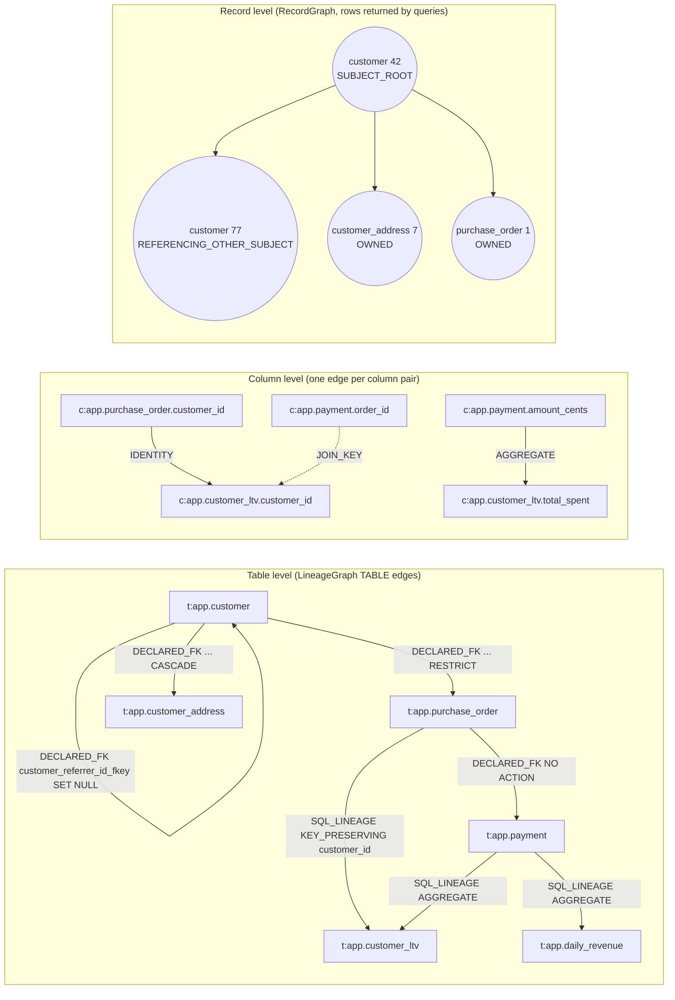

---

## 5. BFS, DFS and topological ordering

| Where | Algorithm | Determinism | Complexity |
|---|---|---|---|
| `discovery/records.py::_Discovery.run` (record discovery) | Level-synchronous **BFS** from the subject root over CONFIRMED, KEY_PRESERVING TABLE edges with key columns. Each level groups the frontier by table (sorted); for every downstream edge it batches the distinct parent key values into `select_by_columns(target, target_columns, batch, select)` queries. | Frontier sorted by `RecordKey.sort_key`; tables sorted; edges sorted by `downstream`. Ints sort before strings (`key_sort_key`). | Each `(edge_id, parent values)` pair is fetched once (`edge_cache`). Graph work is O(V + E) for V discovered rows and E record edges; SQL cost is Σ over levels and edges of ⌈distinct parent values / batch_size⌉ round trips (batch_size ≤ 1000). |
| `LineageGraph.reachable_from(table, statuses)` | `nx.descendants` on a collapsed `DiGraph` of TableRefs. | Returns a set. | O(V + E) over tables. |
| `LineageGraph.traverse(table, order, statuses)` and facade `get_descendants` | `"bfs"`: `nx.bfs_tree(g, table, sort_neighbors=sorted)`; `"dfs"`: `nx.dfs_preorder_nodes(..., sort_neighbors=sorted)`. Any other order → `INVALID_ORDER`. | Neighbours visited in TableRef order; the returned set always equals `reachable_from`. | O(V + E log deg) (sorting neighbours). |
| `LineageGraph.table_cycles` / `detect_cycles` | `nx.simple_cycles` on the table digraph; each cycle rotated to its smallest TableRef; list sorted. | yes | Johnson's algorithm, O((V + E)(C + 1)) for C cycles. |
| `LineageGraph.artifact_order(artifacts)` | Builds an order graph `a → b` whenever `b` is reachable from `a`; rejects self-reaching artifacts (`ARTIFACT_CYCLE`); `nx.lexicographical_topological_sort` keyed by (schema, name). | yes (lexicographic tie-break) | O(A·(V + E)) reachability + topo sort. |
| `RecordGraph.deletion_order(nullable)` | SCC decomposition (`nx.strongly_connected_components`), cycle breaking through nullable edges, then `nx.lexicographical_topological_sort` of the **reversed** graph (children first). | SCCs sorted by min sort key; edges sorted; lexicographic topo sort. | O(V + E) for SCC + topo; plus `has_path` checks for each removed edge when restoring. |
| `planner/ordering.py::_topo_tables` | Kahn's algorithm with a min-heap of TableRefs. Returns fewer tables than given if a table-level cycle exists. | heap order | O((T + P) log T). |
| `planner/ordering.py::_ranks` | Longest-path rank on a DAG (Kahn order), `None` on a cycle. | sorted ready list | O(R + P). |

**Example (executed).** Tables `a, b, c, d` with CONFIRMED edges `a→b`, `a→c`, `b→d`: `traverse(a, "bfs")` = `[b, c, d]`, `traverse(a, "dfs")` = `[b, d, c]`. In the §4.6 catalog both orders from `app.customer` give `[purchase_order, customer_ltv, payment, daily_revenue]`, `table_cycles()` = `[[app.customer]]` (the `referrer_id` self-reference), and `artifact_order([daily_revenue, customer_ltv])` = `[customer_ltv, daily_revenue]` (no dependency between them, so lexicographic).

**Tests [IMPL]:** `unit/lineage/test_api.py::test_bfs_and_dfs_order_differ_and_are_deterministic`, `::test_traversal_statuses_and_leaf`, `::test_traversal_independent_of_edge_input_order`, `::test_traversal_errors`, `unit/lineage/test_properties.py::test_bfs_dfs_traversal_properties`, `::test_table_cycle_detection_matches_networkx`, `::test_dag_deletion_order_respects_every_edge`, `::test_cycle_breaking_is_correct`, `unit/lineage/test_graph.py::test_reachable_from`, `::test_table_cycles`, `::test_artifact_order`, `::test_artifact_order_cycle_raises`, `::test_artifact_order_ignores_cycles_elsewhere`, `unit/discovery/test_records.py::test_deterministic_across_runs_order_and_batching`, `::test_batches_respect_batch_size`.

### 5.1 `RecordGraph` (`lineage/record_graph.py`)

> **`RecordGraph.deletion_order(nullable: Callable[[UUID], bool]) -> DeletionOrder`**
> - *Purpose:* an order in which rows can be deleted: children before parents, cycles broken only through nullable references.
> - *Algorithm:* copy nodes and edges without self-loops (one DELETE removes a self-referencing row). For each SCC with more than one node (sorted): remove every intra-SCC edge whose edge ids are **all** nullable; if the SCC is still cyclic → `GraphIntegrityError("UNBREAKABLE_CYCLE", details={"tables", "record_count"})` (no key values). Then try to restore each removed edge in sorted order and keep it if the graph stays acyclic (`has_path(v, u)` test); only edges that really must be broken stay in `break_edges`. Finally topologically sort the reversed graph lexicographically.
> - *Out:* `DeletionOrder(order, break_edges)`, `break_edges` as `(parent, child, edge_id)`.
> - *Example (executed):* customer 42 → order 1 → payment 9, plus orders 1 ↔ 2 referencing each other (edge 2→1 nullable). Result `order = [payment 9, purchase_order 2, purchase_order 1, customer 42]`, `break_edges = [(purchase_order 2, purchase_order 1, edge …3)]`. With `nullable = lambda e: False` it raises `UNBREAKABLE_CYCLE` with details `{"tables": ["app.purchase_order"], "record_count": 2}`.
> - *Tests:* `unit/lineage/test_record_graph.py::test_deletion_order_dag_children_first`, `::test_deletion_order_ignores_self_reference`, `::test_scc_broken_via_nullable_edge`, `::test_scc_breaks_only_what_is_needed`, `::test_multi_edge_pair_needs_all_ids_nullable`, `::test_unbreakable_cycle_raises_without_values` **[IMPL]**

| Method | Purpose / rule | Tests **[IMPL]** |
|---|---|---|
| `add_root(key)` | Add or upgrade a SUBJECT_ROOT at depth 0. | `unit/lineage/test_record_graph.py::test_add_root_upgrades_existing` |
| `add_dependency(parent, child, edge_id, role) -> bool` | New child: depth = parent depth + 1. Existing child: accumulate `via_edge_ids`, depth = min, keep the more protective role (`_ROLE_PRECEDENCE`: OWNED 0 < SHARED 1 < REFERENCING_OTHER_SUBJECT 2 < SUBJECT_ROOT 3). Parent must exist (`UNKNOWN_PARENT`); SUBJECT_ROOT role is refused (`INVALID_ROLE`). | `::test_add_dependency_existing_child_accumulates`, `::test_depth_takes_minimum`, `::test_role_precedence_is_protective`, `::test_add_dependency_errors` |
| `set_role(key, role)` | Explicit override after BFS (ignores precedence). Cannot set or change SUBJECT_ROOT. | `unit/lineage/test_roles.py::test_set_role_reclassifies_after_bfs`, `::test_set_role_is_an_explicit_override`, `::test_set_role_errors_leak_no_values` |
| `nodes()`, `edges()`, `by_table()`, `attrs(key)` | Deterministic, sorted accessors. | `::test_nodes_edges_by_table_sorted`, `::test_mixed_int_str_keys_sort` |
| `record_set_hash()` | `canonical_hash([k.as_canonical() for k in sorted keys])`. Ignores roles and edges. | `::test_record_set_hash_stable_across_insertion_order`, `::test_record_set_hash_known_value`, `::test_record_set_hash_ignores_edges_and_roles` |
| `to_node_link(key_hmac)` | `{nodes, edges}` where records are identified only by `key_hmac(key)`; no raw values. | `::test_to_node_link_has_no_raw_values` |

`RecordDiscoveryResult(record_graph, affected_artifacts, warnings)` (`lineage/results.py`) freezes and sorts `affected_artifacts` and uses identity equality (`eq=False`) because it holds a mutable graph (`unit/lineage/test_record_graph.py::test_record_discovery_result_freezes_and_sorts`, `unit/lineage/test_roles.py::test_record_discovery_result_identity_equality`).

---

## 6. Record-level ownership resolution

> **`discover_records(graph, root, subject_key, reader, limits, policies=None) -> RecordDiscoveryResult`** · `discovery/records.py`
> - *Purpose:* find every row that depends on the subject and assign it a role.
> - *In → Out:* `LineageGraph`, `SubjectRoot`, subject key tuple, `TargetReader`, `DiscoveryLimits` → `RecordDiscoveryResult` (record graph + affected artifacts with their worst traceability + warnings). `policies` is accepted but unused (the planner applies retention).
> - *Algorithm:*
>   1. `_prepare`: for every table reachable from the root (CONFIRMED edges), cache its downstream edges, collect the columns that must be selected (PK ∪ edge columns), and build *reference specs* `_RefSpec(source, source_columns, target_columns)` for every traversable edge that is a DECLARED_FK or whose source columns equal the source PK. Unconfirmed TABLE edges leaving reachable tables are counted in a warning ("… were not traversed").
>   2. `load_root`: the root key columns must equal the root table's PK (else `ValidationError`); arity checked; the row is read with `select_by_columns`; missing row → `SubjectNotFoundError`.
>   3. `run`: BFS (§5). For each traversable edge the children are fetched in batches. A child in a table without a PK becomes a predicate key `RecordKey(table, edge.target_columns, values, is_predicate=True)`. Rows of the **root table** reached by an edge are recorded but **not added to the frontier** (never traversed further). Non-traversable edges mark their target in `affected_artifacts` with the edge's traceability (a KEY_PRESERVING edge without key columns is treated as OPAQUE with a warning). An artifact edge that actually reached rows marks its target KEY_PRESERVING.
>   4. Limits: a new row deeper than `max_depth` or a total above `max_records` raises `DiscoveryLimitExceeded` (details: limit name, value, table; no key values).
>   5. `roles` (below), then a `RecordGraph` is built from the recorded links.
> - *Tests:* `unit/discovery/test_records.py::test_ground_truth_records_and_roles`, `::test_precision_and_recall_are_one`, `::test_upstream_and_unrelated_rows_are_not_reached`, `::test_affected_artifacts`, `::test_depths_edges_and_composite_traversal`, `::test_warnings_flag_predicate_tables`, `::test_subject_not_found`, `::test_limits`, `::test_limits_exactly_at_size_pass`, `::test_invalid_root_definitions`, `::test_suggested_edges_are_never_traversed`, `::test_opaque_and_keyless_edges_mark_artifacts`, `::test_self_referencing_subject_stays_root`, `::test_other_subject_rows_reached_as_subject_are_not_traversed`, `::test_uuid_and_decimal_key_values_are_normalised`, `integration/discovery/test_records_ground_truth.py::test_primary_subject_roles`, `::test_all_tiny_subjects_and_random_sample`, `::test_default_scale_random_subjects`, `::test_limits_enforced_without_leaking_values`, `::test_new_child_row_is_discovered_without_reseeding` **[IMPL]**

### 6.1 The four roles and the fixpoint rule (`_Discovery.roles`, `_is_shared`)

Initial assignment for every discovered row `k`:
- `SUBJECT_ROOT` if `k` is the subject's root key;
- `REFERENCING_OTHER_SUBJECT` if `k` is another row of the root table (e.g. customer 77 whose `referrer_id` is 42);
- `OWNED` otherwise.

Then a **greatest fixpoint** demotes OWNED rows to `SHARED`. Let `S` = the set of rows with role SUBJECT_ROOT or OWNED. Repeat until no change:

1. Build an index of `S`: for each referenced `(table, key columns)` pair, the set of key values held by rows in `S`.
2. An OWNED row `k` becomes SHARED if
   - (a) none of its parents (rows it was reached from) is in `S` (it was reached only through SHARED rows), **or**
   - (b) for some reference spec `(source, source_cols, target_cols)` of its table with `source` reachable from the root, the row's non-NULL `target_cols` value is **not** in the index of `S` for `(source, source_cols)`, i.e. it points at a row outside the subject's set.

Formally, with `ref(k)` the set of (spec, value) references of row `k` and `P(k)` its parents:

```
SHARED(k)  ⇐  P(k) ∩ S = ∅   ∨   ∃ (spec, v) ∈ ref(k): spec.source ∈ Reach ∧ v ∉ Index_S(spec.source, spec.source_cols)
S ← S \ {k : SHARED(k)}      (iterate to a fixpoint; S only shrinks, so it terminates in ≤ |S| rounds)
```

Because `S` only shrinks, the result is the greatest set that is closed under the rule, and it is deterministic (rows processed in sorted order). Example (executed, §7.9 variant): customer 42 owns ticket 10; message 401 (author 42) is OWNED; message 402 on ticket 10 written by customer 77 has `author_customer_id = 77`, which is not in `S`'s customer keys `{42}`, so it is **SHARED** (depth 2).

**[LIMIT]** The rule is conservative: a subject's message on an anonymous or other subject's ticket is SHARED (never deleted), even where a human might call it owned (limitations.md #8; `integration/discovery/test_inference_and_edge_cases.py::test_message_on_anonymous_ticket_is_shared_documented_divergence`). **[IMPL]** `integration/discovery/test_inference_and_edge_cases.py::test_message_by_referred_customer_on_subject_ticket_is_shared`, `unit/discovery/test_records.py::test_shared_cascades_through_descendants`, `integration/discovery/test_records_ground_truth.py::test_secondary_subject_shares_the_same_messages`.

When building the `RecordGraph`, a link to the subject's own root (a self-reference) is added as OWNED and `add_dependency` keeps the stronger SUBJECT_ROOT role.

### 6.2 Predicate keys

Tables without a primary key (the demo `marketing_event_log`) cannot be addressed per row. Their rows become `RecordKey(..., is_predicate=True)` with the edge's target columns. Consequences:
- the discovery warning `"<table> has no primary key; rows are addressed by predicate"`;
- the planner counts a predicate key as the number of rows it matches, from `predicate_row_counts` (computed by the service with `count_by_columns`), defaulting to 1 (`unit/planner/test_build_plan.py::test_predicate_key_without_counts_defaults_to_one_per_predicate`);
- a `NO_PRIMARY_KEY` WARNING conflict (acknowledgeable);
- **[LIMIT]** evidence leaves digest predicate keys with `is_predicate=False` (`PlanItem` has no `is_predicate` field; CR verification-crypto-engineer-2 §6), so per-record evidence is weaker (limitations.md #9).

### 6.3 Limits

`DiscoveryLimits(max_depth=10, max_records=100_000, batch_size=1_000)`; all must be ≥ 1. `POST /api/erasure-plans/{request_id}/generate` accepts `max_depth` (1–50) and `max_records` (1–10 000 000) (`PlanGenerate`). Exceeding a limit gives HTTP 413 (`DISCOVERY_LIMIT`).

---

## 7. Erasure planning and execution

### 7.1 Inputs: policies

`PolicySet(retention: Mapping[TableRef, RetentionAction], pii: Mapping[ColumnRef, PiiColumn])`. `action_for(table)` returns the table's retention action, **defaulting to `DELETE`**. Retention actions: `DELETE`, `ANONYMIZE` (keep the row, scrub PII, detach references), `RETAIN` (legal hold: keep the row untouched). A `PiiColumn` has a category, an `ErasureStrategy` (`NULLIFY` or `PSEUDONYMIZE`), `is_confirmed` and `use_for_residual_scan`. The service loads policies with `PolicyRepo.policy_set()`.

### 7.2 Actions and categories (`contracts/enums.py`)

| `PlanAction` | `ActionCategory` | DML by the executor | Verifiable in DB |
|---|---|---|---|
| `DELETE_ROWS` | DELETE | `DELETE … WHERE (key) IN (VALUES …)` | yes (ROW_ABSENT) |
| `EXPECT_CASCADE` | DELETE | none; counts what the database cascaded | yes (CASCADE_COMPLETE) |
| `DELETE_DERIVED_BY_KEY` | DELETE | DELETE by key | yes (ROW_ABSENT) |
| `INVALIDATE_CACHE` | INVALIDATE | DELETE by key | yes (ROW_ABSENT) |
| `NULLIFY_REFERENCE` | INVALIDATE | `UPDATE … SET fk = NULL` | yes (REFERENCE_NULLIFIED) |
| `REFRESH_MATVIEW` | RECOMPUTE | `REFRESH MATERIALIZED VIEW` | yes (DERIVED_CONSISTENT) |
| `RECOMPUTE_TABLE` | RECOMPUTE | `DELETE FROM t; INSERT INTO t <definition>` | yes (DERIVED_CONSISTENT) |
| `ANONYMIZE_ROWS` | RETAIN | `UPDATE … SET col = NULL | pseudonym` | yes (COLUMNS_ANONYMIZED) |
| `RETAIN_ROWS` | RETAIN | none; counts the rows | yes (RETENTION_HONORED) |
| `SCHEDULE_EXTERNAL` | SCHEDULE | none (SKIPPED) | **never** |
| `MANUAL_REVIEW` | MANUAL_REVIEW | none (SKIPPED) | **never** |
| `UNRESOLVED` | UNRESOLVED | none (SKIPPED) | **never** |

`UNVERIFIABLE_CATEGORIES = {SCHEDULE, MANUAL_REVIEW, UNRESOLVED}`. `action_category(action)` and the property `PlanItem.category` look the category up. **[IMPL]** `unit/contracts/test_contracts.py::test_every_plan_action_has_a_category`.

### 7.3 `build_plan` and its passes (`planner/planner.py`)

> **`build_plan(request_id, discovery, lineage, policies, artifacts, external=(), *, plan_id, predicate_row_counts=None) -> ErasurePlan`**
> - *Purpose:* turn a record-level discovery result into an ordered, explainable, hashed plan.
> - *In → Out:* `RecordDiscoveryResult`, `LineageGraph`, `PolicySet`, inspectable and external artifacts, a fresh `plan_id` → `ErasurePlan(plan_id, request_id, schema_fingerprint, record_set_hash, items, conflicts, plan_hash)`.
> - *Algorithm:* `_Planner.run` executes these passes in order: `classify` → `split_cascades` → `plan_detaches` → `draft_nullify` (non-anonymized rows) → `draft_anonymize` → `cascade_conflicts` → `plan_deletes` → `cascade_checks` → `plan_artifacts` → `draft_retained_rows` → `draft_shared` → `plan_external` → `predicate_warnings` → `derived_deps` → `assemble`. **It never raises for policy conflicts**: every problem becomes a `PlanConflict`. It raises `GraphIntegrityError` only for inconsistent inputs (`UNKNOWN_RECORD_TABLE`, `EDGE_MISMATCH`, unknown edge id).
> - *Tests:* `unit/planner/test_build_plan.py` (31 tests, e.g. `::test_shop_default_plan_structure`, `::test_other_subjects_are_never_deleted`, `::test_deletes_children_before_parents_in_shop`, `::test_reasons_are_pii_free_and_explainable`, `::test_record_in_unknown_table_raises_graph_integrity`, `::test_record_edge_mismatch_raises_graph_integrity`, `::test_plan_ids_and_hashes_are_set`), `unit/planner/test_artifacts.py` (20 tests) **[IMPL]**

What each pass does:

1. **classify.** Rows of artifact tables go to `artifact_rows` (non-subject rows of a non-view artifact without a maintain action are treated as shared). *Root-table protection:* an OWNED row in the subject-root table is reclassified `REFERENCING_OTHER_SUBJECT`, so only the subject's own root row can be deleted from that table (`::test_root_table_protection_overrides_owned_role`). SUBJECT_ROOT/OWNED rows are split by `action_for(table)` into `removal` (DELETE), `anonymize`, `retain`.
2. **split_cascades.** A removed row whose removed parent reaches it via an `ON DELETE CASCADE` edge is an *expected cascade*; the others are *explicit* deletes. If a set of expected rows is covered by no explicit row (a pure cascade cycle), the smallest one becomes explicit (`::test_pure_cascade_cycle_deletes_one_row_explicitly`). `triggers[r]` = the explicit rows whose DELETE removes `r`.
3. **plan_detaches.** For rows of other subjects (parent in the subject's rows), shared rows and retained rows (parent being removed, FK edge): a nullable FK gives a `_Detach` (→ `NULLIFY_REFERENCE`); a NOT NULL FK gives a conflict (`_detach_conflict`): shared → recorded for the BLOCKING `SHARED_RECORD`; removed parent + CASCADE → left to `cascade_conflicts`; other subject → `NOT_NULL_REFERENCE`; RESTRICT/NO ACTION → `RESTRICT_FROM_RETAINED`; otherwise `NOT_NULL_REFERENCE`.
4. **draft_anonymize.** Target columns = confirmed scrub-able PII columns (`pii_targets`) ∪ FK columns referencing rows being deleted. No columns → the rows become `RETAIN_ROWS` instead (`::test_anonymize_without_confirmed_pii_retains_rows`). `pii_targets` emits `RETAINED_WITH_PII` WARNING for PK/NOT-NULL-NULLIFY PII columns and for PSEUDONYMIZE columns, and `UNCONFIRMED_PII` WARNING for suggested columns of anonymized tables.
5. **cascade_conflicts.** Policy §2(c) of CR erasure-engine-engineer-1: any row reached through a CASCADE FK from a removed row that is not itself removed and not detached first → `CASCADE_DESTROYS_RETAINED` BLOCKING ("cascade would delete a record not owned by the subject" for other subjects' and shared rows).
6. **plan_deletes.** `delete_constraints` lists `(u, v, edge)` = "v must be gone before u is deleted" for removed rows, except trigger edges (v cascades with u) and nullable SET NULL edges. `order_deletions` (§7.4) orders the explicit rows; on an unorderable cycle, rows relying on a cascade are promoted to explicit and the ordering is retried; still impossible → `UNBREAKABLE_CYCLE` BLOCKING. Broken references become `NULLIFY_REFERENCE` with purpose `break_cycle`. One `DELETE_ROWS` draft per batch and key shape, with `depends_on` from the order and from the detaches; then one `EXPECT_CASCADE` per table depending on its triggers' deletes.
7. **cascade_checks.** Appends to every DELETE_ROWS reason one clause per CASCADE FK whose parent is the batch table: `cascade_check <constraint>: <schema.child>(<cols>) <- (<parent cols>) = <n>` (`planner/text.py::cascade_check`). `n` = child rows that must reference the batch right before its DELETE. The reason is part of the plan hash.
8. **plan_artifacts.** Views are skipped (they store nothing). Matviews (or `MATERIALIZED_VIEW` artifacts) → `REFRESH_MATVIEW`; `RECOMPUTE_SQL` artifacts with SQL → `RECOMPUTE_TABLE` with `definition_sha256=<hex>` in the reason (`definition_token`); CACHE or `INVALIDATE_BY_KEY` → `INVALIDATE_CACHE` on the subject's keyed rows; `DELETE_BY_KEY` → `DELETE_DERIVED_BY_KEY`. No usable strategy, OPAQUE lineage, or an AGGREGATE artifact that cannot be rebuilt → `UNRESOLVED` item + `OPAQUE_ARTIFACT` BLOCKING. Rebuilds propagate to every artifact reachable from a modified table or rebuilt artifact. All derived steps are ordered by `LineageGraph.artifact_order`; a cyclic dependency → `UNBREAKABLE_CYCLE`. Rule: AGGREGATE gives a refresh/recompute, **never a row delete** (`unit/planner/test_artifacts.py::test_matview_rows_give_refresh_never_delete`, `::test_aggregate_artifact_is_refreshed`, `::test_recompute_table_binds_definition_hash`, `::test_opaque_artifact_is_unresolved_and_blocking`, `::test_propagates_refresh_to_downstream_artifacts_without_discovery_marks`).
9. **draft_retained_rows.** `RETAIN_ROWS` per table (legal hold) + `RETAINED_WITH_PII` WARNING if the table has PII columns.
10. **draft_shared.** Shared rows are **never destroyed**. NOT NULL link into removed rows → `MANUAL_REVIEW` item + `SHARED_RECORD` BLOCKING (not acknowledgeable); otherwise `SHARED_RECORD` WARNING (references nullified first, or untouched) (`::test_not_null_shared_record_is_blocking_and_cascade_flagged`, `::test_nullable_shared_record_is_detached_before_parent_delete`).
11. **plan_external.** For each key mapping of an EXTERNAL artifact whose source table holds subject rows: `EXTERNAL_TASK` strategy → `SCHEDULE_EXTERNAL` + `EXTERNAL_ARTIFACT` WARNING; otherwise `UNRESOLVED` + `OPAQUE_ARTIFACT` BLOCKING. RECORD level if the mapping columns can be projected from the subject's keys, else TABLE level (`unit/planner/test_artifacts.py::test_external_with_handler_is_scheduled_with_warning`, `::test_external_without_handler_is_unresolved_and_blocking`, `::test_external_keyed_by_non_key_column_is_table_level`).
12. **predicate_warnings.** `NO_PRIMARY_KEY` WARNING per predicate table.
13. **derived_deps / assemble.** Derived steps depend on earlier steps on tables they are reachable from; items are numbered by `(phase, rank, reason)`; conflicts are sorted BLOCKING first; `plan_with_hash` sets the hash.

**Phases** (lower runs first; from the module docstring): 1 NULLIFY_REFERENCE / ANONYMIZE_ROWS · 2 DELETE_ROWS · 3 EXPECT_CASCADE · 4 DELETE_DERIVED_BY_KEY / INVALIDATE_CACHE · 5 RECOMPUTE_TABLE / REFRESH_MATVIEW · 6 RETAIN_ROWS, SCHEDULE_EXTERNAL, MANUAL_REVIEW, UNRESOLVED.

`detect_conflicts(discovery, lineage, policies, artifacts, external=())` returns the conflicts `build_plan` would report (`::test_detect_conflicts_matches_build_plan`).

### 7.4 Ordering (`planner/ordering.py`)

> **`order_deletions(explicit, triggers, constraints, nullable) -> OrderedDeletes`**
> - *Purpose:* order explicit deletes so that every RESTRICT / NO ACTION constraint holds, with cascades made explicit.
> - *Algorithm:* each constraint `(u, v, e)` ("v before u") is mapped onto triggers: every trigger `b` of `u` must run after the designated (smallest) trigger `d` of `v`; if `b == d`, or both are in one table (one DELETE statement, PostgreSQL checks RESTRICT/NO ACTION at statement end), it needs no ordering. The mapped pairs form a `RecordGraph` that is ordered with `deletion_order(nullable)` (nullable = `on_delete ∈ {RESTRICT, NO_ACTION, SET_DEFAULT}` and all FK columns nullable). Tables are then ordered with `_topo_tables` (Kahn). If the table level has a cycle but the record level does not, rows are split into **ranked batches** with `_ranks` (longest path), now also counting same-table constraints; if that is cyclic → `UNBREAKABLE_CYCLE`.
> - *Out:* `OrderedDeletes(batches, breaks, before, cycle)`. `breaks` are the *original* `(parent, child, edge)` triples to nullify.
> - *Tests:* `unit/planner/test_build_plan.py::test_breakable_cycle_nullifies_first`, `::test_unbreakable_cycle_conflict`, `::test_table_level_cycle_without_record_cycle_uses_ranked_batches`, `::test_cascading_row_with_restricting_second_parent_is_deleted_explicitly`, `unit/executor/test_executor.py::test_ranked_batches_respect_same_table_constraints`, `unit/executor/test_properties.py::test_random_plans_are_ordered_and_execute_safely` (Hypothesis) **[IMPL]**

### 7.5 Conflicts and acknowledgement (`planner/state.py`)

| `ConflictCode` | Severity emitted | Acknowledgeable (`ACKNOWLEDGEABLE_CODES`) | Raised by |
|---|---|---|---|
| `RESTRICT_FROM_RETAINED` | BLOCKING | no | `_detach_conflict` |
| `NOT_NULL_REFERENCE` | BLOCKING | no | `_detach_conflict` |
| `CASCADE_DESTROYS_RETAINED` | BLOCKING | no | `cascade_conflicts` |
| `UNBREAKABLE_CYCLE` | BLOCKING | no | `plan_deletes`, `plan_artifacts` |
| `OPAQUE_ARTIFACT` | BLOCKING | **yes** | `draft_unresolved`, `plan_external` |
| `SHARED_RECORD` | BLOCKING or WARNING | no (removed per CR erasure-engine-engineer-1 §2) | `draft_manual`, `draft_shared` |
| `RETAINED_WITH_PII` | WARNING | **yes** | `pii_targets`, `draft_retained_rows` |
| `NO_PRIMARY_KEY` | WARNING | **yes** | `predicate_warnings` |
| `UNCONFIRMED_PII` | WARNING | no | `pii_targets` |
| `EXTERNAL_ARTIFACT` | WARNING | **yes** | `plan_external` |

`ErasurePlan.is_blocked` = any BLOCKING conflict with `resolved=False`. `initial_status(plan)` = BLOCKED if blocked else DRAFT.

> **`acknowledge_conflict(plan, index) -> ErasurePlan`**
> - *Algorithm:* index out of range → `PlanError("CONFLICT_NOT_FOUND")`; already resolved → `CONFLICT_ALREADY_RESOLVED`; code not in `ACKNOWLEDGEABLE_CODES` → `CONFLICT_NOT_ACKNOWLEDGEABLE`; else set `resolved=True` and **recompute the plan hash** (the conflict's `resolved` flag is hashed). The old hash can no longer be approved.
> - *Example (executed, §7.9 shared variant):* acknowledging the `SHARED_RECORD` conflict raises `PlanError` with code `CONFLICT_NOT_ACKNOWLEDGEABLE`.
> - *Tests:* `unit/planner/test_hashing_state.py::test_acknowledge_resolves_and_rehashes`, `::test_acknowledge_out_of_range`, `::test_only_listed_codes_are_acknowledgeable`, `::test_shared_record_can_never_be_acknowledged`, `::test_ack_all_helper_unblocks_acknowledgeable_plan`, `e2e/test_security_api.py::test_acknowledge_changes_the_hash_and_the_old_hash_is_rejected` **[IMPL]**

The service (`pipeline.acknowledge`) allows acknowledging only on DRAFT/BLOCKED plans, marks the DB conflict `ACKNOWLEDGED`, stores the new hash, moves BLOCKED → DRAFT once nothing blocking remains, and appends `CONFLICT_ACKNOWLEDGED` (payload: conflict id, code, new hash, `note_present` boolean; the note text itself is not stored in the audit payload).

### 7.6 Plan hashing (`planner/hashing.py`)

> **`compute_plan_hash(plan) -> str`** = `canonical_hash(plan_hash_payload(plan))`
> - *Payload:* `{"request_id", "schema_fingerprint", "record_set_hash", "items": [...], "conflicts": [...]}`. Each item: `step_order, action, table, lineage_level, key_columns, record_keys (lists, planner order), target_columns, expected_row_count, depends_on (sorted), reason_edge_ids (sorted strings), reason`. Each conflict: `code, severity, table, resolved` (sorted). **`plan_id`, `plan_hash` and conflict messages are not hashed.**
> - *Why:* approval must echo exactly what will run. Because `reason` is hashed, the `cascade_check` counts and the `definition_sha256` token are bound to the approval.
> - *Example (executed, §7.9 plan):* `c748fe94c2e69adf3210208c1f259becda6583fc456ad26ccbd44a2218cf1ad3`; payload keys `['request_id', 'schema_fingerprint', 'record_set_hash', 'items', 'conflicts']`; `check_approval(plan, DRAFT, "0"*64)` raises `PLAN_HASH_MISMATCH`.
> - *Tests:* `unit/planner/test_hashing_state.py::test_same_inputs_same_hash_and_bytes`, `::test_hash_is_stable_across_processes`, `::test_plan_with_hash_is_idempotent_and_ignores_plan_id`, `::test_conflict_order_does_not_change_hash`, `::test_any_item_field_change_changes_hash`, `::test_plan_level_changes_change_hash`, `::test_conflict_changes_change_hash` **[IMPL]**

`plan_with_hash(plan)` returns a copy with the recomputed hash. `pipeline.approve` and `pipeline._execute` (via `plan_hasher=compute_plan_hash`) **recompute** the hash from the stored content before approval and before execution.

### 7.7 Plan state machine (`planner/state.py::TRANSITIONS`)

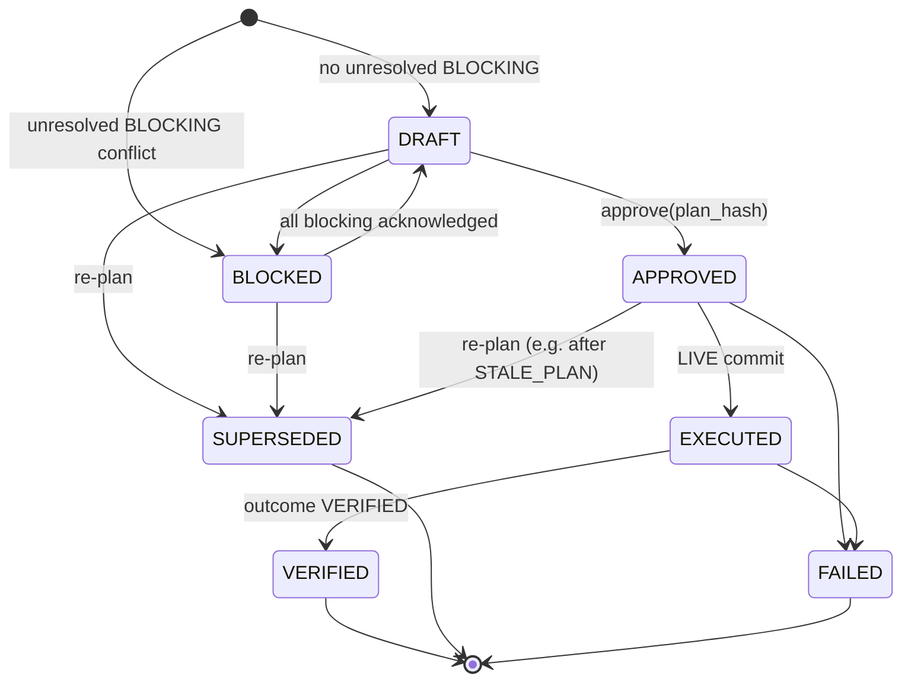

`check_transition(current, target)` raises `InvalidStateTransition` (`INVALID_STATE`). `check_approval(plan, current, approved_hash)` checks not-blocked (`PlanBlockedError`), the transition to APPROVED, and `approved_hash == plan.plan_hash` (`PlanHashMismatch`). **[IMPL]** `unit/planner/test_hashing_state.py::test_transition_matrix`, `::test_initial_status_and_approval_checks`, `e2e/test_security_api.py::test_superseded_plan_cannot_be_approved_or_executed`, `::test_unapproved_plan_cannot_be_executed`.

Note (code fact): only `approve` goes through `check_transition`. The service sets SUPERSEDED, EXECUTED and VERIFIED directly with `PlanRepo.set_status`, and **no code path sets plan status `FAILED`**: after a failed LIVE run the plan stays APPROVED (the run is FAILED), and after a FAILED or PARTIAL verification it stays EXECUTED. The request status follows the outcome instead (§8.5). See Appendix B.

### 7.8 The executor (`executor/executor.py`)

> **`execute_plan(plan, approval, writer, rediscover, audit, mode, *, clock, pseudonym_columns=(), recompute_sql=None, plan_hasher=None, actor="lae-executor") -> ExecutionResult`**
> - *Purpose:* run an approved plan inside the **caller's** transaction. It never commits or rolls back.
> - *Algorithm:*
>   1. preconditions: `plan.is_blocked` → `PlanBlockedError`; `approval.plan_id`/`plan_hash` must match → `PlanHashMismatch`; if `plan_hasher` is given, the recomputed hash must equal `plan.plan_hash` → `PlanHashMismatch`; `_validate`: strictly increasing `step_order`, `depends_on` only on earlier steps, key arity = `len(key_columns)` → `PlanError("INVALID_PLAN")`;
>   2. **drift check before any write:** `(fp, rs) = rediscover(writer)`; if `fp != plan.schema_fingerprint` or `rs != plan.record_set_hash` → `StalePlanError` with `details = {schema_changed, records_changed}`;
>   3. `lock_all`: `lock_rows` (`SELECT 1 … FOR UPDATE`) for every RECORD item with keys except SCHEDULE_EXTERNAL / UNRESOLVED, asserting the locked count equals `expected_row_count` (`RowCountMismatch`);
>   4. `run_all`, per item in order: `_NO_DML` actions (SCHEDULE_EXTERNAL, MANUAL_REVIEW, UNRESOLVED) → SKIPPED; DELETE_ROWS → first `check_cascades` (parse `CASCADE_CHECK_RE` from the reason, count child rows per CASCADE FK with `count_by_columns`, must equal the planned `n`), then `delete_rows`; DELETE_ROWS / DELETE_DERIVED_BY_KEY / INVALIDATE_CACHE → `delete_rows` + rowcount check; EXPECT_CASCADE → `remaining = count_by_columns(...)` must be 0 and `locked − remaining` must equal the expected count; ANONYMIZE_ROWS / NULLIFY_REFERENCE → `update_columns` with `ColumnAssignment("PSEUDONYM")` for columns in `pseudonym_columns` (ANONYMIZE only) and `ColumnAssignment("NULL")` otherwise, rowcount check; REFRESH_MATVIEW → `refresh_matview`; RECOMPUTE_TABLE → the supplied SQL's `definition_sha256` token must appear in the hashed reason (else `PlanHashMismatch`), then `recompute_table`; RETAIN_ROWS → `count_by_columns` must equal the expected count (rows are not modified);
>   5. LIVE only: `audit.append(EXECUTION_COMMITTED, "erasure_plan", plan_id, actor, {plan_id, plan_hash, mode, approved_by, started_at, finished_at, steps})` in the same transaction; status COMMITTED. DRY_RUN: status ROLLED_BACK (the caller must roll back).
> - *Errors:* every failure is re-raised with `details.completed_steps`, `step_order`, `action`, `table` (never key values); a non-LaeError becomes `ExecutionError("STEP_FAILED", details.error_type=<class name>)`.
> - *Tests:* `unit/executor/test_executor.py` (32 tests), e.g. `::test_live_happy_path_erases_subject_and_keeps_others`, `::test_dry_run_performs_identical_operations_and_changes_nothing`, `::test_blocked_plan_is_rejected_before_any_access`, `::test_hash_mismatch_and_wrong_plan_are_rejected`, `::test_new_order_after_planning_is_stale_and_nothing_is_written`, `::test_schema_change_is_stale`, `::test_dml_rowcount_mismatch_rolls_back_everything`, `::test_cascade_that_leaves_rows_is_a_mismatch`, `::test_unplanned_cascade_row_inserted_after_planning_rolls_back`, `::test_missing_cascade_child_is_also_a_mismatch`, `::test_malformed_cascade_check_is_invalid_plan`, `::test_injected_failure_at_any_step_rolls_back_fully`, `::test_recompute_requires_matching_definition`, `::test_external_and_unresolved_steps_are_skipped_and_never_locked`, `::test_shared_message_with_not_null_link_is_never_deleted` **[IMPL]**

**[LIMIT]** `RECOMPUTE_TABLE` has no rowcount assertion against a planned count (the item is TABLE level, so `expected_row_count` is `None`); a wrong definition is detected only afterwards by `DERIVED_CONSISTENT` (review L1, limitations.md #12). **[LIMIT]** The cascade check covers direct children of a batch; an unplanned grandchild under a planned child is not counted (CR erasure-engine-engineer-1, implementation note).

**Dry run.** DRY_RUN performs exactly the same reads, locks and writes (so rowcount and cascade assertions are exercised), but the service always rolls the SERIALIZABLE transaction back, so data and the `EXECUTION_COMMITTED` event are discarded; only `EXECUTION_STARTED` and `EXECUTION_ROLLED_BACK` (separate transactions) remain. A DRY_RUN may run on DRAFT or APPROVED plans and uses a synthetic approval `dry-run:<actor>`.

**Pseudonyms.** `PgTargetWriter.update_columns` writes
`col = 'anon_' || left(encode(hmac(convert_to(<pk1>::text || ':' || <pk2>::text …, 'UTF8'), <pseudonym subkey>, 'sha256'), 'hex'), 16)`
(`PSEUDONYM_PREFIX = "anon_"`; key text = the table's PK, else the key columns). A pseudonym needs a text, non-JSON column. Verification accepts a value as anonymized iff it is NULL or matches `PSEUDONYM_PATTERN = anon_[0-9a-f]{16}` (`verification/checks.py::is_anonymized`). `pseudonym_columns(plan, policies, lineage)` selects ANONYMIZE target columns whose confirmed strategy is PSEUDONYMIZE **and** that are not FK columns of the item's reason edges (a pseudonym would break the FK) (`unit/planner/test_build_plan.py::test_pseudonym_columns_excludes_fk_columns`, `integration/db/test_target.py::test_update_columns_null_and_pseudonym`, `::test_pseudonym_composite_key_and_key_required`). **[LIMIT]** The pseudonym-vs-NULL choice is computed from policies at execution time and is not bound by the plan hash (review L2).

### 7.9 Worked example on the in-memory harness (executed)

Schema (built with `backend/tests/unit/planner/erasure_harness.py::Schema` and `FakeDB`, run through the **real** `discover_records`, `build_plan`, `execute_plan` and `verify_execution`):
`customer(id, email NOT NULL, referrer_id)` with `customer_referrer_id_fkey` SET NULL; `customer_address(id, customer_id NOT NULL, street)` CASCADE; `purchase_order(id, customer_id, shipping_name)` RESTRICT, policy ANONYMIZE; confirmed PII `customer.email` and `purchase_order.shipping_name` (PSEUDONYMIZE). Rows: customers 42 and 77 (77 was referred by 42), address 7 and order 1 of 42, order 2 of 77.

Discovery: `customer 42 SUBJECT_ROOT (0)`, `customer 77 REFERENCING_OTHER_SUBJECT (1)`, `customer_address 7 OWNED (1)`, `purchase_order 1 OWNED (1)`. Record-set hash `b948ba6c…77f4ee`.

Plan `c748fe94…f1ad3` (DRAFT, not blocked):

| Step | Action [category] | Table | Keys | Expected | depends_on | Reason (verbatim) |
|---|---|---|---|---|---|---|
| 1 | NULLIFY_REFERENCE [INVALIDATE] | app.customer | (77,) | 1 | – | NULLIFY_REFERENCE referrer_id on 1 row of app.customer: rows belong to other subjects and reference the subject via FK customer_referrer_id_fkey (ON DELETE SET NULL) |
| 2 | ANONYMIZE_ROWS [RETAIN] | app.purchase_order | (1,) | 1 | – | ANONYMIZE 1 row of app.purchase_order: retention policy ANONYMIZE; columns customer_id (NULLIFY: references rows being deleted), shipping_name (PSEUDONYMIZE) |
| 3 | DELETE_ROWS [DELETE] | app.customer | (42,) | 1 | 1, 2 | DELETE 1 row of app.customer: subject root; cascade_check customer_address_customer_id_fkey: app.customer_address(customer_id) <- (id) = 1 |
| 4 | EXPECT_CASCADE [DELETE] | app.customer_address | (7,) | 1 | 3 | EXPECT_CASCADE 1 row of app.customer_address: removed by FK customer_address_customer_id_fkey (ON DELETE CASCADE) when the referenced rows of app.customer are deleted |

Conflict: `RETAINED_WITH_PII WARNING app.purchase_order: column(s) shipping_name are pseudonymized, not anonymized; retained rows may still be re-identifiable`. `pseudonym_columns` = `{app.purchase_order.shipping_name}` (`customer_id` is an FK column, so it is set to NULL).

- **Drift:** inserting a second address for 42 after planning and executing LIVE raises `StalePlanError STALE_PLAN {'schema_changed': False, 'records_changed': True}`; nothing is written.
- **Dry run:** `ROLLED_BACK`, steps `(1, APPLIED, 1, 1) … (4, APPLIED, 1, 1)`, data checksum unchanged, 0 audit events.
- **LIVE:** `COMMITTED`, same step counts, one `EXECUTION_COMMITTED` event. Afterwards: customer 77 remains with `referrer_id=None`; address 7 is gone; order 1 has `customer_id=None`, `shipping_name='anon_9cdf8c66967181a1'` (the harness's fake pseudonym, same shape as the SQL one); order 2 of customer 77 is untouched.

Variant with shared records (executed): `support_ticket 10` of 42 (SET NULL), `ticket_message 401` by 42 and `402` by 77 on ticket 10 (`ticket_id` NOT NULL CASCADE). Discovery marks 402 **SHARED**. The plan is **blocked**: `DELETE_ROWS support_ticket 10` → `DELETE_ROWS customer 42` (depends on 1) → `EXPECT_CASCADE ticket_message 401` → `MANUAL_REVIEW ticket_message 402`, with `CASCADE_DESTROYS_RETAINED BLOCKING` ("cascade would delete a record not owned by the subject (1 row via FK m_ticket (ON DELETE CASCADE), NOT NULL column(s) ticket_id)") and `SHARED_RECORD BLOCKING`. **[IMPL]** `integration/services/test_api_e2e.py::test_shared_records_block_live_execution`.

---

## 8. Transactions and concurrency

### 8.1 Engines and `session_scope` (`lae/db/engine.py`)

`make_engine(settings, role)` builds a SQLAlchemy engine with `hide_parameters=True` (statement parameters never appear in exceptions or logs) and, on every new connection, runs `set_config('statement_timeout', …)`, `set_config('lock_timeout', …)` and `set_config('TimeZone', 'UTC', false)` with bound values. `session_scope(engine, *, isolation=None, read_only=False)` opens one transaction, optionally at `READ COMMITTED` / `REPEATABLE READ` / `SERIALIZABLE` (`ISOLATION_LEVELS`), optionally issuing `SET TRANSACTION READ ONLY` first; it commits on success and rolls back on any exception. SQLSTATE `40001` / `40P01` are re-raised as `SerializationConflict` (`is_serialization_failure`). **[IMPL]** `integration/db/test_engine.py::test_session_scope_commit_rollback_isolation_readonly`, `::test_serialization_failure_is_translated`, `::test_make_engine_roles_and_timeouts`.

### 8.2 Isolation level per operation (`services/pipeline.py`)

| Operation | Transaction(s) | Engine | Isolation | Audit event(s) in the same transaction |
|---|---|---|---|---|
| `create_snapshot` | 1 | owner | default (READ COMMITTED) | `SNAPSHOT_CREATED` |
| `latest_snapshot`, `latest_or_new_snapshot` (check) | 1 | reader | default, READ ONLY | – |
| `set_edge_status` | 1 | owner | default | `EDGE_STATUS_CHANGED` (skipped if unchanged) |
| `create_request` | 1 (+ snapshot) | owner | default | `REQUEST_RECEIVED` |
| `run_discovery` | read + write | reader, then owner | **REPEATABLE READ, READ ONLY**; then default | `DISCOVERY_COMPLETED` (only when `audit=True`) |
| `generate_plan` | read + write | reader, then owner | **REPEATABLE READ, READ ONLY** (discovery, probes, ambiguity counts, predicate counts on one snapshot); then default | `PLAN_CREATED` |
| `acknowledge` | 1 | owner | default | `CONFLICT_ACKNOWLEDGED` |
| `approve` | 1 | owner | default | `PLAN_APPROVED` |
| `_execute` phase 1 (checks, start run) | 1 | owner | default | `EXECUTION_STARTED` |
| `_execute` phase 2 (the erasure) | 1 | owner | **SERIALIZABLE** | `EXECUTION_COMMITTED` (appended by the executor; LIVE only) |
| `_execute` phase 3 (dry run or failure) | 1 | owner | default | `EXECUTION_ROLLED_BACK` (DRY_RUN) or `EXECUTION_FAILED` (LIVE error) |
| `verify` | start + checks + complete | owner, reader, owner | default; **REPEATABLE READ, READ ONLY**; default | `VERIFICATION_COMPLETED` (+ `EDGE_STATUS_CHANGED` for residual suggestions) |
| `issue_evidence` | 1 | owner | default | `EVIDENCE_ISSUED`, and `SUBJECT_DATA_PURGED` if VERIFIED |
| `export_anchor` | 1 + file write | owner | default | `CHAIN_HEAD_EXPORTED` |
| `evidence_export` | 1 | reader | default, READ ONLY | – |

The audit event is always appended **inside** the transaction of the state change it records (CLAUDE.md rule 6), so either both commit or neither does.

### 8.3 Concurrency controls

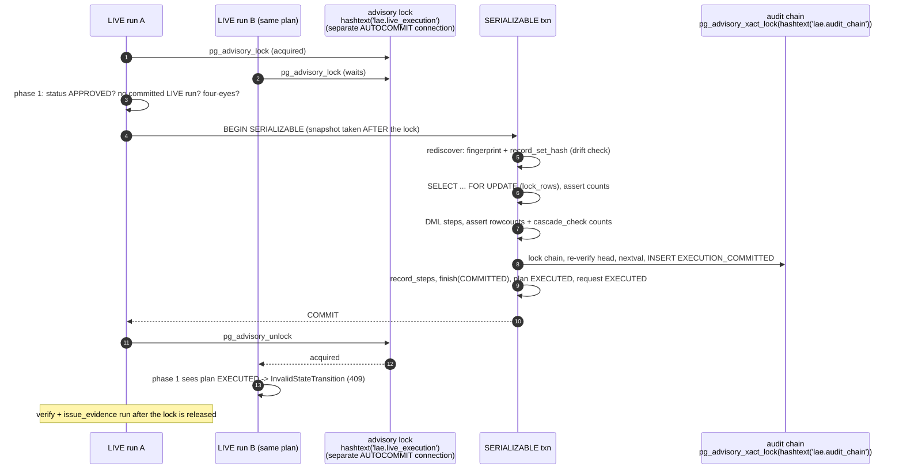

| Control | Where | What it prevents |
|---|---|---|
| `_live_execution_lock` (session-level `pg_advisory_lock(hashtext('lae.live_execution'))` on a separate AUTOCOMMIT connection, held for the whole LIVE execution) | `services/pipeline.py` | Two LIVE runs whose SERIALIZABLE snapshots both see the same chain head: with only the unique index *neither* could commit. With the lock the second run starts after the first commits and fails cleanly. |
| SERIALIZABLE transaction + drift re-check inside it | `pipeline._execute`, `executor.execute_plan` | Acting on a plan whose schema or record set changed (`STALE_PLAN`). |
| `SELECT … FOR UPDATE` on every in-DB RECORD item (`PgTargetWriter.lock_rows`) + count assertions | `executor._Run.lock_all` | Concurrent modification of the rows between check and DML. |
| `cascade_check` count before each parent DELETE | `executor._Run.check_cascades` | Unplanned cascades, e.g. a child inserted concurrently after the drift check. |
| Audit sink transaction-level advisory lock (`CHAIN_LOCK_KEY = "lae.audit_chain"`), head re-verification, `nextval` before INSERT | `lae/db/audit_sink.py::PgAuditSink.append` | Interleaved appends; appending onto a corrupted head (`AuditChainBroken`). |
| `uq_audit_event_prev_hash` (0003) | DB | A forked chain under any concurrency; the violation is translated to `SerializationConflict` (HTTP 503, retryable). |
| `uq_execution_run_live_committed` (partial unique) | DB; `ExecutionRepo.finish` translates it to `AlreadyExecutedError` | Two committed LIVE runs for one plan. |
| `uq_erasure_plan_active` (partial unique) | DB | Two live (DRAFT/BLOCKED/APPROVED) plans for one request. |
| Duplicate-request check by subject HMAC | `pipeline.create_request` | A second open request for the same subject (409). |
| Four-eyes: `require_four_eyes and approval.approved_by == actor` → `InvalidStateTransition(details={"rule": "four_eyes"})` | `pipeline._execute` (LIVE only) | The approver executing their own approval. |

**Tests [IMPL]:** `e2e/test_security_db.py::test_two_threads_executing_the_same_plan_commit_exactly_once`, `::test_failed_execution_leaves_data_intact_and_plan_replannable`, `e2e/test_security_api.py::test_double_live_execution_is_rejected`, `::test_four_eyes_approver_cannot_execute`, `::test_second_open_request_for_same_subject_is_rejected`, `integration/db/test_audit_sink.py::test_concurrent_appends_are_serialized`, `::test_tampering_is_detected_at_exact_seq`, `integration/services/test_api_e2e.py::test_drift_between_approval_and_execution_is_detected`, `integration/services/test_security_hardening.py::test_four_eyes_and_replan_after_stale`, `::test_subject_key_is_canonical_and_duplicates_rejected`, `unit/executor/test_executor.py::test_unplanned_cascade_row_inserted_after_planning_rolls_back`.

### 8.4 What happens on failure

1. Any `LaeError` (e.g. `STALE_PLAN`, `ROW_COUNT_MISMATCH`, `PLAN_HASH_MISMATCH`, `SERIALIZATION_CONFLICT`) or unexpected exception inside phase 2 leaves `session_scope`, which **rolls back everything**, data DML and the in-transaction audit event. An unexpected exception becomes `ExecutionError("EXECUTION_FAILED", details.type=<class>)` so the run is never left RUNNING (review L3).
2. Phase 3 (new transaction) stores the step results if the executor returned a result (a dry run; when the executor raised, there is no result and the completed steps exist only in the error's `details.completed_steps`), sets the run to `FAILED` (LIVE) or `ROLLED_BACK` (DRY_RUN) with `ErrorInfo(code, message)`, and appends `EXECUTION_FAILED` / `EXECUTION_ROLLED_BACK` with the error code and the number of recorded steps.
3. The error is re-raised with `details.execution_run_id` and mapped to an HTTP status (§13.2).
4. The plan stays APPROVED. After `STALE_PLAN` the operator re-plans: `generate_plan` supersedes the live plan (SUPERSEDED) and purges its raw keys.

### 8.5 End-to-end sequence

```mermaid
sequenceDiagram
  autonumber
  actor Op as Operator (UI/CLI)
  participant API as FastAPI /api
  participant P as services.pipeline
  participant D as discovery+lineage
  participant PL as planner
  participant X as executor
  participant V as verification
  participant AU as audit (sink, evidence)
  participant DB as PostgreSQL
  Op->>API: POST /erasure-requests {subject_root, subject_key}
  API->>P: create_request
  P->>DB: latest_or_new_snapshot (fingerprint compare / create_snapshot)
  P->>DB: read subject row, canonical key, duplicate check by HMAC
  P->>AU: REQUEST_RECEIVED (same txn)
  Op->>API: POST /discovery/{request_id}
  API->>P: run_discovery (REPEATABLE READ, READ ONLY)
  P->>D: discover_records (BFS, roles)
  P->>AU: DISCOVERY_COMPLETED
  Op->>API: POST /erasure-plans/{request_id}/generate
  API->>P: generate_plan
  P->>D: discover_records + capture_residual_probes + _exclude_ambiguous_probes
  P->>PL: build_plan -> ErasurePlan(plan_hash)
  P->>DB: supersede old live plan (+ purge its raw keys), store plan, HMACs, probes
  P->>AU: PLAN_CREATED
  opt acknowledgeable conflicts
    Op->>API: POST .../conflicts/{id}/acknowledge
    P->>AU: CONFLICT_ACKNOWLEDGED (new plan_hash)
  end
  Op->>API: POST /erasure-plans/{id}/approve {plan_hash} (X-LAE-Actor = approver)
  P->>PL: compute_plan_hash == stored; check_approval
  P->>AU: PLAN_APPROVED
  Op->>API: POST /erasure-plans/{id}/execute {mode: DRY_RUN}
  P->>X: execute_plan in SERIALIZABLE txn, then ROLLBACK
  P->>AU: EXECUTION_STARTED, EXECUTION_ROLLED_BACK
  Op->>API: POST /erasure-plans/{id}/execute {mode: LIVE} (X-LAE-Actor = executor)
  P->>P: _live_execution_lock, four-eyes check
  P->>X: execute_plan (drift, FOR UPDATE, DML, asserts)
  X->>AU: EXECUTION_COMMITTED (same txn) -> COMMIT
  P->>V: verify (REPEATABLE READ, READ ONLY): per-item checks, EMBEDDING_ABSENT, REDISCOVERY_EMPTY, RESIDUAL_VALUE_SCAN
  P->>DB: store report, residual-hit SUGGESTED edges, plan VERIFIED?, request status
  P->>AU: VERIFICATION_COMPLETED
  P->>AU: issue_evidence: leaves, Merkle root, Ed25519 signature, chain anchor
  P->>AU: EVIDENCE_ISSUED
  alt outcome VERIFIED
    P->>DB: purge erasure_request.subject_key + raw keys of all plan versions
    P->>AU: SUBJECT_DATA_PURGED
  end
  P->>AU: export_anchor -> var/anchors/anchor-<seq>.json, CHAIN_HEAD_EXPORTED
  Op->>API: GET /evidence/{request_id}/download, /leaves
```

Request status after verification (`pipeline.verify`): VERIFIED → `VERIFIED` (with `completed_at`); PARTIAL → stays `EXECUTED`; FAILED → `FAILED`. Plan status becomes `VERIFIED` only for outcome VERIFIED. Evidence is issued for any outcome except a verification run in status `ERROR`. **[IMPL]** `integration/services/test_api_e2e.py::test_full_erasure_happy_path_checked_against_the_database`, `::test_verified_outcome_purges_raw_subject_data`, `::test_hidden_copies_fail_verification_and_are_suggested`.

Purge (`issue_evidence`, only for VERIFIED): `RequestRepo.purge_subject_key` sets `erasure_request.subject_key = NULL`; `PlanRepo.purge_raw_keys` NULLs `plan_item.record_keys` and `record_dependency.parent_key/child_key` for **every** plan version of the request (HMACs stay). Superseded versions are purged already at re-plan time (review H3). **[LIMIT]** PARTIAL and FAILED requests keep the raw key with no deadline; `reason` and actor strings are never purged (limitations.md #22, review L6). **[IMPL]** `e2e/test_security_db.py::test_no_raw_pii_in_logs_responses_or_lae_schema_after_purge`, `integration/db/test_repositories.py::test_plan_round_trip_approval_and_purge`.

---

## 9. Residual PII detection

Lineage can miss copies (an un-modelled table, a hidden column, free text). The residual scan is an independent check that does not use lineage at all: it looks for the subject's identifier values, as HMACs, in every text-like column.

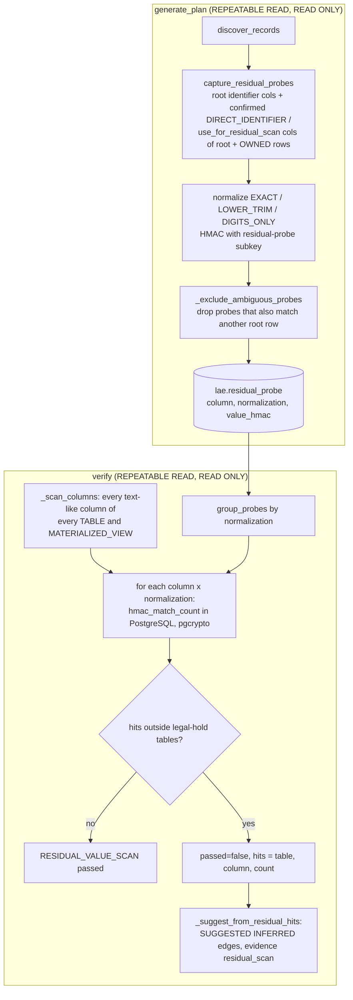

### 9.1 Probe capture

> **`capture_residual_probes(root, subject_key, record_graph, reader, policies, keyring, *, batch_size=1000) -> list[ResidualProbe]`** · `discovery/records.py`
> - *Purpose:* HMAC digests of the subject's identifier values, taken before erasure.
> - *Algorithm:* columns = the root's `identifier_columns` plus confirmed PII columns that are `DIRECT_IDENTIFIER` or have `use_for_residual_scan=True` (`_probe_columns`). Rows = the subject root plus OWNED rows of those tables (SHARED and other subjects' rows are ignored). Values are read in batches; for each non-NULL value and each normalization from `probe_normalizations` whose normalized text is not blank, `keyring.digest(value, norm)` gives one probe. Sorted and unique. The service passes `rt.probe_keyring` (the residual-probe subkey). Root row missing → `SubjectNotFoundError`.
> - *Example (executed, §7.9 data, key `bytes(range(32))`):* three probes: `customer.email EXACT a59fc578…`, `customer.email LOWER_TRIM a59fc578…` (same digest: `"alice@example.com"` is already normalized), `purchase_order.shipping_name EXACT c532fe4b…`.
> - *Tests:* `unit/discovery/test_residual_probes.py::test_probes_contain_only_hmacs`, `::test_expected_digests_and_normalizations`, `::test_root_only_probes_without_policies`, `::test_unconfirmed_policies_add_nothing`, `::test_empty_normalized_values_are_skipped`, `::test_missing_subject_raises`, `::test_batching_of_probe_reads`, `integration/discovery/test_residual_probes_integration.py::test_primary_probes_are_hmacs_only`, `::test_probes_find_the_hidden_copies_fk_discovery_missed`, `::test_probes_ignore_shared_and_other_subject_rows` **[IMPL]**

`probe_normalizations(column, value)`: always `EXACT`; plus `LOWER_TRIM` if the column name contains `email`, `e_mail` or `mail`, or the value contains `@`; plus `DIGITS_ONLY` if the name contains `phone`, `mobile`, `tel`, `fax` or `msisdn` (`unit/discovery/test_residual_probes.py::test_probe_normalizations`).

### 9.2 Normalizations (`audit/hmac_keys.py::normalize` and its SQL twins in `lae/db/target.py`)

| Normalization | Python (`normalize`) | SQL used by `hmac_match_count` |
|---|---|---|
| `EXACT` | text unchanged (ints rendered in decimal) | `(col::text)` |
| `LOWER_TRIM` | strip exactly `LOWER_TRIM_STRIP_CHARS` = space, TAB, LF, CR, FF, VT (U+000B) from both ends, then map only `A–Z` → `a–z` | `LOWER_TRIM_SQL` = `translate(btrim(col, E' \t\n\r\f\x0B'), 'ABCDEFGHIJKLMNOPQRSTUVWXYZ', 'abcdefghijklmnopqrstuvwxyz')` |
| `DIGITS_ONLY` | keep only ASCII `0–9` | `DIGITS_ONLY_SQL` = `regexp_replace(col, '[^0-9]', '', 'g')` |

JSON/JSONB columns are cast with `::text` first. **The `\x0B` note:** PostgreSQL escape strings have no `\v` escape (`E'\v'` is the letter `v`), so the vertical tab must be written `\x0B`. Writing `\v` would strip leading and trailing `v` letters (`'vivian'` → `'ivian'`) and miss VT (CR verification-crypto-engineer-2 §1). LOWER_TRIM is ASCII-only and locale-independent on purpose, so Python and SQL agree byte for byte.

*Example (executed):* `normalize("  Alice@Example.COM\t", LOWER_TRIM)` = `'alice@example.com'`; `normalize("+1 (555) 010-9999", DIGITS_ONLY)` = `'15550109999'`; `normalize("\x0bVivian\x0b", LOWER_TRIM)` = `'vivian'`; `normalize("ÉMILE", LOWER_TRIM)` = `'Émile'` (the non-ASCII `É` is unchanged); `normalize(42, EXACT)` = `'42'`. With `HmacKeyring(bytes(range(32)))`, `digest("  Alice@Example.COM\t", LOWER_TRIM)` = `digest("alice@example.com")` = `a59fc578d4cb46faab1d6eb348e7c74b33b85122d6459fdb7bf5654b333acab4`.

**[IMPL]** `unit/audit/test_hmac_keys.py::test_lower_trim`, `::test_digits_only`, `::test_lower_trim_strip_set_is_exactly_ascii_whitespace`, `::test_lower_trim_equals_sql_model`, `::test_lower_trim_equals_sql_model_on_tricky_alphabet`, `::test_lower_trim_digest_matches_reference`, `integration/db/test_target.py::test_lower_trim_matches_python_normalization`, `::test_hmac_match_counts_ground_truth_hidden_copies`, `::test_hmac_match_on_jsonb_and_rejections`, `integration/verification/test_residual_real.py::test_lower_trim_is_needed_for_the_variants`.

### 9.3 The in-database scan

> **`PgTargetReader.hmac_match_count(col, digests, normalization, hmac_key) -> int`** · `lae/db/target.py`
> - *SQL:* `SELECT count(*) FROM <t> WHERE encode(hmac(convert_to(<normalized col>, 'UTF8'), %s, 'sha256'), 'hex') = ANY(%s)`, with the key and the sorted, lower-cased digest list as **bound parameters** (pgcrypto `hmac`). The column must be text-like (`is_text_like`), the key ≥ 32 bytes. Values never leave the database; only a count returns.

> **`check_residual(reader, plan, probes, scan_columns, hmac_key, policies) -> CheckResult`** · `verification/residual.py`
> - *Algorithm:* `group_probes` groups digests by normalization (rejects non-hex64 digests with `VerificationError("INVALID_PROBE")`). For every scan column and every normalization the counts are summed. A column with hits in a table that has both policy `RETAIN` and a `RETAIN_ROWS` item goes to `retained_hits` (legal hold, does not fail); all others go to `hits`. `passed` iff `total_hits == 0`. `observed = {hits, retained_hits, total_hits, columns_scanned, probe_count}`, `expected = {"total_hits": 0}`.
> - *Example (executed, §7.9 after LIVE):* scan of `customer.email`, `purchase_order.shipping_name`, `customer_address.street` with the 3 probes → `total_hits 0`, passed. After inserting a hidden copy `shipping_name = "  ALICE@example.com "` the check fails with `hits = [{"table": "app.purchase_order", "column": "shipping_name", "count": 1}]` (matched by the LOWER_TRIM probe of `customer.email`) and the outcome becomes FAILED.
> - *Tests:* `unit/verification/test_engine.py::test_residual_scan_catches_hidden_copy_lineage_missed`, `::test_residual_counts_sum_over_normalizations`, `::test_retained_table_without_retain_item_counts_as_hit`, `::test_retain_item_without_retain_policy_counts_as_hit`, `::test_residual_scan_without_probes`, `::test_residual_scan_deduplicates_columns`, `::test_malformed_probe_digest`, `integration/verification/test_residual_real.py::test_probes_are_digests_of_the_subject`, `::test_fk_only_erasure_leaves_hidden_copies`, `::test_erasing_hidden_copies_passes_and_verifies`, `::test_retained_legal_hold_hits_are_reported_separately` **[IMPL]**

Scan surface (`pipeline._scan_columns`): every column whose base type is one of `text`, `character varying`, `varchar`, `citext`, `jsonb`, `json`, `character`, in every TABLE and MATERIALIZED_VIEW of the catalog. Views are skipped (they would double-count their base tables).

### 9.4 Ambiguous-probe exclusion

> **`_exclude_ambiguous_probes(rt, reader, catalog, root, key, probes) -> tuple[list[ResidualProbe], int]`** · `services/pipeline.py`
> - *Purpose:* avoid false FAILED outcomes caused by a value shared with another person (e.g. two customers with the same name).
> - *Algorithm:* for each probe, `own` = number of text columns of the **subject's own root row** whose digest under the probe's normalization equals the probe; `total` = Σ over the root table's text columns of `hmac_match_count(col, [probe], normalization, probe_key)`. Keep the probe iff `total ≤ own`. Returns the kept probes and the number excluded (recorded as `ambiguous_probes_excluded` in the `PLAN_CREATED` payload).
> - *Tests:* `integration/services/test_security_hardening.py::test_shared_name_does_not_cause_false_residual_failure` **[IMPL]**
> - **[LIMIT]** A surviving copy of a non-unique value (e.g. a shared name) is not detected (limitations.md #17a). Benchmarks report how many probes were excluded (e.g. 34 of 82+34 at default/S1, §10.5).

### 9.5 Residual-hit feedback into lineage

> **`_suggest_from_residual_hits(rt, s, snapshot_id, root, report, actor) -> list[RelationshipEdge]`** · `services/pipeline.py`
> - *Algorithm:* for each failed `RESIDUAL_VALUE_SCAN` hit `(table, column, count)` outside the root table, propose `root.<identifier column> → table.column` (preferring an identifier column with the same name) as a TABLE and a COLUMN edge: `origin=INFERRED`, `status=SUGGESTED`, `transform=IDENTITY`, `KEY_PRESERVING`, `confidence=0.5`, details `{"evidence": "residual_scan", "hit_count", "note"}`. Ids are `uuid5(_RESIDUAL_NS, "<level>|<root>.<src>|<target>.<col>")`; already-suggested pairs (including containment suggestions for the same columns) are skipped. Saved in the snapshot with an `EDGE_STATUS_CHANGED` event, and carried into later snapshots by `create_snapshot`.
> - *Effect:* once a human CONFIRMS it, discovery traverses it with **exact** matching, so exact copies are deleted by predicate; case/whitespace variants remain detectable only by the scan.
> - *Tests:* `integration/services/test_api_e2e.py::test_hidden_copies_fail_verification_and_are_suggested`, `frontend/src/pages/LineagePage.test.tsx › "shows residual_scan evidence with hit_count and confirms the edge with the token"` **[IMPL]**. Measured effect: §10.5 (`S2_after_feedback`).

### 9.6 What the residual scan cannot detect

**[LIMIT]** (limitations.md #16–#19, security_analysis.md §4, CR verification-crypto-engineer-2 §4):
- substrings in free text (a name or email inside `document.body`) and values inside JSON (the `jsonb::text` form keeps quotes and keys, so a whole-value match fails);
- Unicode case variants (`É` vs `é`), other Unicode whitespace (NBSP), encodings (base64, URL encoding), hashes, encrypted, transformed or concatenated values, array columns;
- non-unique identifiers excluded as ambiguous (§9.4);
- anything when there are zero probes (the check passes vacuously, review L5);
- a hidden copy inside a legal-hold table (exemption is per table, review L5);
- counts are *matches summed over normalizations*, not distinct rows (a row matching EXACT and LOWER_TRIM counts twice); pass/fail is unaffected (limitations.md #18);
- data outside PostgreSQL's live relations (WAL, backups, dead tuples, replicas, files).

**[FUTURE]** A substring scan (would need raw probe values as bound parameters before the purge), a per-row legal-hold exclusion (`hmac_match_count(..., exclude_keys=...)`), and the vector-digest part of `EMBEDDING_ABSENT` were proposed in CR verification-crypto-engineer-2 §4–5 and are not implemented.

### 9.7 The verification engine as a whole (`verification/engine.py`)

The residual scan is one of several independent checks. The whole flow:

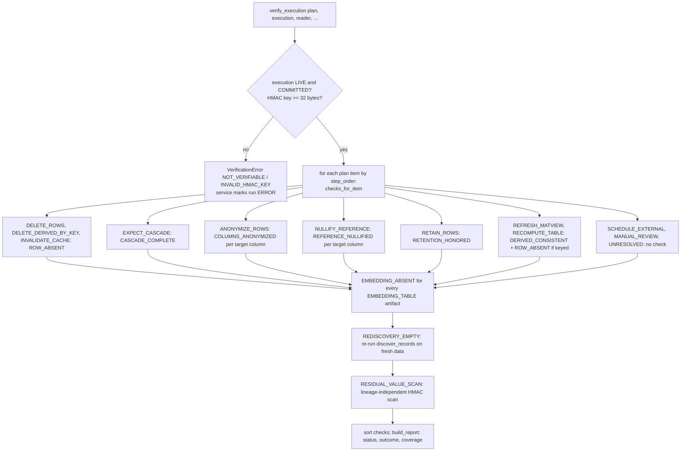

> **`verify_execution(plan, execution, reader, rediscover_records, artifacts, probes, scan_columns, hmac_key, policies) -> VerificationReport`**
> - *Rule:* failing checks are **data** (`passed=False`); `VerificationError` is raised only when a check *cannot run* (reader error → `CHECK_NOT_RUNNABLE` with only the exception class name, unchained because PostgreSQL messages can quote values; invalid count → `INVALID_READER_RESULT`; a key-based action at TABLE level → `UNCHECKABLE_ITEM`; a refresh item without a registered definition → `UNCHECKABLE_ITEM`; two artifacts with one target → `AMBIGUOUS_ARTIFACT`). The service then records the run as `ERROR` and issues no evidence.
> - *Sorting:* by `(step_order is None, step_order, check_type, table, column)`, global checks last.
> - *Tests:* `unit/verification/test_engine.py` (54 tests, e.g. `::test_correct_erasure_is_verified`, `::test_checks_sorted_and_deterministic`, `::test_observed_expected_hold_only_counts`, `::test_only_committed_live_is_verifiable`, `::test_bad_hmac_key`, `::test_reader_error_is_verification_error_without_pii`, `::test_table_level_keyed_action_cannot_run`, `::test_ambiguous_artifact_target`), `integration/verification/test_checks_real.py` (10 tests on real PostgreSQL) **[IMPL]**

| Check function (`verification/checks.py`, `rediscovery.py`) | Passes iff | Observed / expected (counts only) | Tests **[IMPL]** |
|---|---|---|---|
| `check_absent(reader, item)` (ROW_ABSENT / CASCADE_COMPLETE) | `count_by_columns(item keys) == 0` | `remaining_rows`; `planned_keys` | `unit/verification/test_engine.py::test_row_absent_fails_when_root_remains`, `::test_cascade_complete_fails`, `::test_invalidate_cache_fails`, `integration/verification/test_checks_real.py::test_row_absent_with_composite_keys`, `::test_cascade_complete_real` |
| `check_anonymized(reader, item)` (COLUMNS_ANONYMIZED) | rows still present = expected **and** every target column `is_anonymized` (NULL or `anon_[0-9a-f]{16}`) | `rows_present`, `violations` | `::test_columns_anonymized_fails_on_raw_value`, `::test_pseudonym_pattern_is_strict`, `::test_anonymized_row_deleted_fails`, `integration/verification/test_checks_real.py::test_columns_anonymized_with_real_pseudonyms` |
| `check_nullified(reader, item, plan)` (REFERENCE_NULLIFIED) | all target columns NULL; a missing row is allowed only if a DELETE-category item of the plan removes it | `rows_present`, `rows_deleted_by_plan`, `rows_missing`, `violations` | `::test_reference_not_nullified`, `::test_referencing_row_of_other_subject_vanished`, `::test_nullified_then_deleted_row_is_fine`, `integration/verification/test_checks_real.py::test_reference_nullified_missing_row_unless_plan_deletes_it` |
| `check_retained(reader, item)` (RETENTION_HONORED) | rows present = expected | `rows_present` | `::test_retention_honored_fails_when_row_deleted`, `::test_retention_honored_fails_on_extra_row` |
| `check_derived(reader, item, plan, artifacts)` (DERIVED_CONSISTENT + ROW_ABSENT) | `symmetric_difference_count(stored, definition) == 0`, i.e. \|stored EXCEPT ALL fresh\| + \|fresh EXCEPT ALL stored\| = 0; plus no subject-keyed rows left (item keys, or keys derived through `subject_source_keys`) | `difference_rows`; `remaining_rows` | `::test_derived_inconsistent`, `::test_subject_row_left_in_key_preserving_artifact`, `::test_recompute_table_is_checked`, `integration/verification/test_checks_real.py::test_derived_consistent_matview_refresh_real` |
| `check_embeddings(reader, plan, artifacts)` (EMBEDDING_ABSENT) | no row of an EMBEDDING_TABLE keyed by a source key the plan deleted; runs even without a plan item | `remaining_rows`; `source_keys` | `::test_embedding_absent_runs_without_a_plan_item`, `::test_derived_by_key_and_embedding_fail_together`, `integration/verification/test_checks_real.py::test_embedding_absent_real` |
| `check_rediscovery(reader, plan, rediscover_records)` (REDISCOVERY_EMPTY) | no SUBJECT_ROOT/OWNED record found again, except rows of RETAIN_ROWS/ANONYMIZE_ROWS items; `SubjectNotFoundError` counts as "nothing found" | `remaining_records`, `retained_records`, `subject_root_found`, `remaining_by_table` | `::test_rediscovery_finds_leftover_owned_row`, `::test_rediscovery_with_retained_root_passes`, `::test_rediscovery_subject_gone`, `::test_rediscovery_error_is_verification_error` |
| `check_residual(...)` (RESIDUAL_VALUE_SCAN) | §9.3 | §9.3 | §9.3 |

**[LIMIT]** REDISCOVERY_EMPTY walks the same lineage graph, so it cannot find un-modelled copies (the residual scan covers those). EMBEDDING_ABSENT is key-based only; embeddings stored under unrelated keys are not detected (limitations.md #19).

Executed (§7.9): `REFERENCE_NULLIFIED app.customer.referrer_id step 1 {rows_present 1, rows_deleted_by_plan 0, rows_missing 0, violations 0}`, `COLUMNS_ANONYMIZED` for `customer_id` and `shipping_name` (step 2), `ROW_ABSENT app.customer` (3), `CASCADE_COMPLETE app.customer_address` (4), `REDISCOVERY_EMPTY {remaining_records 0, subject_root_found False}`, `RESIDUAL_VALUE_SCAN {total_hits 0, columns_scanned 3, probe_count 3}`.

---

## 10. Precision, recall, F1, coverage and benchmark calculations

### 10.1 Exact metrics (`verification/metrics.py`)

All ratios are `fractions.Fraction`; floats appear only for display. `0/0` is **undefined** and returned as `None` (not 0, not 1), so it cannot bias averages.

| Function | Formula | `None` when |
|---|---|---|
| `precision(tp, fp)` | P = tp / (tp + fp) | tp + fp = 0 (nothing discovered) |
| `recall(tp, fn)` | R = tp / (tp + fn) | tp + fn = 0 (empty ground truth) |
| `f1(p, r)` | F1 = 2PR / (P + R) | P or R is `None`, or P + R = 0 |
| `coverage(verified, required)` | C = verified / required (`ValidationError` if verified > required) | required = 0 |
| `confusion(discovered, truth)` | (tp, fp, fn) = (\|D ∩ T\|, \|D − T\|, \|T − D\|) | – |

Counts must be non-negative ints (bools rejected); `f1` requires `Fraction`s in [0, 1].

*Examples (executed):* `precision(0, 0)`, `recall(0, 0)`, `f1(Fraction(0), Fraction(0))`, `coverage(0, 0)` → all `None`. `confusion({1,2,3,4}, {3,4,5})` = `(2, 2, 1)`. **[IMPL]** `unit/verification/test_metrics.py::test_precision_recall_exact`, `::test_zero_over_zero_is_none`, `::test_f1`, `::test_coverage`, `::test_invalid_counts`, `::test_f1_rejects_out_of_range`, `::test_confusion`, `::test_confusion_identities`.

### 10.2 Verification coverage and outcome (`verification/outcome.py`, `contracts/types.py`)

- *Required artifacts* = every plan item. *Verified* = `item_verified(item, checks)`: the item's category is not in `UNVERIFIABLE_CATEGORIES`, at least one check is bound to it (`check.step_order == item.step_order`), and all bound checks passed.
- `VerificationReport.coverage` = `Fraction(verified, required)`, but **`Fraction(1)` when required = 0** (it decides the outcome, CR lead-1 §3). This intentionally differs from `metrics.coverage(0, 0) = None`, which is the *reporting* metric (CR verification-crypto-engineer-2 §2). Executed: `VerificationReport(PASSED, ()).coverage` = `1`.
- `build_report`: status `FAILED` if any check failed, else `PASSED`; outcome `FAILED` if any check failed; else `VERIFIED` iff coverage = 1; else `PARTIAL`.

Consequence: a plan with any SCHEDULE_EXTERNAL, MANUAL_REVIEW or UNRESOLVED item can at best be **PARTIAL** (e.g. any subject reachable from `external.crm_export_files`). **[IMPL]** `unit/verification/test_outcome.py::test_item_verified_rule`, `::test_build_report_status_and_outcome`, `::test_leaves_agree_with_coverage`, `unit/verification/test_engine.py::test_unresolved_item_gives_partial`, `::test_schedule_and_manual_review_never_verified`, `::test_failure_beats_partial`, `::test_empty_plan_is_verified`, `integration/verification/test_outcome_real.py::test_verified`, `::test_partial_with_external_item`, `::test_failed_by_residual_scan_alone_keeps_full_coverage`.

Executed example (§7.9): 4 items, 7 checks all passed → `PASSED`, `VERIFIED`, coverage `4/4 = 1`.

### 10.3 Benchmark definitions (`benchmarks/measure.py`, `run.py`, `stats.py`, `methods.py`)

Methods (`benchmarks/methods.py`): `ManualDeletion` (BASELINE_1_MANUAL, a fixed list of DELETEs), `FkOnlyDeletion` (BASELINE_2_FK_ONLY, declared-FK discovery + child-first DELETE of every discovered row), `LaePipeline` (PROPOSED_LAE, the full `lae.services.pipeline`). Measurement is done by **direct SQL** in `measure.py`, never by asking the engine.

- **Ground-truth units.** `unit(table, key)` = `(table, tuple(str(v) for v in key))`, from the generator's bookkeeping (`SubjectTruth.from_truth`: owned, retained, shared, referencing_other, derived, hidden copies). Hidden marketing rows are identified by `ctid`.
- **Discovery quality** (`discovery_quality`): truth = owned ∪ derived ∪ hidden units; `(tp, fp, fn) = metrics.confusion(discovered, truth)`; also `recall_fk_truth` against owned rows only.
- **Micro-averaging** (`run.summarize`): tp, fp and fn are **summed over all subjects of a set first**, then P, R, F1 are computed once from the sums: P = Σtp / (Σtp + Σfp), R = Σtp / (Σtp + Σfn). (Macro-averaging would average per-subject ratios and would have to drop subjects with 0/0.) Results keep the exact fraction (`"exact": "n/d"`) and a rounded float.
- **Erasure coverage** (`erasure_coverage`): per ground-truth unit, correct iff — owned non-retained row deleted; ANONYMIZE row still present, unlinked from the subject (`customer_id` ≠ subject) and its PII columns NULL or changed; RETAIN row present and byte-identical (md5 of the row text); derived row gone; hidden copy gone; another customer's reference to the subject cleared. Coverage = Σcorrect / Σtotal (`metrics.coverage`). `coverage` counts every subject of a set (blocked/failed subjects keep their units, mostly incorrect); `coverage_committed_only` restricts to committed subjects.
- **Residual rows** (`residual_scan`): an independent SQL scan of every text/json column of every `app` table and matview. `hmac_rows` = whole-value HMAC-SHA256 (pgcrypto) of `lower(btrim(value, ws))` equal to the subject's email or phone digest; `substring_rows` = the email occurs anywhere in the lower-cased text, or the phone matches. The summary reports `substring` (a superset). Phone matches in other customers' own rows are excluded.
- **Damage** (`damage`): md5 per row before/after; `unrelated_damage` = rows deleted or modified that belong to none of owned/derived/shared/referencing-other (marketing log compared as a multiset); `shared_rows_deleted`, `shared_rows_modified`, `other_customers_deleted` separately; `retention_violations` from coverage.
- **Latency** (`stats.percentile`): linear interpolation between closest ranks (numpy's default). With sorted values x₀…x₍ₙ₋₁₎ and q ∈ [0, 1]: pos = (n − 1)·q, lo = ⌊pos⌋, hi = min(lo + 1, n − 1), p = x_lo + (x_hi − x_lo)·(pos − lo). `describe` returns n, p50, p95, mean, min, max (rounded to 3 decimals).

### 10.4 Worked numeric examples (counts from `benchmarks/results/summary.json`; rounded values as in `summary.md`)

1. **small / BASELINE_2_FK_ONLY / S1:** Σtp = 416, Σfp = 0, Σfn = 96.
   P = 416/416 = 1; R = 416/512 = **13/16 = 0.8125**; F1 = 2·1·(13/16) / (1 + 13/16) = (26/16)/(29/16) = **26/29 = 0.8966**. Executed with `lae.verification.metrics`: `1 13/16 26/29`. summary.md row: precision 1, recall 0.8125, F1 0.8966. ✔
2. **small / PROPOSED_LAE / S1:** Σtp = 462, Σfp = 0, Σfn = 50. R = 462/512 = **231/256 = 0.9023**; F1 = **462/487 = 0.9487** (executed). summary.md: 0.9023, 0.9487. ✔
3. **Coverage, small / BASELINE_1_MANUAL / S1:** 207 of 517 units correct → 207/517 = **0.4004** (executed `metrics.coverage(207, 517)`). summary.md: 0.4004. ✔
4. **Percentile:** values `[10, 20, 30, 40, 100]`, q = 0.95: pos = 4·0.95 = 3.8, lo = 3, hi = 4 → 40 + (100 − 40)·0.8 = **88.0**; p50 = 30.0 (executed `describe` → `{'n': 5, 'p50': 30.0, 'p95': 88.0, 'mean': 40.0, 'min': 10.0, 'max': 100.0}`).

### 10.5 Measured results (copied from `benchmarks/results/summary.md`)

Generated 2026-11-04 at commit `99082c5` (dirty working tree: True), seed 42, 20 subjects per set; Windows 11 laptop (Intel Core 5 120U), PostgreSQL 16.15 in Docker Desktop; warm caches.

| scale | method | set | precision | recall | F1 | coverage | coverage (committed only) | residual rows | unrelated damage | shared destroyed | retention violations |
|---|---|---|---|---|---|---|---|---|---|---|---|
| small | BASELINE_1_MANUAL | S1 | 0.9518 | 0.3086 | 0.4661 | 0.4004 | 0.8333 | 85 | 0 | 0 | 0 |
| small | BASELINE_2_FK_ONLY | S1 | 1 | 0.8125 | 0.8966 | 0.3153 | 0.3153 | 57 | 0 | 12 | 258 |
| small | PROPOSED_LAE | S1 | 1 | 0.9023 | 0.9487 | 0.7427 | 0.8995 | 60 | 0 | 0 | 0 |
| small | PROPOSED_LAE | S2_after_feedback | 1 | 1 | 1 | 0.9770 | 1 | 4 | 0 | 0 | 0 |
| default | BASELINE_1_MANUAL | S1 | 0.9592 | 0.2509 | 0.3977 | 0.4600 | n/a | 83 | 0 | 0 | 0 |
| default | BASELINE_2_FK_ONLY | S1 | 1 | 0.8238 | 0.9034 | 0.2522 | 0.2522 | 51 | 0 | 10 | 322 |
| default | PROPOSED_LAE | S1 | 1 | 0.9199 | 0.9583 | 0.7513 | 0.8983 | 60 | 0 | 0 | 0 |
| default | PROPOSED_LAE | S2_after_feedback | 1 | 1 | 1 | 0.8180 | 1 | 16 | 0 | 0 | 0 |
| large | BASELINE_1_MANUAL | S1 | 0.9924 | 0.2373 | 0.3830 | 0.4810 | n/a | 76 | 0 | 0 | 0 |
| large | BASELINE_2_FK_ONLY | S1 | 1 | 0.8370 | 0.9112 | 0.2387 | 0.2387 | 48 | 0 | 10 | 331 |
| large | PROPOSED_LAE | S1 | 1 | 0.9275 | 0.9624 | 0.9042 | 0.9231 | 41 | 0 | 0 | 0 |
| large | PROPOSED_LAE | S2_after_feedback | 1 | 1 | 1 | 0.8273 | 1 | 14 | 0 | 0 | 0 |

LAE latency, total per subject (ms, p50 / p95): small S1 1250 / 4169; default S1 1712 / 2029; large S1 7511 / 18336. Verification dominates at the large scale (verify p50 5694 ms). LAE outcomes, e.g. default S1: `FAILED=8;PARTIAL=6` with 6 subjects blocked. Ambiguous probes excluded (default S1): 34, over 17 subjects, with 82 probes kept.

How to read it: LAE never deleted unrelated or shared rows and never violated retention (all 0), whereas FK-only destroyed shared rows and violated retention. No subject reached VERIFIED in the benchmark, because the external CRM artifact makes every subject at best PARTIAL (§10.2) and hidden case/whitespace variants make some FAILED. After confirming the residual-scan suggestion (`S2_after_feedback`), discovery recall reached 1 at all scales. The full table (including S2_control and all latency columns) is in `benchmarks/results/summary.md`; `docs/benchmarking.md` explains the protocol. **[LIMIT]** Synthetic data from one generator and noisy laptop timings (limitations.md #27–#28).

---

## 11. Hash chain, Merkle tree, Ed25519, canonical JSON, HKDF

### 11.1 Canonical JSON (`audit/canonical.py`)

> **`canonical_json(obj) -> bytes`**, **`sha256_hex(data) -> str`**, **`canonical_hash(obj) -> str`** (= `sha256_hex(canonical_json(obj))`)
> - *Rules (`_normalize`):* UTF-8; keys sorted; separators `","` and `":"` (no whitespace); `ensure_ascii=False` (raw UTF-8, control characters escaped by `json`); `allow_nan=False`. `None`, `bool`, `str`, `int` as-is; `Enum` → its value; **`float` rejected** (`CanonicalizationError`, "floats are not allowed in canonical JSON (at $.x)"); `Decimal` → `format(d, "f")` string (non-finite rejected); `UUID` → lowercase string; `datetime` must be timezone-aware → UTC ISO-8601 with microseconds and `Z`; mappings need `str` keys; `list`/`tuple` → list; anything else rejected.
> - *Example (executed):* `{"b": 1, "a": [True, None, "é"], "t": datetime(2026,1,1,12,0,tzinfo=UTC), "u": UUID("12345678-1234-5678-1234-567812345678"), "d": Decimal("1.50")}` →
>   `{"a":[true,null,"é"],"b":1,"d":"1.50","t":"2026-01-01T12:00:00.000000Z","u":"12345678-1234-5678-1234-567812345678"}` (bytes: `é` as `\xc3\xa9`), `canonical_hash` = `cd55cad2fd7901e1c312af98c62c36f2739c14ddaef1e2a959947f7cbd03ad17`. A naive datetime raises "naive datetime at $.x".
> - *Tests:* `unit/audit/test_canonical.py::test_keys_sorted_and_no_whitespace`, `::test_insertion_order_does_not_matter`, `::test_unicode_is_raw_utf8_not_escaped`, `::test_control_characters_are_escaped`, `::test_floats_rejected`, `::test_naive_datetime_rejected`, `::test_non_string_keys_rejected`, `::test_datetime_same_instant_same_bytes`, `unit/audit/test_golden_vectors.py::test_canonical_vectors` **[IMPL]**

### 11.2 HMAC keyring (`audit/hmac_keys.py`)

`HmacKeyring(key)` requires ≥ `MIN_KEY_BYTES = 32` bytes; its `__repr__`/`__str__` print `HmacKeyring(<redacted>)` and it refuses to be pickled. `digest_bytes(data)` = hex HMAC-SHA256; `digest(value, normalization=EXACT)` = HMAC of the UTF-8 of `normalize(value, normalization)`; `key_digest(key: RecordKey)` = HMAC of `canonical_json(key.as_canonical())`; `matches(value, expected_hex, normalization)` compares in constant time (`hmac.compare_digest`).

*Example (executed, key `bytes(range(32))`):* `RecordKey(app.customer, ("id",), (42,)).as_canonical()` → `{"columns":["id"],"is_predicate":false,"table":"app.customer","values":[42]}`; `key_digest` = `b70dd59747cee965900f0962db357a7ea22e1f22d1680c7a5384a1e4c01e2acb`. **[IMPL]** `unit/audit/test_hmac_keys.py::test_short_key_rejected`, `::test_key_digest_is_hmac_of_canonical_record_key`, `::test_different_keys_differ`, `::test_matches`, `::test_key_never_exposed`, `unit/audit/test_golden_vectors.py::test_hmac_vectors`.

Which key is used where: `rt.keyring` (audit-identity subkey) for request HMACs, plan-item `record_key_hmacs`, record-dependency HMACs, evidence leaves and API record ids; `rt.probe_keyring` for probes and the in-DB scan; `rt.pseudonym_key` for pseudonyms (§2.6). **[LIMIT]** HMACs of low-entropy keys (integer ids) are brute-forceable if a key leaks; the probe and pseudonym subkeys are bound parameters and could appear in PostgreSQL logs with `log_statement=all` (security_analysis.md §4).

### 11.3 Hash chain (`audit/hashchain.py`)

> **`next_hash(prev_hash, seq, event_type, payload_canonical) -> str`**
> - *Construction (byte level):*
>   ```
>   event_hash = SHA-256(  bytes.fromhex(prev_hash)                 32 bytes
>                        ‖ SHA-256(payload_canonical.encode("utf-8"))  32 bytes
>                        ‖ seq.to_bytes(8, "big")                     8 bytes, unsigned big-endian
>                        ‖ event_type.encode("utf-8") )               variable, last field
>   ```
>   `GENESIS_HASH` = 64 ASCII zeros. Inputs are validated (`ValueError`): `prev_hash` 64 lowercase hex, `0 ≤ seq < 2⁶⁴` (bools rejected), non-empty `event_type`, `str` payload. The only variable-length field is last, so the concatenation is unambiguous.
> - *Example (executed):* payload 1 (built by `build_payload_canonical("erasure_request", UUID(int=1), "alice", 2026-11-05T10:00Z, {"subject_key_hmac": "ab"*32})`) =
>   `{"data":{"subject_key_hmac":"abab…ab"},"envelope":{"actor":"alice","entity_id":"00000000-0000-0000-0000-000000000001","entity_type":"erasure_request","occurred_at":"2026-11-05T10:00:00.000000Z"}}`;
>   `h1 = next_hash(GENESIS, 1, "REQUEST_RECEIVED", p1)` = `aeefa114d2f9f8e3984c54efb9926a617254e2aab31b76ab7a3d229f7dbce83a`;
>   `h2 = next_hash(h1, 2, "PLAN_CREATED", p2)` = `1a19aca1ef30f3ba8d7ed8d90aef8d063085508e7b91bc86bf6cb74f8beaced7`.
> - *Tests:* `unit/audit/test_hashchain.py::test_formula_matches_independent_computation`, `::test_next_hash_rejects_malformed`, `unit/audit/test_golden_vectors.py::test_chain_vectors` **[IMPL]**

> **`verify_chain(events, expected_start_prev=GENESIS_HASH) -> ChainVerification`**
> - *Algorithm:* walks events in order; fails at the first event with a non-int seq (`bad_seq`), a non-increasing seq (`seq_not_increasing`), `prev_hash` ≠ previous `event_hash` (`prev_hash_mismatch`), recomputed hash ≠ stored (`event_hash_mismatch`), or any malformed field (`malformed_event`). Gaps in `seq` are allowed (identity values consumed by rolled-back transactions); a deleted event is still caught by the broken link. Comparisons use `hmac.compare_digest`. Never raises.
> - *Out:* `ChainVerification(valid, checked_events, head_seq, head_hash, first_invalid_seq, reason)`.
> - *Example (executed):* the two events above → `valid=True, checked_events=2, head_seq=2`. Changing `"items":3` to `4` in event 2's payload → `valid=False, first_invalid_seq=2, reason='event_hash_mismatch'`, head stays at seq 1. Verifying event 2 alone from genesis → `prev_hash_mismatch` at seq 2.
> - *Tests:* `unit/audit/test_hashchain.py::test_valid_chain`, `::test_empty_chain_is_valid`, `::test_accepts_generator_and_seq_gaps`, `::test_payload_tamper_detected_at_exact_seq`, `::test_event_type_tamper_detected`, `::test_recomputed_hash_but_broken_link_detected`, `::test_deleted_event_detected`, `::test_reordered_events_detected`, `::test_non_increasing_seq_detected`, `::test_seq_tamper_detected`, `::test_wrong_genesis_detected`, `::test_segment_verification`, `::test_malformed_events_never_raise`, `::test_garbage_inputs_never_raise`, `::test_any_single_payload_tamper_detected_at_that_seq` **[IMPL]**

**The envelope.** The hash formula binds only `seq`, `event_type`, `payload_canonical` and `prev_hash`. To also bind `entity_type`, `entity_id`, `actor` and `occurred_at` without changing the formula, `PgAuditSink` stores `payload_canonical = canonical_json({"envelope": {entity_type, entity_id, actor, occurred_at}, "data": payload})` (`lae/db/audit_sink.py::build_payload_canonical`; CR verification-crypto-engineer-1 §1). `envelope_mismatch(columns, payload_canonical)` and `first_envelope_mismatch(events)` (`audit/evidence.py`) report a stored column that disagrees with the hashed envelope (timestamps compared as instants, UUIDs as UUIDs). `LaeServices.verify_chain` (API `POST /api/audit/verify-chain`, CLI `lae audit verify`) combines both checks and reports `ENVELOPE_MISMATCH` if that comes first. **[IMPL]** `unit/audit/test_envelope.py::test_consistent_export_verifies`, `::test_rewritten_column_fails_at_its_seq`, `::test_equivalent_spellings_are_not_mismatches`, `::test_earliest_failure_wins`, `integration/db/test_audit_sink.py::test_appends_form_a_valid_chain_with_envelope`, `::test_clock_is_normalized_to_utc_and_validated`.

**`PgAuditSink.append`** (per call, in the caller's transaction): `pg_advisory_xact_lock(hashtext('lae.audit_chain'))`; read the head and re-verify its own hash (`AuditChainBroken` if not); `nextval(pg_get_serial_sequence('lae.audit_event','seq'))` so the seq is known before hashing (`OVERRIDING SYSTEM VALUE` in the INSERT; the identity stays `GENERATED ALWAYS` for everyone else); compute the hash; INSERT. A `uq_audit_event_prev_hash` violation becomes `SerializationConflict`.

### 11.4 Merkle tree (`audit/merkle.py`)

> **`MerkleTree.build(leaves)` / `from_leaf_hashes(hashes)`, `.root`, `.proof(i)`; `verify_proof(leaf, proof, root) -> bool`; `root_of(leaves)`**
> - *Construction:* RFC 6962-style domain separation:
>   `leaf_hash = SHA-256(0x00 ‖ canonical_json(leaf.as_canonical()))` (`LEAF_PREFIX = b"\x00"`),
>   `node_hash = SHA-256(0x01 ‖ left(32 bytes) ‖ right(32 bytes))` (`NODE_PREFIX = b"\x01"`).
>   Level by level, nodes are paired left to right; an **odd last node is promoted unchanged** to the next level (no duplication, so no CVE-2012-2459-style ambiguity; it gives the same root as RFC 6962's MTH). Empty tree root = `EMPTY_ROOT` = SHA-256(b"") = `e3b0c44298fc1c149afbf4c8996fb92427ae41e4649b934ca495991b7852b855`. Leaves are used in the given order; `build_evidence` sorts them by canonical bytes first.
> - *Proofs:* `proof(i)` lists, bottom-up, each sibling with `side` = where the **sibling** sits: `"L"` means `parent = node_hash(sibling, current)`, `"R"` means `parent = node_hash(current, sibling)`; a promoted node has no sibling at that level. `verify_proof` recomputes the path and requires the result to equal both `root` and `proof.root`; it never raises and rejects malformed steps.
> - *Example (executed):* three leaves (`app.customer` DELETE_ROWS, `app.customer_address` EXPECT_CASCADE, `app.customer_ltv` REFRESH_MATVIEW). Levels: `[9bf4d729…, b3d1094b…, a1b658e4…]` → `[d521ad66…, a1b658e4…]` (leaf 2 promoted) → root `ca18c028a0d1690708172526d4ac92527574979bbbb23d110f6e20c82bc60fdd`; check `root == node_hash(node_hash(l0, l1), l2)` → True. `proof(2)` = one sibling `{hash: d521ad66…, side: "L"}`; `proof(0)` sides `["R", "R"]`; both verify; leaf 1 with proof 0 → False.
> - *Tests:* `unit/audit/test_merkle.py::test_leaf_hash_domain_separation`, `::test_empty_tree`, `::test_single_leaf_root_is_leaf_hash`, `::test_three_leaves_promotes_odd_node`, `::test_all_proofs_for_sizes_0_to_17`, `::test_swapped_leaves_change_root_and_fail_proofs`, `::test_proof_rejects_malformed_steps`, `::test_root_matches_rfc6962_reference`, `::test_check_type_order_does_not_change_leaf_hash`, `unit/audit/test_golden_vectors.py::test_merkle_vectors` **[IMPL]**

**Leaves** (`leaves_from_verification(plan, report, keyring)`): RECORD-level item → one leaf per record key, `key_hmac = keyring.key_digest(RecordKey(item.table, item.key_columns, key))`; TABLE-level item → one leaf, `key_hmac = keyring.digest(item.table.qualified())`; `check_types` = distinct check types bound to the item; `passed` = the item counts as verified (same rule as `item_verified`, restated in `audit/evidence.py::_item_verified` because `lae.audit` may not import `lae.verification`). `EvidenceLeaf.as_canonical()` sorts `check_types`. RECORD items with no keys produce no leaf. **[IMPL]** `unit/audit/test_leaves.py::test_leaf_shapes`, `::test_leaves_sorted_and_no_raw_keys`, `::test_failed_check_marks_leaf`, `::test_item_without_bound_checks_is_not_passed`, `::test_round_trip_through_evidence_and_proofs`, `unit/verification/test_outcome.py::test_leaves_agree_with_coverage`.

### 11.5 Ed25519 signing (`audit/signing.py`)

- `ALGORITHM = "Ed25519"` (via `cryptography`). Private keys are unencrypted PKCS#8 PEM (`Signer.from_pem`, `Signer.load`; an encrypted key is rejected). `Signer.save` creates the file exclusively with mode 0600 and refuses to overwrite.
- **Key id:** `key_id_for(pub)` = first 16 hex chars of SHA-256 over the **raw 32-byte public key**. Executed: the documented test-vector key has `key_id = 4c2fada436d2148b`.
- **Signature:** `Signer.sign(data)` = standard base64 (with padding) of the 64-byte Ed25519 signature (deterministic). `verify_signature(public_key_pem, data, signature_b64)` returns `False` (never raises) for a bad, malformed, wrong-length **or non-canonically base64-encoded** signature; it raises `SignatureError` only when the public key cannot be loaded.
- **[IMPL]** `unit/audit/test_signing.py::test_round_trip`, `::test_deterministic`, `::test_tampered_data_fails`, `::test_tampered_signature_fails`, `::test_malformed_signatures_return_false`, `::test_non_canonical_base64_rejected`, `::test_wrong_key_fails`, `::test_key_id`, `::test_save_load_and_refuse_overwrite`, `::test_encrypted_key_rejected`, `::test_private_key_not_exposed`, `unit/audit/test_golden_vectors.py::test_signature_vectors`, `::test_evidence_vectors`, `::test_committed_vector_verifies_offline`.
- **[LIMIT]** The signing key is an unencrypted PEM; file mode 0600 has no effect on Windows (review Info, limitations.md #25). **[FUTURE]** HSM/KMS storage (security_analysis.md §4).

### 11.6 Evidence bundle (`audit/evidence.py::build_evidence`)

> **`build_evidence(plan, execution: ExecutionEvidence, verification, leaves, chain_anchor: ChainAnchor, signer, issued_at) -> EvidenceBundle`**
> - *Bundle (canonical JSON, `BUNDLE_VERSION = "1"`, exact field set `BUNDLE_FIELDS`):* `bundle_version`, `plan_id`, `plan_hash`, `snapshot_fingerprint` (= `plan.schema_fingerprint`), `record_set_hash`, `execution {run_id, mode, committed_at, step_counts{APPLIED, FAILED, SKIPPED}}`, `verification {status, checks[…] sorted by canonical bytes}`, `merkle_root`, `leaf_count`, `chain_anchor {seq, event_hash}`, `issued_at`, `signing_key_id`. Signature = Ed25519 over `canonical_json(bundle)`.
> - *Preconditions (`ValidationError`):* hex64 hashes, `chain_anchor.seq ≥ 1`, aware datetimes, execution LIVE + COMMITTED, verification not RUNNING, every `leaf.key_hmac` hex64 (guards against a raw key slipping into evidence). Floats in check observations → `CanonicalizationError`.
> - *Example (executed, §7.9 run, test-vector key):* 4 leaves → `merkle_root 8c594a796c9db18f0abcff057d9db1115ed62b0993f103e096e48854579aadb8`, `leaf_count 4`, signature `V6xo+Jvpoi+oGV1xNPGL+SE1yoZN57N6IHp7otuhCtFN/vWZM8XWKi5SE4fBRc7Opx3b7jr5x3WF+OpLjuMGDA==`.
> - *Tests:* `unit/audit/test_evidence.py::test_bundle_shape`, `::test_leaf_and_check_order_do_not_matter`, `::test_empty_leaves`, `::test_build_rejects_invalid_inputs`, `::test_build_rejects_floats_in_checks`, `::test_failed_verification_can_still_be_evidenced`, `::test_no_raw_values_in_bundle`, `::test_chain_anchor_from_event` **[IMPL]**

In the service, `issue_evidence` registers the signer's public key (`SigningKeyRepo.register`), anchors the bundle to the **current chain head** (`AuditRepo.head()`), stores it in `lae.evidence_bundle`, appends `EVIDENCE_ISSUED` (payload includes `bundle_sha256` and the outcome), then purges if VERIFIED, and finally calls `export_anchor`. It is idempotent per plan (`uq(plan_id)`; an existing bundle is returned).

---

## 12. Offline evidence verification

### 12.1 File formats

| File | Content | Produced by |
|---|---|---|
| **Export file** (`bundle.json`) | canonical `{"bundle": {...}, "signature": "<base64>"}` (`EXPORT_FIELDS`); no other top-level key is accepted | `EvidenceBundle.export_json`, `pipeline.evidence_export`, `GET /api/evidence/{request_id}/download` |
| **Leaves file** (`leaves.json`) | JSON array of `leaf.as_canonical()` in bundle order (`LEAF_FIELDS` = table, key_hmac, action, check_types, passed) | `EvidenceBundle.leaves_canonical`, `GET /api/evidence/{request_id}/leaves` |
| **Chain export** (`chain.json`) | JSON array of events in seq order; `seq, event_type, payload_canonical, prev_hash, event_hash` required; `entity_type, entity_id, actor, occurred_at` optional | `AuditRepo.export_chain` (via `lae audit export`) |
| **Anchor file** | canonical `{"anchor": {"anchor_version": "1", "seq", "event_hash", "exported_at", "key_id"}, "signature"}` | `export_chain_head` (`pipeline.export_anchor` → `var/anchors/anchor-<seq:08d>.json`, `lae audit export-head`) |

CLI: `lae audit export <request_id> --out-dir evidence_out` writes `bundle.json`, `leaves.json` and `chain.json` (the full chain). `lae verify-evidence bundle.json --public-key <pub.pem> [--leaves leaves.json] [--chain chain.json]` prints `{valid, signature_ok, merkle_ok, chain_ok, errors}` and exits 0 only if valid. `lae keys generate` writes `<out>.pub.pem` next to the private key.

### 12.2 `verify_evidence_offline`

> **`verify_evidence_offline(bundle_json, public_key_pem, leaves_json=None, chain_json=None) -> EvidenceVerification`** · `audit/evidence.py`
> - *Inputs:* text only; **no database and no network**. Never raises.
> - *Checks:*
>   1. strict JSON parse (`_strict_loads`: rejects floats, NaN/Infinity and duplicate keys); exactly `bundle` + `signature`; re-canonicalize `bundle` and verify the Ed25519 signature;
>   2. structure (`_structural_errors`): exact `BUNDLE_FIELDS`, `bundle_version == "1"`, hex64 `merkle_root`, non-negative int `leaf_count`, well-formed `chain_anchor`, and `signing_key_id == public_key_id(public_key_pem)` (catches a bundle re-signed by an attacker's key);
>   3. with leaves: parse (each leaf must be in canonical form, e.g. sorted `check_types`), rebuild the Merkle tree, compare root and `leaf_count` (`merkle_ok`);
>   4. with a chain: `chain_segment_error`: verify the segment starting from its first event's `prev_hash`, compare every exported envelope column with the hashed envelope, and require the bundle's `(seq, event_hash)` anchor to be one of its events (`chain_ok`). An error names the first bad seq.
> - *Out:* `EvidenceVerification(valid, signature_ok, merkle_ok, chain_ok, errors)`; `merkle_ok`/`chain_ok` are `None` when the optional file was not given. `valid = signature_ok ∧ no errors ∧ merkle_ok ≠ False ∧ chain_ok ≠ False`.
> - *Example (executed, §7.9 run):* signature only → `valid=True, merkle_ok=None, chain_ok=None`; with leaves + chain → all `True`. Changing `"leaf_count":4` to `5` in the export → `signature_ok=False, merkle_ok=False`, errors `('signature is invalid', 'leaf_count does not match the number of leaves')`. Rewriting the `actor` column of chain event 1 → `chain_ok=False`, `'audit chain invalid at seq 1 (envelope_mismatch)'`. Another public key → `('signature is invalid', 'signing_key_id does not match the public key')`.
> - *Tests:* `unit/audit/test_evidence.py::test_round_trip_full`, `::test_round_trip_signature_only`, `::test_pretty_printed_export_still_verifies`, `::test_any_bundle_change_breaks_signature`, `::test_structural_errors_even_if_resigned`, `::test_flipped_signature_bit`, `::test_wrong_public_key`, `::test_resigned_by_attacker_key_detected_by_key_id`, `::test_malformed_bundle_file_never_raises`, `::test_float_or_duplicate_inside_signed_bundle_rejected`, `::test_leaf_tampering_fails_merkle`, `::test_leaf_count_mismatch_with_matching_root`, `::test_chain_tampering_fails`, `::test_chain_segment_without_genesis`, `::test_export_is_offline_only`, `integration/verification/test_audit_evidence_real.py::test_db_backed_evidence_verifies_offline`, `::test_tampered_payload_fails_offline_at_exact_seq`, `::test_tampered_envelope_column_fails_offline_at_exact_seq`, `::test_forged_bundle_and_wrong_key_fail` **[IMPL]**

### 12.3 Anchors (`audit/anchor.py`)

> **`export_chain_head(head: ChainAnchor | AuditEventRecord, signer, exported_at) -> SignedChainHead`** and **`verify_anchor(anchor_json, public_key_pem, chain=None) -> AnchorVerification`**
> - *Purpose:* a DB superuser could rewrite the whole chain consistently. A signed `(seq, event_hash)` kept **outside** the database makes that detectable: the anchored event must still be in any later valid export.
> - *verify_anchor:* checks the signature, the exact field set (`ANCHOR_FIELDS`), `anchor_version == "1"`, positive seq, hex64 hash, aware `exported_at`, `key_id` = id of the public key; with `chain` (JSON text or `AuditEventRecord`s) the segment must be valid (including envelopes) and contain the anchored event. Never raises.
> - *Example (executed):* an anchor of the §7.9 chain head verifies (`valid=True, chain_ok=True`). After an attacker rewrites a payload and **re-hashes the whole chain consistently** (so `verify_chain` alone would pass), `verify_anchor` → `valid=False, chain_ok=False`, `'anchored event not found in the audit chain'`.
> - *Tests:* `unit/audit/test_anchor.py::test_document_shape`, `::test_round_trip_with_chain`, `::test_rewritten_chain_is_detected`, `::test_tampered_chain_is_detected`, `::test_field_tamper_breaks_signature`, `::test_wrong_public_key`, `::test_structurally_bad_anchor_even_if_signed`, `::test_malformed_files_never_raise`, `::test_export_rejects_bad_input`, `unit/audit/test_envelope.py::test_anchor_verifier_checks_envelopes_for_text_and_records` **[IMPL]**
> - **[LIMIT]** `export_anchor` writes to `var/anchors` on the same host, which is not truly external (limitations.md #21). **[FUTURE]** storing anchors with a third party.

There is no `verify-head` CLI command at HEAD (it was only suggested in CR verification-crypto-engineer-2 §7); anchors are verified by calling `verify_anchor` from Python.

### 12.4 What `valid=True` means and does not mean

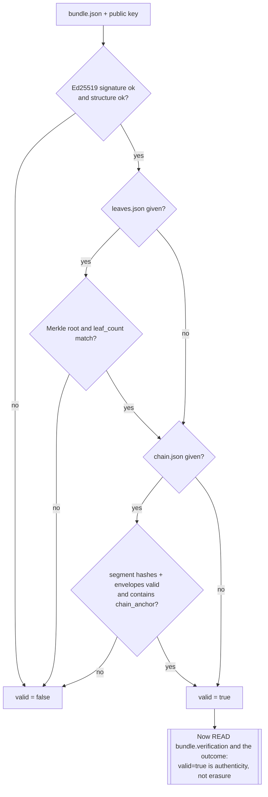

`valid=True` proves (security_analysis.md §3): the holder of the trusted key produced the bundle; its content (plan hash, record-set hash, step counts, checks, Merkle root) is unchanged; with a chain export, the chain up to the anchor is internally consistent and its columns match the hashed envelopes.

It does **not** prove that the erasure succeeded: **PARTIAL and FAILED bundles are signed just as validly** (`unit/audit/test_evidence.py::test_failed_verification_can_still_be_evidenced`). It proves nothing about data outside PostgreSQL's live relations, nothing about an operator who controls both the database and the key from the start, and nothing about human identity (`X-LAE-Actor` is a claim). **[LIMIT]**

---

## 13. API, error mapping and frontend integration

### 13.1 Application factory and security middleware (`lae/api/app.py`)

> **`create_app(services_factory, *, api_token, cors_origins=(…5173…), allowed_hosts=("localhost","127.0.0.1","testserver")) -> FastAPI`** · `lae/api/app.py`
> - *Purpose:* builds the HTTP app. Routers are thin: they validate the request, call the service and return the response model. There is no business logic in the routers.
> - *In → Out:* a zero-argument factory returning a `LaeServicesProtocol` (called lazily, once) plus the API token → a `FastAPI` instance.
> - *Algorithm:* two routers. `public` holds only `GET /api/health`. The second router `r` carries `dependencies=[Depends(require_token)]`, so **every other route needs the token, reads included**. Middleware runs `TrustedHostMiddleware` (refuses foreign `Host` headers, a DNS-rebinding mitigation), then `CORSMiddleware` (explicit origins, methods GET/POST, headers `Content-Type`, `X-LAE-Token`, `X-LAE-Actor`), then an access-log middleware that logs method, path template, status and duration (never bodies or query strings). Three exception handlers: `LaeError` → envelope, `RequestValidationError` → 422 with field locations only (submitted values are never echoed), and any other `Exception` → 500 `INTERNAL` with a generic message.
> - *Tests:* `unit/api/test_app.py::test_mutations_require_token`, `unit/api/test_app.py::test_no_token_configured_disables_mutations`, `unit/api/test_app.py::test_validation_errors_do_not_echo_values`, `unit/api/test_app.py::test_unhandled_errors_hide_details`, `integration/services/test_security_hardening.py::test_reads_require_token_and_host_is_checked`. **[IMPL]**

> **`require_token(x_lae_token, x_lae_actor) -> str`** (closure inside `create_app`)
> - *Purpose:* local-prototype authentication.
> - *Algorithm:* no server token configured gives 401 (mutations disabled). Otherwise `hmac.compare_digest` on the **UTF-8 bytes** of the header and the configured token. Bytes, because comparing `str` raises `TypeError` on non-ASCII input. The result is the actor name from `X-LAE-Actor` (stripped, ≤ 64 chars, default `local-operator`).
> - *Example:* header `X-LAE-Token: tökén` gives 401, not 500. A wrong token gives 401 and the service is never called.
> - *Tests:* `unit/api/test_app.py::test_mutations_require_token`, `integration/services/test_security_hardening.py::test_reads_require_token_and_host_is_checked`, `e2e/test_security_api.py::test_read_endpoints_require_the_token`, `e2e/test_security_api.py::test_unauthorized_mutations_change_nothing`. **[IMPL]**
> - **[LIMIT]** One shared token. The actor is a self-asserted claim (four-eyes compares claims, not authenticated identities).

> **`_status_for_class(exc: LaeError) -> int`** · `lae/api/app.py`
> - *Purpose:* HTTP status for domain error codes that are not listed in `STATUS_BY_CODE`, chosen by exception family, so domain refusals never become 500.
> - *Algorithm:* `NotFoundError` → 404. `ValidationError` → 422. `PlanError | ExecutionError` → 409. Anything else → 500.
> - *Example:* acknowledging a `SHARED_RECORD` conflict raises `PlanError(code="CONFLICT_NOT_ACKNOWLEDGEABLE")`, giving 409 (it was 500 before the fix).
> - *Tests:* `unit/api/test_app.py::test_unlisted_domain_codes_map_by_family_not_500`, `unit/api/test_app.py::test_domain_errors_map_to_envelopes`. **[IMPL]**

**`STATUS_BY_CODE`** (exact contents): `NOT_FOUND` 404 · `SUBJECT_NOT_FOUND` 404 · `INVALID_INPUT` / `UNKNOWN_TABLE` / `UNKNOWN_COLUMN` / `CANONICALIZATION` 422 · `INVALID_STATE` / `PLAN_BLOCKED` / `PLAN_HASH_MISMATCH` / `PLAN` / `STALE_PLAN` / `ALREADY_EXECUTED` / `ROW_COUNT_MISMATCH` 409 · `DISCOVERY_LIMIT` 413 · `SERIALIZATION_CONFLICT` 503 · `UNAUTHORIZED` 401. Every non-2xx body has the shape `{"error": {"code", "message", "details"}}`, and `details` never contains personal-data values.

### 13.2 Endpoints (all under `/api`; the token is required on all except health)

| Method | Path | Service method (`lae/services/impl.py`, class `LaeServices`) | Writes? |
|---|---|---|---|
| GET | `/health` *(public)* | `health` (DB ping, extension versions, chain check, signing key id; `degraded` instead of 500 when the DB is down) | no |
| GET | `/stats` | `stats` (live `COUNT`s) | no |
| GET | `/customers?q=&limit=` | `search_customers` (LIKE wildcards escaped, email masked) | no |
| POST / GET | `/erasure-requests` | `create_request` / `list_requests` | create: yes |
| GET | `/erasure-requests/{request_id}` | `get_request` | no |
| POST | `/discovery/{request_id}` | `run_discovery` (may create a snapshot, appends `DISCOVERY_COMPLETED`) | yes |
| GET | `/discovery/{request_id}` | `latest_discovery` (**read-only recomputation**, never creates a snapshot) | no |
| POST | `/lineage-edges/{edge_id}/status` | `set_edge_status` (INFERRED edges only, idempotent) | yes |
| GET | `/executions?request_id=` | `list_executions` (404 for an unknown request) | no |
| GET | `/lineage/schema?level=` | `schema_graph` (404 until a snapshot exists) | no |
| GET | `/lineage/{request_id}?level=` | `lineage` (record graph from the latest plan, or a read-only discovery) | no |
| POST | `/erasure-plans/{request_id}/generate` | `generate_plan` | yes |
| GET | `/erasure-plans/{plan_id}` | `get_plan` | no |
| POST | `/erasure-plans/{plan_id}/conflicts/{conflict_id}/acknowledge` | `acknowledge_conflict` | yes |
| POST | `/erasure-plans/{plan_id}/approve` | `approve_plan` (body `plan_hash`) | yes |
| POST | `/erasure-plans/{plan_id}/execute` | `execute_plan` (body `mode` DRY_RUN or LIVE) | yes |
| GET / POST | `/verification/{request_id}` · `/verification/{request_id}/run` | `get_verification` / `run_verification` | run: yes |
| GET | `/audit/events?after_seq=&limit=` | `audit_events` | no |
| POST | `/audit/verify-chain` | `verify_chain` (hash chain + envelope columns) | no |
| GET | `/audit/{request_id}` | `audit_for_request` (events + chain + evidence + signature check) | no |
| GET | `/evidence/{request_id}/download` · `/evidence/{request_id}/leaves` | `evidence_download` / `evidence_leaves` | no |
| GET | `/benchmarks?scenario=` | `benchmark_runs` | no |

The ASGI entry point is `lae/api/main.py` (`uvicorn lae.api.main:app`). It builds the app from `.env` settings (`api_token` is a `SecretStr` of at least 24 characters). Full request and response samples: [api_documentation.md](api_documentation.md). **[IMPL]** Tests: `unit/api/test_app.py::test_openapi_lists_brief_endpoints`, the 9 tests in `integration/services/test_api_e2e.py`, and the 15 tests in `e2e/test_security_api.py`.

### 13.3 Frontend integration (`frontend/src`)

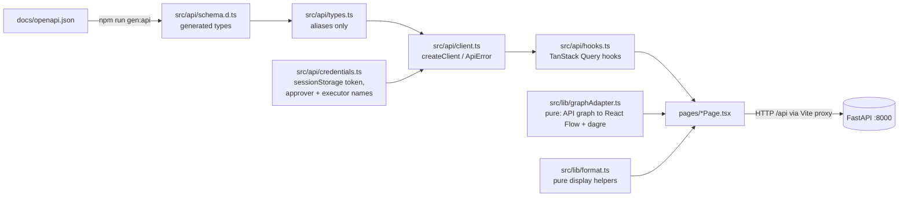

| Piece | Responsibility | Tests (`frontend/src` › "title") |
|---|---|---|
| `frontend/src/api/client.ts`: `createClient`, `ApiError`, `parseErrorPayload`, `buildUrl`, `actorFor`, `isApiError` | Typed fetch. Turns the error envelope into an `ApiError`. Falls back to `HTTP_<status>` and `NETWORK_UNREACHABLE`. Sends `X-LAE-Token` and `X-LAE-Actor` on **every** request. Execute calls use the *executor* name, approve calls the *approver* name (four-eyes) | `api/client.test.ts` › "parses the error envelope", "returns parsed JSON on success and sends the token on GET too", "sends the executor name as X-LAE-Actor for execute calls (four-eyes)", "maps network failures to NETWORK_UNREACHABLE" |
| `frontend/src/api/credentials.ts`: `getCredentials` / `setCredentials` / `clearCredentials` / `subscribeCredentials` | Token and actor names kept in **sessionStorage only**, never in source or localStorage | `api/client.test.ts` › "are kept in sessionStorage only" |
| `frontend/src/api/hooks.ts` (25 hooks, e.g. `useGeneratePlan`, `useApprovePlan`, `useExecutePlan`, `useSetEdgeStatus`, `useVerifyChain`) | One TanStack Query hook per endpoint. Mutations invalidate the affected queries | exercised by the page tests |
| `frontend/src/lib/graphAdapter.ts`: `schemaGraphToFlow`, `recordGraphToFlow`, `edgeVisual`, `layoutGraph`, `inferredEdgesForReview`, `countByRole`, `indexEdges`, `isolatedNodeCount` | Pure conversion of `SchemaGraphOut` / `LineageOut` to React Flow nodes and edges. Edge style by origin. Role shape plus text tag (colour is never the only signal). Deterministic dagre layout | `lib/graphAdapter.test.ts` |
| `frontend/src/lib/format.ts`: `summarizeSteps`, `formatCoverage`, `evidenceSummary`, `metricBars`, … | Pure display helpers. Coverage is shown from the exact integer counts | `lib/format.test.ts` |
| Pages (routes in `frontend/src/App.tsx`): Dashboard `/`, Requests `/requests`, Lineage `/lineage/:requestId?`, Plan `/plan/:requestId?`, Execution `/execution/:requestId?`, Verification & Audit `/verification/:requestId?`, Benchmarks `/benchmarks` | Each page shows only API data, with loading, empty and error states (error code shown). Plan: the approve button sends `plan_hash` exactly as received. Execution: LIVE needs a confirmation dialog. Lineage: SUGGESTED-edge review queue with Confirm/Reject | `pages/PlanPage.test.tsx` › "shows the full plan hash and sends it back exactly as received, with auth headers", "is disabled when the server reports the plan as blocked", "shows the error code and offers Re-plan on STALE_PLAN"; `pages/ExecutionPage.test.tsx` › "lists past runs from GET /api/executions and marks runs of earlier plan versions"; `pages/states.test.tsx`; `App.test.tsx` |
| `frontend/e2e/smoke.mjs` + `frontend/e2e/cdp.mjs` (`npm run test:e2e`) | Dependency-free browser smoke test that drives the installed Edge over the Chrome DevTools Protocol against a running backend, and captured `docs/screenshots/*.png` | run manually (needs the backend). **[LIMIT]** not in CI. Playwright not installed (needs approval) |

**[IMPL]** 73 Vitest tests pass. Fetch is mocked **only inside tests**, and the shipped app contains no fixtures or placeholder numbers.

---

## 14. Security architecture and trust boundaries

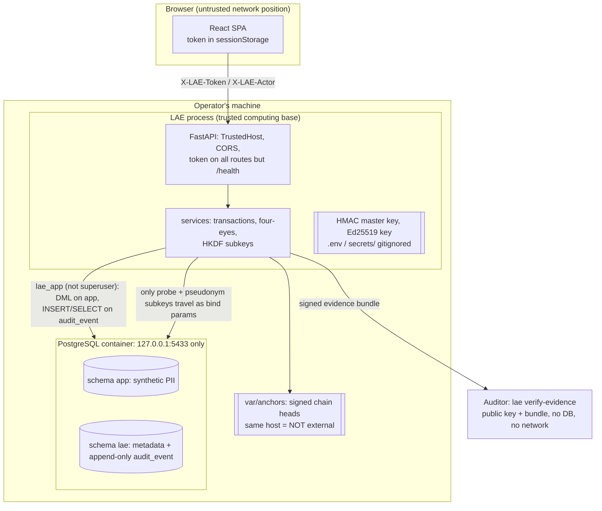

**Boundaries and what each control protects** (file references; details in [security_analysis.md](security_analysis.md)):

| Boundary | Control | Where | Status / test |
|---|---|---|---|
| Network → API | localhost-only DB port, `TrustedHostMiddleware`, explicit CORS origins, token on every non-health route, custom header that forces a CORS preflight | `docker-compose.yml`, `lae/api/app.py` | **[IMPL]** `integration/services/test_security_hardening.py::test_reads_require_token_and_host_is_checked` |
| API → services | Pydantic `extra="forbid"`, bounded key items (int64 range, str ≤ 128), `subject_root` pattern, no value echo | `lae/api/schemas.py`, `lae/api/app.py` | **[IMPL]** `e2e/test_security_api.py::test_oversized_and_malformed_payloads`, `e2e/test_security_api.py::test_injection_shaped_subject_keys_are_rejected_without_damage` |
| services → PostgreSQL | non-superuser `lae_app` (migration 0002); identifiers validated against the catalog snapshot and quoted; values bound; artifact SQL single-SELECT and on the extended protocol | `lae/db/target.py`, `lae/db/_sql.py`, `backend/migrations/versions/0002_security_hardening.py` | **[IMPL]** `integration/services/test_security_hardening.py::test_app_role_cannot_tamper_with_audit`, `integration/services/test_security_hardening.py::test_artifact_sql_breakout_is_rejected` |
| Secrets | HKDF-SHA256 subkeys (`derive_subkey` in `lae/services/runtime.py`); the audit-identity key never reaches PostgreSQL; `.env` / `secrets/` gitignored | `lae/services/runtime.py` | **[IMPL]** `integration/services/test_security_hardening.py::test_hmac_subkeys_are_domain_separated` |
| Operator → data | approval bound to the plan hash; four-eyes; dry run; shared and other-subject rows never destroyed | `lae/services/pipeline.py`, `lae/planner/` | **[IMPL]** `integration/services/test_security_hardening.py::test_four_eyes_and_replan_after_stale`, `e2e/test_security_api.py::test_four_eyes_approver_cannot_execute` |
| History → auditor | hash chain + envelope + UNIQUE(prev_hash); Ed25519 bundle; offline verifier | `lae/audit/`, `backend/migrations/versions/0003_audit_chain_linear.py` | **[IMPL]** `e2e/test_security_db.py::test_audit_log_is_append_only_and_tampering_is_detected`, `e2e/test_security_db.py::test_two_threads_executing_the_same_plan_commit_exactly_once` |
| PII leakage | HMAC identifiers, purge after VERIFIED, redacted errors, logs without bodies | `lae/services/pipeline.py`, `lae/api/app.py` | **[IMPL]** `integration/services/test_api_e2e.py::test_no_raw_pii_in_responses_or_logs`, `e2e/test_security_db.py::test_no_raw_pii_in_logs_responses_or_lae_schema_after_purge` |

**Trust model.** The trusted computing base is the LAE process plus its keys. PostgreSQL's superuser (`lae_owner`, used for migrations) is **trusted not to rewrite history**: it *can* disable the trigger and rebuild a consistent chain, and that is detectable only against an anchor held by a third party. **[LIMIT]** The independent review (`docs/change_requests/security-review-1.md`) found 3 High, 7 Medium and 8 Low issues. All High and most Medium issues were fixed with regression tests. M7 was fixed only partly (four-eyes, but no per-user auth). L1, L2, L5, L6 and L8 remain open (§15).

---

## 15. Limitations and future possibilities

### 15.1 Documented limitations **[LIMIT]**
Each item gives its source. The consolidated list is in [limitations.md](limitations.md).

| # | Limitation | Source |
|---|---|---|
| 1 | Logical erasure only: dead tuples before `VACUUM`, WAL, backups, replicas, dumps and OS caches are not touched or inspected | limitations.md §1 |
| 2 | One PostgreSQL database. `EXTERNAL` artifacts are only scheduled (`SCHEDULE_EXTERNAL`), so subjects linked to them reach **PARTIAL** at best | limitations.md §1. benchmarking.md (no VERIFIED outcome in any LAE set) |
| 3 | Not a legal-compliance tool. Retention policies are operator input | README, methodology.md |
| 4 | Lineage sources are FKs, view/matview SQL, registered mappings and confirmed inferences. App code, triggers, procedures and ETL are not analysed | limitations.md §2 |
| 5 | Containment inference did not suggest the hidden-copy table at θ = 0.95 (0.805). The residual scan plus human confirmation closes the gap | limitations.md §2, CR lineage-discovery-engineer-2 |
| 6 | Confirmed text edges match exact values, so case/whitespace variants survive (the scan still reports them) | limitations.md §2, benchmarking.md §4 |
| 7 | SQLGlot gaps (recursive CTEs, UDFs, LATERAL SRFs, dynamic SQL) make an artifact OPAQUE / UNRESOLVED | limitations.md §2 |
| 8 | The SHARED rule is conservative (it may protect rows a human would call owned) | CR lineage-discovery-engineer-2 §3 |
| 9 | PK types int/text. Tables without a PK are erased by predicate, with weaker evidence | limitations.md §2 |
| 10 | `suggest_pii` is not called by any API or CLI path | limitations.md §2 |
| 11 | Aggregates are recomputed in full (cost grows with artifact size) | limitations.md §3 |
| 12 | RECOMPUTE_TABLE has no rowcount assertion. The pseudonym-vs-NULL choice is not hash-bound | security-review-1 L1, L2 |
| 13 | The synchronous API blocks during long operations | limitations.md §3 |
| 14 | The residual scan matches whole normalised values only: no substrings, Unicode case folding, encodings, hashes, encrypted values or arrays | limitations.md §4 |
| 15 | **Ambiguous (non-unique) probes are excluded**, so a surviving shared name is not detected | limitations.md §4 (17a), CR frontend-engineer-2 |
| 16 | Zero probes pass vacuously. Legal-hold exclusion works per table | security-review-1 L5 |
| 17 | Residual counts are matches, not distinct rows | CR verification-crypto-engineer-3 §4 |
| 18 | EMBEDDING_ABSENT is key-based (no vector-digest comparison) | CR verification-crypto-engineer-2 §5 |
| 19 | A valid signature ≠ complete erasure. Tamper-evident, not tamper-proof. Anchors stored on the same host | security_analysis.md §3–4 |
| 20 | The raw key is purged only on VERIFIED. `reason` and actor strings are never purged | security-review-1 L6, limitations.md §5 |
| 21 | API `event_id` is derived from the event hash, not the stored column | limitations.md §5 |
| 22 | One shared token. Self-asserted actor. Dev passwords. Unencrypted signing key. `lae_reader` password hard-coded | security-review-1 M7, L8. security_analysis.md §4 |
| 23 | LIVE executions are serialised by one global advisory lock (no parallel erasures) | `_live_execution_lock` in `lae/services/pipeline.py` (trade-off for QA D1) |
| 24 | CI workflow written but never run. Frontend smoke test not in CI | CR qa-devops-engineer-1 |
| 25 | Evaluation validity: one synthetic generator, 20 subjects per set, laptop timings | benchmarking.md §7 |

### 15.2 Future possibilities **[FUTURE]** (none of these is implemented)
- Off-host anchor publication (e.g. to a transparency log or a separate auditor service) to close the superuser-rewrite gap.
- Per-user authentication with server-side identity, so four-eyes compares authenticated principals.
- A separate `lae_executor` role, and running migrations under a non-superuser owner.
- A distinct-row residual counting port method (`hmac_match_rows`, proposed in CR verification-crypto-engineer-3 §4).
- Vector-digest comparison for embeddings. Substring/tokenised residual matching with privacy-preserving indexes.
- Normalised-match traversal for confirmed text edges (to catch case/whitespace variants without relying on the scan).
- A rowcount assertion for RECOMPUTE_TABLE and hash-binding of anonymisation assignments.
- Asynchronous job execution for long erasures. Per-subject (instead of global) execution locks.
- `VACUUM` / storage-level erasure steps, and coverage of external systems through verifiable connectors.
- A compose `full` profile (API + web containers) and a CI run on GitHub Actions.

---

## Appendix A: function reference index

Every function or class that has an entry (template or table row) in §1–§15. Each was resolved mechanically to its definition at HEAD (Python `ast` over `backend/src`, `benchmarks`, `db/fixtures`). Where a name is defined in more than one file, all files are listed.

| Function / class | Defined in | Explained in |
|---|---|---|
| `_status_for_class` | `lae/api/app.py` | §13 |
| `create_app` | `lae/api/app.py` | §13 |
| `require_token` | `lae/api/app.py` | §13 |
| `verify_chain` | `lae/api/app.py`, `lae/audit/hashchain.py`, `lae/services/facade.py`, `lae/services/impl.py` | §11 |
| `export_chain_head` | `lae/audit/anchor.py` | §12 |
| `canonical_json` | `lae/audit/canonical.py` | §11 |
| `build_evidence` | `lae/audit/evidence.py` | §11 |
| `verify_evidence_offline` | `lae/audit/evidence.py` | §12 |
| `next_hash` | `lae/audit/hashchain.py` | §11 |
| `build` | `lae/audit/merkle.py`, `lae/db/target.py` | §11 |
| `hmac_match_count` | `lae/contracts/ports.py`, `lae/db/target.py` | §9 |
| `coverage` | `lae/contracts/types.py`, `lae/verification/metrics.py` | §10 |
| `artifacts_from_catalog` | `lae/discovery/artifacts.py` | §4 |
| `auto_artifact_id` | `lae/discovery/artifacts.py` | §4 |
| `external_dependencies` | `lae/discovery/artifacts.py` | §4 |
| `merge_registered` | `lae/discovery/artifacts.py` | §4 |
| `build_catalog` | `lae/discovery/catalog.py` | §4 |
| `catalog_fingerprint` | `lae/discovery/catalog.py` | §4 |
| `describe_table` | `lae/discovery/catalog.py` | §4 |
| `read_catalog` | `lae/discovery/catalog.py` | §4 |
| `schema_drift` | `lae/discovery/catalog.py` | §4 |
| `discover_foreign_keys` | `lae/discovery/foreign_keys.py` | §4 |
| `fk_edge_id` | `lae/discovery/foreign_keys.py` | §4 |
| `foreign_key_edges` | `lae/discovery/foreign_keys.py` | §4 |
| `infer_relationships` | `lae/discovery/inference.py` | §4 |
| `capture_residual_probes` | `lae/discovery/records.py` | §9 |
| `discover_records` | `lae/discovery/records.py` | §6 |
| `extract_artifacts_lineage` | `lae/discovery/sql_lineage.py` | §4 |
| `extract_sql_lineage` | `lae/discovery/sql_lineage.py` | §4 |
| `execute_plan` | `lae/executor/executor.py`, `lae/services/facade.py`, `lae/services/impl.py` | §7 |
| `add_edge` | `lae/lineage/api.py`, `lae/lineage/graph.py` | §4 |
| `add_table` | `lae/lineage/graph.py` | §4 |
| `artifact_order` | `lae/lineage/graph.py` | §5 |
| `build_lineage_graph` | `lae/lineage/graph.py` | §4 |
| `column_edges_for` | `lae/lineage/graph.py` | §4 |
| `downstream` | `lae/lineage/graph.py` | §4 |
| `edge` | `lae/lineage/graph.py` | §4 |
| `edge_evidence` | `lae/lineage/graph.py` | §4 |
| `mark_artifact` | `lae/lineage/graph.py` | §4 |
| `reachable_from` | `lae/lineage/graph.py` | §5 |
| `table_view` | `lae/lineage/graph.py` | §4 |
| `to_node_link` | `lae/lineage/graph.py`, `lae/lineage/record_graph.py` | §4 |
| `traverse` | `lae/lineage/graph.py` | §5 |
| `add_dependency` | `lae/lineage/record_graph.py` | §5 |
| `add_root` | `lae/lineage/record_graph.py` | §5 |
| `deletion_order` | `lae/lineage/record_graph.py` | §5 |
| `nodes` | `lae/lineage/record_graph.py` | §5 |
| `record_set_hash` | `lae/lineage/record_graph.py` | §5 |
| `set_role` | `lae/lineage/record_graph.py` | §5 |
| `compute_plan_hash` | `lae/planner/hashing.py` | §7 |
| `order_deletions` | `lae/planner/ordering.py` | §7 |
| `build_plan` | `lae/planner/planner.py` | §7 |
| `acknowledge_conflict` | `lae/planner/state.py`, `lae/services/facade.py`, `lae/services/impl.py` | §7 |
| `_exclude_ambiguous_probes` | `lae/services/pipeline.py` | §9 |
| `_extra_keys` | `lae/services/pipeline.py` | §4 |
| `_suggest_from_residual_hits` | `lae/services/pipeline.py` | §9 |
| `derive_subkey` | `lae/services/runtime.py` | §2 |
| `check_absent` | `lae/verification/checks.py` | §9 |
| `check_anonymized` | `lae/verification/checks.py` | §9 |
| `check_derived` | `lae/verification/checks.py` | §9 |
| `check_embeddings` | `lae/verification/checks.py` | §9 |
| `check_nullified` | `lae/verification/checks.py` | §9 |
| `check_retained` | `lae/verification/checks.py` | §9 |
| `verify_execution` | `lae/verification/engine.py` | §9 |
| `confusion` | `lae/verification/metrics.py` | §10 |
| `f1` | `lae/verification/metrics.py` | §10 |
| `precision` | `lae/verification/metrics.py` | §10 |
| `recall` | `lae/verification/metrics.py` | §10 |
| `check_rediscovery` | `lae/verification/rediscovery.py` | §9 |
| `check_residual` | `lae/verification/residual.py` | §9 |

---

## Appendix B: doc/code discrepancies

The design documents were written before implementation. Where they disagree with the code at HEAD, **the code (described in this walkthrough) is authoritative**. The change requests in `docs/change_requests/` record why each change was made.

| # | Design-doc statement | Code at HEAD | Where it changed |
|---|---|---|---|
| 1 | API prefix `/api/v1` (architecture.md §2 diagram, module_contracts.md §9–10) | Prefix `/api`, 23 paths (§13.2) | CR lead-1 §4 |
| 2 | Three runtime roles incl. `lae_executor` with DML only on `app` (architecture.md §11, §13, §15) | The app runs as non-superuser **`lae_app`** (migration 0002). `lae_reader` exists. `lae_owner` runs migrations. `lae_executor` is created by `scripts/create_test_dbs.py` but **not used** | security-review-1 M2. database_schema.md §7 |
| 3 | Executor transaction uses `SET LOCAL lock_timeout/statement_timeout` (architecture.md §11.2) | Timeouts are set per connection with bound `set_config` in `lae/db/engine.py` | implementation choice (Database Engineer) |
| 4 | Recompute via `TRUNCATE` + `INSERT` (architecture.md §11.5) | `PgTargetWriter.recompute_table` uses `DELETE FROM` + `INSERT … <definition>` inside the caller's transaction | implementation choice |
| 5 | `EMBEDDING_ABSENT` also compares pre-erasure vector digests (architecture.md §12) | Key-based only (§9) | CR verification-crypto-engineer-2 §5 |
| 6 | Purge after `EVIDENCE_ISSUED` (architecture.md §13) | Purge **only when the outcome is VERIFIED**, then across all plan versions. Superseded versions are purged at supersede time | CR lead-1 §3, security-review-1 H3 |
| 7 | `ck_erasure_plan_approval_consistent` = approved statuses ⇔ `approved_at IS NOT NULL` (database_schema.md §3.3 and model listing) | Migration 0002: SUPERSEDED/FAILED may keep approval history | security-review-1 M5 |
| 8 | `audit_event` has no unique `prev_hash` (database_schema.md §3.4) | Migration 0003 adds `uq_audit_event_prev_hash`. LIVE executions are serialised by `_live_execution_lock` | CR qa-devops-engineer-1 D1 |
| 9 | SHARED_RECORD conflicts can be acknowledged (CR lead-1 §2 list) | **Not acknowledgeable.** A nullable link is detached (NULLIFY_REFERENCE + WARNING). A NOT NULL link stays BLOCKING | CR erasure-engine-engineer-1 §2 (safety) |
| 10 | The plan state machine includes `FAILED` (database_schema.md, PlanStatus) | No code path sets plan status `FAILED`. After a failed LIVE run the plan stays APPROVED and the run is recorded as `EXECUTION_FAILED` (§7) | code fact |
| 11 | `GET /api/discovery/{id}` returns the "latest result, no re-run" (CR frontend-engineer-1 decision) | A **read-only recomputation**: it never writes or creates a snapshot, and gives 404 after the subject was erased | CR frontend-engineer-2 decision 2 |
| 12 | `AuditEventOut.event_id` is the stored event id (database_schema.md §6) | Derived from the event hash (`UUID(event_hash[:32])`) | limitations.md §5 |
| 13 | B1 benchmark at 100k subjects, B1–B6 scenarios (architecture.md §14) | One scenario (B5 completeness + latency) at 100 / 1 000 / 10 000 customers, 20 subjects per set, plus the feedback experiment | benchmarking.md |
| 14 | AT-01 expects 15 relations (development_plan.md §6) | The catalog has 17 relations (`app.document`, `app.customer_profile_cache` added) | CR lead-1 §5 |
| 15 | AT-06 inference suggests `marketing_event_log.email` at θ = 0.95 | Not suggested (containment 0.805). Suggested by residual-scan feedback instead | CR lineage-discovery-engineer-2 §2 |
| 16 | AT-15 records `EXECUTION_ROLLED_BACK` for a failed LIVE run | `EXECUTION_FAILED` (ROLLED_BACK is used for dry runs) | code fact |
| 17 | AT-17 returns `ALREADY_EXECUTED` | A repeat LIVE execution returns 409 `INVALID_STATE` (the plan is no longer APPROVED). The unique index still guarantees idempotency | code fact |
| 18 | Agents work in git worktrees (development_plan.md §5) | Agents worked in one shared tree on disjoint paths. The Lead committed | development_progress.md |
| 19 | Residual LOWER_TRIM SQL `E' \t\n\r\f\v'` (CR verification-crypto-engineer-1 §5, original text) | `E' \t\n\r\f\x0B'`. PostgreSQL has no `\v` escape | CR verification-crypto-engineer-2 §1 |
| 20 | Environment table in architecture.md §0 (Docker missing, "virtualization off") | Historical. Docker Desktop is installed. Virtualization was on (WMI quirk) | architecture.md §0 correction, implementation_checklist.md |
