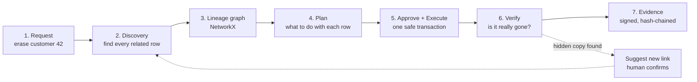

# Viva & Presentation Guide: Lineage-Aware Erasure Engine (LAE)

> Read this top to bottom once, then keep it open during the presentation.
> Parts 1–4 give you the story. Part 5 is the live demo script (click by click). Parts 6–9 are the "how it works" you explain when asked. Part 11 is a question bank.
> The deep technical reference is `docs/technical_walkthrough.md`. You don't need to memorise it.

---

## PART 1: The 30-second pitch (say this first)

> "When a person asks a company to delete their data (the *right to erasure*, as in GDPR), the obvious answer is `DELETE FROM customer WHERE id = 42`. That is **not enough**. Copies of that person's data sit in other tables, in summary tables, in caches, in AI embeddings, and sometimes in tables that aren't even linked by a foreign key. Some data **must not** be deleted, because the law requires invoices to be kept. Other people's data is mixed in too.
>
> Our project, the **Lineage-Aware Erasure Engine**, *finds* all the places where one person's data lives, *plans* a safe erasure that follows retention rules, *executes* it inside one database transaction after a human approves it, *independently checks* that the data is really gone, and produces *cryptographic evidence* of what was done, without storing the personal data itself.
>
> We measured it against two simpler approaches on 100, 1 000 and 10 000 synthetic customers. Our system erased **74–90 %** of the person's data, against **24–48 %** for the baselines, and it never deleted another person's data or a legally retained row."

---

## PART 2: The problem, in plain words

Imagine customer **Alice (id 42)**. Her data is spread across:

| Where | Example | Why plain DELETE fails |
|---|---|---|
| Child tables (FK) | addresses, orders, order lines, tickets, messages, documents | `ON DELETE RESTRICT` on orders makes the DELETE **fail**. Other FKs need explicit deletes |
| Legally retained rows | orders, payments (tax law) | must be **kept but anonymised**, not deleted |
| Derived/summary tables | `customer_ltv` (lifetime value), `daily_revenue`, `customer_segment` | still contain her numbers until **recomputed** |
| Cache | `customer_profile_cache` | a copy keyed by her id, with no FK |
| AI embeddings | `document_embedding` (pgvector) | vectors computed from her documents |
| Hidden copies | `marketing_event_log.email` | **no foreign key at all**, so nothing links it to her |
| Other people's data | a message *another* customer wrote on her ticket | must **not** be deleted |
| Outside the DB | an exported CRM file | can't be checked from inside the DB |

**Our key insight:** a relationship between *tables* doesn't tell you which *rows* belong to Alice. You have to follow the relationships through the actual data (record-level lineage). And whatever you find, you must verify **independently**, because the lineage can miss things (the hidden copies).

---

## PART 3: The big picture: 7 stages



An analogy you can use: *"It's like a careful house-cleaner. First they **survey** every room (discovery), then **draw a map** of what is connected (graph), then **write a cleaning plan** that says what to throw away, what to keep and what to just blank out (plan). The owner **signs the plan** (approval). They clean everything in **one go**, so it either all happens or nothing does (transaction). An **inspector** who doesn't trust the map then searches every room again (verification). Finally they hand over a **sealed, signed report** that anyone can check later (evidence)."*

---

## PART 4: Technology, and why each piece (DBMS angle)

| Tech | Used for | Why (say this) |
|---|---|---|
| **PostgreSQL 16** | the database being erased (`app` schema) + the engine's own data (`lae` schema) | real constraints, transactions, isolation levels, triggers, roles, system catalogs |
| **pgvector** | the `document_embedding` table | demonstrates erasure of AI embeddings |
| **pgcrypto** | `hmac()` inside SQL | the residual scan can compare **fingerprints** in the DB without sending real values |
| **SQLAlchemy 2 + psycopg 3** | DB access | exact control of transactions and isolation |
| **Alembic** | migrations (`0001_baseline`, `0002_security_hardening`, `0003_audit_chain_linear`) | versioned, repeatable schema |
| **SQLGlot** | parses view/materialized-view SQL | finds which source columns feed which output columns |
| **NetworkX** | graphs | BFS/DFS, topological sort, cycle detection |
| **cryptography** | Ed25519 signatures, HKDF key derivation | proven library; we never wrote our own crypto |
| **FastAPI** | REST API (23 endpoints under `/api`) | typed, auto-documented (`/docs`) |
| **React + Vite + TypeScript + Tailwind + React Flow** | the dashboard | graph visualisation; types generated from the API |
| **pytest / Vitest** | 1 314 automated tests | unit tests with fakes; integration tests on real PostgreSQL |
| **Docker Compose** | runs PostgreSQL locally | reproducible setup |

**Architecture rule** (good to mention): the code is layered. `api → services → domain modules → contracts`. The domain modules (discovery, lineage, planner, executor, verification, audit) **never talk to the database directly**. They use small interfaces called *ports* (`TargetReader`, `TargetWriter`, `AuditSink` in `backend/src/lae/contracts/ports.py`). That lets us unit-test them with fakes. The tool `import-linter` enforces the rule automatically.

---

## PART 5: LIVE DEMO SCRIPT (click by click, with what to say)

> **Before the viva:** Docker Desktop running. Then, in two PowerShell windows, run `.\scripts\start-backend.ps1` and `.\scripts\start-frontend.ps1`. Open http://localhost:5173. Click **Settings** and paste the token (print it with `Select-String -Path .env -Pattern '^LAE_API_TOKEN=' | ForEach-Object { $_.Line.Split('=',2)[1] }`). Set **Approver = alice** and **Executor = bob**.
> If you want fresh data first: `.\.venv\Scripts\lae db seed --scale default --seed 42 --yes`.

### Screen 1: Dashboard
- **Show:** synthetic customers (1 000), discovered tables (17), edges, audit events, and the health badges (API, DB, audit chain VALID).
- **Say:** "Every number here is a live `COUNT` from the database. Nothing is hard-coded. The audit chain badge means the system just recomputed the whole hash chain and it's intact."

### Screen 2: Erasure Requests
- **Do:** search a customer, select one, and click create request.
- **Say:** "The email is masked. The system stores the customer key only temporarily. In the audit log it appears only as an **HMAC fingerprint**, a keyed hash, so the audit trail contains no personal data. While one request is open, a second one for the same person is refused."

### Screen 3: Erasure Plan
- **Do:** Run discovery, then Generate plan.
- **Show:** the records found by role (SUBJECT_ROOT, OWNED, SHARED, REFERENCING_OTHER_SUBJECT), and the plan table with categories.
- **Say, walking through the categories:**
  - **DELETE**: the customer, addresses, loyalty account. Addresses are removed automatically by `ON DELETE CASCADE`, and the plan *expects* that exact number.
  - **RETAIN**: orders are kept for tax reasons, but their personal columns (name, address) are **pseudonymised** and the link to the customer is cut. Order lines and payments are kept untouched (legal hold).
  - **RECOMPUTE**: `customer_ltv`, `daily_revenue`, `customer_segment` are summary tables. You can't delete "her part" of a SUM, so we **rebuild** them.
  - **INVALIDATE**: her cache entry.
  - **SCHEDULE**: the external CRM export. It's outside the DB, so we can only schedule it.
  - "Every row has a **reason** with no personal data, and links to the lineage edges that justify it."
- **Point at the plan hash:** "This is a SHA-256 hash of the entire plan. Approval is tied to this exact hash, so if anything changes, the approval no longer counts."

### Screen 4: Execution Monitor, dry run
- **Do:** Dry run.
- **Say:** "A dry run executes every step inside a real transaction, checks every row count, and then **rolls back**. Nothing changes. It's a rehearsal."

### Screen 5: Approve, then Execute LIVE
- **Do:** Approve on the Plan page (as alice), then Execute LIVE on the Execution page (as bob) and confirm.
- **Say:** "This is the **four-eyes rule**: the approver and the executor must be different people. If alice tries to execute her own approval, she's refused. Execution runs in **one SERIALIZABLE transaction**. Before writing anything, it **re-discovers** the data. If anything changed since approval (say a new order was placed), it aborts with `STALE_PLAN` and changes nothing. Every step's row count must match the plan exactly, otherwise everything rolls back. All or nothing: that's atomicity from ACID."

### Screen 6: Verification & Audit
- **Show:** the outcome badge, coverage (e.g. 9/10), the checks table, residual hits, the hash chain, the signature, and the evidence download.
- **Say:** "Verification is **independent**. It doesn't trust the plan. It checks each row directly, and it runs a **residual scan** over every text column of every table, looking for the person's email or phone fingerprint *without using the lineage at all*. The outcome here is **PARTIAL**, not VERIFIED, because the external CRM export can't be checked from inside the database. The system refuses to over-claim. The evidence is signed with Ed25519, and anyone can verify it **offline**."
- **Optional terminal moment:**
  ```powershell
  .\.venv\Scripts\lae audit export <request-id>
  .\.venv\Scripts\lae verify-evidence evidence_out\bundle.json --public-key secrets\signing_key.pub.pem --leaves evidence_out\leaves.json --chain evidence_out\chain.json
  ```
  "This needs no database and no network. If I change one character in the bundle, verification fails."

### Screen 7: The research point (hidden copies)
- **Do:** erase a customer whose email was copied into `marketing_event_log`.
- **Show:** the outcome **FAILED**, with residual hits in `app.marketing_event_log.email`.
- **Say:** "This is the key experiment. `marketing_event_log` has **no foreign key** to customers, so lineage can't see it. The independent scan **found** the leftover copies, so the system honestly reports FAILED instead of a false success. It then **suggests** a new relationship, `customer.email → marketing_event_log.email`."
- **Do:** Lineage Explorer, find the suggested edge, Confirm it. Then erase the *next* such customer.
- **Say:** "Once a human confirms the suggestion, the next plan deletes those copies too. In our benchmark, one confirmation removed **83–95 %** of the hidden copies for later customers."

### Screen 8: Lineage Explorer
- **Show:** the table-level graph, then the column-level graph, then the record-level graph, and click an edge to see its **evidence** (which FK constraint or SQL produced it).
- **Say:** "There are three levels of lineage. Table level says customer is linked to orders. Column level says `customer.id` feeds `purchase_order.customer_id`. Record level says customer **42** owns order **1001**. Only the record level tells you what to actually erase."

### Screen 9: Benchmarks
- Show the stored runs (present only if `benchmarks.run` stored results in the dev database). "These are measured results, explained in Part 10."

---

## PART 6: How each stage works (explain when asked)

### 6.1 Discovery: finding the data
**DBMS concepts:** system catalog, foreign keys, composite keys, ON DELETE actions, views, materialized views.

| Function | File | Explain it as |
|---|---|---|
| `read_catalog(reader, schemas)` | `backend/src/lae/discovery/catalog.py` | Reads PostgreSQL's **system catalog** (`pg_class`, `pg_attribute`, `pg_constraint`) to list every table, column, type and primary key. Computes a **fingerprint** (SHA-256) of the whole schema, so we can detect later whether the schema changed |
| `discover_foreign_keys(reader, catalog)` | `backend/src/lae/discovery/foreign_keys.py` | Reads every FK from `pg_constraint`, **keeping the column order of composite keys** (e.g. `(order_id, line_no)`) and the delete rule (`CASCADE`, `RESTRICT`, `SET NULL`, `NO ACTION`). Produces one table-level edge plus one column-level edge per column pair |
| `extract_sql_lineage(artifact, catalog)` | `backend/src/lae/discovery/sql_lineage.py` | Parses a view's SQL with **SQLGlot**, traces each output column back to its source columns, and classifies the artifact: **KEY_PRESERVING** (still keyed by customer, so the subject's rows can be found), **AGGREGATE** (a SUM over many people, so it must be recomputed), or **OPAQUE** (we can't understand the SQL, so it's flagged UNRESOLVED and never guessed) |
| `infer_relationships(...)` | `backend/src/lae/discovery/inference.py` | Finds *possible* links with no FK by sampling values. Always marked **SUGGESTED**, and never used until a human confirms |
| `discover_records(graph, root, subject_key, reader, limits)` | `backend/src/lae/discovery/records.py` | **The heart:** a **BFS** from the customer's row that follows only confirmed edges, *downstream*, querying the real rows batch by batch. Gives every row a **role** (see 6.3) |

### 6.2 The lineage graph (NetworkX)
| Function / class | File | Explain it as |
|---|---|---|
| `build_lineage_graph(catalog, edges, ...)` | `backend/src/lae/lineage/graph.py` | Builds a directed multigraph: nodes are tables and columns, edges are FK, SQL lineage or registered links. Every edge carries its **evidence** |
| `LineageGraph.traverse` / `get_descendants(graph, table, order="bfs"\|"dfs")` | `lineage/graph.py`, `lineage/api.py` | Everything reachable from a table, in BFS order (by distance) or DFS order (deep first). Deterministic, because neighbours are sorted |
| `RecordGraph.deletion_order(nullable)` | `backend/src/lae/lineage/record_graph.py` | **Reverse topological order**: children are deleted before parents, so no FK is violated. Cycles (e.g. a customer who references another customer) are found as strongly connected components and broken by setting a nullable FK to NULL first. If that's impossible, the plan is blocked |
| `RecordGraph.record_set_hash()` | same | A SHA-256 of the sorted list of all found rows. Used to detect if the data changed before execution |

**BFS in one line:** "Visit the start row, then all rows that directly reference it, then *their* references, level by level. A *visited* set prevents infinite loops."
**Topological sort in one line:** "Order the rows so that every row comes before the rows it depends on. Reversed, children come first, which is the safe deletion order."

### 6.3 Record-level ownership: the roles
| Role | Meaning | What happens |
|---|---|---|
| SUBJECT_ROOT | Alice's own customer row | deleted |
| OWNED | rows that belong only to Alice (her addresses, her orders…) | deleted, or retained and anonymised per policy |
| REFERENCING_OTHER_SUBJECT | *another customer* who points to Alice (e.g. Alice referred Bob) | **never deleted**. Only the reference is set to NULL |
| SHARED | a row also linked to someone else (Bob's message on Alice's ticket) | **never destroyed**. Detached if the link can be nulled, otherwise the plan is **BLOCKED** for a human |

"The rule is: *dependency is not ownership*. Just because a row points to Alice doesn't mean it belongs to her."

### 6.4 Planning
| Function | File | Explain it as |
|---|---|---|
| `build_plan(request_id, discovery, lineage, policies, artifacts, external, ...)` | `backend/src/lae/planner/planner.py` | Turns found rows into ordered steps using the **retention policies** (DELETE / ANONYMIZE / RETAIN per table) and the roles. Raises **conflicts**: e.g. `CASCADE_DESTROYS_RETAINED` (a cascade would delete something we must keep), `SHARED_RECORD`, `OPAQUE_ARTIFACT`. A blocking conflict stops approval |
| `action_category(action)` | `backend/src/lae/contracts/enums.py` | Maps each fine-grained action to the 7 user-facing categories: DELETE, INVALIDATE, RECOMPUTE, RETAIN, SCHEDULE, MANUAL_REVIEW, UNRESOLVED |
| `compute_plan_hash(plan)` | `backend/src/lae/planner/hashing.py` | SHA-256 over a **canonical JSON** of the plan (sorted keys, no floats), so the same plan always gives the same hash |

**Step order:** detach and anonymise first, then delete children before parents, then check cascades, then derived data (cache, embeddings), then recompute and refresh summaries, then the non-DB items (retain, schedule, manual review).

### 6.5 Execution: transactions (big DBMS topic)
| Function | File | Explain it as |
|---|---|---|
| `execute(rt, plan_id, mode, actor)` | `backend/src/lae/services/pipeline.py` | Checks the plan is APPROVED and that the executor isn't the approver (**four-eyes**), then runs everything in **one SERIALIZABLE transaction** |
| `execute_plan(plan, approval, writer, rediscover, audit, mode, ...)` | `backend/src/lae/executor/executor.py` | Verifies the approval hash, **re-discovers** and compares (drift check: `STALE_PLAN`), locks the target rows (`SELECT … FOR UPDATE`), runs each step and **asserts the row count**. Any mismatch raises an error and rolls everything back. It never commits by itself; the service owns the transaction |
| `_live_execution_lock(rt)` | `services/pipeline.py` | A PostgreSQL **advisory lock**, so two LIVE executions can't run at the same time (we found and fixed a real concurrency bug here) |

**Say:** "We use **SERIALIZABLE**, the strictest isolation level, so the transaction behaves as if it ran alone. Combined with the drift re-check and row locks, a change made by someone else between approval and execution is detected and nothing is written."

ACID mapping:
- **Atomicity:** one transaction, full rollback on any mismatch.
- **Consistency:** FK order, constraints and CHECKs are respected.
- **Isolation:** SERIALIZABLE plus FOR UPDATE.
- **Durability:** commit, with the audit event recorded *in the same transaction*.

### 6.6 Verification
| Function | File | Explain it as |
|---|---|---|
| `verify_execution(plan, execution, reader, ...)` | `backend/src/lae/verification/engine.py` | Runs checks per plan item: **ROW_ABSENT**, **CASCADE_COMPLETE**, **COLUMNS_ANONYMIZED**, **RETENTION_HONORED**, **DERIVED_CONSISTENT** (the recomputed summary equals a fresh computation), **EMBEDDING_ABSENT**, **REDISCOVERY_EMPTY** (run discovery again and find nothing left), and **RESIDUAL_VALUE_SCAN** |
| `capture_residual_probes(...)` | `backend/src/lae/discovery/records.py` | *Before* erasure, takes HMAC fingerprints of Alice's email and phone in a few normalised forms. Raw values are never stored |
| `PgTargetReader.hmac_match_count(...)` | `backend/src/lae/db/target.py` | Inside PostgreSQL, computes `hmac(normalized_value, key)` for every text cell and counts matches with Alice's fingerprints. **It doesn't use the lineage at all**, which is why it can catch hidden copies |
| `_exclude_ambiguous_probes(...)` | `services/pipeline.py` | Removes fingerprints that also match *someone else* (two customers with the same name). Without this, correct erasures were reported FAILED. We found that in testing and fixed it |
| `_suggest_from_residual_hits(...)` | `services/pipeline.py` | Turns scan hits into **suggested** lineage edges for a human to confirm (the feedback loop) |

**Outcome rule:** **FAILED** if any check fails. **VERIFIED** only if nothing failed **and** coverage = 100 %. Otherwise **PARTIAL** (e.g. scheduled external items). **Coverage** = verified items ÷ required items.

### 6.7 Audit and evidence (crypto, simply)
| Concept | Function / file | One-line explanation |
|---|---|---|
| **Hash (SHA-256)** | `audit/canonical.py::canonical_hash` | A fingerprint of data. Change one bit and the hash changes completely |
| **HMAC** | `audit/hmac_keys.py::HmacKeyring` | A hash *with a secret key*, so outsiders can't guess "is this customer 42?" by hashing 42 themselves |
| **Hash chain** | `audit/hashchain.py::next_hash` | Each audit event's hash includes the **previous** event's hash. Change an old event and every later hash breaks. Like a blockchain without the mining |
| **Append-only** | DB trigger on `lae.audit_event` + no UPDATE/DELETE permission for the app role + `UNIQUE(prev_hash)` | Events can't be edited or deleted, and the chain can't fork |
| **Merkle tree** | `audit/merkle.py::MerkleTree` | Hashes every erased record (leaves) pairwise up to a single **root**. You can prove "record X was erased" with a short proof, without revealing the other records |
| **Ed25519 signature** | `audit/signing.py::Signer` | A digital signature: only the private key can sign, and anyone with the public key can verify. It signs the evidence bundle |
| **Offline verification** | `audit/evidence.py::verify_evidence_offline`, CLI `lae verify-evidence` | Checks the signature, the Merkle root and the chain with **no database and no network** |
| **HKDF** | `services/runtime.py::derive_subkey` | Derives separate keys per purpose from one master key, so the audit key never goes to the database |

**Must-say honesty line:** "A valid signature proves the evidence is **authentic and unchanged**. It does **not** prove every copy is gone. The signed bundle holds the check results and a PASSED / FAILED status, but **not** the VERIFIED / PARTIAL / FAILED outcome: a PARTIAL erasure is signed as PASSED. The outcome is in the API and in the audit log. That is a known limitation of the v1 format."

---

## PART 7: The database design (DBMS marks)

**Two schemas in one database:**
- **`app`**: the demo "company" data being erased: customer, customer_address, loyalty_account, purchase_order, order_line, shipment, payment, product, support_ticket, ticket_message, document, document_embedding, customer_profile_cache, marketing_event_log, plus the matviews customer_ltv, daily_revenue and the CTAS table customer_segment.
- **`lae`**: the engine's own tables: lineage_snapshot, catalog_table, catalog_column, lineage_edge, derived_artifact, pii_classification, subject_root, retention_policy, erasure_request, residual_probe, erasure_plan, plan_item, plan_conflict, record_dependency, execution_run, execution_step_result, verification_run, verification_check, audit_event, evidence_bundle, signing_key, benchmark_run.

**Show the evaluator these DBMS features (all real, all tested):**
| Feature | Where |
|---|---|
| Composite primary key + composite FK | `order_line (order_id, line_no)` ← `shipment (order_id, line_no)` |
| All ON DELETE actions | CASCADE (addresses), RESTRICT (orders), SET NULL (referrer, tickets), NO ACTION (payments) |
| Self-referencing FK | `customer.referrer_id → customer.id` |
| Table without a PK | `marketing_event_log` (handled by predicate) |
| Materialized views | `customer_ltv` (key-preserving), `daily_revenue` (aggregate) |
| CHECK constraints | e.g. statuses, 64-hex hashes, "approved hash = plan hash" |
| Partial unique indexes | only one active plan per request; only one committed LIVE run per plan (**idempotency**) |
| Triggers | append-only `audit_event`; verification allowed only for committed runs |
| Roles & privileges | `lae_owner` (migrations), `lae_app` (the app: **not a superuser**, can't touch audit history), `lae_reader` (read-only) |
| Isolation levels | READ COMMITTED (normal), REPEATABLE READ READ ONLY (discovery/verification), SERIALIZABLE (execution) |
| Advisory locks | the audit chain append; LIVE execution serialisation |
| System catalog | discovery reads `pg_constraint`, `pg_class`, `pg_attribute`, `pg_get_viewdef` |

---

## PART 8: Methodology (research angle)

1. **Ground truth:** our data generator (`db/fixtures/generator.py`) is deterministic (seed 42) and records, *by itself*, exactly which rows belong to each customer, including the hidden copies. So we can measure accuracy objectively.
2. **Three methods compared on identical fresh data:**
   - **B1 manual:** a hand-written DELETE script.
   - **B2 FK-only:** follow foreign keys and delete everything found.
   - **LAE:** the full system.
3. **Scales:** 100, 1 000 and 10 000 customers. 20 customers per set, chosen to include hidden copies and shared records.
4. **Measured by direct SQL after execution**, never trusting the engine's own report.

---

## PART 9: The maths (with tiny examples)

- **Precision** = TP / (TP + FP): "of what we found, how much was really hers?"
- **Recall** = TP / (TP + FN): "of what was really hers, how much did we find?"
- **F1** = 2·P·R / (P + R): the balance of the two.
- **Coverage** = correctly handled units ÷ total units (benchmark); verified items ÷ required items (verification).

**Example:** her real rows = {1, 2, 3, 4, 5}; we found {1, 2, 3, 9}.
TP = 3 (1, 2, 3), FP = 1 (9), FN = 2 (4, 5).
Precision = 3/4 = 0.75. Recall = 3/5 = 0.60. F1 = 2·0.75·0.60 / 1.35 ≈ 0.667.
(Edge case: if nothing was found, precision 0/0 is reported as "undefined", not 0. Function `precision` in `backend/src/lae/verification/metrics.py`.)

**Percentiles (latency):** p50 = median, p95 = the time 95 % of requests are faster than (linear interpolation).

---

## PART 10: The results: numbers to quote

| | B1 manual DELETE | B2 FK-only | **LAE** |
|---|---|---|---|
| Erasure coverage (100 / 1k / 10k customers) | 0.40 / 0.46 / 0.48 | 0.32 / 0.25 / 0.24 | **0.74 / 0.75 / 0.90** |
| Precision | 0.95–0.99 | 1.0 | **1.0** |
| Recall | 0.24–0.31 | 0.81–0.84 | **0.90–0.93** |
| Other people's records destroyed | 0 | 10–12 | **0** |
| Legally retained rows deleted | 0 | 258–331 | **0** |
| Median time per request | 22–30 ms | 137–156 ms | 1.25–7.5 s |

**How to explain them:**
- "The manual script failed for **59 of 60** customers, on a foreign-key RESTRICT. That's exactly why plain DELETE isn't enough."
- "FK-only deletes whatever it can reach, including legally retained invoices and other people's messages. It's unsafe."
- "LAE is the only one with high coverage **and** zero damage. It's slower (seconds, not milliseconds), mostly because the independent scan checks every text cell. That's a per-request cost, which is acceptable for erasure requests."
- "Why isn't LAE at 100 %? Two measured reasons. (1) It **refuses** plans that would destroy someone else's data (blocked, by design). (2) Hidden copies with no FK can't be found by lineage. The scan catches them and, after one human confirmation, 83–95 % of them were removed for later customers."

---

## PART 11: Question bank (likely questions → answers)

**Basics**
1. *What problem does this solve?* Erasing one person's data *completely and safely* when copies are spread across related tables, summaries, caches, embeddings and unlinked tables, while respecting legal retention and other people's data.
2. *Why not just DELETE with CASCADE?* CASCADE deletes too much (retained invoices, shared records) and too little (summary tables, caches, hidden copies with no FK). RESTRICT FKs make it fail. We measured it: the manual script failed 59/60 times, and FK-only had 258–331 retention violations.
3. *What is lineage?* Where data came from and where it went. Table level, column level and record level. Only record-level lineage tells you which rows to erase.
4. *Is the data real?* No. 100 % synthetic (`example.test` emails), generated deterministically with seed 42.

**Database**
5. *Which isolation level and why?* SERIALIZABLE for execution, so it behaves as if it ran alone. REPEATABLE READ READ ONLY for discovery and verification, for a consistent snapshot.
6. *What if data changes between approval and execution?* The executor re-runs discovery inside the transaction and compares the record-set hash and the schema fingerprint. On a mismatch it raises `STALE_PLAN`, writes nothing, and the user re-plans.
7. *How do you avoid FK violations when deleting?* Reverse topological order, children first. Cycles are broken by setting a nullable FK to NULL first. Expected cascades are counted and checked.
8. *How do you handle a table without a primary key?* Rows are matched by a predicate (column = value), and the count is checked. A warning is raised because the evidence is weaker.
9. *What is a materialized view, and how do you erase from it?* A stored query result. You can't delete "her share" of a SUM, so we `REFRESH MATERIALIZED VIEW` after the base rows are erased, and verify it equals a fresh computation.
10. *What constraints did you use?* PK/FK including composite keys, CHECK constraints (statuses, hex hashes, approved hash = plan hash), partial unique indexes (one active plan, one committed run), and triggers (append-only audit).
11. *What's idempotency here?* Executing the same approved plan twice can't erase twice: a partial unique index allows only one committed LIVE run per plan, and a second attempt returns 409.
12. *What happens if two people execute at the same time?* An advisory lock serialises LIVE executions, and `UNIQUE(prev_hash)` on the audit chain makes a fork impossible. Our test runs two threads: exactly one commits.
13. *Why two schemas?* Separation: `app` is the data being erased; `lae` is the engine's metadata and audit. Discovery never scans `lae`.
14. *Does the app run as superuser?* No. It runs as `lae_app`, which can't update, delete or truncate the audit table and can't disable its trigger. Migrations use the admin role.
15. *What about VACUUM / physical deletion?* PostgreSQL keeps dead row versions (MVCC) until VACUUM, and copies stay in WAL and backups. We guarantee **logical** erasure from live tables only, and say so clearly.

**Algorithms**
16. *Where do you use BFS? DFS?* BFS in record discovery (level by level from the customer row, with limits on depth and record count). Both are available for graph traversal (`get_descendants(order="bfs"|"dfs")`). Topological sort gives the deletion order.
17. *Complexity of discovery?* Roughly O(V + E) over the found rows and edges, with one batched SQL query per edge per batch (up to 1 000 keys per query).
18. *How does SQL lineage work?* SQLGlot parses the view SQL, qualifies the columns and traces each output column back to its sources. If a key column passes through unchanged (and is grouped by), the view is KEY_PRESERVING; if values pass only through SUM/COUNT, it's AGGREGATE; if it can't be parsed, it's OPAQUE.
19. *What if the SQL is too complex?* It's marked OPAQUE, giving an UNRESOLVED item, and the outcome is at most PARTIAL. We never guess.

**Verification and results**
20. *How do you know the data is really gone?* Two independent ways. Per-row checks from the plan, **and** a scan of every text column with no lineage, comparing HMAC fingerprints inside the DB.
21. *Why HMAC and not plain values?* So we never store the raw email. And with a secret key, nobody can compute fingerprints to test guesses.
22. *What does PARTIAL mean?* Everything checkable in the DB passed, but something can't be verified in the DB (e.g. the external CRM export).
23. *Why is FAILED sometimes the right answer?* Because hidden copies really remained. Reporting success would be a lie. Honesty is a design goal.
24. *What were the false positives you fixed?* Two customers with the same name: the scan matched the *other* person's name. We now exclude fingerprints that also match someone else.
25. *Precision 1.0: isn't that suspicious?* LAE only deletes rows it can trace to the subject through confirmed links, so it never picks wrong rows (FP = 0). Its weakness is recall (hidden copies), which is exactly what the scan and feedback address.

**Security and crypto**
26. *What does the hash chain prove?* That the audit history hasn't been edited: changing any event breaks every later hash.
27. *Can an admin cheat?* A database superuser could rewrite the whole chain consistently. That's detectable only against a chain-head **anchor** stored elsewhere (`lae audit export-head`). We document this.
28. *What does the signature prove?* Authenticity and integrity of the evidence, not complete erasure.
29. *What's a Merkle proof?* A short list of sibling hashes that lets someone check that one record's leaf is part of the signed root, without seeing the other records.
30. *Authentication?* Local prototype: one shared API token, sent as a header on every request except health. Plus the four-eyes rule: approver ≠ executor. There's no per-user login. That's a stated limitation.
31. *Did anyone review security?* Yes, an independent read-only review: 3 High, 7 Medium and 8 Low issues. All High and most Medium were fixed with tests (non-superuser role, auth on reads, SQL-injection breakout, key separation, a stuck-replan bug).
32. *Any SQL injection risk?* Identifiers are validated against the catalog and quoted, and values are always bound parameters. Registered view SQL must be a single SELECT (checked with SQLGlot) and runs in a mode PostgreSQL won't allow multiple statements in. The tests try injection-shaped inputs and get 4xx with no damage.

**Project process**
33. *How did you test it?* 1 314 automated tests: unit tests with fakes, integration tests on real PostgreSQL, end-to-end security tests, frontend tests, and benchmarks measured by independent SQL.
34. *What bugs did testing find?* A PostgreSQL `\v` escape bug in the scan, an audit-chain fork under concurrency, a stuck re-plan after a stale plan, namesake false positives, and the app running as superuser.
35. *What would you do next?* Store anchors off-host, add per-user authentication, add vector-similarity checks for embeddings, match case variants in confirmed links, and run the CI pipeline.

**Trick questions**
36. *Is this GDPR compliant?* We don't claim legal compliance. It's a research prototype showing the technical mechanism. Retention rules are inputs from the operator.
37. *Does it erase backups?* No, only live tables in one PostgreSQL database.
38. *Why is it so slow compared to DELETE?* It does far more: discovery, planning, a safe transaction and a full independent scan. It's seconds per request, which is fine for occasional erasure requests. DELETE is fast but wrong.
39. *What if the customer's email appears inside a free-text document body?* The document itself is deleted via its FK. But the scan matches **whole values** only, so a copy embedded inside unrelated free text isn't detected. That's a documented limitation.

---

## PART 12: Cheat sheet (memorise these)

- 7 stages: request → discovery → graph → plan → approve + execute → verify → evidence.
- 3 lineage levels: table, column, record.
- 4 roles: SUBJECT_ROOT, OWNED, REFERENCING_OTHER_SUBJECT, SHARED.
- 7 action categories: DELETE, INVALIDATE, RECOMPUTE, RETAIN, SCHEDULE, MANUAL_REVIEW, UNRESOLVED.
- 3 outcomes: VERIFIED, PARTIAL, FAILED.
- Isolation: SERIALIZABLE for execution.
- Crypto: SHA-256, HMAC, hash chain, Merkle tree, Ed25519, HKDF.
- Numbers: coverage 0.74–0.90 vs 0.24–0.48. Zero damage. The manual script fails 59/60. 1 314 tests. 23 API endpoints. 17 relations. 1 000 demo customers.
- Honest limits: logical (not physical) erasure; one database; whole-value matching; shared token; signature ≠ proof of erasure.

---

## PART 13: If something goes wrong during the demo

| Symptom | Fix (say "let me restart it" calmly) |
|---|---|
| UI says "Enter a valid API token" | Settings → paste the token again |
| "separation of duties" when executing | Approver and Executor names must be different (alice / bob) |
| Plan is BLOCKED | That's a *feature*: the customer has a shared record. Explain Part 6.3, then pick another customer |
| A customer was already erased | Pick another, or reset: `.\.venv\Scripts\lae db seed --scale default --seed 42 --yes` |
| Backend won't start ("address already in use") | Something is still on port 8000: close the old window, or restart the PC terminal |
| Nothing loads | Docker Desktop must be running: `docker compose up -d db` |

Good luck. You built something real, measured it honestly, and can explain every part.
